# Adaptative Climate — Specification

Status: **draft**. Baseline written from the README and the code, then
amended. The code will follow the spec once agreed.

Conventions:

- Rules are named `<SCOPE>-<SECTION>-<n>` (`SRC-DATA-3`, `ENT-INIT-1`...),
  so we can refer to them. A rule is what the integration **must** do.
- Diagrams are Mermaid (rendered by GitHub and the VS Code Markdown preview
  with the Mermaid extension).

## Table of contents

- [0. Glossary](#0-glossary-new)
- [1. Overall behavior](#1-overall-behavior-new)
  - [1.1 Introduction](#11-introduction)
    - [1.1.1 Overview](#111-overview)
    - [1.1.2 Events and data](#112-events-and-data)
  - [1.2 Source behavior](#12-source-behavior)
    - [1.2.1 Events](#121-events)
    - [1.2.2 Stored data management](#122-stored-data-management)
      - [1.2.2.1 Stored data](#1221-stored-data)
      - [1.2.2.2 Restore (at `HAtS_start`)](#1222-restore-at-hats_start)
      - [1.2.2.3 Update (on each change of the source entity)](#1223-update-on-each-change-of-the-source-entity)
    - [1.2.3 State management](#123-state-management)
      - [1.2.3.1 State machine](#1231-state-machine)
      - [1.2.3.2 UNDISCOVERED state](#1232-undiscovered-state)
      - [1.2.3.3 OFF state](#1233-off-state)
      - [1.2.3.4 ON(m) state](#1234-onm-state)
      - [1.2.3.5 UNUSABLE state](#1235-unusable-state)
    - [1.2.4 Request confirmation](#124-request-confirmation)
    - [1.2.5 Setting request management](#125-setting-request-management)
  - [1.3 Entity behavior](#13-entity-behavior)
    - [1.3.1 Events](#131-events)
    - [1.3.2 State management](#132-state-management)
      - [1.3.2.1 State machine](#1321-state-machine)
      - [1.3.2.2 INIT state](#1322-init-state)
      - [1.3.2.3 OFF state](#1323-off-state)
      - [1.3.2.4 ON(m) state](#1324-onm-state)
      - [1.3.2.5 WAITING(m) state](#1325-waitingm-state)
      - [1.3.2.6 NO_SOURCE state](#1326-no_source-state)
    - [1.3.3 Mode management](#133-mode-management)
      - [1.3.3.1 Mono-source and bi-source modes](#1331-mono-source-and-bi-source-modes)
      - [1.3.3.2 Bi-source mode: phase management](#1332-bi-source-mode-phase-management)
        - [1.3.3.2.1 Phase management](#13321-phase-management)
        - [1.3.3.2.2 Wanted phase](#13322-wanted-phase)
    - [1.3.4 Capabilities management](#134-capabilities-management)
      - [1.3.4.1 Principle](#1341-principle)
      - [1.3.4.2 Modes listed](#1342-modes-listed)
      - [1.3.4.3 Temperature targets used by each mode](#1343-temperature-targets-used-by-each-mode)
      - [1.3.4.4 Step](#1344-step)
      - [1.3.4.5 Range](#1345-range)
      - [1.3.4.6 Fan and swing](#1346-fan-and-swing)
    - [1.3.5 Settings management](#135-settings-management)
      - [1.3.5.1 Reference temperature](#1351-reference-temperature)
      - [1.3.5.2 External sensors](#1352-external-sensors)
      - [1.3.5.3 Temperature targets](#1353-temperature-targets)
      - [1.3.5.4 Fan and swing values](#1354-fan-and-swing-values)
- [2. Entities and attributes](#2-entities-new)
  - [2.1 Entities created](#21-entities-created)
  - [2.2 Attributes of the AC entity](#22-attributes-of-the-ac-entity)
  - [2.3 Home Assistant versions](#23-home-assistant-versions)
- [3. Configuration](#3-configuration-new)
  - [3.1 Configuration parameters](#31-configuration-parameters)
    - [3.1.1 General](#311-general)
    - [3.1.2 Modes](#312-modes)
    - [3.1.3 Temperature sensor](#313-temperature-sensor)
    - [3.1.4 Timers and durations](#314-timers-and-durations)
    - [3.1.5 Monitoring](#315-monitoring)
    - [3.1.6 Temperature limits and gap](#316-temperature-limits-and-gap)
    - [3.1.7 Fan and swing](#317-fan-and-swing)
  - [3.2 YAML](#32-yaml)
- [4. Monitoring](#4-monitoring-new)
  - [4.1 Monitoring sensors](#41-monitoring-sensors)
  - [4.2 Sources (`monitoring_sources`)](#42-sources-monitoring_sources)
  - [4.3 Temperatures (`monitoring_temperatures`)](#43-temperatures-monitoring_temperatures)
  - [4.4 Problem lifecycle, logs and events](#44-problem-lifecycle-logs-and-events)

<a id="0-glossary-new"></a>

## 0. Glossary

| Term | Meaning |
|---|---|
| **Entity** | The Adaptative Climate `climate` entity (one per config entry). |
| **Source entity** | A `climate` entity of Home Assistant configured for a mode (`<mode>_entity`). One source entity can serve several modes. |
| **Source** | The local object that follows one source entity: its stored data (§1.2.2) and its state machine (§1.2.3.1). One per source entity. |
| **Reference temperature** | The temperature the entity regulates on: the temperature sensor (`temperature_sensor`) when set, else the current temperatures of the sources, minus the offset of their mode (§3.1.3). |
| **Takeover** | A change made directly on a source entity (remote, app) that the entity follows: the source wins. |
| **Source mode** | The HVAC mode sent to a source: the mode, or the **phase** (`heat` / `cool`) of a bi-source mode (§1.3.3.1). |
| **Served modes** | The modes of the entity a source entity is configured for. Known by the entity, which decides what is served or foreign. The source gets its **served source modes** (the source mode of each: the mode, or the phase of a bi-source `heat_cool`) at its creation, only to judge whether it is `UNUSABLE` (§1.2.3.5). |
| **Usable** | A source entity that exists in Home Assistant and whose state is not `unavailable` / `unknown`. |
| **Capability** | A capability attribute of a source entity (Home Assistant `capability_attributes` of `climate`), or `supported_features`, kept by the source (§1.2.2). Managed: `hvac_modes` (per source); `supported_features`, `min_temp`, `max_temp`, `target_temp_step`, `fan_modes`, `swing_modes`, `swing_horizontal_modes` (per source and mode). Not managed for now: `min_humidity`, `max_humidity`, `target_humidity_step`, `preset_modes`. |
| **Request** | The entity asks a source entity for a mode (or `off`). |
| **Mode order** | The order of the HVAC modes in Home Assistant (`HVACMode`): `off`, `heat`, `cool`, `heat_cool`, `auto`, `dry`, `fan_only`. The **first configured mode** is the first mode configured in that order (`off` excepted). |

Diagram notation: UML state diagrams (run-to-completion semantics: each
state machine handles one event at a time, to the end), transitions written
`event [guard] / activity`. Events are named as in §1.1.2. Activities:

- sending an event: its name (`StAC_off`, `ACtS_request(r)`...);
- **composite activity** `X.name`, defined once by its owner `X` and
  reused: `AC.apply(m)`, `AC.apply(off)`, `AC.follow(S)` (§1.3.2.1),
  `AC.apply(p)` (§1.3.3.2.1); a computation of the owner is written the
  same way (`AC.wanted`, §1.3.3.2.2);
- **elementary action** on the data of the machine where it is written,
  without prefix: `start T`, `cancel T`, `restart T` (a timer `T` of that
  machine), `x := v`, `store x`, `save` (write the saved data), `log`
  (at warning level unless said otherwise).

<a id="1-overall-behavior-new"></a>

## 1. Overall behavior

### 1.1 Introduction

#### 1.1.1 Overview

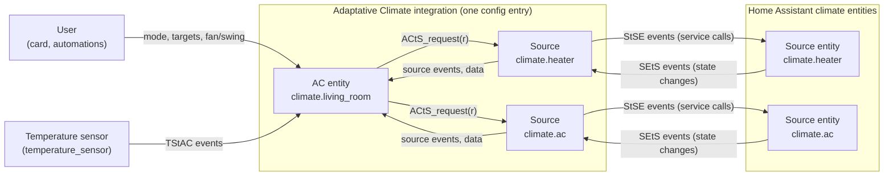

- **AC entity**: the Adaptative Climate `climate` entity seen by the user.
  It decides the mode and drives its sources (§1.3).
- **Source**: one local object per source entity (§1.2). It follows its
  source entity, stores its data, and carries out the requests of the AC
  entity. The AC entity never talks to a source entity directly.
- **Source entity**: a `climate` entity of Home Assistant (heater, AC,
  heat pump...), configured for one or more modes of the AC entity.
- **Temperature sensor**: the optional sensor giving the reference temperature (`temperature_sensor`,
  §3.1.3).

#### 1.1.2 Events and data

Two kinds of exchanges:

- **Event** `XtY_name`: sent by `X` to `Y`, it triggers something in `Y`
  (a transition, a reaction). `X` and `Y`: `HA` Home Assistant, `U`
  user, `T` temperature sensor, `AC` AC entity, `S` source, `SE` source
  entity. Example: `ACtS_request(r)`. An event sent to `S` or `AC`
  reaches all its functions.
  - Between two functions of the same source, `X` and `Y` name the
    functions: `Sd` stored data management (§1.2.2), `Ss` state
    management (§1.2.3), `Sc` request confirmation (§1.2.4), `Sr`
    setting request management (§1.2.5). Example: `SstSc_send(r)`.
  - `M` is the monitoring (§4).
  - **Timer** `X_name_timeout`: the end of a timer of `X`, an event of
    `X` to itself. Example: `Sc_confirm_timeout`.
  - No other event: a condition is written as a guard on events, and a
    function that must tell another one something sends it a named
    event.
- **Data** `name@X`: a value that `X` makes readable. The reader reads
  it by naming it, when it needs it; reading triggers nothing, and
  nothing is sent. Example: `action@S`, the action of the source `S`.

Between the user and the AC entity:

| Event | Direction | Meaning |
|---|---|---|
| `UtAC_set_mode(m)` | user → AC entity | The user asks for the mode `m` (`off` included): card, `set_hvac_mode`, `turn_on` (last mode), `turn_off`. |
| `UtAC_set_settings(s)` | user → AC entity | The user sets settings `s`: temperature targets (`set_temperature`), fan, swing, horizontal swing. |

Between the temperature sensor and the AC entity:

| Event | Direction | Meaning |
|---|---|---|
| `TStAC_temperature(t)` | temperature sensor → AC entity | The value of the temperature sensor changed: `t` is the new value (`temperature@T`), or `None` when it is no longer valid. |

Data the temperature sensor makes readable to the AC entity:

| Data | Content |
|---|---|
| `temperature@T` | The value of the temperature sensor now, converted to the unit of Home Assistant; `None` when it is not valid (`unavailable`, `unknown`, not a number, infinite). A change is reported by `TStAC_temperature(t)`. |

Between the AC entity and a source:

| Event | Direction | Meaning |
|---|---|---|
| `ACtS_request(r)` | AC entity → source | Put the source entity in `r` (an HVAC mode, or `off`). |
| `ACtS_settings(s)` | AC entity → source | Settings `s` (targets, fan/swing) for the source entity (§1.2.5). |
| `StAC_settings(s)` | source → AC entity | Settings `s` changed on the source entity (takeover), outside a request confirmation and `SETTLE(m)`; or, during `SETTLE(m)`, fan/swing values the source did not get (first use of the mode, SRC-SET-12) (§1.2.5). |
| `StAC_temperature(t)` | source → AC entity | The current temperature of the source entity changed: `t` is the new value (`temperature@S`), or `None` when it is no longer shown (SRC-STATE-11). |
| `StAC_capabilities` | source → AC entity | The stored capabilities of the source changed (SRC-DATA-12): the entity reads them again (`capabilities@S`, ENT-CAP-7). |
| `StAC_action(a)` | source → AC entity | The `hvac_action` `a` of the source entity changed (SRC-STATE-12). |
| `StAC_undiscovered` | source → AC entity | The source enters `UNDISCOVERED`. |
| `StAC_off` | source → AC entity | The source enters `OFF`. |
| `StAC_on(m)` | source → AC entity | The source enters `ON(m)`. |
| `StAC_unusable` | source → AC entity | The source enters `UNUSABLE`. |
| `StAC_usable` | source → AC entity | The source leaves `UNUSABLE` (it goes back to its stored state, which the AC entity already knows). |

Between a source and its source entity:

| Event | Direction | Meaning |
|---|---|---|
| `StSE_set_hvac_mode(r)` | source → source entity | Service call `climate.set_hvac_mode` carrying out a request. |
| `StSE_set_temperature(t)`, `StSE_set_fan_mode(f)`, `StSE_set_swing_mode(w)`, `StSE_set_swing_horizontal_mode(h)` | source → source entity | Service calls sending the settings to the source entity, one per setting, made by the setting request management (§1.2.5). |
| `SEtS_off`, `SEtS_on(m)`, `SEtS_unavailable`, `SEtS_unknown`, `SEtS_attributes` | source entity → source | Changes of the source entity (§1.2.1). |
| `SEtS_call_failed(c)` | source entity → source | The service call `c` (`StSE_set_*`) returned an error (§1.2.1). |

Data a source makes readable to the AC entity:

| Data | Content |
|---|---|
| `capabilities@S` | The stored capabilities of the source (§1.2.2), whatever its state. A change is reported by `StAC_capabilities`. |
| `temperature@S` | The current temperature the source entity shows now (`current_temperature`), as read (the entity removes the offset, §3.1.3); `None` when it shows none or is not usable. Not stored. A change is reported by `StAC_temperature(t)`. |
| `action@S` | The `hvac_action` the source entity shows now; `None` when it has none or is not usable. Not stored (SRC-STATE-12). A change is reported by `StAC_action(a)`. |
| `settings@S` | The settings the source entity shows now, whatever the state of the source: `temperature`, `target_temp_low`, `target_temp_high`, `fan_mode`, `swing_mode`, `swing_horizontal_mode`, as read (the entity removes the offset, §3.1.3); `None` for each one it does not show, all `None` when it is not usable. Not stored. |

Settings (targets, fan/swing): §1.2.5.

### 1.2 Source behavior

A source has four functions:

- **stored data management** (§1.2.2): permanent, it does not depend on
  the state of the source;
- **state management** (§1.2.3): the state machine of the source. Its
  state is a **local** state, kept in sync with the source entity; it is
  not the state of the source entity itself;
- **request confirmation** (§1.2.4): confirmation, retries and settle time
  of a request, in parallel with the state machine;
- **setting request management** (§1.2.5): the state machine that sends
  the temperature targets and fan/swing settings to the source entity, in
  parallel with the state machine and the request confirmation.

#### 1.2.1 Events

| Event | From → To | Meaning |
|---|---|---|
| `HAtS_start` | Home Assistant → source | The config entry is set up (HA start, entry reload). |
| `SEtS_off` | source entity → source | The source entity changed to `off`. |
| `SEtS_on(m)` | source entity → source | The source entity changed to the HVAC mode `m`. |
| `SEtS_unavailable` | source entity → source | The source entity changed to `unavailable`, or was removed from Home Assistant. |
| `SEtS_unknown` | source entity → source | The source entity changed to `unknown`. |
| `SEtS_attributes` | source entity → source | Only attributes of the source entity changed (its state stays the same). |
| `SEtS_call_failed(c)` | source entity → source | The service call `c` (`StSE_set_hvac_mode`, `StSE_set_*`) returned an error. |
| `ACtS_request(r)` | AC entity → source | The entity asks the source entity for `r` (an HVAC mode, or `off`). |
| `ACtS_settings(s)` | AC entity → source | The entity gives the settings `s` (targets, fan/swing) for the source entity (§1.2.5). |

Between the functions of the source:

| Event | From → To | Meaning |
|---|---|---|
| `SdtSs_restored` | stored data → state | The first restore of the stored data is done (§1.2.2). |
| `SdtSs_data_available` | stored data → state | The data of a source becomes available: restored or read at start (SRC-DATA-4), or read later (SRC-DATA-6). |
| `SdtSs_served_mode_lost` | stored data → state | A served source mode is no longer in the stored `hvac_modes`: its removal is confirmed (SRC-DATA-10). |
| `SdtSs_served_modes_back` | stored data → state | Every served source mode is in the stored `hvac_modes` again (SRC-DATA-6). |
| `SstSc_send(r)` | state → request confirmation | `r` is sent to the source entity: entry check of `OFF` / `ON(m)`, or a request for another state during a request confirmation (SRC-STATE-2). |
| `SstSc_back(m)` | state → request confirmation | The source is back from `UNUSABLE` in `ON(m)`, and the source entity already shows `m` (SRC-STATE-7). |
| `SstSr_mode_changed(x)` | state → setting requests | The mode of the source changes to `x` (a mode, or `off`) on a request of the entity: `ACtS_request(x)` in `OFF` / `ON(m)`, or stored in `UNUSABLE` (SRC-SET-1). |
| `SstSr_takeover(x)` | state → setting requests | The mode of the source changes to `x` on a change of the source entity, followed (`[followed]`, SRC-STATE-5). |
| `SstSr_unusable` | state → setting requests | The source enters `UNUSABLE`. |
| `SctSr_settle_start` | request confirmation → setting requests | Entry of `SETTLE(m)`: request confirmed, or back from `UNUSABLE` in `ON(m)` (§1.2.4). |
| `SctSr_settle_end` | request confirmation → setting requests | End of the settle timer (§1.2.4). |
| `SctM_out_of_sync_up`, `SctM_out_of_sync_down` | request confirmation → monitoring | The source entity does not show the state asked at the end of a confirmation / the confirmation is over (MON-SRC-3). |

Timers of the source:

| Event | Timer of | Meaning |
|---|---|---|
| `Sd_removal_timeout` | stored data | End of a removal confirmation (`capability_rem_confirmation`, SRC-DATA-10). |
| `Sc_confirm_timeout` | request confirmation | End of `request_confirmation_timer` (SRC-REQ-6). |
| `Sc_retry_timeout` | request confirmation | End of `request_retry_timer` (SRC-REQ-7). |
| `Sc_settle_timeout` | request confirmation | End of `settle_timer` (SRC-REQ-3). |
| `Sr_resync_timeout` | setting requests | End of the resync timer (SRC-SET-8). |
| `Sr_send_retry_timeout` | setting requests | End of the send retry timer (SRC-SET-7). |

#### 1.2.2 Stored data management

##### 1.2.2.1 Stored data

Stored data of a source, saved across restarts:

| Data | Kept per | Content |
|---|---|---|
| State | source | `OFF` or `ON(m)`: the state the source is in, or the one asked while `UNUSABLE` (SRC-STATE-4). Never `UNDISCOVERED` / `UNUSABLE`. Written by the state management (SRC-STATE-9). |
| `hvac_modes` | source | The HVAC modes of the source entity. The same whatever its mode. |
| Mode capabilities | (source, mode) | `supported_features`, `min_temp`, `max_temp`, `target_temp_step`, `fan_modes`, `swing_modes`, `swing_horizontal_modes`, as last read **while the source entity was in that mode**. |
| `low_high_seen` | (source, mode) | The source entity has shown numeric `target_temp_low` / `target_temp_high` once while in that mode. Never cleared. |

- **SRC-DATA-1** The mode capabilities are **discovered** as the modes are
  used: those of a mode are read only while the source entity runs in it
  (source state `ON(m)`). A mode of `hvac_modes` with no stored
  capabilities (never run) gets the Home Assistant defaults:

  | Capability | Default |
  |---|---|
  | `supported_features` | 0: no temperature target, no fan, no swing |
  | `min_temp` / `max_temp` | 7 °C / 35 °C, converted to the unit of Home Assistant |
  | `target_temp_step` | none |
  | `fan_modes`, `swing_modes`, `swing_horizontal_modes` | none |
  | `low_high_seen` | no |

- **SRC-DATA-2** Nothing is read for `off` (useless).
- **SRC-DATA-3** The data is **available** once `hvac_modes` is known
  (restored or read). Mode capabilities may still be missing: Home
  Assistant defaults (SRC-DATA-1).
- What the entity does with a mode not discovered yet: ENT-CAP-3 to ENT-CAP-6
  (§1.3).

##### 1.2.2.2 Restore (at `HAtS_start`)

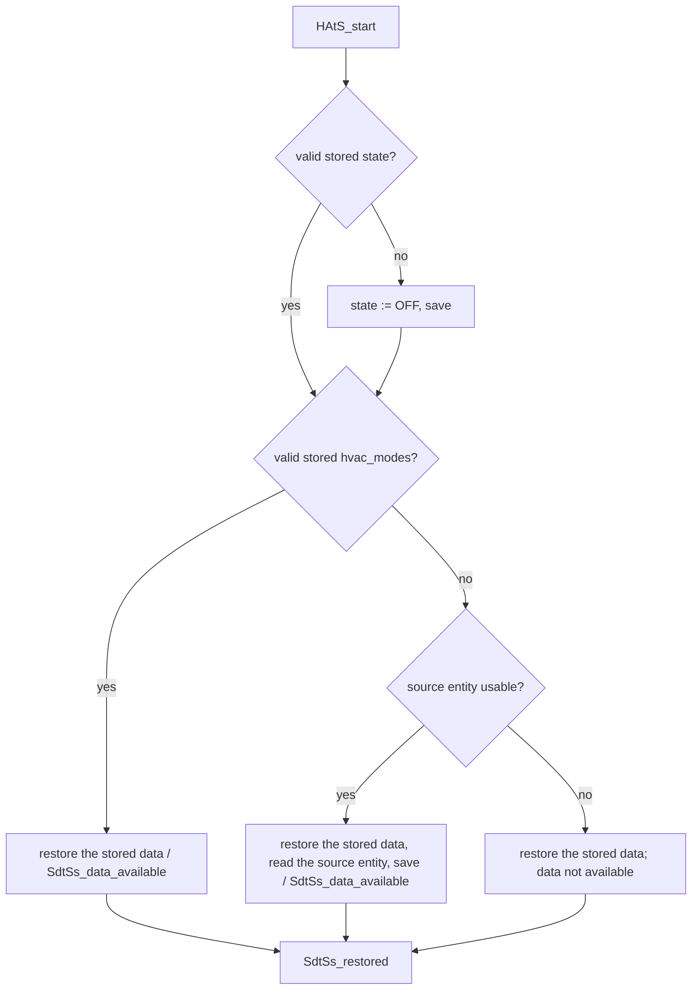

- **SRC-DATA-4** At `HAtS_start`, the stored data is read and restored.
  Each missing value is handled alone:
  - no stored state → the stored state is set to `OFF`: the source was
    never used (or its state is lost), so it starts from a clean state
    (its entry turns the source entity off if it runs, SRC-STATE-2);
  - no stored `hvac_modes` → the source entity is read (`hvac_modes`,
    and the mode capabilities if it runs in a mode); if it cannot be
    read (not usable), the data is not available (SRC-DATA-3) until the
    first usable change (SRC-DATA-6);
  - no stored mode capabilities or `low_high_seen` for a mode → Home
    Assistant defaults (SRC-DATA-1).

  Data available (`hvac_modes` restored or read) raises
  `SdtSs_data_available`. The end of this first restore raises
  `SdtSs_restored`.
- **SRC-DATA-5** A stored value that is not valid (corrupted) is dropped,
  and handled as missing (SRC-DATA-4); the other stored data is
  restored.

##### 1.2.2.3 Update (on each change of the source entity)

- **SRC-DATA-6** On every change of a usable source entity (`SEtS_off`,
  `SEtS_on(m)`, `SEtS_attributes`):
  - data not available yet → it is read and saved: data available
    (`SdtSs_data_available`);
  - `hvac_modes` is read again;
  - if the source entity runs in a mode `m`, the capabilities of `m`
    are read again;
  - each value read is compared with the stored one:
    - no change → nothing;
    - a first value, or a new number (`min_temp`, `target_temp_step`...)
      → stored and saved at once, and reported (SRC-DATA-12);
    - a value no longer shown (attribute missing or `None`) → removal
      confirmation (below);
    - a value made of items (a list such as `hvac_modes` or `fan_modes`,
      or `supported_features`, a set of features) is compared **item by
      item**: an item added is stored and saved at once; an item no
      longer shown goes through the removal confirmation, on its own.
      Example: `fan_modes` stored `[low, medium, high]`, shown
      `[low, medium, turbo]`: `turbo` is added at once, the removal of
      `high` is confirmed.
- **SRC-DATA-7** A source entity that is not usable is not read: the stored
  data stays as it is.
- **SRC-DATA-8** `low_high_seen` of mode `m` is set when numeric low/high
  values are shown while the source entity runs in `m` (reported,
  SRC-DATA-12). It is never removed.
- **SRC-DATA-9** Only the configured source entities keep their data: a
  source entity removed from the configuration loses it.

**Removal confirmation** (one per value no longer shown, and one per item
no longer shown in a value made of items; for `hvac_modes`, or a
capability of a mode). "value" below is that value or that item:

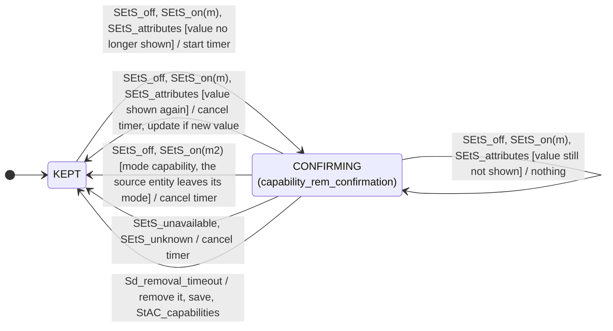

- **SRC-DATA-10** A value no longer shown, or an item no longer shown, is
  kept for `capability_rem_confirmation` (§3.1.4, 60 s by default). The
  timer is cancelled when it is shown again; other changes of the source
  entity (current temperature, items added...) let it run. At the end of
  the timer, it is removed and the data is saved.
- **SRC-DATA-11** A capability of mode `m` is only judged while the source
  entity runs in `m`: the source entity leaving `m` cancels its timer.
  The source entity becoming not usable cancels every timer (SRC-DATA-7).
- **SRC-DATA-12** Every change of the stored capabilities (`hvac_modes`,
  mode capabilities, `low_high_seen`) is reported to the entity, once
  stored: `StAC_capabilities`, whatever the state of the source. This
  covers an item or a value added or changed (SRC-DATA-6),
  `low_high_seen` set (SRC-DATA-8), and a removal confirmed
  (SRC-DATA-10). Several changes read in the same update of the source
  entity give one event. The data that becomes available
  (`SdtSs_data_available`) is not reported this way: the source leaves
  `UNDISCOVERED`, which the entity gets (`StAC_off` or `StAC_unusable`,
  SRC-STATE-8).

#### 1.2.3 State management

##### 1.2.3.1 State machine

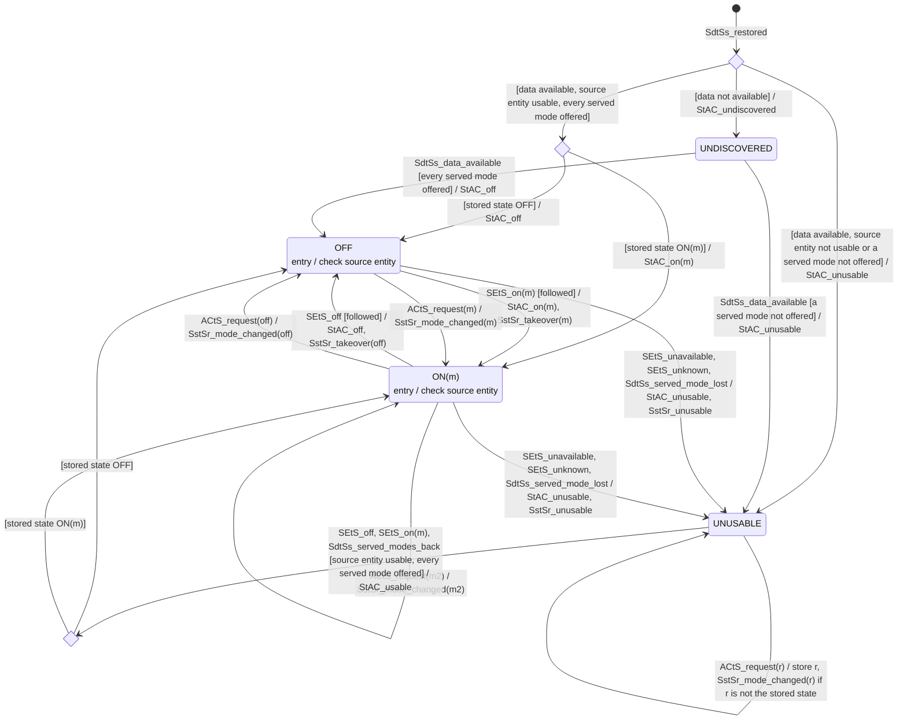

`[followed]`: the change of the source entity is a takeover: no request
confirmation running, or in `RETRY_WAIT(r)` a state other than `r`
(SRC-STATE-5, SRC-REQ-9). In `CONFIRMING(r)`, and for `r` shown in
`RETRY_WAIT(r)`, the request confirmation handles it alone (§1.2.4).

"check source entity" (entry of `OFF` and `ON(m)`): if the source entity
does not show the state (`off`, or `m`), the state is sent to it and the
request confirmation starts (`SstSc_send(r)`, §1.2.4). Back from
`UNUSABLE` in `ON(m)` with the source entity already in `m`, the settle
time starts (`SstSc_back(m)`, SRC-STATE-7). During a request
confirmation, a request for another state is always sent, without this
comparison (`SstSc_send(r2)`, SRC-STATE-2).

- **SRC-STATE-1** After `HAtS_start`, the source waits for the end of the first
  restore (`SdtSs_restored`), then:
  - data not available → `UNDISCOVERED`, reported to the entity;
  - data available, and source entity not usable or a served source mode
    not offered (§1.2.3.5) → `UNUSABLE`, reported to the entity;
  - data available, source entity usable and every served source mode
    offered → the stored state (`OFF`
    when none was stored, SRC-DATA-4), reported to
    the entity (`OFF` or `ON(m)`).
- **SRC-STATE-2** On entry of `OFF` or `ON(m)`, however it is entered (request,
  restore, back from `UNUSABLE`), the state is compared with the source
  entity: if it differs, the state is sent to the source entity and the
  request confirmation starts (§1.2.4). Entered from a change of the
  source entity, it is the same: nothing is sent.
  - Exception: during a request confirmation (`CONFIRMING(r)` or
    `RETRY_WAIT(r)`, §1.2.4), a request for another state than `r` is
    always sent, without comparing. A command is still on its way, so the
    state shown by the source entity cannot be trusted.
  - Example: `request(heat)`, then `request(off)` while the device still
    shows `off`: `off` is sent, so that the `heat` still on its way does
    not win.
  - A request for `r` itself changes nothing: the confirmation goes on.
- **SRC-STATE-3** In `OFF` or `ON(m)`, a request from the entity moves the
  state at once to the state asked (`ON(m)` or `OFF`), and its entry
  sends it (SRC-STATE-2); `ON(m)` → `ON(m2)` is a new entry. No `StAC_`
  event is sent: the entity asked for it. A `StAC_off` / `StAC_on(m)` always means a
  change made on the source entity, never the result of a request.
- **SRC-STATE-4** In `UNUSABLE`, a request from the entity is stored as the
  stored state; nothing is sent.
- **SRC-STATE-5** In `OFF` or `ON(m)`, a change of the source entity
  (`SEtS_off`, `SEtS_on(m)`) moves the state, and the new state is
  reported to the entity (takeover). During a request confirmation, the
  confirmation handles these changes first (§1.2.4):
  - a change that shows `r` confirms the request: the state is already
    `r`, nothing is reported;
  - in `CONFIRMING(r)`, a change that does not show `r` is ignored
    (SRC-REQ-1): it does not reach the state machine;
  - in `RETRY_WAIT(r)`, a change to another state than `r` stops the
    retries and is followed as a takeover (SRC-REQ-9).

  In `SETTLE(m)`, a change of mode is followed as a takeover too (only
  the settings shown are ignored, SRC-SET-5). So the only change of mode
  of the source entity that is not followed is one that does not show
  `r` in `CONFIRMING(r)`.
- **SRC-STATE-6** In `OFF` or `ON(m)`, `SEtS_unavailable`, `SEtS_unknown`
  or `SdtSs_served_mode_lost` always moves the source to
  `UNUSABLE`, even during a request confirmation, which ends (the state
  asked stays the stored state, sent again on return: SRC-STATE-7). Reported to
  the entity.
- **SRC-STATE-7** In `UNUSABLE`, the source back (source entity usable,
  and every served source mode offered: on `SEtS_off`, `SEtS_on(m)` or
  `SdtSs_served_modes_back`) moves the source to its **stored** state, not to
  the state shown. While a served source mode is missing, the changes of
  the source entity do not make it leave `UNUSABLE`.
  - The entry of that state sends it if needed (SRC-STATE-2).
  - When the stored state is `ON(m)`, the source always goes through
    `SETTLE(m)` (§1.2.4), even if the source entity already shows `m`: it
    sends its kept settings, ignores during `settle_timer` the values the
    device reports while reconnecting, and sends them again at the end if
    needed (SRC-SET-5, SRC-SET-6).
  - The entity gets only `StAC_usable`: the stored state is the one it
    already knows.
  - The source does not know whether its stored state is a foreign mode
    (SRC-ON-1): a foreign mode is resent like any other. It is only
    stored if the entity sent no request meanwhile (ENT-STATE-5).
- **SRC-STATE-8** In `UNDISCOVERED`, the source gets no request: the entity
  refuses its modes and does not turn it off (§1.3.2.1). When the data becomes available, the source goes to `OFF`,
  reported to the entity; its entry turns the source entity off if it
  runs (SRC-STATE-2). If a served source mode is not offered, it goes to
  `UNUSABLE` instead, with `OFF` as stored state.
- **SRC-STATE-9** Every change of state is saved as the stored state.
  `UNDISCOVERED` and `UNUSABLE` are never stored: they keep the stored
  state as it is (a request in `UNUSABLE` still changes it,
  SRC-STATE-4).
- **SRC-STATE-10** Resynchronization: at start, and when the source entity comes
  back from unavailable, **Home Assistant wins**: the stored state is sent
  to the source entity (SRC-STATE-2, SRC-STATE-7), whatever was changed on the device
  meanwhile. At start, everything is resynchronized (several sources left
  on would give odd effects); after unavailability, there was a problem,
  so everything is resynchronized when it ends. The source entity has the
  upper hand (takeover) in `OFF` / `ON(m)`, except in `CONFIRMING(r)`
  (SRC-STATE-5).

- **SRC-STATE-11** In `OFF` or `ON(m)`, a change of the current
  temperature of the source entity (`current_temperature`, in
  `SEtS_attributes`) is reported to the entity: `StAC_temperature(t)`, as
  read (the entity removes the offset, §3.1.3), `None` when it is no
  longer shown (attribute missing or `None`). The source does not store
  it: the entity reads it when it needs it (`temperature@S`, §1.1.2).
- **SRC-STATE-12** Action (`hvac_action`): the source does not store it;
  the entity reads it when it needs it (`action@S`, §1.1.2).
  - In `OFF` or `ON(m)`, a change of the `hvac_action` of the source
    entity (in `SEtS_attributes`, `SEtS_on(m)` or `SEtS_off`) is
    reported to the entity: `StAC_action(a)`, as read (`None` when it
    disappears). This includes the request confirmation and `SETTLE(m)`:
    the source entity may still show the action of the previous mode,
    it is reported as it is.

##### 1.2.3.2 UNDISCOVERED state

The data of the source is not available.

- The first usable change of the source entity makes the data available
  (SRC-DATA-6): `SdtSs_data_available` moves the source to `OFF` (SRC-STATE-8).
- **SRC-UNDISC-1** The source offers nothing: no capability (the entity does
  not count it for the step, uses Home Assistant default ranges 7–35 °C,
  no options), no HVAC mode (its modes are not judged as offered or not).

##### 1.2.3.3 OFF state

The source entity is off.

- Settings: see §1.2.5.

##### 1.2.3.4 ON(m) state

The source entity runs in `m`, any HVAC mode other than `off`.

- **SRC-ON-1** `ON(m)` is just the HVAC mode of the source entity. Whether
  `m` is a mode the source serves here (or a foreign mode) is decided by
  the entity. The source only uses its served source modes to judge
  whether it is `UNUSABLE` (§1.2.3.5).
- Settings: see §1.2.5.

##### 1.2.3.5 UNUSABLE state

The data of the source is available, but the source cannot be used, for
one of two reasons:

- **source entity not usable** (`unavailable`, `unknown`, or missing in
  Home Assistant): the stored data stays as it is (SRC-DATA-7): the
  entity keeps reading the capabilities of the source as they were when
  it was last usable;
- **served mode not offered** (**SRC-UNUS-1**): the source entity is
  usable, but a served source mode is not in its stored `hvac_modes`
  (lost after the configuration, or never offered by a source entity
  not checked at configuration, ENT-TYPE-4). The source entity is still
  read (SRC-DATA-6), so that the return of the mode is seen
  (`SdtSs_served_modes_back`). The entity raises a Repairs issue (ENT-HVAC-5).
  A source serving several modes is `UNUSABLE` for all of them, even
  those still offered: losing a mode is an anomaly, to be repaired.

In both cases, nothing is sent to the source entity (SRC-STATE-4), and
it is resynchronized when the source is back (SRC-STATE-7).

#### 1.2.4 Request confirmation

Runs in parallel with the state machine of §1.2.3.1. `SstSc_send(r)` is
the entry check of `OFF` / `ON(m)` sending `r` to the source entity
(SRC-STATE-2). It works the same way to turn a source entity on in a
mode (`r` = `m`) and to turn it off (`r` = `off`). In `CONFIRMING(r)`
and `RETRY_WAIT(r)`, every request for another state is a
`SstSc_send(r2)`: it is always sent (SRC-STATE-2).

Every entry of `SETTLE(m)` sends `SctSr_settle_start`, and the end of
its timer `SctSr_settle_end`, to the setting request management
(§1.2.5).

A **request confirmation is running** in `CONFIRMING(r)` and
`RETRY_WAIT(r)`: "during a request confirmation" and "outside a request
confirmation" have this meaning in the whole spec. `IDLE` and
`SETTLE(m)` are not a running confirmation (`SETTLE(m)` is named on its
own).

`SctM_out_of_sync_up` tells the monitoring that the problem "source out
of sync" of this source is there (MON-SRC-3); `SctM_out_of_sync_down`
that it is gone (nothing to do for the monitoring if it is not there).

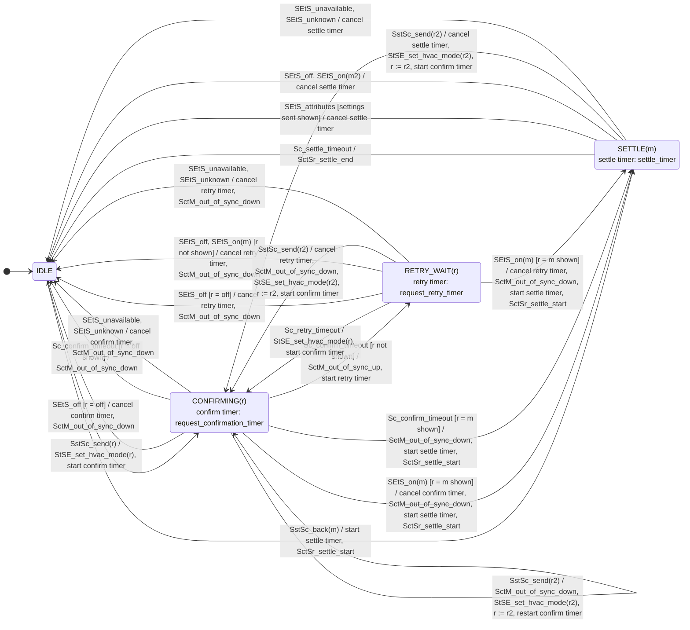

- **SRC-REQ-1** During the confirmation, the changes of the source entity
  that do not show `r` are ignored: a device may still show its previous
  mode, or go through `off`, before showing the mode asked. Cloud devices
  may take a while. Exception: `SEtS_unavailable` / `SEtS_unknown` ends the confirmation
  (SRC-STATE-6).
- **SRC-REQ-2** The source entity showing `r` ends the confirmation: the
  source is in the state asked. When `r` is a mode (`ON(m)`), the source
  enters `SETTLE(m)`: the settings (targets, fan/swing) are sent and, for
  `settle_timer` (§3.1.4, 12 s by default), the settings shown by the source
  entity are ignored
  (§1.2.5, SRC-SET-5).
- **SRC-REQ-3** `SETTLE(m)` ends at the end of the settle timer, or
  earlier when the source entity shows the settings sent. It also stops
  (settle timer cancelled):
  - when the source leaves `m`: a change of the source entity
    (`SEtS_off`, `SEtS_on(m2)`, followed: SRC-STATE-5);
  - on a new request (a new confirmation starts);
  - on `SEtS_unavailable` / `SEtS_unknown`.
- **SRC-REQ-4** The call to the source entity fails: the error is logged;
  the confirmation goes on until its timeout (SRC-REQ-6).
- **SRC-REQ-5** A new send (new request) during the confirmation or the
  retry wait replaces the previous one: the state confirmed becomes the
  new one (`r := r2`), and a new confirmation starts. It is always sent,
  even if the source entity already shows the new state (SRC-STATE-2).
- **SRC-REQ-6** At the end of the confirm timer, the state shown by the
  source entity is checked:
  - it shows `r`: the request is confirmed, as in SRC-REQ-2, without
    monitoring. This happens when `r` was sent to a source entity that
    already showed it (SRC-REQ-5): it reports no change, so nothing else
    would end the confirmation;
  - it does not show `r` (call failed, or the device did not follow): the
    monitoring reports the source entity out of sync (MON-SRC-3), and the
    source waits `request_retry_timer` (§3.1.4, 5 min by default: retry
    wait).
- **SRC-REQ-7** At the end of the retry wait, `r` is sent again and a new
  confirmation (`request_confirmation_timer`, §3.1.4, 30 s by default) starts, with
  the same behavior. This goes on every `request_retry_timer` as long as the
  source entity does not show `r`.
- **SRC-REQ-8** The confirmation and the retries stop only when the source
  entity shows `r`, or when the source leaves the state that started them
  (new request: SRC-REQ-5; `SEtS_unavailable` / `SEtS_unknown`: SRC-STATE-6; change of the source entity
  during the retry wait: SRC-REQ-9).
- **SRC-REQ-9** During the retry wait, the source entity is master: a change
  of the source entity to another state than `r` (remote, app) stops the
  retries and is followed as a takeover (SRC-STATE-5): the state moves and is
  reported to the entity.
- **SRC-REQ-10** When the settle time applies. `SETTLE(m)` protects the
  settings Home Assistant has just **pushed**: right after entering a
  mode, some devices report their own stored value for that mode a few
  seconds later, which must not be taken for a takeover.
  - Settle: after a request confirmed by the source entity (Home
    Assistant asked for the mode and pushes its settings).
  - Settle: when the source comes back from `UNUSABLE` in `ON(m)`
    (resynchronization, Home Assistant wins and pushes its settings,
    SRC-STATE-7).
  - No settle: on a mode change made on the device (`SEtS_on(m)` outside
    a confirmation). The source wins: nothing is pushed, the settings of
    the device are adopted (SRC-SET-11), and the values it reports in the
    next seconds are adopted too.

#### 1.2.5 Setting request management

The setting request management is a state machine of the source, in
parallel with the state management (§1.2.3) and the request confirmation
(§1.2.4). It starts **once**, at `HAtS_start` (the resync timer starts then),
and runs until the entry unloads: it is not started for each request. It
has a single state, so it is described by its reactions to events (table
below).

- **It keeps the settings.** The setting request management keeps the
  settings received from the entity (`ACtS_settings(s)`) for the current
  mode of the source, in memory (SRC-SET-1). They are withdrawn when the
  mode of the source changes. The entity keeps its own settings for
  every mode, and saves them (ENT-SET-1): it sends those of the new mode
  at each request.
- **It sends them.** On the events of the "Sending" and "Timers" parts
  of the table,
  it sends to the source entity the kept settings the source entity does
  not show, with one Home Assistant service call per setting
  (`StSE_set_*`). The events come from the entity, from the request
  confirmation, or from its own timers. The conditions read the state of
  the other machines (`ON(m)`, §1.2.3; request confirmation running,
  `SETTLE(m)`, §1.2.4). Otherwise nothing is sent: in `OFF`,
  `UNDISCOVERED`, `UNUSABLE` and during a request confirmation, the
  settings are only kept (SRC-SET-3).
- **It follows the source entity.** It adopts the settings changed on
  the source entity (takeover), and reports them to the entity
  (`StAC_settings`).

Settings `s`: any of the temperature targets (`temperature`, or `target_temp_low` and
`target_temp_high`, already computed by the entity: offset (§3.1.3), step,
range),
`fan_mode`, `swing_mode`, `swing_horizontal_mode`. Each one is sent with
its own service call (`StSE_set_temperature`, `StSE_set_fan_mode`,
`StSE_set_swing_mode`, `StSE_set_swing_horizontal_mode`). The settle time
comes from the request confirmation (`SETTLE(m)`, §1.2.4).

"no confirmation": no request confirmation running
(`CONFIRMING`, `RETRY_WAIT`, §1.2.4).

| Event | From | Condition | Action | Rule |
|---|---|---|---|---|
| **Keeping** | | | | |
| `ACtS_settings(s)` | the entity | — | keep `s` | SRC-SET-1 |
| `SstSr_mode_changed(x)`, `SstSr_takeover(x)`: the mode of the source changes (request of the entity, or change of the source entity followed) | the state management (§1.2.3) | — | withdraw the kept settings; cancel the send retry timer (nothing left to retry) | SRC-SET-1, SRC-SET-7 |
| `SstSr_unusable`: the source enters `UNUSABLE` | the state management (§1.2.3) | — | cancel the send retry timer; the settings stay kept, and are sent at the return (entry of `SETTLE(m)`) | SRC-SET-7, SRC-STATE-7 |
| **Sending** | | | | |
| `ACtS_settings(s)` | the entity | `ON(m)`, no confirmation | `StSE_set_*` of the settings of `s` the source entity does not show | SRC-SET-2 |
| `SctSr_settle_start`: entry of `SETTLE(m)` (request confirmed, or return from `UNUSABLE` in `ON(m)`) | the request confirmation (§1.2.4) | — | `StSE_set_*` of the kept settings the source entity does not show; `StAC_settings` of the fan/swing without kept value | SRC-SET-5, SRC-SET-12 |
| `SctSr_settle_end` | the request confirmation (§1.2.4) | other values shown during `SETTLE(m)` | `StSE_set_*` of the kept settings the source entity does not show | SRC-SET-6 |
| **Timers** | | | | |
| `HAtS_start` | Home Assistant | — | start the resync timer (30 min) | SRC-SET-8 |
| `Sr_resync_timeout` | its own timer | `ON(m)`, no confirmation | `StSE_set_*` of the kept settings the source entity does not show (a command lost by the device, a device back to its own value without telling) | SRC-SET-8 |
| `Sr_resync_timeout` | its own timer | in every case | restart the resync timer | SRC-SET-8 |
| `SEtS_call_failed(c)`, `c` a `StSE_set_*` | the source entity (call error) | the call is not the retry | start the send retry timer (5 s); restart it if it runs | SRC-SET-7 |
| `Sr_send_retry_timeout` | its own timer | `ON(m)`, no confirmation | `StSE_set_*` of the kept settings the source entity does not show, once: if it fails, a warning is logged and the timer is not started again | SRC-SET-7 |
| `Sr_send_retry_timeout` | its own timer | otherwise | nothing | SRC-SET-7 |
| **Following the source entity** | | | | |
| `SEtS_attributes`: a setting **with** a kept value shows another value | the source entity | in `SETTLE(m)` | ignored (the device may report its own value for the mode a few seconds later), remembered for `SctSr_settle_end` | SRC-SET-5 |
| `SEtS_attributes`: a fan/swing **without** kept value (first use of the mode) changes | the source entity | in `SETTLE(m)` | `StAC_settings` of the value: nothing was sent for it, so there is nothing to protect | SRC-SET-12 |
| `SEtS_attributes`: a setting changed | the source entity | `ON(m)`, no confirmation, not in `SETTLE(m)` | keep it, `StAC_settings` of the changes (takeover) | SRC-SET-11 |
| `SEtS_attributes` | the source entity | otherwise: `OFF`, request confirmation | ignored | SRC-SET-11 |
| `SstSr_takeover(m2)`: mode changed on the source entity, followed (SRC-STATE-5) | the state management (§1.2.3) | `m2` a mode (not `off`) | after the withdrawal (Keeping): keep the settings shown in `m2`, `StAC_settings` of all of them | SRC-SET-11 |

The send retry timer only concerns the settings: a mode change or
`UNUSABLE` cancels it, since the settings it would retry are withdrawn
or wait for the return. The resync timer is not cancelled: it runs all
the time, and its condition is checked at each timeout.

- **SRC-SET-1** The setting request management keeps the last settings received
  (`ACtS_settings(s)`) for its current mode: settings depend on the mode.
  - When the mode of the source changes (`ACtS_request(r)` for another
    state, or a change of the source entity followed: `SEtS_off`,
    `SEtS_on(m2)`), the kept settings are **withdrawn**.
  - After a request, the entity sends the settings of the new mode
    (`ACtS_settings(s)`).
  - In `UNUSABLE`, they are kept, unless a request for another state is
    received: the state asked is stored (SRC-STATE-4) and the kept
    settings are withdrawn, as for any mode change.
- **SRC-SET-2** In `ON(m)` outside a request confirmation, a settings request
  is sent to the source entity at once, except the settings it already
  shows. Low and high targets go together.
- **SRC-SET-3** In `OFF`, `UNDISCOVERED`, `UNUSABLE`, and during a request
  confirmation (`CONFIRMING`, `RETRY_WAIT`), nothing is sent: the
  settings are kept, and sent when the source enters `SETTLE(m)`.
- **SRC-SET-4** Fan and swing values are matched to the options of the source
  entity in that mode ignoring case, and sent as the source entity spells
  them. A value it does not offer is not sent.
- **SRC-SET-5** On entry of `SETTLE(m)` (§1.2.4), the kept settings the
  source entity does not show are sent. During `SETTLE(m)`, the values
  shown by the source entity for the kept settings are ignored (a device
  may report its own values for the mode a few seconds later). The settle
  time only protects the settings the source has a value for: a fan/swing
  setting without kept value is followed at once (SRC-SET-12).
- **SRC-SET-6** At the end of the settle
  timer, if the source entity showed other settings meanwhile, the kept
  settings are sent again; if it showed nothing, nothing is sent. Known
  limitation: a source entity already at the settings gets nothing, so
  nothing ends `SETTLE(m)` early: its settings are ignored for the full
  `settle_timer`.
- **SRC-SET-7** Retry on error: a call that fails starts the send retry
  timer (5 s), or restarts it if it runs (another call failed
  meanwhile); the retry call itself does not. It is a timer of the setting request management, not a
  state: the other events are handled meanwhile as usual (new settings,
  takeover, settings shown).
  - At its end, in `ON(m)` outside a request confirmation, the kept
    settings the source entity does not show are sent again, **once**:
    if the call fails again, a warning is logged, and no new retry is
    started (the resync takes over, SRC-SET-8). Otherwise, nothing is
    sent.
  - A mode change of the source (the kept settings are withdrawn,
    SRC-SET-1), and the source entering `UNUSABLE` (the settings are
    sent again when it comes back, SRC-STATE-7), cancel it.
  - Only a call error triggers it, not a source entity that accepts the
    call without applying the setting (SRC-SET-10).
- **SRC-SET-8** Resync: the resync timer runs all the time (started at
  `HAtS_start`, restarted at each timeout). Every 30 minutes, the settings the source entity does
  not show (compared with those sent) are sent again (a command lost by
  the device, a device back to its own value without telling).
- **SRC-SET-9** Monitoring: a setting sent and not shown by the source entity
  is a problem (MON-SRC-4). Not judged during `SETTLE(m)` or a request
  confirmation.
- **SRC-SET-10** Setting not applied (the source entity accepts the call, or
  fails, and its value **does not change**): the source keeps the setting
  received from the entity, which stays the reference (Home Assistant wins). It is sent
  again (SRC-SET-7, SRC-SET-8) and the monitoring reports it (MON-SRC-4). Nothing is
  sent to the entity: its setting is unchanged.
- **SRC-SET-11** Takeover (a value of the source entity **changes** to another
  value than the one sent: remote, app): in `ON(m)`, outside a request
  confirmation and `SETTLE(m)`, the source keeps the new value as its
  setting and sends `StAC_settings(s)` (the settings changed) to the
  entity, which adopts them. During a confirmation or `SETTLE(m)`, such
  changes are ignored (SRC-REQ-1, SRC-SET-5), except, during `SETTLE(m)`,
  a fan/swing setting without kept value (SRC-SET-12). After a mode change made on the
  source entity (`SEtS_on(m)` followed, SRC-STATE-5), the source sends its
  current settings at once (`StAC_settings(s)`, the settings shown by the
  source entity in `m`): the entity adopts them (the source wins).
- **SRC-SET-12** A fan/swing setting the source did not get (no value kept:
  first use of the mode, ENT-FANV-5) is not protected by the settle time,
  since nothing was pushed for it:
  - on entry of `SETTLE(m)`, the source reports to the entity
    (`StAC_settings`) the value its source entity shows for it;
  - during `SETTLE(m)`, every change of that value is reported at once.
    The source keeps no value for it, so each change is followed: a
    device that first shows a passing value (that of the previous mode)
    then its own one ends with its own one;
  - the entity adopts these values (ENT-FANV-5).

  Temperature targets are not concerned: the entity always has a value
  for them, sent once the mode is discovered (ENT-CAP-6).
- How the entity computes the temperature targets (offsets, steps, ranges) and
  remembers fan/swing per mode: §1.3.5.3, §1.3.5.4.

### 1.3 Entity behavior

The AC entity has four functions:

- **state management** (§1.3.2): its own state machine, which drives the
  sources;
- **mode management** (§1.3.3): mono-source and bi-source modes, and the
  phases of a bi-source mode;
- **capabilities management** (§1.3.4): its capabilities, from those of
  its sources;
- **settings management** (§1.3.5): temperature targets and fan/swing settings.

#### 1.3.1 Events

| Event | Direction | Meaning |
|---|---|---|
| `HAtAC_start` | Home Assistant → AC entity | The config entry is set up (HA start, entry reload). |
| `UtAC_set_mode(m)` | user → AC entity | The user asks for the mode `m` (`off` included): card, `set_hvac_mode`, `turn_on` (last mode), `turn_off`. |
| `UtAC_set_settings(s)` | user → AC entity | The user sets settings `s`: temperature targets (`set_temperature`), fan, swing, horizontal swing. |
| `TStAC_temperature(t)` | temperature sensor → AC entity | See §1.1.2. |
| `StAC_undiscovered`, `StAC_off`, `StAC_on(m)`, `StAC_unusable`, `StAC_usable`, `StAC_settings(s)`, `StAC_temperature(t)`, `StAC_capabilities`, `StAC_action(a)` | source → AC entity | See §1.1.2. Each one comes from one source. |
| `ACtS_request(r)`, `ACtS_settings(s)` | AC entity → source | See §1.1.2. |

Data read (§1.1.2): from a source, `capabilities@S`, `temperature@S`,
`action@S`, `settings@S`; from the temperature sensor, `temperature@T`.

Words used below:

- **source of `m`**: the source configured for the mode `m` of the
  entity;
- **active source**: the source of the current mode;
- **available source**: a source in `OFF` or `ON(x)` (not `UNDISCOVERED`, not
  `UNUSABLE`);
- **becomes available**: a source enters `OFF` or `ON(x)` from `UNUSABLE`
  (`StAC_usable`) or from `UNDISCOVERED` (`StAC_off`, SRC-STATE-8);
- **no source available**: every source is `UNUSABLE` or `UNDISCOVERED`;
- **served / foreign**: `StAC_on(x)` from a source `S` is **served** when
  `S` is the source of the mode `x` of the entity, **foreign** otherwise
  (a heater set to `fan_only` on its remote). A bi-source `heat_cool`
  has no source of its own: `StAC_on(heat_cool)` is always foreign then
  (a heat pump serving both phases set to `heat_cool` on its remote).

#### 1.3.2 State management

##### 1.3.2.1 State machine

Activities on the transitions:

| Activity | What is sent |
|---|---|
| `AC.apply(m)` | To the source of `m`: `ACtS_request(m)` (the phase for a bi-source mode) and `ACtS_settings(s)` (the settings of `m`, §1.3.5).<br> To every other source not `OFF` and not `UNDISCOVERED` (`UNUSABLE` included): `ACtS_request(off)`. |
| `AC.apply(off)` | To every source not `OFF` and not `UNDISCOVERED` (`UNUSABLE` included): `ACtS_request(off)`. |
| `AC.follow(S)` | Takeover by `S` in a **served** mode only. To every source not `OFF`, not `UNDISCOVERED` and other than `S` (`UNUSABLE` included): `ACtS_request(off)`. Nothing to `S`. |

An `UNDISCOVERED` source never gets a request: its modes are refused
(ENT-HVAC-2), and it does not need to be turned off, since it enters
`OFF` when it is discovered (SRC-STATE-8).

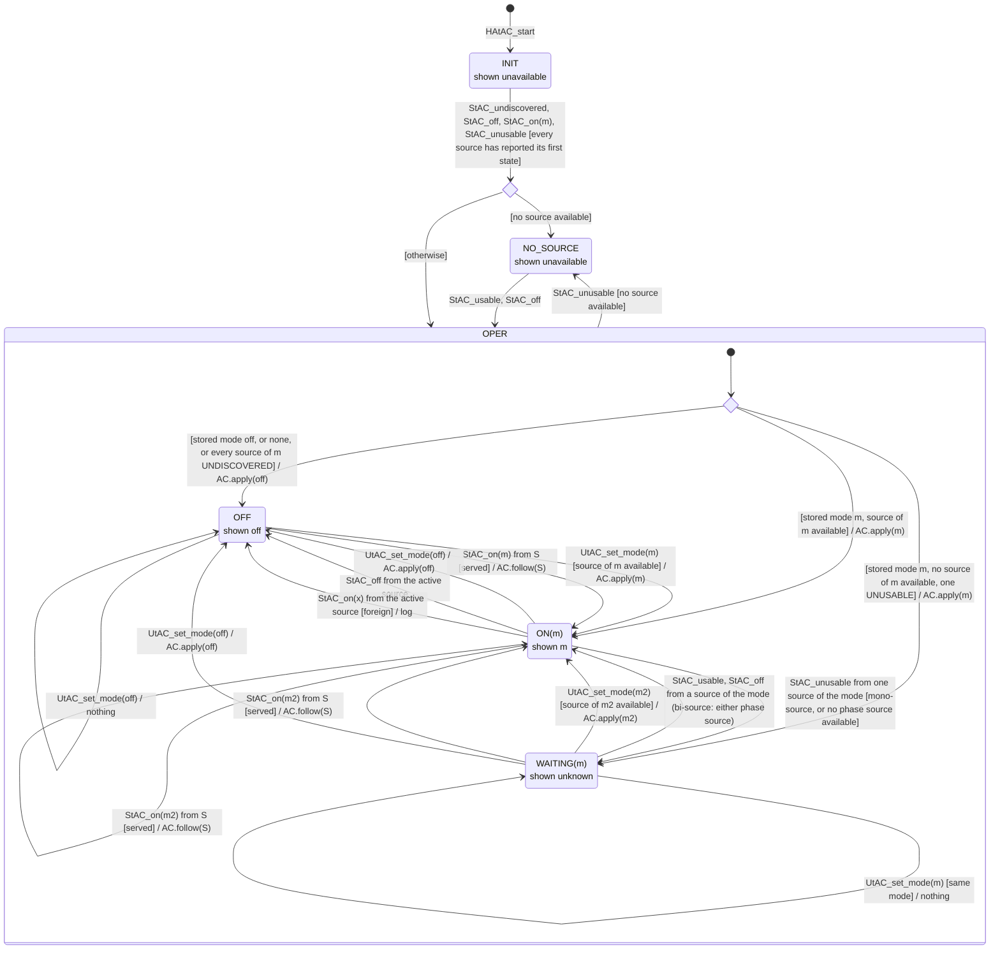

- **ENT-STATE-1** The entity stores its mode (`off` or `m`), saved across
  restarts. `INIT` and `NO_SOURCE` keep it.
- **ENT-STATE-2** The entity also stores its **last used mode**: the mode of
  its last `ON(m)` (`heat_cool` for a bi-source `heat_cool`). It is saved
  across restarts. It is used:
  - by `turn_on`, which asks for the last used mode, or for the first
    configured mode when no mode was ever used (`UtAC_set_mode`);
  - in `OFF`, for the temperature targets shown and set when the entity
    has no low/high (ENT-TGT-7, ENT-TGT-11: "the mode `turn_on` would
    start");
  - in `OFF`, for the reference temperature (ENT-REF-2: the last used
    source).
- **ENT-STATE-3** **A change asked by the user** (`UtAC_set_mode`) is sent to
  the sources (`AC.apply`). **A change coming from a source** (`StAC_`) is
  followed, and nothing is sent to that source: the source wins
  (takeover). The other sources are still turned off (`AC.follow`).
- **ENT-STATE-4** A user mode change goes to the mode asked if its source is
  available (`OFF` or `ON`). `off` is always accepted. Otherwise it is
  refused with an error.
  - A request for the current mode does nothing: no request sent, no
    error. This holds in `ON(m)` and `WAITING(m)` for `m` (in
    `WAITING(m)`, the source is not available, but the entity is already
    in `m` and waits for it), and in `OFF` for `off`. An automation that repeats the mode (a schedule setting
    `heat` every morning) does not turn off a tolerated foreign source
    (ENT-STATE-5), nor choose the phase of a bi-source `heat_cool` again
    (ENT-WANT-1), nor gets an error while the source is away.
- **ENT-STATE-5** A source mode change:
  - `StAC_on(x)` **served**: takeover, the entity goes to `ON(x)` and
    turns the other sources off (`AC.follow`);
  - `StAC_on(x)` **foreign** from the currently active source (it left
    its mode for a foreign one): the entity goes `OFF`; nothing is sent
    to any source (the source keeps running);
  - `StAC_on(x)` **foreign** from any other source: nothing happens
    (logged, listed in the `foreign_modes` attribute);
  - `StAC_off` from the active source: the entity goes `OFF`.

  A source in a foreign mode is **tolerated until the entity next sends
  requests**: nothing is sent to it on the foreign change, but every
  `AC.apply` and `AC.follow` turns off each source not `OFF`, the foreign one
  included. This happens on a mode change by the user, a takeover by
  another source (`AC.follow`), a phase switch of a bi-source `heat_cool`
  (`AC.apply(p)`), and at start or reload (`resume` makes an `AC.apply`,
  ENT-INIT-1, ENT-INIT-4).
  - A foreign source that goes `UNUSABLE` and comes back resends its
    stored state (SRC-STATE-7): the foreign mode if no `AC.apply` / `AC.follow`
    happened meanwhile, else `off` (the request was stored,
    SRC-STATE-4).
- **ENT-STATE-6** Main states: `INIT`, `OPER` (sub-states `OFF`, `ON(m)`,
  `WAITING(m)`) and `NO_SOURCE`. Entering `OPER` goes through the choice
  `resume`. `no source available` leaves `OPER` for `NO_SOURCE`, whatever
  the sub-state, and wins over the other transitions.
- **ENT-STATE-7** Bi-source mode (`heat_cool` with the heat and cool
  sources): `ON(heat_cool)` has phase sub-states (§1.3.3.2); "source of
  `m` available" means at least one of the two sources available
  (ENT-TYPE-8).
- **ENT-STATE-8** `turn_on` only acts in `OFF`:
  - in `OFF`, it asks for the last used mode (ENT-STATE-2);
  - in `ON(m)` and `WAITING(m)`, it does nothing: no request, no error
    (the entity is already on; in `WAITING(m)`, it waits for its source);
  - in `INIT` and `NO_SOURCE`, the entity is unavailable, so Home
    Assistant does not call it (ENT-NOSRC-2).

##### 1.3.2.2 INIT state

- **ENT-INIT-1** At `HAtAC_start`, the entity waits until every source has reported
  its first state (`StAC_undiscovered`, `StAC_off`, `StAC_on(m)` or
  `StAC_unusable`, SRC-STATE-1); a source in `UNDISCOVERED` counts. It then goes
  to its stored mode if it can, else `OFF` (choice `resume`), and
  resynchronizes the sources (`AC.apply`). Before, its kept targets are
  brought back in line with the step and the range (ENT-TGT-4).
- **ENT-INIT-2** Stored mode `m` whose source is `UNDISCOVERED` (bi-source:
  both phase sources): `OFF`. This should not happen: a configuration
  change sets the entity to `OFF` (ENT-INIT-4), and a source discovered
  stays discovered (its data is saved). It covers lost or corrupted
  stored data (SRC-DATA-5).
- **ENT-INIT-3** Shows: the entity is **unavailable** (no mode, no action, no
  temperature target, no setting).
- **ENT-INIT-4** A change of the configuration (options in the UI, or
  YAML: an entry changed in the YAML, CFG-YAML-3) reloads the entry and
  **sets the entity to `OFF`**: its stored mode becomes `off`, and the
  phase is forgotten (ENT-PHASE-1). The reload then goes through `INIT`
  as when Home Assistant starts (stored data, last used mode, settings),
  and `resume` turns the sources off (`AC.apply(off)`).
  - This keeps a new configuration simple: no mode is resumed with
    sources that changed, and a new source (`UNDISCOVERED`) never gets a
    request (§1.3.2.1).
  - If the last used mode is no longer configured, `turn_on` asks for the
    first configured mode (ENT-STATE-2).
  - A source entity removed from the configuration is no longer managed:
    if it runs, it keeps running, since the entity only sends requests to
    its configured sources. Its stored data is dropped (SRC-DATA-9).
  - A reload without configuration change (asked from Home Assistant),
    and a YAML entry imported again unchanged at start (CFG-YAML-1), are
    restarts: the stored mode is resumed.

##### 1.3.2.3 OFF state

Every source is asked to be off.

- **ENT-OFF-1** Shows: the entity is available; `hvac_mode` `off`;
  `hvac_action` `off`. Capabilities and settings shown: §1.3.4, §1.3.5.

##### 1.3.2.4 ON(m) state

The source of `m` runs `m`; every other source is asked to be off.

- **ENT-ON-1** Shows: the entity is available; `hvac_mode` `m`;
  `hvac_action` of the active source (the phase source for a bi-source
  mode). Capabilities and settings shown: those of `m` (§1.3.4, §1.3.5).
- **ENT-ON-2** `hvac_action`:
  - it is read on the active source (`action@S`) each time the
    active source changes or comes back: entry of `ON(m)`, phase switch
    of a bi-source `heat_cool`, return of the phase source from
    `UNUSABLE` (`WAITING_PHASE(p)` → `PHASE(p)`);
  - it then follows `StAC_action(a)` from the active source; those of
    the other sources are ignored;
  - it is shown as the source entity shows it, also during a request
    confirmation and `SETTLE(m)` (it may still be the action of the
    previous mode);
  - `None` when the source entity has none, or is not usable
    (`WAITING_PHASE(p)`). The Home Assistant card then shows the mode
    instead of the action.

##### 1.3.2.5 WAITING(m) state

The source of the current mode `m` is `UNUSABLE`; the mode is kept.

- Entered on `StAC_unusable` from the active source.
- Left when the source is back (`StAC_usable` → `ON(m)`: the source
  resynchronizes itself, SRC-STATE-7; its settings are kept, SRC-SET-1), when the
  user asks for another mode, or on a takeover by another source.
- **ENT-WAIT-1** Shows: the entity is available; `hvac_mode` unknown
  (`None`); `hvac_action` unknown (`None`). Capabilities and settings
  shown: those of `m`, as last known (§1.3.4, §1.3.5). The
  `monitoring_sources` binary sensor (§4.2) tells which source is
  away.

##### 1.3.2.6 NO_SOURCE state

No source is available: every source is `UNUSABLE` or `UNDISCOVERED`.

- **ENT-NOSRC-1** Shows: the entity is **unavailable** (no mode, no action, no
  temperature target, no setting). The stored mode is kept for the return.

- Left as soon as a source becomes available, through the choice
  `resume` (§1.3.2.1). The sources are resynchronized (`AC.apply`).
- **ENT-NOSRC-2** No user event in `NO_SOURCE` (nor in `INIT`): Home
  Assistant does not call a service on an unavailable entity (the call
  is skipped without error, also from an automation).

#### 1.3.3 Mode management

##### 1.3.3.1 Mono-source and bi-source modes

The sources of the modes are configured in §3.1.2. From that configuration,
each mode is mono-source or bi-source. The following table describes the possible options from the configuration:

| Mode | Configuration | Type | Sources |
|---|---|---|---|
| `heat`, `cool`, `auto`, `dry`, `fan_only` | `<mode>_entity` set | mono-source | its source |
| `heat_cool` | `heat_cool_entity` set | mono-source | its source |
| `heat_cool` | no `heat_cool_entity`, `heat_entity` and `cool_entity` set | **bi-source** | the heat source (phase `heat`) and the cool source (phase `cool`) |
| any | no source | not listed | — |

When `heat_cool` is bi-source (no `heat_cool_entity`), it uses the heat
and cool sources, one per phase:

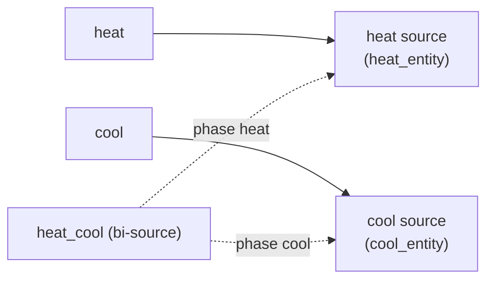

Otherwise (`heat_cool_entity` declared), `heat_cool` is mono-source and
uses its own source, like the other modes.

- **ENT-TYPE-1** Each mode has at most one source entity of its own. A
  source entity can serve several modes.
- **ENT-TYPE-2** At least one mode has a source.
- **ENT-TYPE-3** A source cannot be an Adaptative Climate entity (calls
  would loop).
- **ENT-TYPE-4** When an entry is created or its configuration changed (UI
  or YAML), each source entity is checked against the source modes it
  serves:
  - it shows its `hvac_modes` and one of them is missing: the
    configuration is refused (error in the UI; YAML entry not imported,
    error logged, CFG-YAML-5);
  - it does not show them (unavailable, unknown, not loaded yet): the
    configuration is accepted. The state machine protects: if the source
    entity, once seen, does not offer the mode, the source is `UNUSABLE`
    (SRC-UNUS-1) and a Repairs issue is raised (ENT-HVAC-5).

  At a start with an unchanged configuration (YAML imported again,
  CFG-YAML-1), nothing is refused: a mode lost meanwhile is handled while
  running (SRC-UNUS-1), so that the entry and its stored data are kept.
- **ENT-TYPE-5** Whether a mode is mono-source or bi-source is set by the
  **configuration only** (§3.1.2): it never changes while running, only
  when the configuration changes (the entry is reloaded, ENT-INIT-4). The same mode
  can be either, depending on the configuration (today only `heat_cool`).
- **ENT-TYPE-6** Mono-source mode `m`: the source mode is `m`; the active
  source is the source of `m`.
- **ENT-TYPE-7** Bi-source mode: two sources, one per **phase** (`heat`,
  `cool`); one runs at a time (§1.3.3.2). The source mode is the phase; the
  active source is the source of the phase. Both sources can be the same
  entity (a heat pump switches its own mode).
- **ENT-TYPE-8** A bi-source mode is available as long as at least one of
  its two sources is available (ENT-HVAC-3). A source that does not offer its
  phase is `UNUSABLE` (SRC-UNUS-1). Otherwise, a user request for it is
  refused (ENT-STATE-4).
- **ENT-TYPE-9** In `ON(heat_cool)` bi-source, a mode change made on one
  of the two phase sources (`StAC_on(x)`, `x` = `heat` or `cool`) is a
  takeover: the source wins, and the entity leaves `heat_cool` for the
  **mono-source** mode `x` (`ON(x)`). Examples:
  - phase `heat`, the AC (cool source) is set to `cool` on its remote →
    `ON(cool)`;
  - phase `heat`, a heat pump serving both is set to `cool` on its
    remote → `ON(cool)`;
  - phase `cool`, the radiator (heat source) is turned on in `heat` →
    `ON(heat)`.

  A phase source set to `heat_cool` is in a foreign mode (§1.3.1): the
  entity is not configured with a source for `heat_cool`. From the
  active source, the entity goes `OFF` (ENT-STATE-5).

  Setting the phase source to the mode it already runs (radiator set to
  `heat` in phase `heat`) changes nothing on the source entity: no event,
  the entity stays `heat_cool`.

##### 1.3.3.2 Bi-source mode: phase management

###### 1.3.3.2.1 Phase management

When `heat_cool` is bi-source, `ON(heat_cool)` has two sub-states. Both
are written with the current phase `p` (`heat` or `cool`):

- `PHASE(p)`: the source of `p` is available and runs `p`;
- `WAITING_PHASE(p)`: the source of `p` is `UNUSABLE`. The phase `p` is
  kept, and its source gets the request when it comes back (SRC-STATE-4),
  like `WAITING(m)` for a mode.

`p'` is the other phase (`cool` when `p` is `heat`, and the reverse).

The entity chooses the phase from the reference temperature and the temperature targets
(see `AC.wanted` below).

Entering a phase `p` is written `AC.apply(p)`:

- the source of `p` is asked to run `p`, with the settings of that phase
  (`ACtS_request(p)`, `ACtS_settings`);
- every other source that is not off (and not `UNDISCOVERED`, §1.3.2.1) is asked to turn off
  (`ACtS_request(off)`), the source of the other phase included. Except
  when both phases use the same entity (a heat pump): it just switches
  from one mode to the other.

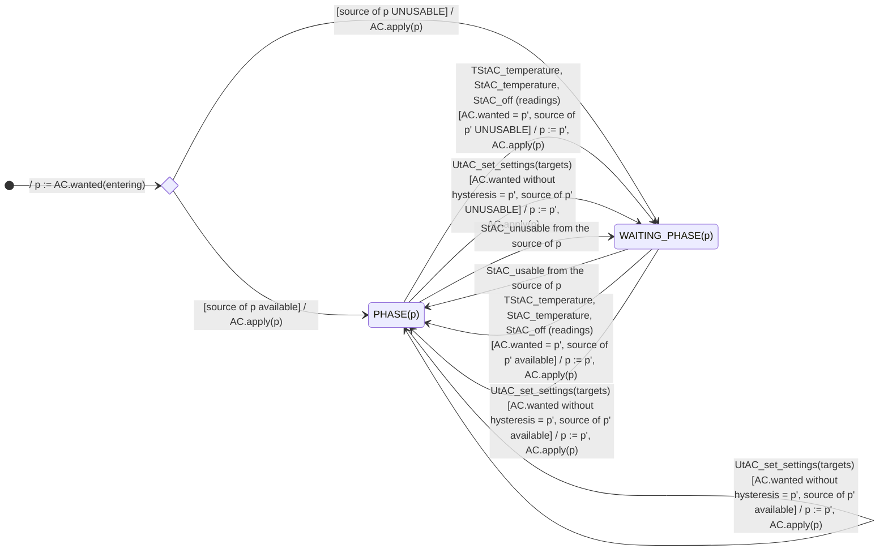

Leaving: no phase source available → `WAITING(heat_cool)` (ENT-PHASE-6);
a change made on a phase source → takeover (ENT-PHASE-4).

The initial transition (`[*] --> entering`) is taken at each entry of
`ON(heat_cool)`.

The **readings** (a "new reading" in the text) are the events that can
change the wanted phase:

- a new value of the reference, local high or local low temperature
  (§1.3.3.2.2): `TStAC_temperature`, or `StAC_temperature` from the heat
  or cool source;
- the discovery of a phase source: `StAC_off` from a phase source that
  was `UNDISCOVERED` (SRC-STATE-8). It counts as a reading because the
  switch it blocked (ENT-PHASE-7) can then happen. A `StAC_off` from a
  phase source that was available is a change made on that source
  (takeover, ENT-PHASE-4), not a reading.
> **Note — The return of an `UNUSABLE` source does not**:
> its phase was not blocked, it waited in `WAITING_PHASE` (ENT-PHASE-5).

- **ENT-PHASE-1** The phase is stored with the mode, and saved across
  restarts.
  - It only exists while the stored mode is `heat_cool`: it is forgotten
    when the entity leaves `heat_cool` (another mode, or `off`).
  - It is not resumed as such. Every entry of `ON(heat_cool)` (user
    request, restart, back from `WAITING(heat_cool)` or `NO_SOURCE`)
    chooses the phase again (`AC.wanted(entering)`, ENT-WANT-1); the stored
    phase is only used there when there is no reference temperature.
- **ENT-PHASE-2** The phase is checked on every new reading (the
  discovery of a phase source included), and on every change of the
  temperature targets by the user (`AC.wanted`, below). A change of the
  temperature targets by the user ignores the hysteresis (`phase_hysteresis` = 0): the
  user asked for it, the phase follows at once.
- **ENT-PHASE-3** A phase switch is an `AC.apply(p)` of the new phase
  (above). The entity does not wait nor judge anything meanwhile: each
  source confirms its own request (§1.2.4): the new phase source its mode
  (retries, monitoring, settle time), the other one `off`. A source sends
  no `StAC_` event for a request it confirms (SRC-STATE-3).
- **ENT-PHASE-4** Leaving the phase from a source (phase source turned off
  or set to another served mode elsewhere) follows the state machine
  (ENT-STATE-5, ENT-TYPE-9).
- **ENT-PHASE-5** One phase source `UNUSABLE`:
  - the entity stays in `ON(heat_cool)`, in `WAITING_PHASE(p)` if it is the
    source of the current phase;
  - the phase is kept, and its source gets the request when it comes back
    (SRC-STATE-4);
  - the other phase can still start if the temperatures ask for it
    (ENT-PHASE-7): from `PHASE(p)` toward an `UNUSABLE` source, the
    entity goes to `WAITING_PHASE(p')`.
- **ENT-PHASE-6** No phase source available (both `UNUSABLE`, or one
  `UNUSABLE` and the other `UNDISCOVERED`): the entity goes to
  `WAITING(heat_cool)` (§1.3.2). It goes back to `ON(heat_cool)` as soon
  as one of them becomes available.
- **ENT-PHASE-7** The entity switches to the other phase unless the
  source of that phase is `UNDISCOVERED`: it cannot get a request
  (§1.3.2.1), so the current phase is kept. A source `UNUSABLE` does not
  block the switch: the entity goes to `WAITING_PHASE(p')`, and the source
  gets the request when it comes back (SRC-STATE-4).

###### 1.3.3.2.2 Wanted phase

Phase choice (`AC.wanted`). It uses three temperatures:

- the **reference temperature** (§1.3.5.1);
- the **local high temperature**: the temperature that must be above the
  high target to switch to `cool`;
- the **local low temperature**: the temperature that must be below the
  low target to switch to `heat`.

| Temperatures available (§1.3.5.1) | Local high temperature | Local low temperature |
|---|---|---|
| `temperature_sensor` with a valid value | the sensor | the sensor |
| no valid sensor, both source temperatures | the **lowest** of the two | the **highest** of the two |
| no valid sensor, one source temperature | that one | that one |
| none | none | none |

Hysteresis `h`:

- on a new reading: `h` = `phase_hysteresis` (§3.1.3);
- on a change of the temperature targets by the user: `h` = 0 ("wanted without
  hysteresis", ENT-PHASE-2).

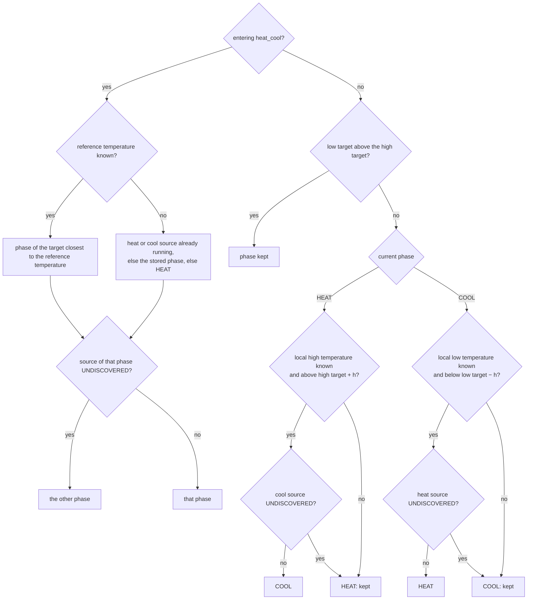

- **ENT-WANT-1** Entering `heat_cool`: the phase is the one of the temperature target
  closest to the reference temperature. Without reference temperature:
  the heat or cool source already running, else the stored phase
  (ENT-PHASE-1), else `heat`.
  - A phase whose source is `UNDISCOVERED` is never chosen: the other
    phase is taken (its source is available or `UNUSABLE`; otherwise the
    mode is not available, ENT-HVAC-3). Afterwards, ENT-PHASE-7 keeps
    the entity out of that phase until its source is discovered.
  - This applies to every entry: user request, restart, back from
    `WAITING(heat_cool)` or `NO_SOURCE`.
  - The hysteresis is not used when entering. So after a restart, the
    phase can differ from the one before. Example: targets 19 / 24, phase
    `heat`, reference temperature 22: after a restart, the closest target
    is 24, so the phase is `cool`.
- **ENT-WANT-2** Local high and low temperatures: see the table above.
- **ENT-WANT-3** Switching phase (after entering):
  - in phase `heat`, the phase switches to `cool` when the local high
    temperature is above the high target plus `h`;
  - in phase `cool`, the phase switches to `heat` when the local low
    temperature is below the low target minus `h`;
  - a source of the new phase `UNDISCOVERED` keeps the current phase
    (ENT-PHASE-7); a source `UNUSABLE` does not: the phase switches, and
    waits for its source (`WAITING_PHASE`);
  - otherwise the phase is kept. This covers: a temperature in between,
    an unknown local temperature, and the low target above the high one
    (after a takeover).
> **Note — why the lowest and the highest:** each source reads near its
> own device, so the two may disagree. Switching to `cool` only when even
> the lowest one is above the high target (and to `heat` only when even
> the highest one is below the low target) means the two sources agree.
> When they contradict each other, the phase is kept: no oscillation.

> **Note — why the hysteresis:** with close temperature targets, or a temperature
> near a temperature target, the phase would switch back and forth (short cycles).
> This wears the compressors and wastes energy. A change of the temperature targets
> by the user is not concerned: the phase follows at once (`h` = 0).

#### 1.3.4 Capabilities management

Capabilities of the modes and temperatures (§1.3.4.1 to §1.3.4.5), then of fan and swing (§1.3.4.6).

The capabilities management runs in parallel with the state management
(§1.3.2), from `HAtAC_start` until the entry unloads: it handles
`StAC_capabilities` (ENT-CAP-7) whatever the state of the entity (`INIT`
and `NO_SOURCE` included), and changes no state.

##### 1.3.4.1 Principle

- **ENT-CAP-1** The entity builds its own capabilities (modes, range, step,
  temperature targets, options) from the capabilities of its sources
  (`capabilities@S`, §1.2.2).
  - It uses them whatever the state of the sources.
  - A source in `UNUSABLE` keeps the capabilities it showed last.
- **ENT-CAP-2** The capabilities of a mode `m` come from the source of `m`,
  as it showed them while running in `m`.
  - They are stored per source and per mode (SRC-DATA-1).
  - For a bi-source `heat_cool`, they come from the heat source running in
    `heat`, and from the cool source running in `cool`.

> **Note:** the entity does not need to handle a capability that
> disappears for a while (a device that hides an attribute while it
> restarts, or in some states): the source keeps it until its removal is
> confirmed (SRC-DATA-10, SRC-DATA-11). The entity always reads stable
> capabilities.

A mode is **not discovered yet** when its source has never run in it
(SRC-DATA-1):

- **ENT-CAP-3** A mode not discovered yet is available as any other
  (ENT-HVAC-2): the entity can switch to it.
- **ENT-CAP-4** Until its first activation, the mode has no capability.
  - The entity shows no temperature target and no fan/swing for it.
  - Its range is the Home Assistant default range, 7–35 °C.
  - The temperature targets the user sets for it meanwhile are kept, but
    not sent.
  - A fan/swing request for it is refused (ENT-FAN-4).
- **ENT-CAP-5** When the mode is activated for the first time, the entity
  only sends the mode.
  - No temperature target and no fan/swing setting is sent: the entity does not know
    yet what the source accepts in that mode.
  - The entity never uses the capabilities of another mode to decide what
    to send.
- **ENT-CAP-6** At the first update of the source in that mode, the
  capabilities of the mode are discovered (SRC-DATA-6), and reported to
  the entity (`StAC_capabilities`, ENT-CAP-7).
  - The kept temperature targets are first brought back in line
    (ENT-TGT-4): before, the mode counted as 7–35 °C (ENT-CAP-4) and
    had no step.
  - They are then sent as in ENT-TGT-8 (offset, range of the mode, step
    of the source).
  - For fan/swing, the entity adopts the values of the source as soon as
    they are shown, during the settle time too (ENT-FANV-5).
  - Until the discovery, the source runs with its own settings.

A change of the capabilities of a source, discovery or later:

- **ENT-CAP-7** On `StAC_capabilities` (SRC-DATA-12), the entity reads the
  capabilities of that source again (`capabilities@S`) and rebuilds its own (§1.3.4: modes
  available, features, step, range, fan/swing options). Then:
  - the step or the range of a mode changed: the kept targets are
    brought back in line (ENT-TGT-4);
  - the options of a mode changed: the fan/swing memory is checked
    (ENT-FANV-3);
  - the entity writes its state in Home Assistant, so that the card and
    the attributes show the new capabilities (except in `INIT` and
    `NO_SOURCE`, where the entity is unavailable).

##### 1.3.4.2 Modes listed

- **ENT-HVAC-1** The entity lists `off` and every configured mode
  (§1.3.3.1), in its `hvac_modes`.
  - `heat_cool` is listed when it is configured, mono-source or
    bi-source.
  - The modes are listed in mode order (§0).
  - The list comes from the configuration. It does not change while
    running, so the card always shows the same modes.
- **ENT-HVAC-2** A mode can be in the list without being available. A
  mono-source mode is not available when its source is `UNDISCOVERED` or
  `UNUSABLE`. A source that does not offer the mode is `UNUSABLE`
  (SRC-UNUS-1).
- **ENT-HVAC-3** A bi-source mode is not available when **both** sources
  are `UNDISCOVERED` or `UNUSABLE` (one available source is enough,
  ENT-PHASE-5). A source that does not offer its phase is `UNUSABLE`
  (SRC-UNUS-1).
- **ENT-HVAC-4** A mode that is not available:
  - stays in the list;
  - is listed in the `unavailable_modes` attribute;
  - is refused when the user asks for it (ENT-STATE-4).
- **ENT-HVAC-5** When a source does not offer the mode it serves (the
  source is then `UNUSABLE`, SRC-UNUS-1):
  - a warning is logged, and a Repairs issue
    (`<entry>_<mode>_not_supported`) is raised;
  - the issue is removed when the source offers the mode again, and when
    the entry unloads;
  - a source never seen is not judged.

##### 1.3.4.3 Temperature targets used by each mode

The entity keeps three temperature targets:

- **low**: the heating setpoint;
- **high**: the cooling setpoint;
- **T**: the single temperature target.

Each mode uses some of them. It shows them either in the single target
attribute (`temperature`), or in the low/high attributes
(`target_temp_low`, `target_temp_high`).

| Mode | Temperature targets used | Shown as |
|---|---|---|
| `heat` | low | `temperature` |
| `cool` | high | `temperature` |
| `heat_cool` bi-source | low, high | `target_temp_low`, `target_temp_high` |
| `heat_cool` mono-source, source with low/high | low, high | `target_temp_low`, `target_temp_high` |
| `heat_cool` mono-source, source with a single temperature target | T | `temperature` |
| `auto`, source with low/high | low, high | `target_temp_low`, `target_temp_high` |
| `auto`, source with a single temperature target | T | `temperature` |
| `dry`, source with a single temperature target | T | `temperature` |
| `auto` or `dry`, source without temperature target | none | nothing |
| `fan_only` | none | nothing |

- **ENT-FEAT-1** What a mode uses depends on what its source supports in
  that mode. The source is in one of three cases:
  - **with low/high**: the source uses two setpoints, `target_temp_low`
    and `target_temp_high` (ENT-FEAT-2);
  - **with a single temperature target**: the source uses one setpoint,
    `temperature`. It declares the feature `TARGET_TEMPERATURE`, and is
    not "with low/high";
  - **without temperature target**: the source has no temperature setpoint at all, for example a
    dehumidifier in `dry`. It declares neither `TARGET_TEMPERATURE` nor
    `TARGET_TEMPERATURE_RANGE`. The entity then shows no temperature target in that
    mode, and sends none.
- **ENT-FEAT-2** A source is "with low/high" in the mode `m` when it
  declares the feature `TARGET_TEMPERATURE_RANGE`.
  - If it declares only `TARGET_TEMPERATURE_RANGE`, that is enough.
  - If it also declares `TARGET_TEMPERATURE`, one more condition is
    needed: it has already shown numeric low/high values while running
    in `m` (`low_high_seen`, SRC-DATA-8).
  - Why: some sources declare both features but only use the single
    temperature target, or only use low/high in some modes. For example,
    a template climate with only `set_temperature`, or a thermostat that
    declares both features in every mode and uses low/high only in
    `heat_cool` or `auto`: in `heat`, it shows no low/high, so it gets
    the single target.
  - The condition is judged per mode, from what the source showed in
    that mode: offering a mode such as `heat_cool` says nothing about the
    other modes.

> **Note — known limitation:** if the device behind a source entity is
> replaced, and the entity id stays the same, the source keeps its
> `low_high_seen`. Only deleting the entry clears it.

- **ENT-FEAT-3** Features declared by the entity:
  - it always declares `TURN_ON` and `TURN_OFF`;
  - it declares `TARGET_TEMPERATURE` when at least one configured mode
    shows a single temperature target (`temperature`);
  - it declares `TARGET_TEMPERATURE_RANGE` when at least one configured
    mode shows low/high;
  - these features do not change with the current mode;
  - the other features of the sources (presets, humidity) are not
    exposed.

##### 1.3.4.4 Step

- **ENT-STEP-1** The entity has one step (`target_temp_step`). It is
  computed from the steps of all the sources, in all their discovered
  modes.
  - The step of the entity is the largest value that divides every step
    of the sources exactly.
  - Examples: steps 0.5 and 1 give 0.5. Steps 0.5 and 0.2 give 0.1.
  - A source without step counts as 0.5 °C (1 °F), as the Home Assistant
    card does.
  - If no step is known yet, the step is 0.5 °C (1 °F).
- **ENT-STEP-2** The step does not change with the state or the mode. So a
  temperature target keeps the same value when the mode changes.

##### 1.3.4.5 Range

- **ENT-RANGE-1** The range of a mode comes from its source.
  - It is the `min_temp` / `max_temp` of the source in that mode, minus the
    offset of the mode (§3.1.3).
  - For a bi-source `heat_cool`, it goes from the minimum of the heat
    phase (the heat source in `heat`) to the maximum of the cool phase
    (the cool source in `cool`): the low target goes to the heat source,
    the high one to the cool source. Each target is then brought into
    the range of its phase when it is sent (ENT-RANGE-4).
  - For a mode not discovered yet, it is 7–35 °C (ENT-CAP-4).
- **ENT-RANGE-2** The range shown by the entity:
  - in `ON(m)` and `WAITING(m)`: the range of `m`;
  - in `OFF`: the widest range of all the modes.
- **ENT-RANGE-3** The limits `min_temp` / `max_temp` (§3.1.6):
  - they can only narrow the range, never widen it;
  - a limit outside the range is ignored;
  - they apply to the reference temperature, before the offset.
- **ENT-RANGE-4** When the entity sends a temperature target to the source
  of a mode, it first brings it into the range of that mode
  (ENT-RANGE-1, ENT-RANGE-3). A value below the minimum is sent as the
  minimum, and a value above the maximum is sent as the maximum. The
  value kept by the entity does not change.
- **ENT-RANGE-5** A temperature target set by the user is kept within the
  widest range of all the modes that use it (§1.3.4.3). A value taken
  from a source can be outside (takeover: ENT-TGT-9). For example, the
  low target is used by `heat`, and by `heat_cool` and `auto` when their
  source has low/high: the low target can take any value that at least
  one of these modes accepts.
- **ENT-RANGE-6** This way, a value is not lost because one mode cannot
  reach it. For example, with a radiator at 5–30 °C for `heat` and a heat
  pump at 18–30 °C for `heat_cool`, a low target of 14 °C is kept at
  14 °C. The radiator gets 14 °C, and the heat pump gets 18 °C.

##### 1.3.4.6 Fan and swing

The three settings `fan_mode`, `swing_mode` and `swing_horizontal_mode` are
handled the same way. This section only covers their options; the values
kept for each mode are part of the settings (§1.3.5).

- **ENT-FAN-1** The options of a mode for a setting are the options its
  source showed while running in that mode (`fan_modes`, `swing_modes`,
  `swing_horizontal_modes`), when it declares the matching feature in
  that mode.
  - For a bi-source `heat_cool`, they are the options of the source of
    the current phase.
  - A mode not discovered yet has no option (ENT-CAP-4).
- **ENT-FAN-2** The entity declares the features `FAN_MODE`, `SWING_MODE`
  and `SWING_HORIZONTAL_MODE` as soon as at least one configured mode has
  options for that setting. These features do not change with the mode,
  so the card keeps the same size.
- **ENT-FAN-3** The options shown by the entity depend on its state:
  - in `ON(m)` and `WAITING(m)`, it shows the options of `m` (in
    `WAITING(m)`, the ones known last);
  - in `ON(heat_cool)` bi-source, it shows the options of the current
    phase, or the options shared by the two phases when `bi_source_sync`
    is on (ENT-FAN-8);
  - in `OFF`, it shows the options shared by the synchronized modes when
    **every** configured mode is in `sync_modes` (ENT-FAN-6), a bi-source
    `heat_cool` excepted (it cannot be listed, ENT-FAN-7); otherwise, it
    shows none (it does not show the options of the mode `turn_on` would
    start).
- **ENT-FAN-4** A setting is shown and set only from what is discovered.
  The capability (the setting itself) and its values (the options) are
  distinct:
  - **capability not discovered** (the source never ran in the mode, or
    does not declare the setting in it): the setting is not shown, and a
    user request for it is refused with a clear error;
  - **capability discovered**: the setting is shown, with its discovered
    values (ENT-FAN-1), which may be none;
  - only a discovered value can be set (compared without taking the case
    into account, ENT-FAN-5). Any other value is refused with a clear
    error; with no discovered value, every request is refused.

  The same check applies to what is shown and to the requests: the user
  only sees and sets discovered values. In `OFF`, what is shown is given
  by ENT-FAN-3 (shared options when every mode is synchronized, otherwise
  none, so every request is refused).
- **ENT-FAN-5** Values are compared without taking the case into account:
  `Low` and `low` are the same value. Each source gets the value written
  as it writes it. Other names are not matched: `1` is not `low`.
- **ENT-FAN-6** The options shared by the synchronized modes (`sync_modes`,
  §3.1.7) are the options offered by **all** of them, without taking the
  case into account. They are written as the first synchronized mode
  writes them, in mode order.
- **ENT-FAN-7** Configuration errors of `sync_modes`, each one reported by
  a warning and a Repairs issue, removed once the cause is gone:
  - a synchronized mode whose source does not have a setting at all (a
    radiator without fan): that mode is ignored for that setting, so that
    the others still share their options;
  - `heat_cool` listed while it is bi-source: it is ignored in
    `sync_modes`. A bi-source `heat_cool` is synchronized with
    `bi_source_sync` instead (ENT-FAN-8). `heat_cool` always stays in the
    list of choices of `sync_modes`.
- **ENT-FAN-8** `bi_source_sync` (§3.1.7) synchronizes the two phases of a
  bi-source `heat_cool`, with the same principle as `sync_modes`:
  - the options shown in `ON(heat_cool)` are the options offered by both
    phase sources (the heat source in `heat`, the cool source in `cool`),
    without taking the case into account;
  - a phase source that does not have a setting at all is reported like
    in ENT-FAN-7, and ignored for that setting.

#### 1.3.5 Settings management

- **ENT-SET-1** `UtAC_set_settings(s)`: the settings are kept by the entity
  for the current mode (when off: the temperature targets for the mode
  `turn_on` would start, ENT-TGT-7; fan/swing only when shown, ENT-FAN-3,
  ENT-FANV-9). Fan/swing requests are checked first (ENT-FAN-4).
  - In `ON(m)`, they are sent to the active source (`ACtS_settings(s)`).
  - In `WAITING(m)` and `WAITING_PHASE(p)`, they are sent too: the source
    is `UNUSABLE` and keeps them (SRC-SET-1), then sends them when it
    comes back (SRC-STATE-7).
- **ENT-SET-2** `StAC_settings(s)` from the active source (takeover of a
  setting, or of the mode: SRC-SET-11): the entity adopts them.
- Temperature targets: §1.3.5.3. Fan and swing values: §1.3.5.4.

##### 1.3.5.1 Reference temperature

The temperature the entity regulates on, and shows as its current
temperature.

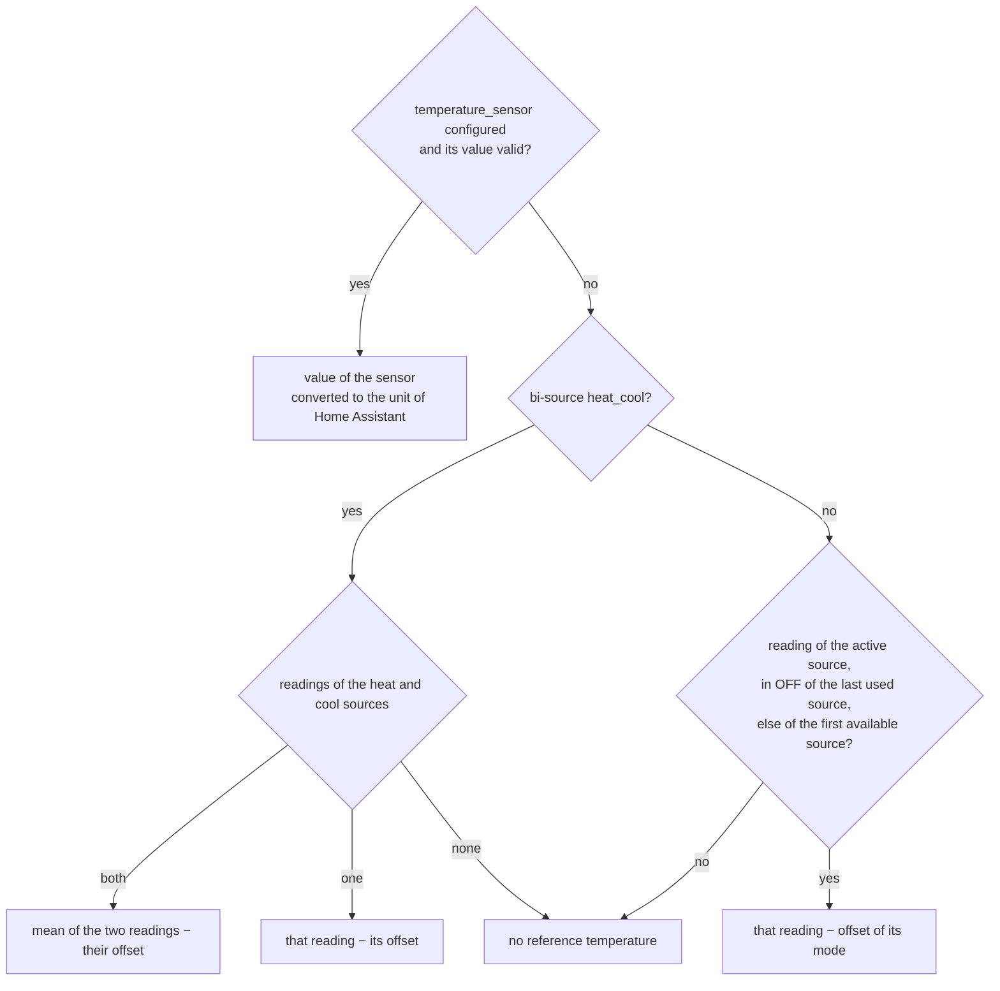

- **ENT-REF-1** With `temperature_sensor` (§3.1.3), the reference
  temperature is its value (`temperature@T`), converted to the unit of
  Home Assistant. A value that is not a valid number (`unavailable`,
  `unknown`, text, infinite) is no value (`None`).
- **ENT-REF-2** Without `temperature_sensor`, or while it has no valid
  value, the reference temperature is the current temperature
  (`temperature@S`) minus the offset of its mode (§3.1.3) of:
  - the active source, in `ON(m)` and `WAITING(m)`;
  - the **last used source** in `OFF`: the source of the last used mode
    (ENT-STATE-2, saved across restarts); for a bi-source `heat_cool`,
    both phase sources, as in `ON(heat_cool)` below (the phase is
    forgotten in `OFF`, ENT-PHASE-1);
  - in `OFF` when no mode was ever used, the **first available source**, in
    mode order;
  - in `ON(heat_cool)` and `WAITING(heat_cool)` **bi-source**, from the
    readings of the heat and cool sources (each one minus the offset of
    its mode):
    - both readings available: their **mean**;
    - only one (the other source `UNUSABLE`, or without current
      temperature): that one;
    - none: no reference temperature (ENT-REF-3).
- **ENT-REF-3** No reference temperature (no valid sensor value, and no
  reading from that source: not available, or no `current_temperature`): the
  entity shows no current temperature
  (`None`). The users of the reference temperature handle its absence
  (for the phase choice: ENT-WANT-1, ENT-WANT-3).
- **ENT-REF-4** The entity shows the reference temperature as its
  `current_temperature`, in every sub-state of `OPER` (in `INIT` and
  `NO_SOURCE` the entity is unavailable).
- **ENT-REF-5** A reading of a source is always taken minus the offset of
  the mode it serves (§3.1.3): a well set offset makes the source read the
  reference temperature.
- **ENT-REF-6** Bi-source mode without valid sensor:
  - the entity shows the reference temperature, the mean of the two
    source temperatures; it is also used when entering `heat_cool`
    (ENT-WANT-1);
  - to switch phase, the entity uses the local high and low temperatures
    instead (the lowest and the highest of the two, ENT-WANT-2), so that
    two sources that disagree do not make the phase oscillate
    (§1.3.3.2.2).
- **ENT-REF-7** The reference temperature is computed from the data
  (`temperature@T`, `temperature@S`), read at each computation. It is
  computed again on every event that can change it:
  - a value changed: `TStAC_temperature`, `StAC_temperature` (`None`
    included: the value is gone);
  - the readings used changed: entry of `OPER`, change of mode or of
    phase, a source that becomes available or `UNUSABLE`.

  So a value that does not change is never missing: at start, at the
  discovery of a source or at its return from `UNUSABLE`, the value is
  read at once, without waiting for a change.

##### 1.3.5.2 External sensors

- **ENT-EXT-1** For each external sensor entity (`<mode>_external_sensor`,
  §3.1.3; one per source entity, CFG-SENS-2), the
  entity writes the value of the temperature sensor to that entity **on
  every `TStAC_temperature` event with a valid value**, whatever the
  state of the entity and of the source (even off, even when the mode is
  not the current one). At `HAtAC_start`, the current value (`temperature@T`)
  is written at once if it is valid. An external sensor entity named by
  several modes is kept once when the configuration is read: each value
  is written to it once.
- **ENT-EXT-2** The value is converted to the unit of the external sensor
  entity and rounded to its step. It is not written when the external
  sensor entity is unavailable, or when the value is out of its range
  (warning logged). A write error is logged.
- **ENT-EXT-3** The offset of a mode with an external sensor is 0: its
  source regulates on the reference temperature.
- **ENT-EXT-4** While the temperature sensor has a valid value
  (`temperature@T`), that value is written again every `external_sensor_resend` (§3.1.4, 900 s by default),
  even unchanged: some devices (thermostatic valves) go back to their own
  sensor when the external temperature is not updated for a while.
- **ENT-EXT-5** Temperature sensor without valid value (`unavailable`,
  `unknown`, `None`, not a number: `TStAC_temperature(None)`, or
  `temperature@T` `None` at `HAtAC_start`): nothing is written, and the
  periodic rewrite stops, so that the device does not regulate on a stale value: a
  device that watches the updates goes back to its own sensor. Writing
  resumes with the next valid value. The monitoring reports the sensor
  (MON-TEMP-4). An external sensor entity cannot be made invalid from Home
  Assistant (a `number` only takes a number in its range).

##### 1.3.5.3 Temperature targets

The temperature targets used and shown by each mode are listed in
§1.3.4.3 (low, high, T).

**What the entity keeps**

- **ENT-TGT-1** The temperature targets belong to the entity, not to the
  sources.
  - Switching mode keeps them, and the source of the new mode gets them.
  - They are temperatures of the reference (§1.3.5.1): the offset is only
    added when a temperature target is sent to a source (ENT-TGT-8).
  - The `saved_targets` attribute shows the three values as kept.
- **ENT-TGT-2** The temperature targets are kept:
  - across restarts;
  - while the entity is `OFF`, in `fan_only`, in a mode without
    temperature target, and in `WAITING(m)`.
- **ENT-TGT-3** A value kept is always on the step of the entity
  (ENT-STEP-1). Its range depends on who set it:
  - set by the user, or taken as a first target (ENT-TGT-10): it is within
    the range of the temperature target (ENT-RANGE-5);
  - taken from the source (takeover, ENT-TGT-9): it is kept as it is,
    even outside that range. The source wins.

  A value outside the range stays until the user or a source sets the
  target again, or until the capabilities change (ENT-TGT-4).

**Capabilities changed**

- **ENT-TGT-4** When the capabilities of a mode change (`StAC_capabilities`,
  ENT-CAP-7: discovery, ENT-CAP-6, or later update of the step or the
  range, SRC-DATA-6, SRC-DATA-10), and when it leaves `INIT` (the step
  or the range may have changed since the targets were saved: a source
  added or removed by a configuration change, ENT-INIT-4), the entity
  takes back control of its kept targets:
  - every kept target is rounded to the step of the entity (ENT-STEP-1);
  - every kept target is brought into the range of the temperature target
    (ENT-RANGE-5), not into the range of the mode alone (ENT-RANGE-6).
    This includes a value taken from a source outside the range
    (ENT-TGT-9): the takeover does not survive a change of the
    capabilities;
  - the gap is applied again (ENT-TGT-5), also when a takeover broke it
    (ENT-TGT-9): the high target moves, as when both are set in the same
    request (ENT-TGT-6); if it cannot (the end of its range is reached),
    the low target moves instead;
  - in `ON(m)` and `WAITING(m)`, a kept target that changed is sent to the
    active source (`ACtS_settings`, ENT-TGT-8).

**Gap between low and high**

- **ENT-TGT-5** The low target stays at least `min_gap` (§3.1.6) below the
  high target.
- **ENT-TGT-6** When one temperature target is set, the other one moves if needed:
  - a low target raised close to the high one pushes the high one up;
  - a high target lowered close to the low one pulls the low one down;
  - the temperature target that moves is rounded away from the other one, on the
    step of the entity, so that the gap is kept;
  - if it cannot move (the end of its range is reached), the temperature target just
    set gives way instead;
  - when both are set in the same request, the high target moves.

**Set by the user**

- **ENT-TGT-7** `UtAC_set_settings` with temperature targets:
  - a value outside the range shown by the entity (ENT-RANGE-2) is
    refused with an error: nothing is kept, nothing is sent;
  - a single `temperature` sets the temperature target the current mode shows as
    `temperature` (§1.3.4.3): low in `heat`, high in `cool`, T in the
    other modes. In `OFF`, it sets the temperature target of the mode `turn_on` would
    start;
  - `target_temp_low` / `target_temp_high` set low / high;
  - with an `hvac_mode` in the same request, the mode and the temperature
    targets are handled together: the entity switches to the new mode
    (`UtAC_set_mode`), and the temperature targets are set for that new
    mode (§1.3.4.3). The source of the new mode gets the mode and the
    temperature targets in the same `AC.apply` (`ACtS_request` then
    `ACtS_settings`).

**Sent to the source**

- **ENT-TGT-8** The entity sends to the active source the temperature targets its
  mode uses (`ACtS_settings`), each one, in this order:
  - plus the offset of the mode (§3.1.3);
  - brought into the range of the mode (ENT-RANGE-4);
  - for low and high, the gap is applied again (`min_gap`, ENT-TGT-5) on
    the values sent: the high target moves up; if it is at the maximum
    of the range, the low target moves down instead;
  - rounded to the step of that source (not the step of the entity); for
    low and high, the target moved for the gap is rounded away from the
    other one, as in ENT-TGT-6.

  The values kept by the entity do not change. Low and high are sent
  together. Example: with a radiator at step 0.5 and an AC at step 1, a
  high target of 24.5 °C stays 24.5 °C in the entity, and the AC gets
  25 °C.

  Why the gap again: each target is brought into the range of the mode
  on its own, so the pair sent can lose its gap, even when the values
  kept have it. Example with a `heat_cool` source at 16–28 °C and
  `min_gap` 2 °C: kept 27 / 29 (the range of the targets is wider,
  ENT-RANGE-6), 30 / 30 (gap broken by a takeover, ENT-TGT-9) or 31 / 33
  (taken outside the range): the source gets 26 / 28 in every case. A
  device with its own minimum gap could otherwise refuse or correct the
  pair, and the setting would never be applied (MON-SRC-4).

  For a bi-source `heat_cool`, the active source is the source of the
  phase, and it gets what its phase mode uses (§1.3.4.3): in phase `heat`,
  the heat source gets low, as in the mode `heat`; in phase `cool`, the
  cool source gets high, as in the mode `cool`. Low and high are not sent
  together.

**Changed on the source (takeover)**

- **ENT-TGT-9** A temperature target changed on the active source (`StAC_settings`)
  becomes the temperature target of the entity. The source wins:
  - the value taken is the value of the source minus the offset of its
    mode, rounded to the step of the entity;
  - it is kept even outside the limits and the range of the entity, until
    the capabilities change (ENT-TGT-4);
  - it is not sent back to the source;
  - the other temperature target moves to keep the gap; the temperature
    target taken never gives way. If the other one cannot move (the end
    of its range is reached), the gap is broken: ENT-TGT-5 does not hold
    until the next change of a target by the user (ENT-TGT-6) or of the
    capabilities (ENT-TGT-4). Example: low taken at 30 °C from a
    radiator, high at the maximum of its range (30 °C): low 30, high 30;
  - when the source changes both low and high, both are taken as they
    are, gap included.

**First temperature targets**

- **ENT-TGT-10** When no temperature target is saved yet (first start), the entity
  takes its first temperature targets from the settings its sources show
  (`settings@S`), once one is available. The entity is then `OFF` (at
  first start there is no stored mode, choice `resume`): there is no
  active source. Each value is minus the offset of its source (one per
  source entity, CFG-SENS-2), and rounded to the step of the entity.
  - T: the single target of a source, else the middle of the range.
  - low and high: the low/high targets of a `heat_cool` source that has
    them; else low from the temperature target of the heat source, and high from the
    temperature target of the cool source; for the missing ones, the low/high pair of
    another source, else T − 1 and T + 1.
  - The gap is then applied (ENT-TGT-6).

**Shown**

- **ENT-TGT-11** The entity shows the temperature targets of its current mode
  (§1.3.4.3). In `OFF`:
  - if the entity has low/high (ENT-FEAT-3), it shows low and high, so
    that they can be set before turning on;
  - otherwise, it shows the temperature targets of the mode `turn_on` would start.
- **ENT-TGT-12** A temperature target is shown within what can be reached:
  - in `ON(m)` and `WAITING(m)`, within the range of `m`: the range of its
    source minus the offset of the mode (ENT-RANGE-1), narrowed by
    `min_temp` / `max_temp` (ENT-RANGE-3);
  - in `OFF`, within the range of the temperature target (ENT-RANGE-5),
    narrowed by `min_temp` / `max_temp`;
  - beyond, the temperature target cannot be reached, so it is not shown
    beyond. The value kept does not change (it may be outside, for
    example after a takeover, ENT-TGT-9).
- **ENT-TGT-13** The `target_gaps` attribute of the AC entity lists the
  temperature targets shown otherwise than they are kept: the target
  kept cannot be reached by the current mode, and the entity shows it
  within what can be reached (ENT-TGT-12).
  - Each entry gives `attribute`, `saved` (the value kept) and `shown`
    (the value shown). The list is empty when every target is shown as
    kept.
  - Example: a low target kept at 14 °C, in `heat_cool` on a heat pump
    whose minimum is 18 °C: the entity shows 18 °C, and `target_gaps`
    holds `{attribute: target_temp_low, saved: 14, shown: 18}`.
  - It is informative, not a problem: the temperature target comes back
    when a mode that can reach it runs.

##### 1.3.5.4 Fan and swing values

The options of each mode are in §1.3.4.6. This section covers the values
the entity keeps, shows and sends for `fan_mode`, `swing_mode` and
`swing_horizontal_mode`.

**Memory**

- **ENT-FANV-1** The entity remembers the fan and swing values of each
  mode, so that a mode finds the values it was left with. The memory is
  saved across restarts, for the configured modes only. The
  `saved_settings` attribute shows it.
- **ENT-FANV-2** Each mode has its own memory, except:
  - the modes in `sync_modes` share one memory (a fan speed chosen in
    `cool` is used in `dry` too);
  - for a bi-source `heat_cool`, the phase `heat` uses the memory of the
    `heat` mode, and the phase `cool` the memory of the `cool` mode;
  - with `bi_source_sync`, the two phases share one memory of their own.
- **ENT-FANV-3** A shared memory only keeps a value offered by all the
  modes that share it (the shared options, ENT-FAN-6, ENT-FAN-8).
  - A value offered by some of them only (a `turbo` speed) can still be
    chosen and sent, but it is not remembered: the shared memory keeps
    its previous value.
  - When a value kept is no longer offered by all of them (the options of
    a source changed, `StAC_capabilities`, ENT-CAP-7), it is replaced by
    the current value of that source (`settings@S`), if that one is
    shared.

**Filled**

- **ENT-FANV-4** The memory of a mode is updated:
  - when the user sets a value (`UtAC_set_settings`);
  - when a value is changed on the active source (`StAC_settings`,
    takeover): the source wins;
  - the first time a mode is used, with the values the source already
    has: a mode without memory keeps the settings of its source.
- **ENT-FANV-5** The first time a mode is used, the entity has no value for
  it, so it sends none. As soon as the capability is discovered, the
  source reports the values its source entity shows, and each change of
  them, without waiting for the end of the settle time (`StAC_settings`,
  SRC-SET-12). The entity adopts these values, and remembers them for
  that mode.

**Sent**

- **ENT-FANV-6** On entering a mode (`AC.apply`), the entity sends the
  remembered values of that mode to its source (`ACtS_settings`).
  - A setting without remembered value is not sent: the source keeps its
    own value.
  - This only happens the first time the mode is used (ENT-FANV-5), or
    when a shared value was dropped because it is no longer offered by
    all the modes, and the current value of the source is not shared
    either (ENT-FANV-3).
- **ENT-FANV-7** A value set by the user is sent to the active source in
  `ON(m)`, and in `WAITING(m)` / `WAITING_PHASE(p)` (ENT-SET-1).

**Shown**

- **ENT-FANV-8** The entity shows:
  - in `ON(m)` and `WAITING(m)`: the value remembered for `m` (for a
    bi-source `heat_cool`, the memory of the current phase, ENT-FANV-2).
    It is the value the entity imposes, as for the temperature targets
    (ENT-TGT-11):
    - a takeover is adopted (ENT-FANV-4), so the value shown is then the
      one of the source;
    - a setting not applied by the source keeps the value of the entity
      (SRC-SET-10); the gap with the device is reported by the monitoring
      (MON-SRC-4);
    - the first time a mode is used, nothing is shown until the source
      reports its values (ENT-FANV-5);
  - in `OFF`: the value of the shared memory when every configured mode
    is in `sync_modes`; otherwise, none (ENT-FAN-3).
- **ENT-FANV-9** In `OFF` with every mode synchronized, a value set by the
  user is remembered in the shared memory, and sent when a mode starts.

<a id="2-entities-new"></a>

## 2. Entities and attributes

### 2.1 Entities created

Each config entry creates one AC entity and two monitoring binary
sensors. Their names come from the `name` of the entry (§3.1.1).

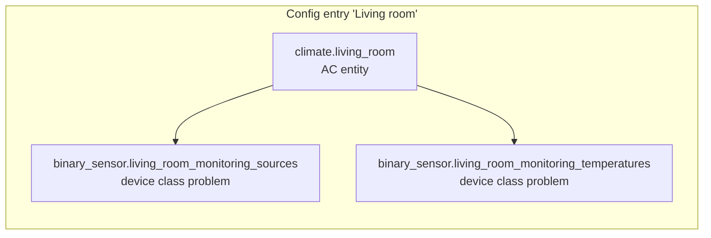

| Entity | Role | Detail |
|---|---|---|
| `climate.<name>` | The AC entity. | §1.3, §2.2 |
| `binary_sensor.<name>_monitoring_sources` | On while the source devices do not respond or do not obey (device class problem). | §4.2 |
| `binary_sensor.<name>_monitoring_temperatures` | On while the temperature readings are not consistent (device class problem). | §4.3 |

- **MON-ENT-1** The two monitoring binary sensors are always available,
  even when the AC entity or its sources are not: they report on them.

### 2.2 Attributes of the AC entity

Standard attributes of a Home Assistant `climate` entity:

| Attribute | Content | Detail |
|---|---|---|
| `hvac_mode` | The current mode; unknown in `WAITING(m)`. | §1.3.2 |
| `hvac_modes` | `off` and the configured modes. | ENT-HVAC-1 |
| `hvac_action` | The action of the active source (`None` when it has none). | ENT-ON-1, ENT-ON-2 |
| `current_temperature` | The reference temperature. | §1.3.5.1 |
| `temperature`, `target_temp_low`, `target_temp_high` | The temperature targets shown by the current mode. | §1.3.4.3, ENT-TGT-11 |
| `min_temp`, `max_temp` | The range shown. | ENT-RANGE-2 |
| `target_temp_step` | The step of the entity. | ENT-STEP-1 |
| `fan_mode(s)`, `swing_mode(s)`, `swing_horizontal_mode(s)` | The fan and swing options and values. | §1.3.4.6, §1.3.5.4 |

Extra attributes:

| Attribute | Content | Detail |
|---|---|---|
| `active_entity_id` | The active source, or `None`. | §1.3.1 |
| `mode_entity_ids` | `{mode: source}`, as configured. | §3.1.2 |
| `unavailable_modes` | The modes listed but not available. | ENT-HVAC-4 |
| `foreign_modes` | `{source: mode}` of the sources running a mode they do not serve. | ENT-STATE-5 |
| `saved_targets` | The three temperature targets, as kept. | ENT-TGT-1 |
| `saved_settings` | The fan and swing values remembered for each mode (not recorded in the history). | ENT-FANV-1 |
| `target_gaps` | The temperature targets shown otherwise than they are kept. | ENT-TGT-13 |

The attributes of the monitoring sensors are in §4.

### 2.3 Home Assistant versions

- **ENT-HA-1** The entities work with Home Assistant before and after
  2026.11. From 2026.11, Home Assistant reads the temperature properties
  of a `climate` entity under new names (`native_temperature_unit`,
  `native_current_temperature`, `native_target_temperature`,
  `native_target_temperature_low`, `native_target_temperature_high`);
  before, it reads them without `native_`. The AC entity provides both.
- **ENT-HA-2** The tests run on a version before 2026.11 and on a version
  from 2026.11, so that both paths are checked.

<a id="3-configuration-new"></a>

## 3. Configuration

### 3.1 Configuration parameters

- **CFG-UNIT-1** The temperature options are in the unit of Home
  Assistant: a *temperature* is a value on the scale, a *temperature
  gap* is a difference (offset, hysteresis, gap). The tables give their
  bounds and defaults in °C, with the °F value in parentheses: the gap
  times 1.8, rounded to the whole °F (as the step, §1.3.4.4).

#### 3.1.1 General

| Option | Type | Default | Effect |
|---|---|---|---|
| `name` | string, unique | — | Title of the entry, and name of the AC entity (the monitoring sensors are named after it, §2.1). In YAML, it identifies the entry (§3.2). |


#### 3.1.2 Modes

| Option | Type | Default | Effect |
|---|---|---|---|
| `heat_entity` | `climate.*` | none | Source entity of the `heat` mode. |
| `cool_entity` | `climate.*` | none | Source entity of the `cool` mode. |
| `heat_cool_entity` | `climate.*` | none | Source entity of the `heat_cool` mode (mono-source). |
| `auto_entity` | `climate.*` | none | Source entity of the `auto` mode. |
| `dry_entity` | `climate.*` | none | Source entity of the `dry` mode. |
| `fan_only_entity` | `climate.*` | none | Source entity of the `fan_only` mode. |

Declaring `heat_entity` and `cool_entity` gives a **bi-source**
`heat_cool` mode, unless `heat_cool_entity` is also declared: `heat_cool`
is then mono-source, with that source (§1.3.3.1).

- **CFG-MODE-1** A source entity can serve several modes, in one entry
  or in several; its options must then be consistent (CFG-SENS-2,
  CFG-SENS-3).
- **CFG-MODE-2** A source entity cannot be an AC entity (an entity
  created by Adaptative Climate, of this entry or of another): such a
  configuration is refused.

#### 3.1.3 Temperature sensor

| Option | Type | Default | Effect |
|---|---|---|---|
| `temperature_sensor` | `sensor.*` | none | Reference temperature: read by the entity (`temperature@T`, §1.1.2), its changes sent as `TStAC_temperature`, converted to the unit of Home Assistant. Without it, the readings of the sources are used. |
| `heat_offset` | temperature gap, -10 to 10 °C (-18 to 18 °F) | 0 | Offset of the source of the `heat` mode. |
| `cool_offset` | temperature gap, -10 to 10 °C (-18 to 18 °F) | 0 | Offset of the source of the `cool` mode. |
| `heat_cool_offset` | temperature gap, -10 to 10 °C (-18 to 18 °F) | 0 | Offset of the source of the `heat_cool` mode (no effect when bi-source, CFG-SENS-1). |
| `auto_offset` | temperature gap, -10 to 10 °C (-18 to 18 °F) | 0 | Offset of the source of the `auto` mode. |
| `dry_offset` | temperature gap, -10 to 10 °C (-18 to 18 °F) | 0 | Offset of the source of the `dry` mode. |
| `fan_only_offset` | temperature gap, -10 to 10 °C (-18 to 18 °F) | 0 | Offset of the source of the `fan_only` mode. |
| `heat_external_sensor` | `number.*` / `input_number.*` | none | External temperature input of the source of the `heat` mode (§1.3.5.2). Needs `temperature_sensor`. |
| `cool_external_sensor` | `number.*` / `input_number.*` | none | External temperature input of the source of the `cool` mode (§1.3.5.2). Needs `temperature_sensor`. |
| `heat_cool_external_sensor` | `number.*` / `input_number.*` | none | External temperature input of the source of the `heat_cool` mode (§1.3.5.2). Needs `temperature_sensor`. No effect when bi-source (CFG-SENS-1). |
| `auto_external_sensor` | `number.*` / `input_number.*` | none | External temperature input of the source of the `auto` mode (§1.3.5.2). Needs `temperature_sensor`. |
| `dry_external_sensor` | `number.*` / `input_number.*` | none | External temperature input of the source of the `dry` mode (§1.3.5.2). Needs `temperature_sensor`. |
| `fan_only_external_sensor` | `number.*` / `input_number.*` | none | External temperature input of the source of the `fan_only` mode (§1.3.5.2). Needs `temperature_sensor`. |
| `phase_hysteresis` | temperature gap, ≥ 0 | 1 °C (2 °F) | Bi-source mode: margin beyond a temperature target before the phase switches (ENT-WANT-3), to avoid short cycles. 0: switch as soon as the temperature target is passed. |

Offset (`<mode>_offset`): how much warmer than the reference temperature
the source of that mode reads (negative: colder). A reading of that
source minus the offset is a reference temperature; a temperature target sent to it
is the temperature target plus the offset. The offset is set per mode,
but a source entity has only one: the modes it serves must have the same
offset (CFG-SENS-2). An external sensor forces it to 0 (§1.3.5.2).

External sensor (`<mode>_external_sensor`): some source devices can
regulate with an external temperature (a thermostatic valve with an
"external temperature" number entity, a thermostat following a probe).
That entity gets the reference temperature, so the source regulates on
it. It needs `temperature_sensor` (a configuration without it is
refused), and the offset of that mode is then 0. It is set per mode,
but a source entity has only one: the modes it serves must have the
same (CFG-SENS-2).

- **CFG-SENS-1** `<mode>_offset` and `<mode>_external_sensor` act on the
  source entity of the mode (`<mode>_entity`). For a mode without its own
  source entity, they have no effect: a mode not configured, or a
  bi-source `heat_cool`, whose phases use the options of `heat` and
  `cool` (the source serves `heat` or `cool`, ENT-REF-5).
- **CFG-SENS-2** The options of a source entity must be consistent: it
  has one external sensor and one offset, whatever the mode.
  - The modes it serves must have the same `<mode>_external_sensor`, or
    none of them.
  - Without external sensor, they must have the same `<mode>_offset`.
    With one, the offset is 0 for all of them (§1.3.5.2).

  A configuration that breaks it is refused, with an error naming the
  modes. The modes without their own source entity are not counted
  (CFG-SENS-1). Why: a source entity has one thermometer and one
  external input, and its readings and targets must not depend on the
  mode it is read in (a source `OFF` is in no mode).
- **CFG-SENS-3** The same holds between entries: a source entity
  declared in several entries must have the same external sensor (or
  none) and, without one, the same offset in all of them. A
  configuration that breaks it is refused, with an error naming the
  other entry and its modes. Not handled: two entries with different
  `temperature_sensor` then each write their own value to that external
  sensor (ENT-EXT-1). No real use case: two entries sharing a source
  entity already fight over its mode and settings.

#### 3.1.4 Timers and durations

| Option | Type / range | Default | Effect |
|---|---|---|---|
| `capability_rem_confirmation` | seconds, ≥ 0 | 60 | How long a capability no longer shown by a source entity is kept before it is removed (SRC-DATA-10). 0: removed at once. |
| `request_confirmation_timer` | seconds, > 0 | 30 | How long a source waits for its source entity to show the state asked before the monitoring reports it out of sync (§1.2.4). |
| `settle_timer` | seconds, > 0 | 12 | After the source entity enters a mode asked, how long the settings it shows are ignored (§1.2.4, §1.2.5). 12 s by default: integrations that poll their device usually refresh right after a command, then at most every 10 s (Home Assistant debounce of refresh requests); a value reported late by the device arrives within that time, plus a margin. |
| `external_sensor_resend` | seconds, > 0 | 900 | How often the value of the temperature sensor is written again to the external sensors, even unchanged (ENT-EXT-4). 15 min by default: a margin for devices that need an update at least every 30 min, without loading battery devices. |
| `request_retry_timer` | seconds, ≥ `request_confirmation_timer` | 300 | How long a source waits, after a request confirmation timed out, before sending the state asked again (§1.2.4). |

- **CFG-TIMER-1** `request_retry_timer` must be greater than or equal to
  `request_confirmation_timer`: a configuration that breaks it is refused.
- **CFG-TIMER-2** Fixed durations, not configurable: they are internal
  margins, with no use to tune per installation.

  | Duration | Value | Rule | Why |
  |---|---|---|---|
  | Send retry timer | 5 s | SRC-SET-7 | A failed call is often a short error (device busy, network): one retry soon after; the resync covers a longer one. |
  | Resync timer | 30 min | SRC-SET-8 | Background check: catches a lost command or a device back to its own value, without loading the devices. |
  | Minimum delay of a setting not applied | 30 s | MON-SRC-4 | A device may take that long to show a setting: below it, `monitoring_duration` would report normal delays. |

#### 3.1.5 Monitoring

| Option | Type / range | Default | Effect |
|---|---|---|---|
| `monitoring_gap` | temperature gap, > 0 | 2 °C (4 °F) | Largest gap between two temperature readings before it is a problem (MON-TEMP-1). |
| `monitoring_duration` | seconds, ≥ 0 | 900 | How long a problem lasts before the monitoring reports it (MON-SRC-1, MON-SRC-4, MON-SRC-5, MON-TEMP-1, MON-TEMP-4; 30 s at least for a setting not shown). 0: at once. |

#### 3.1.6 Temperature limits and gap

| Option | Type | Default | Effect |
|---|---|---|---|
| `min_temp` | temperature | none | Lowest temperature of the entity: narrows the range of the sources (ENT-RANGE-3). |
| `max_temp` | temperature | none | Highest temperature of the entity: narrows the range of the sources (ENT-RANGE-3). |
| `min_gap` | temperature gap, ≥ 1 °C (2 °F) | 1 °C (2 °F) | Smallest gap between the low and high targets (ENT-TGT-5). |

- **CFG-LIM-1** `min_temp` must be lower than `max_temp`: a configuration
  that breaks it is refused.

#### 3.1.7 Fan and swing

| Option | Type | Default | Effect |
|---|---|---|---|
| `sync_modes` | list of modes | empty | The modes listed share their fan and swing values: a fan speed chosen in one of them is used in the others (ENT-FAN-6). A mode listed without a source is ignored; a bi-source `heat_cool` listed is reported (ENT-FAN-7). |
| `bi_source_sync` | boolean | off | Bi-source `heat_cool` only: its two phases share their fan and swing values, and show the options offered by both (ENT-FAN-8). |

### 3.2 YAML

The entries can also be declared in `configuration.yaml`:

```yaml
adaptative_climate:
  - name: Living room
    heat_entity: climate.heater
    cool_entity: climate.air_conditioner
    temperature_sensor: sensor.living_room_temperature
```

- **CFG-YAML-1** Each YAML entry is imported as a config entry when Home
  Assistant starts. The options are those of §3.1.
- **CFG-YAML-2** The `name` identifies the entry, so it must be unique in
  the YAML: two entries with the same name are refused.
- **CFG-YAML-3** YAML wins over the UI:
  - an entry changed in the YAML is updated;
  - an entry removed from the YAML is deleted;
  - an imported entry has no options in the UI (they would be
    overwritten by the YAML).
- **CFG-YAML-4** The entries created from the UI are not affected by the
  YAML. Their options flow saves every option at once: the options
  replace the whole configuration of the entry.
- **CFG-YAML-5** The same checks apply to the YAML and to the UI (§3.1); an
  invalid YAML entry is not imported, and the error is logged.

<a id="4-monitoring-new"></a>

## 4. Monitoring

### 4.1 Monitoring sensors

The monitoring uses two binary sensors (§2.1), grouped by what the user
has to do when one turns on:

| Binary sensor | Device class | Groups | What to do |
|---|---|---|---|
| `binary_sensor.<name>_monitoring_sources` | problem | The source devices do not respond or do not obey: source unusable, source not discovered, mode not followed, setting not applied (§4.2). | Check the device: connection, integration, state. |
| `binary_sensor.<name>_monitoring_temperatures` | problem | The temperature readings are not consistent: gaps between the sensor and the sources, or between sources; sensor without valid value (§4.3). | Set the offsets, move or repair the sensor. |

- **MON-SENS-1** A sensor is on while at least one of its problems is
  reported (§4.4).
- **MON-SENS-2** Attributes of both sensors:
  - `problems`: one entry per problem reported, with its type and what it
    is about (source, setting, temperatures, gap);
  - `max_gap` (`monitoring_temperatures` only): the value of
    `monitoring_gap`.
- **MON-SENS-3** Each problem keeps its own delay before it is reported,
  given in §4.2 and §4.3.

### 4.2 Sources (`monitoring_sources`)

| Problem | Up (reported) | Down |
|---|---|---|
| Source unusable (per source, MON-SRC-1) | a source of the stored mode is `UNUSABLE`, for `monitoring_duration` (§3.1.5) | the source is usable again, or the stored mode no longer uses it |
| Source not discovered (per source, MON-SRC-5) | the source is `UNDISCOVERED` for `monitoring_duration` (§3.1.5), whatever the stored mode | the source is discovered (SRC-STATE-8) |
| Source out of sync (per source, MON-SRC-3) | timeout of a request confirmation: the source entity does not show the state asked after `request_confirmation_timer` (SRC-REQ-6) | the source entity shows the state asked; or the retries stop: new request, `SEtS_unavailable` / `SEtS_unknown`, change of the source entity during the retry wait (SRC-REQ-8) |
| Setting not applied (per source and setting, MON-SRC-4) | the source entity in `ON(m)` shows another setting (temperature target, fan, swing) than the one sent, outside the settle time and the request confirmation, for `monitoring_duration` (§3.1.5, 900 s by default, 30 s at least) | the source entity shows the setting sent |

- **MON-SRC-1** Source unusable: reported after `monitoring_duration`
  while the stored mode is not `off` and a source of that mode is
  `UNUSABLE`. The delay absorbs a source entity loaded after the
  integration when Home Assistant starts, and short outages of a device
  (Wi-Fi, cloud): the state is already shown meanwhile (`WAITING(m)`,
  `unavailable_modes`). The sources reported:
  - the source of the current mode, in `WAITING(m)`;
  - either phase source of a bi-source `heat_cool` (`WAITING_PHASE(p)`,
    or the other phase source);
  - the `UNUSABLE` sources of the stored mode, in `NO_SOURCE` (none if
    it is `off`, MON-SRC-2).
- **MON-SRC-2** Source unusable is never reported while the stored mode is
  `off`. The monitoring only reports a source that is in the way:
  - in `OFF`, the entity asks nothing of its sources, so a source
    `UNUSABLE` blocks nothing. It is only met when its mode is asked:
    the request is refused, and the mode is listed in
    `unavailable_modes` (ENT-HVAC-4);
  - a device unplugged for the season (a radiator in summer, an AC at
    the breaker in winter) is normal: reported in `OFF`, it would keep
    `monitoring_sources` on for months, and the sensor would no longer
    mean anything;
  - for the same reason, in `ON(m)` only the sources of `m` are
    reported (MON-SRC-1).
- **MON-SRC-3** Source out of sync:
  - reported at the first timeout of a request confirmation where the
    source entity does not show the state asked (SRC-REQ-6);
  - it stays reported during the retries (every `request_retry_timer`);
  - it ends on every exit of the confirmation or of the retry wait: the
    source entity shows the state asked, a new request (a new
    confirmation starts, and the problem is reported again at its
    timeout if needed), `SEtS_unavailable` / `SEtS_unknown`, or a change
    of the source entity during the retry wait (followed as a takeover).
- **MON-SRC-4** Setting not applied: the source entity shows another
  setting (temperature target, fan, swing) than the one sent to it
  (§1.2.5), and it is not a takeover. Reported after `monitoring_duration`
  (30 s at least: a device may take that long to show it). It ends when
  the source entity shows the setting sent.
- **MON-SRC-5** Source not discovered: a source that stays `UNDISCOVERED`
  (§1.2.3.2) for `monitoring_duration` is reported, whatever the stored
  mode (in `OFF` too, unlike MON-SRC-2). Its source entity was never seen
  usable: it is more likely a configuration error (wrong entity id,
  integration missing or not loaded) than a device away for a while. The
  delay lets a source entity loaded after the integration be discovered
  without a report. It ends when the source is discovered.

### 4.3 Temperatures (`monitoring_temperatures`)

| Problem | Up (reported) | Down |
|---|---|---|
| Gap between the sensor and a source (per reading, MON-TEMP-1) | the temperature sensor and a source reading differ by more than `monitoring_gap`, for `monitoring_duration` (§3.1.5) | the gap is back below `monitoring_gap` |
| Gap between two sources (per pair of readings, MON-TEMP-1) | two readings of different source entities differ by more than `monitoring_gap`, for `monitoring_duration` | the gap is back below `monitoring_gap` |
| Sensor without valid value (MON-TEMP-4) | `temperature_sensor` is configured and has no valid value (`unavailable`, `unknown`, not a number) for `monitoring_duration` | the sensor has a valid value again |

- **MON-TEMP-1** Temperature gaps: a source that does not read the
  reference temperature keeps the room away from the temperature target.
  The monitoring compares the temperature sensor (`temperature@T`)
  with each source reading, and the readings of two **different** source
  entities with each other. A gap is reported when it stays above
  `monitoring_gap` for `monitoring_duration`, and ends when it is back
  below.
- **MON-TEMP-2** Readings compared:
  - each source entity gives one reading: its current temperature
    (`temperature@S`) minus its offset (§3.1.3; the same for all the
    modes it serves, CFG-SENS-2). A well set offset clears the problem;
  - a source `UNUSABLE`, or without current temperature, gives no
    reading.
- **MON-TEMP-3** The readings of sources that are `OFF` are compared too.
- **MON-TEMP-4** Sensor without valid value: reported when
  `temperature_sensor` (§3.1.3) has no valid value (`temperature@T`
  `None`: `TStAC_temperature(None)`, or already at `HAtAC_start`) for
  `monitoring_duration`. It ends as soon as the sensor has one again.
  Meanwhile, the external sensors are not written (ENT-EXT-5), and the
  reference temperature comes from the sources (ENT-REF-2).
- **MON-TEMP-5** The values are read from the data (`temperature@T`,
  `temperature@S`), at `HAtAC_start` and again on every event that can change
  them (`TStAC_temperature`, `StAC_temperature`, a source that becomes
  available or `UNUSABLE`), as for the reference temperature (ENT-REF-7).
  A value that does not change is compared from `HAtAC_start`.

### 4.4 Problem lifecycle, logs and events

One machine per problem (per source, setting, reading...).
`M_condition_true` / `M_condition_false`: the condition of the problem
(column "Up" of §4.2, §4.3) becomes true / false, evaluated by the
monitoring on the events it follows. `M_delay_timeout`: end of the delay
timer, the delay of the problem (`monitoring_duration`, or at once).

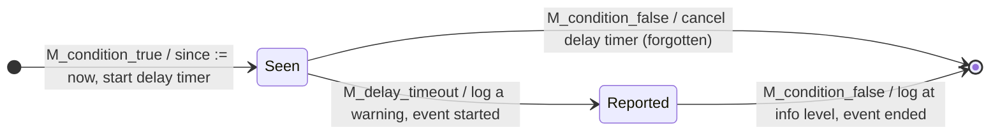

- **MON-LIFE-1** A problem is reported once it lasted its delay (§4.2,
  §4.3). A problem that goes away starts again from zero when it comes
  back, and after a restart.
- **MON-LIFE-2** When a problem is reported, a warning is logged, and an
  `adaptative_climate_problem` event is fired with `status: started`. When
  it ends, it is logged at info level, and the event is fired with
  `status: ended`.
- **MON-LIFE-3** Event data: `entry_id`, `name`, `entity_id` (the
  monitoring sensor of the problem), `status`, `message` (as logged),
  `problem` (as in the `problems` attribute). Automations can use it to
  send notifications.
