# Adaptative Climate — Specification

Status: **draft**. Baseline written from the README and the code, then
amended. The code will follow the spec once agreed.

Conventions:

- Part I rules are named `<SCOPE>-<SECTION>-<n>` (`SRC-DATA-3`,
  `ENT-INIT-1`...), Part II rules keep their old names (`G-1`, `S-3`...),
  so we can refer to them. A rule is what the integration **must** do.
- ❓ **Q-n**: open question, to be decided. Current behavior is described.
- ⚠ marks a current behavior I believe is a bug or a hole.
- ✅ **resolved**: a question closed by a decision.
- Diagrams are Mermaid (rendered by GitHub and the VS Code Markdown preview
  with the Mermaid extension).

# Part I — New spec

Filled step by step, on request only.

## Table of contents

- [0. Glossary](#0-glossary-new)
- [1. Overall behavior](#1-overall-behavior-new)
  - [1.1 Introduction](#11-introduction)
    - [1.1.1 Overview](#111-overview)
    - [1.1.2 Events exchanged](#112-events-exchanged)
  - [1.2 Source behavior](#12-source-behavior)
    - [1.2.1 Events](#121-events)
    - [1.2.2 Stored data management](#122-stored-data-management)
    - [1.2.3 Mode management: state machine](#123-mode-management-state-machine)
    - [1.2.4 Request confirmation](#124-request-confirmation)
    - [1.2.5 UNDISCOVERED state](#125-undiscovered-state)
    - [1.2.6 OFF state](#126-off-state)
    - [1.2.7 ON(m) state](#127-onm-state)
    - [1.2.8 UNUSABLE](#128-unusable)
    - [1.2.9 Settings request](#129-settings-request)
  - [1.3 Entity behavior](#13-entity-behavior)
    - [1.3.1 Events](#131-events)
    - [1.3.2 State management: state machine](#132-state-management-state-machine)
    - [1.3.3 INIT state](#133-init-state)
    - [1.3.4 OFF state](#134-off-state)
    - [1.3.5 ON(m) state](#135-onm-state)
    - [1.3.6 WAITING(m) state](#136-waitingm-state)
    - [1.3.7 NO_SOURCE state](#137-no_source-state)
    - [1.3.8 Capabilities management](#138-capabilities-management)
    - [1.3.9 Settings management](#139-settings-management)
- [2. Configuration](#2-configuration-new)
- [3. Monitoring](#3-monitoring-new)

<a id="0-glossary-new"></a>

## 0. Glossary

| Term | Meaning |
|---|---|
| **Entity** | The Adaptative Climate `climate` entity (one per config entry). |
| **Source entity** | A `climate` entity of Home Assistant configured for a mode (`<mode>_entity`). One source entity can serve several modes. |
| **Source** | The local object that follows one source entity: its stored data (§1.2.2) and its state machine (§1.2.3). One per source entity. |
| **Served modes** | The modes of the entity a source entity is configured for. Known by the entity only. |
| **Usable** | A source entity that exists in Home Assistant and whose state is not `unavailable` / `unknown`. |
| **Capability** | A capability attribute of a source entity (Home Assistant `capability_attributes` of `climate`), or `supported_features`, kept by the source (§1.2.2). Managed: `hvac_modes` (per source); `supported_features`, `min_temp`, `max_temp`, `target_temp_step`, `fan_modes`, `swing_modes`, `swing_horizontal_modes` (per source and mode). Not managed for now: `min_humidity`, `max_humidity`, `target_humidity_step`, `preset_modes`. |
| **Request** | The entity asks a source entity for a mode (or `off`). |

Diagram notation: UML state diagrams, transitions written
`event [guard] / activity`.

<a id="1-overall-behavior-new"></a>

## 1. Overall behavior

### 1.1 Introduction

#### 1.1.1 Overview

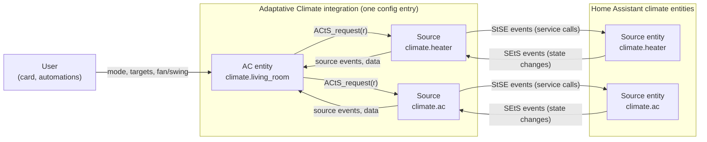

- **AC entity**: the Adaptative Climate `climate` entity seen by the user.
  It decides the mode and drives its sources (§1.3).
- **Source**: one local object per source entity (§1.2). It follows its
  source entity, stores its data, and carries out the requests of the AC
  entity. The AC entity never talks to a source entity directly.
- **Source entity**: a `climate` entity of Home Assistant (heater, AC,
  heat pump...), configured for one or more modes of the AC entity.

#### 1.1.2 Events exchanged

Between the user and the AC entity:

| Event | Direction | Meaning |
|---|---|---|
| `UtAC_set_mode(m)` | user → AC entity | The user asks for the mode `m` (`off` included): card, `set_hvac_mode`, `turn_on` (last mode), `turn_off`. |
| `UtAC_set_settings(s)` | user → AC entity | The user sets settings `s`: targets (`set_temperature`), fan, swing, horizontal swing. |

Between the AC entity and a source:

| Event | Direction | Meaning |
|---|---|---|
| `ACtS_request(r)` | AC entity → source | Put the source entity in `r` (an HVAC mode, or `off`). |
| `ACtS_settings(s)` | AC entity → source | Settings `s` (targets, fan/swing) for the source entity (§1.2.9). |
| `StAC_settings(s)` | source → AC entity | Settings `s` changed on the source entity (takeover), outside a request confirmation and `SETTLE(m)` (§1.2.9). |
| `StAC_undiscovered` | source → AC entity | The source enters `UNDISCOVERED`. |
| `StAC_off` | source → AC entity | The source enters `OFF`. |
| `StAC_on(m)` | source → AC entity | The source enters `ON(m)`. |
| `StAC_unusable` | source → AC entity | The source enters `UNUSABLE`. |
| `StAC_usable` | source → AC entity | The source leaves `UNUSABLE` (it goes back to its stored state, which the AC entity already knows). |
| data | AC entity reads the source | The stored data of the source (capabilities), read when needed, whatever the state of the source. |

Between a source and its source entity:

| Event | Direction | Meaning |
|---|---|---|
| `StSE_set_hvac_mode(r)` | source → source entity | Service call `climate.set_hvac_mode` carrying out a request. |
| `StSE_set_temperature(t)`, `StSE_set_fan_mode(f)`, `StSE_set_swing_mode(w)`, `StSE_set_swing_horizontal_mode(h)` | source → source entity | Service calls carrying out a settings request (§1.2.9). |
| `SEtS_off`, `SEtS_on(m)`, `SEtS_unavailable`, `SEtS_unknown`, `SEtS_attributes` | source entity → source | Changes of the source entity (§1.2.1). |

Settings (targets, fan/swing): §1.2.9.

### 1.2 Source behavior

A source has two functions:

- **stored data management** (§1.2.2): permanent, it does not depend on
  the state of the source;
- **mode management** (§1.2.3 to §1.2.8): the state machine of the
  source. Its state is a **local** state, kept in sync with the source
  entity; it is not the state of the source entity itself.

#### 1.2.1 Events

| Event | Meaning |
|---|---|
| `start` | The config entry is set up (HA start, entry reload). |
| `restored` | The first restore of the stored data is done (§1.2.2). |
| `data_available` | The data of a source becomes available: restored or read at start (SRC-DATA-4), or read later (SRC-DATA-6). |
| `SEtS_off` | The source entity changed to `off`. |
| `SEtS_on(m)` | The source entity changed to the HVAC mode `m`. |
| `SEtS_unavailable` | The source entity changed to `unavailable`, or was removed from Home Assistant. |
| `SEtS_unknown` | The source entity changed to `unknown`. |
| `SEtS_attributes` | Only attributes of the source entity changed (its state stays the same). |
| `ACtS_request(r)` | The entity asks the source entity for `r` (an HVAC mode, or `off`). |
| `ACtS_settings(s)` | The entity gives the settings `s` (targets, fan/swing) for the source entity (§1.2.9). |

#### 1.2.2 Stored data management

##### 1.2.2.1 Stored data

Stored data of a source, saved across restarts:

| Data | Kept per | Content |
|---|---|---|
| State | source | The last usable state: `OFF` or `ON(m)`. Never `UNDISCOVERED` / `UNUSABLE`. Written by the mode management. |
| `hvac_modes` | source | The HVAC modes of the source entity. The same whatever its mode. |
| Mode capabilities | (source, mode) | `supported_features`, `min_temp`, `max_temp`, `target_temp_step`, `fan_modes`, `swing_modes`, `swing_horizontal_modes`, as last read **while the source entity was in that mode**. |
| `low_high_seen` | (source, mode) | The source entity has shown numeric `target_temp_low` / `target_temp_high` once while in that mode. Never cleared. |

- **SRC-DATA-1** The mode capabilities are **discovered** as the modes are
  used: those of a mode are read only while the source entity runs in it
  (source state `ON(m)`). A mode of `hvac_modes` with no stored
  capabilities (never run) gets the Home Assistant defaults:

  | Capability | Default |
  |---|---|
  | `supported_features` | 0: no target, no fan, no swing |
  | `min_temp` / `max_temp` | 7 °C / 35 °C, converted to the unit of Home Assistant |
  | `target_temp_step` | none |
  | `fan_modes`, `swing_modes`, `swing_horizontal_modes` | none |
  | `low_high_seen` | no |

- **SRC-DATA-2** Nothing is read for `off` (useless).
- **SRC-DATA-3** The data is **available** once `hvac_modes` is known
  (restored or read). Mode capabilities may still be missing: Home
  Assistant defaults (SRC-DATA-1).
- What the entity does with a mode not discovered yet: ENT-CAP-2 to ENT-CAP-5
  (§1.3).

##### 1.2.2.2 Restore (at `start`):

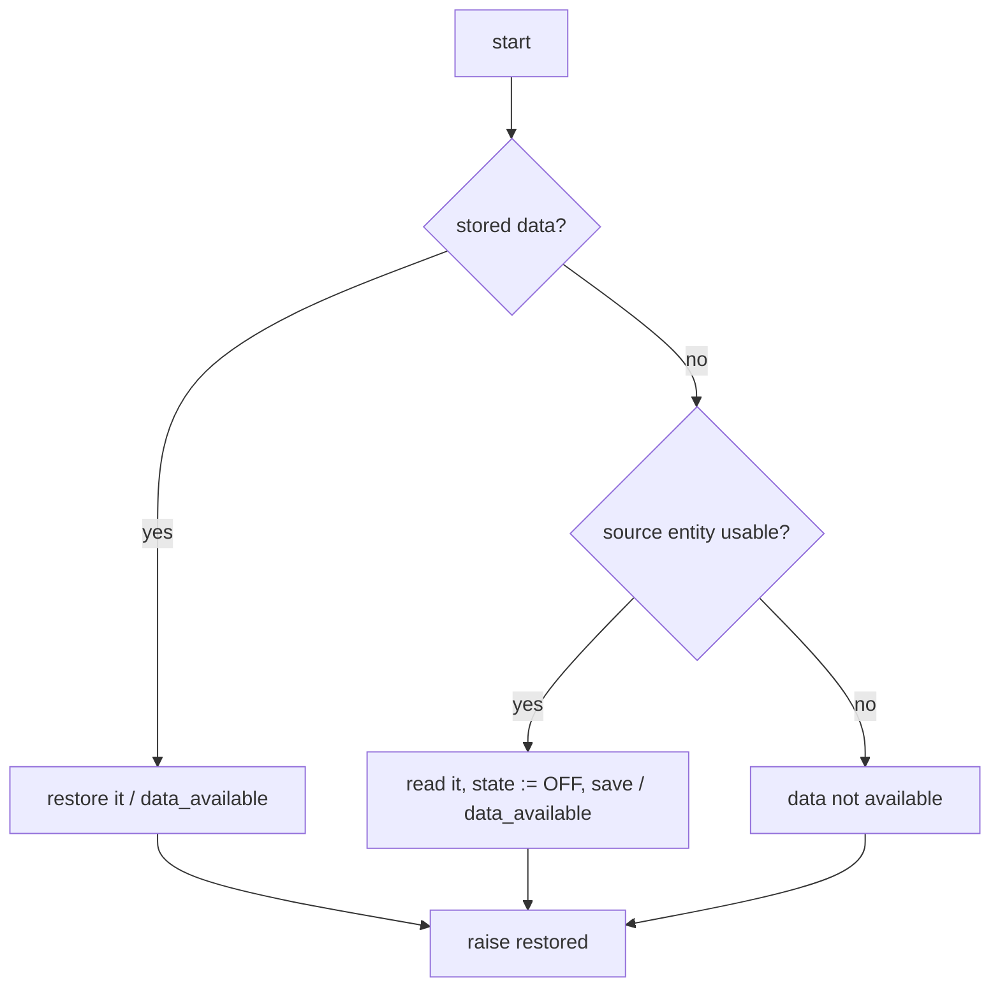

- **SRC-DATA-4** At `start`, the stored data is read. 
  - Without stored data, the
  source entity is read (`hvac_modes`, and the mode capabilities if it
  runs in a mode), and the stored state is set to `OFF`: the source was
  never used, so it starts from a clean state (its entry turns the
  source entity off if it runs, SRC-MODE-2).
  - If it cannot be read (not usable), the data is not
  available. 
  - Data restored or read raises `data_available`. The end of
  this first restore raises `restored`.
- **SRC-DATA-5** A stored value that is not valid (corrupted) is dropped; the
  other stored data is restored.

##### 1.2.2.3 Update (on each change of the source entity):

- **SRC-DATA-6** On every change of a usable source entity (`SEtS_off`,
  `SEtS_on(m)`, `SEtS_attributes`):
  - data not available yet → it is read and saved: data available
    (`data_available`);
  - `hvac_modes` is read again;
  - if the source entity runs in a mode `m`, the capabilities of `m`
    are read again;
  - each value read is compared with the stored one:
    - no change → nothing; 
    - a new or updated value that removes nothing (a first value, a new number, a list with more items) → stored and saved at once; 
    - a value no longer shown (attribute missing or `None`), or a list that lost items (`fan_modes` without `turbo`) → removal confirmation (below).
- **SRC-DATA-7** A source entity that is not usable is not read: the stored
  data stays as it is.
- **SRC-DATA-8** `low_high_seen` of mode `m` is set when numeric low/high
  values are shown while the source entity runs in `m`. It is never
  removed.
- **SRC-DATA-9** Only the configured source entities keep their data: a
  source entity removed from the configuration loses it.

`change` in this diagram: `SEtS_off`, `SEtS_on(m)` or `SEtS_attributes`.

**Removal confirmation** (one per value no longer shown or list that lost
items: `hvac_modes`, or a capability of a mode):

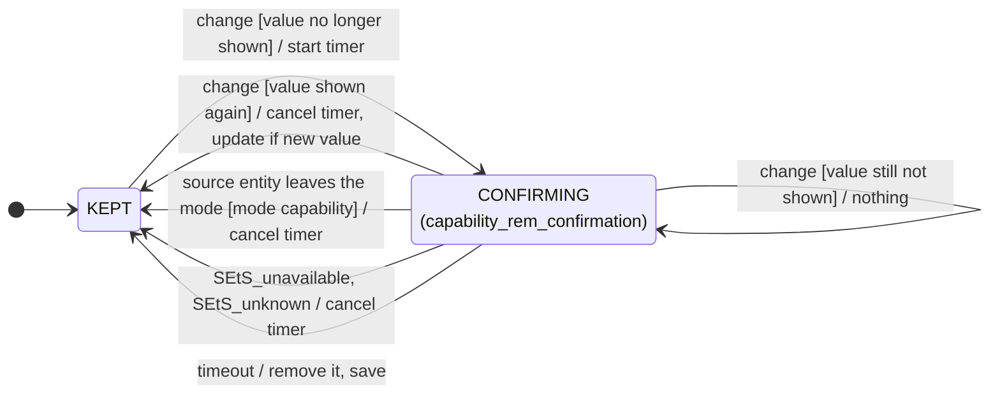

- **SRC-DATA-10** A value no longer shown, or a list that lost items, is kept
  as it is for `capability_rem_confirmation` (§2, 60 s by default). The
  timer is cancelled when the full value is shown again; other changes of
  the source entity (room temperature...) let it run. At the end of the
  timer, the value is removed (or replaced by the shorter list now shown)
  and the data is saved.
- **SRC-DATA-11** A capability of mode `m` is only judged while the source
  entity runs in `m`: the source entity leaving `m` cancels its timer.
  The source entity becoming not usable cancels every timer (SRC-DATA-7).

#### 1.2.3 Mode management: state machine

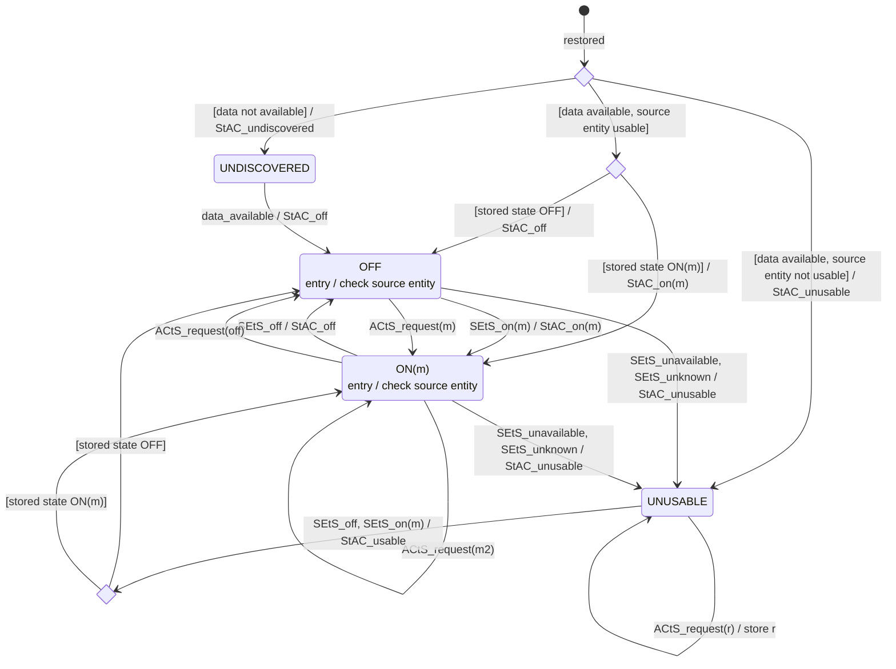

"check source entity" (entry of `OFF` and `ON(m)`): if the source entity
does not show the state (`off`, or `m`), the state is sent to it and the
request confirmation starts (§1.2.4).

- **SRC-MODE-1** After `start`, the source waits for the end of the first
  restore (`restored`), then:
  - data not available → `UNDISCOVERED`, reported to the entity;
  - data available and source entity not usable → `UNUSABLE`,
    reported to the entity;
  - data available and source entity usable → the stored state (`OFF`
    when the data was read from the source entity, SRC-DATA-4), reported to
    the entity (`OFF` or `ON(m)`).
- **SRC-MODE-2** On entry of `OFF` or `ON(m)`, however it is entered (request,
  restore, back from `UNUSABLE`), the state is compared with the source
  entity: if it differs, the state is sent to the source entity and the
  request confirmation starts (§1.2.4). Entered from a change of the
  source entity, it is the same: nothing is sent.
- **SRC-MODE-3** In `OFF` or `ON(m)`, a request from the entity 
  - moves the state
  at once to the state asked (`ON(m)` or `OFF`); 
  - its entry sends it
  (SRC-MODE-2). 
  - `ON(m)` → `ON(m2)` is a new entry. 
  - No `StAC_` event is sent:
  the entity asked for it. A `StAC_off` / `StAC_on(m)` always means a
  change made on the source entity, never the result of a request.
- **SRC-MODE-4** In `UNUSABLE`, a request from the entity is stored as the
  stored state; nothing is sent.
- **SRC-MODE-5** In `OFF` or `ON(m)`, a change of the source entity
  (`SEtS_off`, `SEtS_on(m)`) moves the state, and the new state is reported to the entity.
  During a request confirmation, these changes are handled by the
  confirmation (§1.2.4) and do not reach the state machine.
- **SRC-MODE-6** In `OFF` or `ON(m)`, `SEtS_unavailable` or `SEtS_unknown` always moves the source to
  `UNUSABLE`, even during a request confirmation, which ends (the state
  asked stays the stored state, sent again on return: SRC-MODE-7). Reported to
  the entity.
- **SRC-MODE-7** In `UNUSABLE`, the source entity back (`SEtS_off` or `SEtS_on(m)`)
  moves the source to the **stored** state, not to the state shown; the
  entry of that state sends it if needed (SRC-MODE-2). The entity gets only
  `StAC_usable`: the stored state is the one it already knows.
- **SRC-MODE-8** In `UNDISCOVERED`, no request is made (the entity refuses the mode
  before). When the data becomes available, the source goes to `OFF`,
  reported to the entity; its entry turns the source entity off if it
  runs (SRC-MODE-2).
- **SRC-MODE-9** Every change of state is saved as the stored state (except
  `UNDISCOVERED` / `UNUSABLE`, which keep the last usable one).
- **SRC-MODE-10** Resynchronization: at start, and when the source entity comes
  back from unavailable, **Home Assistant wins**: the stored state is sent
  to the source entity (SRC-MODE-2, SRC-MODE-7), whatever was changed on the device
  meanwhile. At start, everything is resynchronized (several sources left
  on would give odd effects); after unavailability, there was a problem,
  so everything is resynchronized when it ends. The source entity has the
  upper hand (takeover) only in nominal operation: `OFF` / `ON(m)`,
  outside a request confirmation (SRC-MODE-5).

#### 1.2.4 Request confirmation

Runs in parallel with the state machine of §1.2.3. `send(r)` is the
entry check of `OFF` / `ON(m)` sending `r` to the source entity (SRC-MODE-2).
It works the same way to turn a source entity on in a mode (`r` = `m`)
and to turn it off (`r` = `off`).

`monitoring up` raises the problem "source out of sync" of this source
(MON-GEN-1); `monitoring down` clears it (nothing to do if it is not raised).

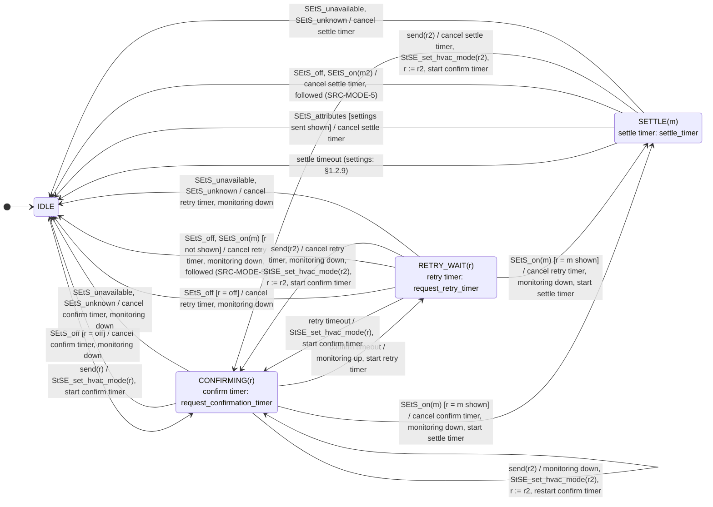

- **SRC-REQ-1** During the confirmation, the changes of the source entity
  that do not show `r` are ignored: a device may still show its previous
  mode, or go through `off`, before showing the mode asked. Cloud devices
  may take a while. Exception: `SEtS_unavailable` / `SEtS_unknown` ends the confirmation
  (SRC-MODE-6).
- **SRC-REQ-2** The source entity showing `r` ends the confirmation: the
  source is in the state asked. When `r` is a mode (`ON(m)`), the source
  enters `SETTLE(m)`: the settings (targets, fan/swing) are sent and, for
  `settle_timer` (§2, 12 s by default), the settings shown by the source
  entity are ignored
  (§1.2.9, SRC-SET-5).
- **SRC-REQ-3** `SETTLE(m)` 
  - ends 
    - at the end of the settle timer, 
    - or earlier
  when the source entity shows the settings sent. 
  - It also stops (settle
  timer cancelled) 
    - when the source leaves `m`: a change of the source
  entity (`SEtS_off`, `SEtS_on(m2)`, followed: SRC-MODE-5), 
    - a new request
  (a new confirmation starts), 
    - or `SEtS_unavailable` / `SEtS_unknown`.
- **SRC-REQ-4** The call to the source entity fails: the error is logged;
  the confirmation goes on until its timeout (SRC-REQ-6).
- **SRC-REQ-5** A new send (new request) during the confirmation or the
  retry wait replaces the previous one: the state confirmed becomes the
  new one (`r := r2`), and a new confirmation starts.
- **SRC-REQ-6** Timeout of the confirmation while the source entity does not
  show `r` (call failed, or the device did not follow): the monitoring
  reports the source entity out of sync (MON-GEN-1), and the source waits
  `request_retry_timer` (§2, 5 min by default: retry wait).
- **SRC-REQ-7** At the end of the retry wait, `r` is sent again and a new
  confirmation (`request_confirmation_timer`, §2, 30 s by default) starts, with
  the same behavior. This goes on every `request_retry_timer` as long as the
  source entity does not show `r`.
- **SRC-REQ-8** The confirmation and the retries stop only when the source
  entity shows `r`, or when the source leaves the state that started them
  (new request: SRC-REQ-5; `SEtS_unavailable` / `SEtS_unknown`: SRC-MODE-6; change of the source entity
  during the retry wait: SRC-REQ-9).
- **SRC-REQ-9** During the retry wait, the source entity is master: a change
  of the source entity to another state than `r` (remote, app) stops the
  retries and is followed as a takeover (SRC-MODE-5): the state moves and is
  reported to the entity.

#### 1.2.5 UNDISCOVERED state

The data of the source is not available.

- The first usable change of the source entity makes the data available
  (SRC-DATA-6): `data_available` moves the source to `OFF` (SRC-MODE-8).
- **SRC-UNDISC-1** The source offers nothing: no capability (the entity does
  not count it for the step, uses Home Assistant default ranges 7–35 °C,
  no options), no HVAC mode (its modes are not judged as offered or not).

#### 1.2.6 OFF state

The source entity is off.

- Settings: see §1.2.9.

#### 1.2.7 ON(m) state

The source entity runs in `m`, any HVAC mode other than `off`.

- **SRC-ON-1** The source does not know which modes the entity uses it for:
  `ON(m)` is just the HVAC mode of the source entity. Whether `m` is a mode
  the source serves here (or a foreign mode) is decided by the entity.
- Settings: see §1.2.9.

#### 1.2.8 UNUSABLE state

The source entity is not usable (`unavailable`, `unknown`, or missing in
Home Assistant), but the data of the source is available.

- The stored data stays as it is (SRC-DATA-7): the entity keeps reading the
  capabilities of the source as they were when it was last usable.

#### 1.2.9 Settings request

Settings `s`: any of the targets (`temperature`, or `target_temp_low` and
`target_temp_high`, already computed by the entity: offset, step, range),
`fan_mode`, `swing_mode`, `swing_horizontal_mode`. Each one is sent with
its own service call (`StSE_set_temperature`, `StSE_set_fan_mode`,
`StSE_set_swing_mode`, `StSE_set_swing_horizontal_mode`). The settle time
comes from the request confirmation (`SETTLE(m)`, §1.2.4).

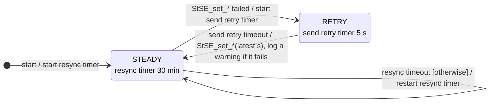

- **SRC-SET-1** The source keeps the last settings received
  (`ACtS_settings(s)`) for its current mode: settings depend on the mode.
  - When the mode of the source changes (`ACtS_request(r)` for another
  state, or a change of the source entity followed: `SEtS_off`,
  `SEtS_on(m2)`), the kept settings are **withdrawn**. 
  - After a request,
  the entity sends the settings of the new mode (`ACtS_settings(s)`).
  - In `UNUSABLE`, they are kept, unless a request for another state is
  received: the state asked is stored (SRC-MODE-4) and the kept settings are
  withdrawn, as for any mode change.
- **SRC-SET-2** In `ON(m)` outside a request confirmation, a settings request
  is sent to the source entity at once, except the settings it already
  shows. Low and high targets go together.
- **SRC-SET-3** In `OFF`, `UNDISCOVERED`, `UNUSABLE`, and during a request
  confirmation (`CONFIRMING`, `RETRY_WAIT`), nothing is sent: the
  settings are kept, and sent when the source enters `SETTLE(m)`.
- **SRC-SET-4** Fan and swing values are matched to the options of the source
  entity in that mode ignoring case, and sent as the source entity spells
  them. A value it does not offer is not sent.
- **SRC-SET-5** On entry of `SETTLE(m)` (§1.2.4), the kept settings the
  source entity does not show are sent. During `SETTLE(m)`, the settings
  shown by the source entity are ignored (a device may report its own
  values for the mode a few seconds later). 
- **SET-x** At the end of the settle
  timer, if the source entity showed other settings meanwhile, the kept
  settings are sent again; if it showed nothing, nothing is sent. Known
  limitation: a source entity already at the settings gets nothing, so
  nothing ends `SETTLE(m)` early: its settings are ignored for the full
  `settle_timer`.
- **SRC-SET-6** Retry on error: a call that fails is tried again **once**,
  5 s later, with the settings of that time. If it fails again, a warning
  is logged. Only a call error triggers it, not a source entity that
  accepts the call without applying the setting.
- **SRC-SET-7** Resync: the resync timer runs all the time (started at
  `start`, restarted at each timeout). Every 30 minutes, the settings the source entity does
  not show (compared with those sent) are sent again (a command lost by
  the device, a device back to its own value without telling).
- **SRC-SET-8** Monitoring: a setting sent and not shown by the source entity
  is a problem (MON-GEN-2). Not judged during `SETTLE(m)` or a request
  confirmation.
- **SRC-SET-9** Setting not applied (the source entity accepts the call, or
  fails, and its value **does not change**): the source keeps the setting
  received from the entity, which stays the reference (Home Assistant wins). It is sent
  again (SRC-SET-6, SRC-SET-7) and the monitoring reports it (MON-GEN-2). Nothing is
  sent to the entity: its setting is unchanged.
- **SRC-SET-10** Takeover (a value of the source entity **changes** to another
  value than the one sent: remote, app): in `ON(m)`, outside a request
  confirmation and `SETTLE(m)`, the source keeps the new value as its
  setting and sends `StAC_settings(s)` (the settings changed) to the
  entity, which adopts them. During a confirmation or `SETTLE(m)`, such
  changes are ignored (SRC-REQ-1, SRC-SET-5). After a mode change made on the
  source entity (`SEtS_on(m)` followed, SRC-MODE-5), the source sends its
  current settings at once (`StAC_settings(s)`, the settings shown by the
  source entity in `m`): the entity adopts them (the source wins).
- How the entity computes the targets (offsets, steps, ranges) and
  remembers fan/swing per mode: to be specified (Part II §4, §5).

### 1.3 Entity behavior

The AC entity has three functions:

- **state management** (§1.3.2 to §1.3.7): its own state machine, which
  drives the sources;
- **capabilities management** (§1.3.8): its capabilities, from those of
  its sources;
- **settings management** (§1.3.9): targets and fan/swing settings.

#### 1.3.1 Events

| Event | Direction | Meaning |
|---|---|---|
| `UtAC_set_mode(m)` | user → AC entity | The user asks for the mode `m` (`off` included): card, `set_hvac_mode`, `turn_on` (last mode), `turn_off`. |
| `UtAC_set_settings(s)` | user → AC entity | The user sets settings `s`: targets (`set_temperature`), fan, swing, horizontal swing. |
| `StAC_undiscovered`, `StAC_off`, `StAC_on(m)`, `StAC_unusable`, `StAC_usable`, `StAC_settings(s)` | source → AC entity | See §1.1.2. Each one comes from one source. |
| `ACtS_request(r)`, `ACtS_settings(s)` | AC entity → source | See §1.1.2. |

Words used below:

- **source of `m`**: the source configured for the mode `m` of the
  entity;
- **active source**: the source of the current mode;
- **available source**: a source in `OFF` or `ON(x)` (not `UNDISCOVERED`, not
  `UNUSABLE`);
- **served / foreign**: `StAC_on(x)` from a source `S` is **served** when
  `S` is the source of the mode `x` of the entity, **foreign** otherwise
  (a heater set to `fan_only` on its remote).

#### 1.3.2 State management: state machine

Activities on the transitions:

| Activity | What is sent |
|---|---|
| `apply(m)` | To the source of `m`: `ACtS_request(m)` (the phase for combined heat/cool) and `ACtS_settings(s)` (the settings of `m`, §1.3.9).<br> To every other source not `OFF` (`UNUSABLE` included): `ACtS_request(off)`. |
| `apply(off)` | To every source not `OFF` (`UNUSABLE` included): `ACtS_request(off)`. |
| `follow(S)` | Takeover by `S` in a **served** mode only. To every source not `OFF` other than `S` (`UNUSABLE` included): `ACtS_request(off)`. Nothing to `S`. |

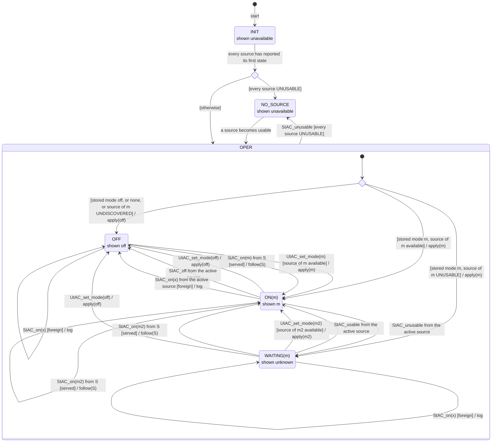

- **ENT-MODE-1** The entity stores its mode (`off` or `m`), saved across
  restarts. `INIT` and `NO_SOURCE` keep it.
- **ENT-MODE-2** **A change asked by the user** (`UtAC_set_mode`) is sent to
  the sources (`apply`). **A change coming from a source** (`StAC_`) is
  followed, and nothing is sent to that source: the source wins
  (takeover). The other sources are still turned off (`follow`).
- **ENT-MODE-3** A user mode change goes to the mode asked if its source is
  available (`OFF` or `ON`). `off` is always accepted. Otherwise it is
  refused with an error.
- **ENT-MODE-4** A source mode change:
  - `StAC_on(x)` **served**: takeover, the entity goes to `ON(x)` and
    turns the other sources off (`follow`);
  - `StAC_on(x)` **foreign** from the currently active source (it left
    its mode for a foreign one): the entity goes `OFF`; nothing is sent
    to any source (the source keeps running);
  - `StAC_on(x)` **foreign** from any other source: nothing happens
    (logged, listed in the `foreign_modes` attribute);
  - `StAC_off` from the active source: the entity goes `OFF`.
- **ENT-MODE-5** Main states: `INIT`, `OPER` (sub-states `OFF`, `ON(m)`,
  `WAITING(m)`) and `NO_SOURCE`. Entering `OPER` goes through the choice
  `resume`. `every source UNUSABLE` leaves `OPER` for `NO_SOURCE`, whatever
  the sub-state, and wins over the other transitions.
- **ENT-MODE-6** Combined heat/cool (heat and cool sources, no `heat_cool`
  source): to be specified.

#### 1.3.3 INIT state

- **ENT-INIT-1** At `start`, the entity waits until every source has reported
  its first state (`StAC_undiscovered`, `StAC_off`, `StAC_on(m)` or
  `StAC_unusable`, SRC-MODE-1); a source in `UNDISCOVERED` counts. It then goes
  to its stored mode if it can, else `OFF` (choice `resume`), and
  resynchronizes the sources (`apply`).
- **ENT-INIT-2** Stored mode `m` whose source is `UNDISCOVERED`: `OFF`. The source
  is seen for the first time; a stored mode whose source is unknown only
  happens after a configuration change with persistent data, which is not
  recommended.
- **ENT-INIT-3** Shows: the entity is **unavailable** (no mode, no action, no
  target, no setting).

#### 1.3.4 OFF state

Every source is asked to be off.

- **ENT-OFF-1** Shows: the entity is available; `hvac_mode` `off`;
  `hvac_action` `off`. Capabilities and settings shown: §1.3.8, §1.3.9.

#### 1.3.5 ON(m) state

The source of `m` runs `m`; every other source is asked to be off.

- **ENT-ON-1** Shows: the entity is available; `hvac_mode` `m`;
  `hvac_action` read from the active source (the phase source for
  combined heat/cool). Capabilities and settings shown: those of `m`
  (§1.3.8, §1.3.9).

#### 1.3.6 WAITING(m) state

The source of the current mode `m` is `UNUSABLE`; the mode is kept.

- Entered on `StAC_unusable` from the active source.
- Left when the source is back (`StAC_usable` → `ON(m)`: the source
  resynchronizes itself, SRC-MODE-7; its settings are kept, SRC-SET-1), when the
  user asks for another mode, or on a takeover by another source.
- **ENT-WAIT-1** Shows: the entity is available; `hvac_mode` unknown
  (`None`); `hvac_action` unknown (`None`). Capabilities and settings
  shown: those of `m`, as last known (§1.3.8, §1.3.9). The
  `source_unavailable` sensor tells which source is away.

#### 1.3.7 NO_SOURCE state

Every source is `UNUSABLE`.

- **ENT-NOSRC-1** Shows: the entity is **unavailable** (no mode, no action, no
  target, no setting). The stored mode is kept for the return.

- Left as soon as a source becomes available (choice `resume`): stored
  mode `off` → `OFF`; source of `m` available → `ON(m)`; otherwise
  `WAITING(m)`. The sources are resynchronized (`apply`).
- **ENT-NOSRC-2** No user event in `NO_SOURCE` (nor in `INIT`): Home
  Assistant does not call a service on an unavailable entity (the call
  is skipped without error, also from an automation).

#### 1.3.8 Capabilities management

- **ENT-CAP-1** The entity reads the capabilities of its sources (§1.2.2) and
  defines its own from them (modes, range, step, features, options),
  whatever the state of the sources.

**Mode not discovered yet** (its source never ran in it, SRC-DATA-1):

- **ENT-CAP-2** The mode is offered when its source offers it (`hvac_modes`):
  the entity can switch to it.
- **ENT-CAP-3** Before its first activation, the mode has no capability: the
  entity shows no target and no fan/swing for it, and the Home Assistant
  default range (7–35 °C). What the user sets for it meanwhile (targets,
  fan/swing) is kept, not sent.
- **ENT-CAP-4** On activation, only the mode is sent to the source: no target
  and no fan/swing, since what the source accepts in that mode is not
  known. The entity never sends a value taken from the capabilities of
  another mode.
- **ENT-CAP-5** At the first update of the source in that mode, its
  capabilities are discovered (SRC-DATA-6); the kept targets and fan/swing
  settings are then sent, within those capabilities (range, step,
  options). Until then the source runs with its own settings, within the
  settle time.

#### 1.3.9 Settings management

- **ENT-SET-1** `UtAC_set_settings(s)`: the settings are kept by the entity
  for the current mode (for `next_mode` when off), and sent to the active
  source in `ON(m)` (`ACtS_settings(s)`).
- **ENT-SET-2** `StAC_settings(s)` from the active source (takeover of a
  setting, or of the mode: SRC-SET-10): the entity adopts them.
- The settings kept per mode, the targets (offsets, steps, ranges, gap)
  and fan/swing memory: to be specified (Part II §4, §5).

<a id="2-configuration-new"></a>

## 2. Configuration

| Option | Type / range | Default | Effect |
|---|---|---|---|
| `capability_rem_confirmation` | seconds, ≥ 0 | 60 | How long a capability no longer shown by a source entity is kept before it is removed (SRC-DATA-10). 0: removed at once. |
| `request_confirmation_timer` | seconds, > 0 | 30 | How long a source waits for its source entity to show the state asked before the monitoring reports it out of sync (§1.2.4). |
| `monitoring_duration` | seconds, ≥ 0 | 900 | How long a problem lasts before the monitoring reports it (MON-GEN-2; 30 s at least for a setting not shown). 0: at once. |
| `settle_timer` | seconds, > 0 | 12 | After the source entity enters a mode asked, how long the settings it shows are ignored (§1.2.4, §1.2.9). 12 s by default: integrations that poll their device usually refresh right after a command, then at most every 10 s (Home Assistant debounce of refresh requests); a value reported late by the device arrives within that time, plus a margin. |
| `request_retry_timer` | seconds, ≥ `request_confirmation_timer` | 300 | How long a source waits, after a request confirmation timed out, before sending the state asked again (§1.2.4). |

- **CFG-GEN-1** `request_retry_timer` must be greater than or equal to
  `request_confirmation_timer`: a configuration that breaks it is refused.

<a id="3-monitoring-new"></a>

## 3. Monitoring

| Problem | Up (raised) | Down (cleared) |
|---|---|---|
| Setting not shown (per source and setting, MON-GEN-2) | the source entity in `ON(m)` shows another setting (target, fan, swing) than the one sent, outside the settle time and the request confirmation, for `monitoring_duration` (§2, 900 s by default, 30 s at least) | the source entity shows the setting sent |
| Source out of sync (per source) | timeout of a request confirmation: the source entity does not show the state asked after `request_confirmation_timer` (SRC-REQ-6) | the source entity shows the state asked; or the retries stop: new request, `SEtS_unavailable` / `SEtS_unknown`, change of the source entity during the retry wait (SRC-REQ-8) |

- **MON-GEN-1** Source out of sync: up at the first timeout of a request
  confirmation (§1.2.4), and stays up during the retries (every `request_retry_timer`).
  Down on every exit of the confirmation or the retry wait: the source
  entity shows the state asked, a new request (a new confirmation
  starts; up again at its timeout if needed), `SEtS_unavailable` / `SEtS_unknown`, or a change
  of the source entity during the retry wait (followed as a takeover).

- **MON-GEN-2** Setting not shown: the source entity shows another setting
  (target, fan, swing) than the one sent to it (§1.2.9), which is not a
  takeover. Up after `monitoring_duration` (30 s at least: a device may
  take that long to show it); down when the source entity shows the
  setting sent.
---

# Part II — Old spec

Elements are removed from here as they move to Part I: what is left is
still to be specified.

## Table of contents (old)

- [0. Glossary](#0-glossary-1)
  - [Timing constants](#timing-constants)
- [1. Overall behavior](#1-overall-behavior-1)
  - [1.1 Principles](#11-principles)
  - [1.3 Reconciliation: how a source update changes the stored mode](#13-reconciliation-how-a-source-update-changes-the-stored-mode)
  - [1.4 Event × state table](#14-event--state-table)
  - [1.5 Mode switch sequence](#15-mode-switch-sequence)
  - [1.6 Restart and reload](#16-restart-and-reload)
  - [1.7 Open questions — overall](#17-open-questions--overall)
- [2. Managed entities](#2-managed-entities)
  - [2.1 Configuration](#21-configuration)
  - [2.2 Entities created per entry](#22-entities-created-per-entry)
  - [2.3 Climate entity](#23-climate-entity)
  - [2.4 Binary sensors](#24-binary-sensors)
  - [2.5 Other outputs](#25-other-outputs)
- [3. Management of sources](#3-management-of-sources)
  - [3.1 Roles](#31-roles)
  - [3.2 Reading a source](#32-reading-a-source)
  - [3.4 Low/high detection](#34-lowhigh-detection)
  - [3.5 Mode offered by its source](#35-mode-offered-by-its-source)
  - [3.6 Exclusivity](#36-exclusivity)
  - [3.7 Active source away](#37-active-source-away)
  - [3.8 Commands and errors](#38-commands-and-errors)
- [4. Temperature management](#4-temperature-management)
  - [4.1 The three targets](#41-the-three-targets)
  - [4.2 Which target each mode uses](#42-which-target-each-mode-uses)
  - [4.3 Step](#43-step)
  - [4.4 Range and limits](#44-range-and-limits)
  - [4.5 Offset](#45-offset)
  - [4.6 First targets](#46-first-targets)
  - [4.7 Setting targets (user)](#47-setting-targets-user)
  - [4.8 Sending targets](#48-sending-targets)
  - [4.9 Following the active source](#49-following-the-active-source)
  - [4.10 What the entity shows](#410-what-the-entity-shows)
  - [4.11 Room temperature](#411-room-temperature)
  - [4.12 Combined heat/cool](#412-combined-heatcool)
  - [4.13 External sensor](#413-external-sensor)
- [5. Fan / swing management](#5-fan--swing-management)
  - [5.1 What is shown](#51-what-is-shown)
  - [5.2 Memory](#52-memory)
- [6. Monitoring](#6-monitoring)
  - [6.1 Monitoring sensor — problem kinds](#61-monitoring-sensor--problem-kinds)
  - [6.2 Temperature readings](#62-temperature-readings)
  - [6.3 Problem lifecycle](#63-problem-lifecycle)
  - [6.4 Target gap sensor](#64-target-gap-sensor)
  - [6.5 Source unavailable sensor](#65-source-unavailable-sensor)
- [7. Trash (what goes nowhere)](#7-trash-what-goes-nowhere)
- [8. Open questions index](#8-open-questions-index)

## 0. Glossary

| Term | Meaning |
|---|---|
| **Foreign mode** | A mode a source entity runs in but does not serve here (e.g. heater set to `fan_only` on its remote). |
| **Mode** | The HVAC mode of the entity: `off`, `heat`, `cool`, `heat_cool`, `auto`, `dry`, `fan_only`. **Stored** by the entity (G-1). |
| **Source mode** | The HVAC mode sent to a source. Equal to the mode, except in combined heat/cool where it is the **phase** (`heat` or `cool`). |
| **Running** | A usable source whose state is not `off`. |
| **Active source** | The source of the stored mode (the phase source in combined heat/cool). None when off. |
| **Expected source mode** | What the active source should show: the mode, or the phase. |
| **Away** | The active source is not usable. The mode is kept: entity state `UNKNOWN(m)`. |
| **Combined heat/cool** | `heat_cool` without `heat_cool_entity` but with heat and cool sources: runs one of them at a time (its **phase**, stored too). |
| **Takeover** | A change made directly on a source (remote, app) that the entity follows. The source wins. |
| **Room temperature** | `temperature_sensor` if set, else the reading of a source minus its offset. |

### Timing constants

| Name | Value | Used for |
|---|---|---|
| `SETTLE_TIME` | 12 s | Source targets ignored after entering a mode; wait for a new combined phase to show. |
| `SEND_RETRY` | 5 s | A failed `set_temperature` is tried again once. |
| `RESYNC_INTERVAL` | 30 min | Targets the active source does not show are sent again. |
| `TARGET_MIN_DURATION` | 30 s | Minimum duration before a target mismatch is a problem. |
| `EXTERNAL_SENSOR_MIN_INTERVAL` | 60 s | External sensor written at most this often. |
| `EXTERNAL_SENSOR_RESEND` | 30 min | External sensor written again even if unchanged. |
| `min_phase_duration` | 10 min (config) | Combined heat/cool holds a phase. |
| `monitoring_duration` | 15 min (config) | A temperature gap / target mismatch becomes a problem. |

---

## 1. Overall behavior

### 1.1 Principles

- **G-1 — The mode is stored.** The entity stores its mode (and the phase
  in combined heat/cool). It changes only through the transitions of §1.2:
  a user command, or a change seen on a source (§1.3). The sources are
  compared with it; they do not define it. It is saved across restarts.
- **G-2 — Exclusivity.** Only the active source runs. Every other running
  source is turned off. A source turned on elsewhere in a served mode
  first changes the stored mode (G-3), then exclusivity applies with it
  as the winner.
- **G-3 — The source has the upper hand.** A mode, target or fan/swing
  setting changed directly on a source is followed, even outside the
  entity's limits, and never pushed back.
- **G-4 — Targets and settings belong to the entity.** Switching mode keeps
  them; the source of the new mode receives them.
- **G-6 — Restart is transparent.** After a restart or a reload of the
  entry (options changed, YAML changed), the entity comes back in its
  stored mode, then reconciles with the sources (§1.6).

### 1.3 Reconciliation: how a source update changes the stored mode

> To be revised against §1.2 (step by step).

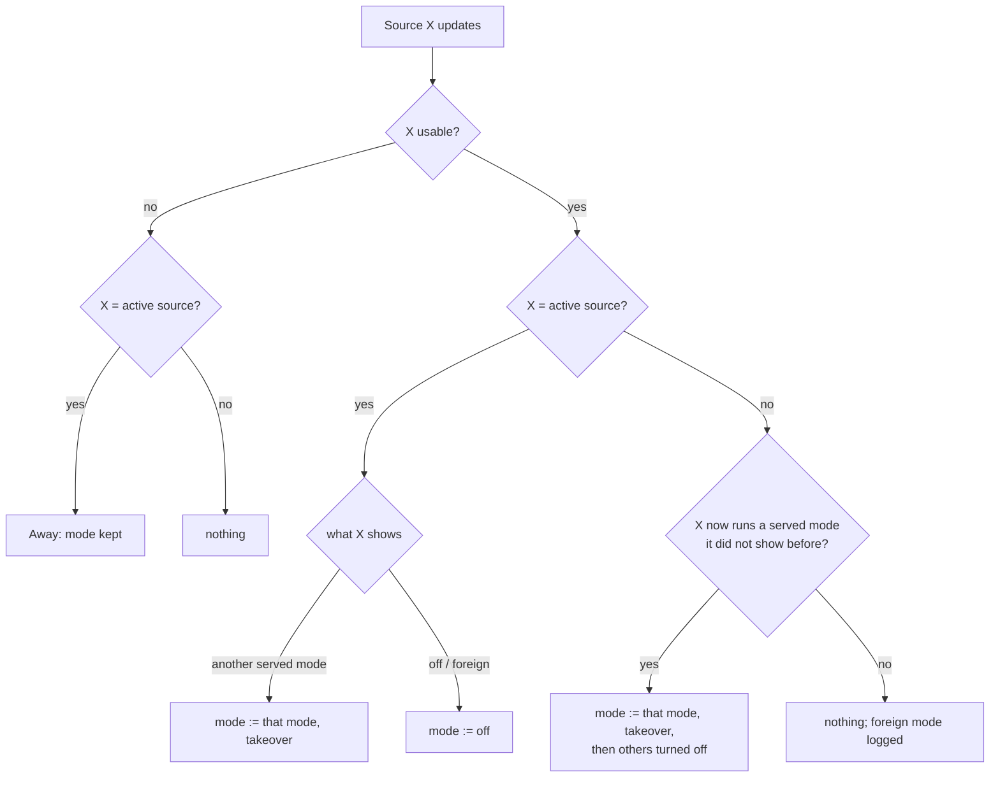

- **G-7** A takeover sets the stored mode, takes the targets and settings
  of the source (T-19, F-3), then applies exclusivity (G-2).
- **G-8** A source serving several modes: the stored mode becomes the mode
  equal to its HVAC state (an AC serving cool and dry switched to dry on
  its remote → `dry`).
- **G-9** In combined heat/cool, the phase source showing the **other**
  phase (a heat pump serving both, switched to cool on its remote while in
  phase heat) is "another served mode": HC ends, mode := `cool`.

### 1.4 Event × state table

> To be revised against §1.2 (step by step).

| Event | Off | On(m) | On(m), source away | Combined HC |
|---|---|---|---|---|
| `set_hvac_mode(m2)` | check m2, mode := m2, pending | same | same | leaves HC, same |
| `set_hvac_mode(off)` / `turn_off` | turn off any running source | mode := off, turn off all running | mode := off (the away source gets it on return, Part I SRC-MODE-4) | mode := off, turn off all |
| `turn_on` | → last used mode (Q-1) | nothing | nothing | nothing |
| `set_temperature` | stored for `next_mode` | stored + sent | stored, sent on return | stored + sent, may switch phase at once |
| Source X turned on elsewhere in a served mode | takeover → On | takeover, others off | takeover, away ends | takeover, HC ends |
| Active source changed elsewhere to another served mode | — | takeover | — | takeover, HC ends (G-9) |
| Active source turned off elsewhere | — | mode := off | — | mode := off |
| Active source to a foreign mode | — | mode := off, source keeps running, `foreign_modes` set | — | mode := off |
| Non-active source to a foreign mode | ignored, logged | ignored, logged | ignored | ignored |
| Active source unavailable | — | → away | — | phase source away, HC kept (T-33) |
| Non-active source unavailable | nothing | nothing | nothing | nothing; that phase cannot start while away |
| Active source back in expected mode | — | — | resume, gets targets + settings | resume |
| Active source back in another served mode | — | — | takeover | takeover, HC ends |
| Active source back off | — | — | mode := off | mode := off |
| HA restart | §1.6 | §1.6 | §1.6 | §1.6 |

### 1.5 Mode switch sequence

> To be revised against §1.2 (step by step).

```mermaid
sequenceDiagram
    actor U as User
    participant E as Entity
    participant N as New source
    participant O as Other sources
    U->>E: set_hvac_mode(m)
    E->>E: check m (sources usable, mode offered) else refuse, nothing changed
    E->>E: mode lock; mode := m
    E->>N: ACtS_request(m) (Part I §1.2.4: call, confirmation, retries, monitoring)
    E->>N: remembered fan / swing of m (errors logged only)
    E->>O: ACtS_request(off) to each other source
    E->>E: release lock
    Note over E,N: targets sent once the source shows m: to be specified
```

- **G-12** One mode change at a time (lock), phase switches included.

### 1.6 Restart and reload

> To be revised against §1.2 (step by step).

What is saved in the restore data of the climate entity:

| Data | Saved | Restored as |
|---|---|---|
| **Mode** (and combined phase) | ✅ | The stored mode, then reconciled (below). |
| Targets (single, low, high) | ✅ | Kept, then the gap is applied. |
| Fan/swing memory per mode (or `sync`) | ✅ | Kept, configured modes only. |
| `last_on_mode` (target of `turn_on`) | ❌ | Lost → first configured mode. ❓ Q-1 |
| Settle, phase hold | ❌ | Lost. |
| Monitoring problem timers | ❌ | Lost: durations restart from zero. |

Reconciliation at start, once the sources are read:

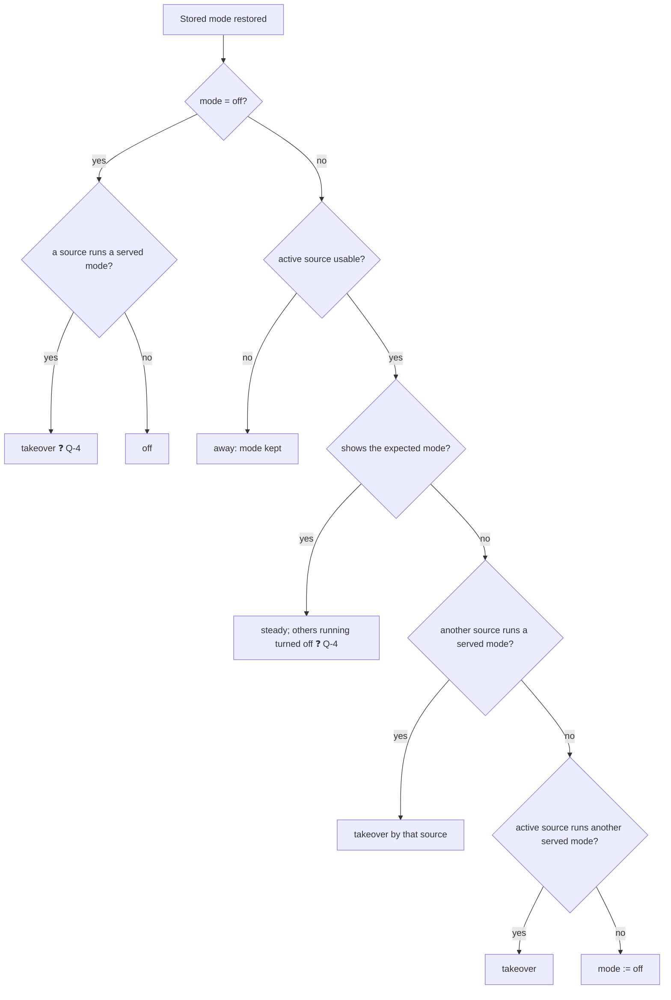

- **G-13** At start, the coordinator reads every source, records their
  capabilities, checks the modes offered (Repairs), logs foreign modes,
  reconciles the stored mode, applies exclusivity with the stored mode as
  winner, then listens for changes.
- **G-14** The external sensors are written at start (see T-35).
- **G-15** A reload of the entry (options flow, YAML change) is a restart.
  A stored mode no longer configured → `off`.

### 1.7 Open questions — overall

- ❓ **Q-1** `last_on_mode` is not saved: after a restart, `turn_on` goes
  to the first configured mode, and while off the entity shows the targets
  of that first mode (when it has no low/high). Save it?
- ✅ **Q-2 resolved by G-1**: at start with two sources running, the source
  of the stored mode wins and the other is turned off (G-13).
- ❓ **Q-4** At restart, the active source already in its mode: take its
  targets (today, as a takeover) or push the saved ones? With a stored
  mode, it is a continuation, not a takeover: pushing the saved targets
  (with settle) looks more consistent. Same question for a source running
  while the stored mode is off.
- ❓ **Q-5** Restored combined HC is not held (`min_phase_duration`): it
  may switch phase right after start. OK?
- ❓ **Q-15** The combined phase wait (12 s) and the request confirmation
  of the source (Part I §1.2.4) are the same thing (the entity asked a
  source for a mode). Use the request confirmation for both?
- ❓ **Q-19** Combined heat/cool with its phase source unavailable: today
  it stays `heat_cool` and the other phase may start. With the new
  states: `UNKNOWN(heat_cool)`, or `ON(heat_cool)` as long as the other
  phase source is available?

---

## 2. Managed entities

### 2.1 Configuration

| Option | Type / range | Default | Effect |
|---|---|---|---|
| `name` | string, unique | — | Entry title, entity name; identifies YAML entries. |
| `heat_entity`, `cool_entity`, `heat_cool_entity`, `auto_entity`, `dry_entity`, `fan_only_entity` | `climate.*` | none | Source of each mode. At least one. |
| `<mode>_offset` | -10..10 | 0 | How much warmer than the room the source of that mode reads. |
| `<mode>_external_sensor` | `number.*` / `input_number.*` | none | Gets the room temperature. Needs `temperature_sensor`. Forces the offset of that mode to 0. |
| `temperature_sensor` | `sensor.*` | none | Room temperature. |
| `sync_modes` | list of modes | [] | Modes sharing fan/swing settings (modes without source ignored). |
| `min_temp`, `max_temp` | float, min < max | none | Narrow the range (never widen). |
| `min_gap` | ≥ 1 | 1 | Gap between low and high targets. |
| `min_phase_duration` | ≥ 0 min | 10 | Combined HC phase hold. |
| `monitoring_gap` | > 0 | 2 | Temperature gap threshold. |

- **E-1 Validation** (UI and YAML): at least one source; a source cannot
  be an Adaptative Climate entity; a source that is loaded and usable must
  offer the mode it serves (not checked when unavailable/unknown); external
  sensor needs `temperature_sensor`; `min_temp < max_temp`; YAML names
  unique.
- **E-2 Derived:** combined HC = no `heat_cool_entity` but both
  `heat_entity` and `cool_entity`.

### 2.2 Entities created per entry

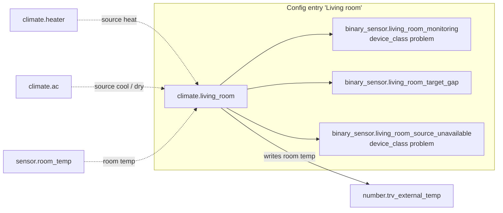

### 2.3 Climate entity

- **E-3 Modes offered:** `off` + every mode with a source + `heat_cool`
  when combined. A mode whose source is unavailable or does not offer it
  stays listed (see `unavailable_modes`).
- **E-4 Features:** `TURN_ON`, `TURN_OFF`; target features = union of what
  each configured mode uses (so they do not change with the mode); fan,
  swing, horizontal swing when at least one source (known) offers options.
  Other source features (presets, humidity...) are **not** exposed.
- **E-5 Availability:** available while at least one source is usable.

Properties per state:

| Property | Off | On(m) | On(m), source away | Combined HC |
|---|---|---|---|---|
| `hvac_mode` | `off` | m | `None` (unknown) | `heat_cool` |
| `hvac_action` | `off` | from active source | `None` | from phase source |
| `temperature` / `target_temp_low` / `target_temp_high` | low+high if the entity has low/high, else targets of `next_mode` | per mode (§4.2) | as m | low + high |
| `min_temp` / `max_temp` | widest of all sources | sources of m | sources of m (known) | widest of heat + cool |
| `target_temp_step` | entity step (§4.3) | same | same | same |
| `current_temperature` | sensor, else first usable source | sensor, else active source | sensor, else first usable source | sensor, else phase source |
| fan / swing options | shared options if every mode synced, else none | source of m | source of m (known) | phase source |
| fan / swing value | memory if every mode synced, else none | active source | memory of m | phase source |

Extra attributes:

| Attribute | Content |
|---|---|
| `active_entity_id` | Active source, or `None`. |
| `mode_entity_ids` | `{mode: source}` as configured. |
| `unavailable_modes` | Modes whose source is unavailable or does not offer the mode. |
| `foreign_modes` | `{source: mode}` of sources running a mode they do not serve. |
| `saved_targets` | `{temperature, target_temp_low, target_temp_high}` as kept (before offset and source step). |
| `saved_settings` | `{mode: {fan_mode, swing_mode, swing_horizontal_mode}}` (not recorded in history). |

### 2.4 Binary sensors

| Sensor | On when | Attributes | Detail |
|---|---|---|---|
| `_monitoring` | a problem lasted its duration | `max_gap`, `problems` | §6.1 |
| `_target_gap` | a shown target differs from the kept one | `gaps` | §6.4 |
| `_source_unavailable` | a source of the stored mode is unavailable (off: never) | `entity_ids` | §6.5 |

All three are always available.

### 2.5 Other outputs

- **E-6 Repairs issue** `<entry>_<mode>_not_supported` per mode whose
  source (known) does not offer it; removed when it does or on unload.
- **E-7 Event** `adaptative_climate_problem` on each problem start/end.
- **E-8 Logs:** warning on foreign mode (each entry into it and at start),
  unsupported mode, failed send after retry, problem start; info on
  problem end.

---

## 3. Management of sources

### 3.1 Roles

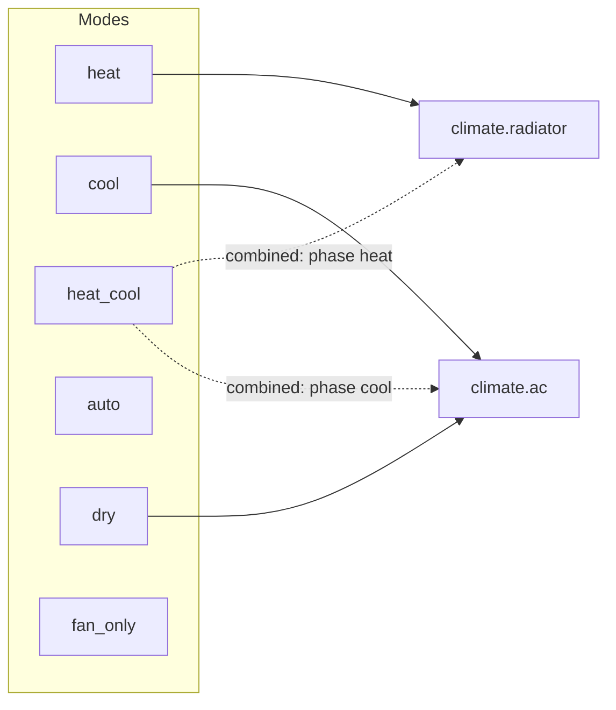

- **S-1** Each mode has at most one source. A source can serve several
  modes (`served_modes`). Switching to a mode sets its source to the HVAC
  mode of the same name (combined HC: the phase).
- **S-2** Combined HC has no source of its own: it uses the heat and cool
  sources (which can be the same heat pump).

### 3.2 Reading a source

- **S-4 Active source**: the source of the stored mode (the phase source
  in combined HC). Its state is compared with the expected source mode
  (§1.3); the state of the sources does not define the mode.
- **S-5 Foreign mode**: a source running a mode it does not serve. The
  entity does not follow it. A non-active source in a foreign mode keeps
  running. The active source going foreign sets the mode to off (§1.3). Listed in `foreign_modes`, warning logged. A mode change or
  `turn_off` of the entity still turns it off.

### 3.4 Low/high detection

- **S-9** A source "has low/high targets" when it has the
  `TARGET_TEMPERATURE_RANGE` feature **and**, if it also has
  `TARGET_TEMPERATURE`, it either offers `heat_cool` or has shown numeric
  `target_temp_low`/`target_temp_high` once (`low_high_seen`).
- **S-10** Known limitation of `low_high_seen` (Part I §1.1.1): a device
  replaced behind the same entity id keeps it; only cleared by deleting
  the entry.

### 3.5 Mode offered by its source

- **S-11** On every source update, each mode is checked against the known
  `hvac_modes` of its source. Not offered → Repairs issue, warning,
  listed in `unavailable_modes`, switching to it refused **before
  anything is changed**. A never-seen source is not judged.

### 3.6 Exclusivity

- **S-12** The winner is always the active source of the stored mode. A
  source turned on elsewhere becomes the winner by changing the stored
  mode first (G-7). Every other source gets `ACtS_request(off)`; failures
  are handled by the source (Part I §1.2.4: confirmation, retries,
  monitoring MON-GEN-1).

### 3.7 Active source away

- **S-15** The active source becomes unusable → the mode is kept, the
  source is **away** (combined HC: see T-33):
  - `hvac_mode` unknown (Part I ENT-WAIT-1), `hvac_action` unknown;
  - shows the targets, range, fan/swing options and remembered values of
    the mode (known capabilities);
  - targets and fan/swing set meanwhile are kept and sent on return.
- **S-16** End of away:

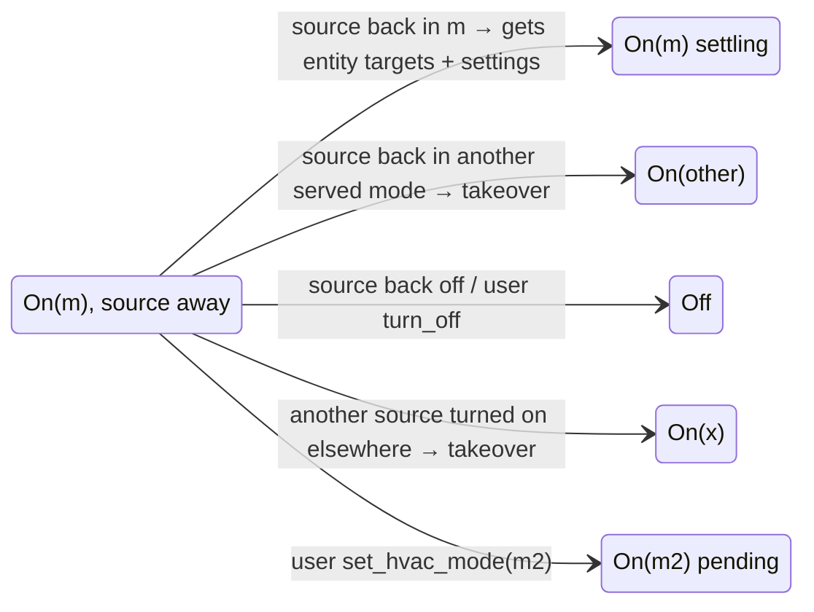

- **S-17** `turn_on` while away does nothing (the mode is on). Away
  survives a restart (the mode is stored, the source still unusable).
- **S-18** While off, an unavailable source changes nothing.

### 3.8 Commands and errors

- **S-19** Every call to a source is a blocking service call; any error is
  raised as `HomeAssistantError` to the caller.
- **S-20** Fan/swing restore fails → logged, mode change goes on.
  `set_temperature` fails → §4.8. Mode changes (turn on, turn off): Part I
  §1.2.4.

---

## 4. Temperature management

### 4.1 The three targets

The entity keeps three targets, in room temperature, on its own step:

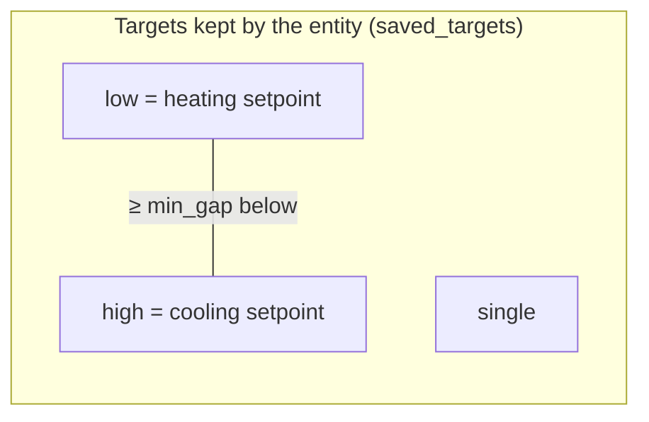

- **T-1** low and high are shared by heat, cool, heat/cool and auto with
  low/high. single is shared by dry and auto without low/high.
- **T-2** Targets are kept across restarts, and while off, in fan only,
  in a mode without target, while the source is away.

### 4.2 Which target each mode uses

| Mode | Source gets | Entity shows `temperature` | `target_temp_low` | `target_temp_high` |
|---|---|---|---|---|
| heat | `temperature` ← low | low | — | — |
| cool | `temperature` ← high | high | — | — |
| heat_cool (own source with low/high) | low, high | — | low | high |
| heat_cool (own source without low/high) | `temperature` ← single | single | — | — |
| heat_cool combined, phase heat | heat source `temperature` ← low | — | low | high |
| heat_cool combined, phase cool | cool source `temperature` ← high | — | low | high |
| auto, source with low/high | low, high | — | low | high |
| auto, source with single only | `temperature` ← single | single | — | — |
| auto / dry, source without target | nothing | — | — | — |
| dry, source with single | `temperature` ← single | single | — | — |
| fan_only | nothing | — | — | — |
| off, entity has low/high | — | — | low | high |
| off, entity has no low/high | — | as `next_mode` | as `next_mode` | as `next_mode` |

- ❓ **Q-8** heat_cool with its own source **without** low/high uses the
  single target (shared with dry/auto), not low/high. OK?

### 4.3 Step

- **T-3** Entity step = largest step every known source step is a multiple
  of (0.5 & 1 → 0.5; 0.5 & 0.2 → 0.1). A source without step counts as
  0.5 °C / 1 °F. No source known → that default.
- **T-4** Every target of the entity is on that step, whatever sets it.
  Each source gets the target rounded to **its own** step.

### 4.4 Range and limits

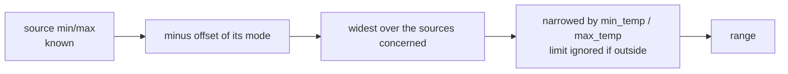

- **T-5** Range of the entity: sources of the stored mode (heat + cool for
  combined HC); off: all sources. No source range → 7–35 °C.
- **T-6** Each target is kept in the widest range of all the sources it
  goes to, in any mode (low: heat, HC/auto with low/high; high: cool, idem;
  single: dry, auto/HC without low/high). Example: heater 5–30 for heat,
  heat pump 18–30 for heat_cool, low 14 → kept 14, heat pump gets 18.
- **T-7** Limits apply to the room target (before the offset).

### 4.5 Offset

- **T-8** Source receives `target + offset(mode)`, rounded to its step, in
  its range. Anything read from it (targets, current temperature, ranges)
  is `value − offset(mode)`.
- **T-9** The offset belongs to the mode, not to the source entity.
- **T-10** A mode with an external sensor has offset 0.

### 4.6 First targets

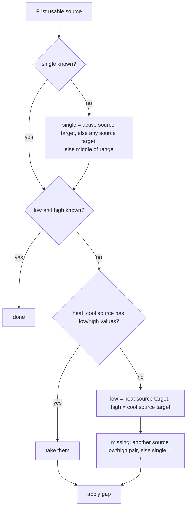

### 4.7 Setting targets (user)

- **T-11** `set_temperature(temperature)` sets low in heat, high in cool,
  single otherwise; off → the mode of `next_mode`. `target_temp_low/high`
  set low/high. With `hvac_mode`: targets are set for that mode, then the
  mode is switched.
- **T-12** Gap: low ≥ `min_gap` below high. The target just set stays, the
  other moves (outward, on step, in its range). If it cannot (range), the
  target just set gives way. Both set: high moves.
- **T-13** On: targets sent at once to the active source; combined HC may
  switch phase at once (ignores the hold).
- **T-14** The state is always written after a `set_temperature` (even
  unchanged), so the card drops the value it shows.

### 4.8 Sending targets

- **T-15** Sent only to the active source showing the expected mode, only
  the targets it has (feature), low and high together, nothing if it
  already shows them.
- **T-16** When: when a pending source shows the mode, at the end of the
  settle time if needed, on user change, on return from away, on resync.
- **T-17** Error → tried again once after 5 s with the targets of that
  time; error again → warning + target mismatch (monitoring).
- **T-18** Every 30 min, the targets the active source does not show
  (mismatches) are sent again. A target taken from the source is never
  overridden.

### 4.9 Following the active source

- **T-19** Mode entered by **takeover** (turned on elsewhere, or shown
  more than 30 s after the request): the source gives its targets.
- **T-20** Mode entered by the entity: settle time (§1.2). Source targets
  ignored, entity shows its own. Ends when the source shows the targets
  sent; at 12 s, resend only if the source showed other targets.
  Known limitation: a source already at the target receives nothing, so
  nothing confirms → full 12 s ignored (a remote change then is lost).
- **T-21** Steady: a target changed on the source becomes the entity
  target (`value − offset`, on entity step), even outside the entity
  limits. The other target moves to keep the gap; the taken one never
  gives way.
- **T-22** Off: source targets are ignored.

### 4.10 What the entity shows

- **T-23** A target the active source (even away) gets is shown clamped to
  **that source's** range (without limits). Others: widest range of the
  sources they go to (with limits), else the entity range.
- **T-24** A shown target differing from the kept one → `target_gap`
  sensor (§6.4).

### 4.11 Room temperature

- **T-25** `temperature_sensor` (converted to HA unit) when valid, else the
  `current_temperature − offset` of the active source, else of the first
  usable source.

### 4.12 Combined heat/cool

```mermaid
stateDiagram-v2
    direction LR
    state "Phase HEAT" as PH
    state "Phase COOL" as PC
    state "Phase wait (12 s) ❓ Q-15<br/>sources may show old phase" as PW
    state "Hold (min_phase_duration)" as HO
    [*] --> PW : enter HC → phase = wanted(entering)
    PW --> PH : heat source shows heat
    PW --> PC : cool source shows cool
    PH --> PW : room asks cool, not held (or user targets)
    PC --> PW : room asks heat, not held (or user targets)
    PH --> [*] : heat source off / other mode elsewhere
    PC --> [*] : cool source off / other mode elsewhere
    note right of HO : runs in parallel from each phase start;<br/>blocks automatic switches only
```

Phase choice (`wanted_phase`):

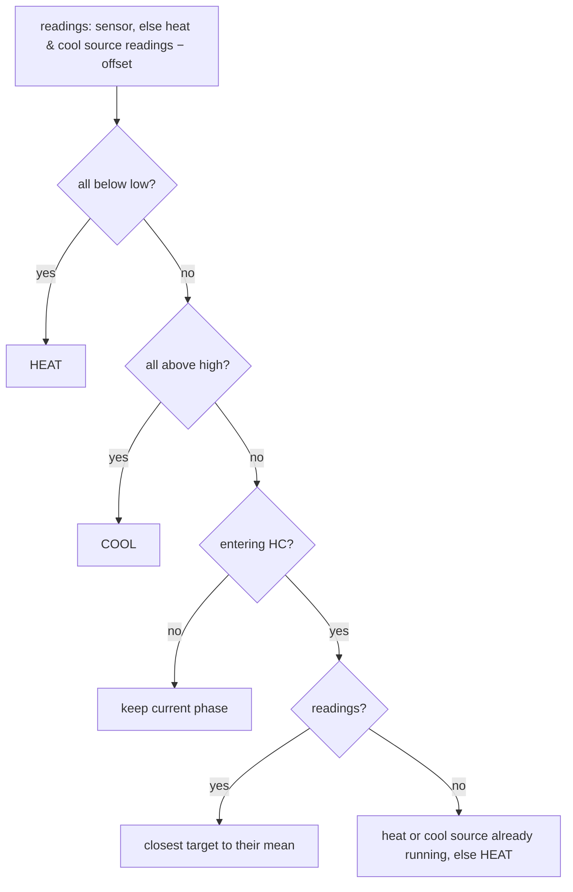

- **T-26** The phase is stored with the mode. One phase source runs at a
  time; the low target goes to the heat source, the high one to the cool
  source (as their single target).
- **T-27** Entering HC needs both sources usable and offering their mode.
- **T-28** A phase started by the entity is held `min_phase_duration`
  before an **automatic** switch. A user target change switches at once.
  0 = no hold.
- **T-29** Contradicting source readings (no sensor) keep the phase. A
  source without reading leaves the other one to decide.
- **T-30** low above high (after a takeover): phase kept.
- **T-31** Phase source set elsewhere to another mode or off → HC ends
  (§1.3). Not judged while the phase switch is pending.
- **T-32** Fan/swing: those remembered for heat and for cool (source modes).
- **T-33** Phase source unavailable → HC kept, phase source away; the
  other phase can still start if the room asks. Back in its phase → gets
  targets; back off → mode off.
- ❓ **Q-9** Heater set to `heat` on its remote while HC runs phase heat:
  the entity stays HC (it is the expected source mode). Accepted?

### 4.13 External sensor

- **T-34** For each mode with `<mode>_external_sensor`: written with the
  room sensor temperature, **whatever the mode of the entity** (even off).
- **T-35** At once on change, then at most every 60 s (latest value),
  again every 30 min even unchanged, and at start.
- **T-36** Converted to the unit of the target entity, rounded to its step.
  Not written: room sensor unavailable, target unavailable, value out of
  its range (warning). Errors logged.
- ❓ **Q-10** Write also when the mode is not active? (current: yes.)

---

## 5. Fan / swing management

Three settings handled the same way: `fan_mode`, `swing_mode`,
`swing_horizontal_mode`.

### 5.1 What is shown

| State | Options | Value |
|---|---|---|
| On(m) / Combined HC | those of the active source (if it has the feature) | active source |
| On(m), source away | known options of the source of m | memory of m |
| Off, every mode in `sync_modes` | options shared by all synced sources (case-insensitive, spelled as the first) | shared memory |
| Off, otherwise | none | none |

- **F-1** The feature exists on the entity if at least one source (known)
  offers options, so the card does not change size. A mode whose source
  lacks it shows no option, and a change is refused with a clear error.

### 5.2 Memory

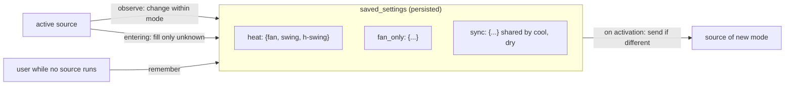

- **F-2** Key: the mode, or `sync` for modes in `sync_modes` (with a
  source). Combined HC uses the keys `heat` and `cool`.
- **F-3** Entering a mode: only fills settings not yet remembered (first
  use keeps the source's settings). Within a mode: every change is
  remembered, wherever it comes from (user via entity, remote).
- **F-4** On activation (and on return from away): each remembered value
  is matched to the source options ignoring case, sent as the source spells
  it, unless already set. Errors logged.
- **F-5** Synced: a value is remembered only if every synced source that
  has the setting offers it. A value only some offer (`turbo`) can be used
  but is not remembered. At send, a shared value no longer common is
  replaced by the source's current value.
- **F-6** Set by the user: sent to the active source; no source running
  (away, off + all synced) → remembered for the mode, sent when it starts.

---

## 6. Monitoring

### 6.1 Monitoring sensor — problem kinds

| Kind | Seen when | Reported after | Key |
|---|---|---|---|
| `sensor` | room sensor vs a source reading (− offset) > `monitoring_gap` | `monitoring_duration` | sensor + reading |
| `sources` | two readings of different entities > `monitoring_gap` | `monitoring_duration` | pair |
| `target` | active source shows another target than sent (not a takeover); not judged off, pending, settling | max(`monitoring_duration`, 30 s) | source + attribute |

### 6.2 Temperature readings

- **M-1** One reading per (source entity, offset): an entity serving two
  modes with the same offset is one reading, with different offsets two
  readings, never compared together.
- **M-2** A source unusable or without `current_temperature` is left out.
- ❓ **Q-12** Readings of sources that are **off** are compared too
  (their sensor may be stale, or the device off far from the room). Keep?

### 6.3 Problem lifecycle

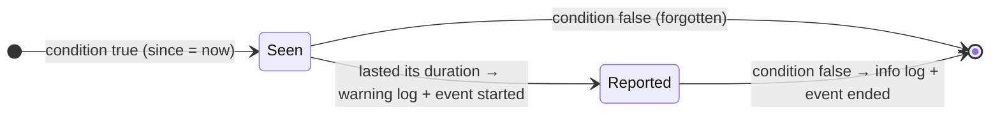

- **M-3** A problem that goes away starts from zero when it comes back,
  and after a restart.
- **M-4** Checked on every source/sensor update, when the target
  mismatches change, and at the time the next seen problem is due.
- **M-5** Event data: `entry_id, name, entity_id, status, message, problem`.

### 6.4 Target gap sensor

- **M-6** On while a target is shown otherwise than kept (T-23). `gaps`:
  `[{attribute, saved, shown}]`. Not a problem: informative.

### 6.5 Source unavailable sensor

- **M-7** On while a source of the stored mode is unavailable: the active
  one (away), either source of combined HC. Off while the mode is off.
  `entity_ids` lists them.

---

## 7. Trash (what goes nowhere)

Things that exist but have no home in the functional spec. To keep, move
or delete.

- **README "Structure" section** is stale (no `engine/`, `known.py`,
  `binary_sensor.py`).
- **YAML import mechanics**: name = identity, YAML wins, an entry removed
  from YAML is deleted, imported entries have no options. Options flow
  replaces the whole data. → Configuration chapter?
- **Compatibility shim** for HA < 2026.11 (`temperature_unit` etc. without
  `native_`).
- **`force_update` trick** after `set_temperature` (T-14): a frontend
  workaround, not behavior.
- **`<mode>_offset` for `fan_only`** (and dry/auto without target): only
  affects readings (current temperature, monitoring). Useful or noise?
- **"Display source"** (first usable source when off): only used for
  `current_temperature` and availability.
- **`Sources.features()` records into the known capabilities** (side
  effect in a reader).
- **Several `Sources` instances** (climate, monitoring, external sensor
  writer) over the same coordinator.
- **`self_reference` check** (a source cannot be one of our entities).
- **Translations** en/fr, `strings.json`.
- **TODO leftovers**: auto mode doing its own switching (option),
  humidity management, "test en 20??".
- **Obsolete with G-1**: reading the mode from the sources,
  `last_on_source`, "first running source in mode order", the saved
  `waiting` tuple and `heat_cool` flag (replaced by the stored mode and
  phase), `switching_to` (replaced by pending + G-11).

---

## 8. Open questions index

| # | Section | Topic |
|---|---|---|
| Q-1 | 1.7 | Save `last_on_mode` across restarts? |
| Q-2 ✅ | 1.7 | Resolved by G-1: the stored mode wins at start. |
| Q-4 | 1.7 | At start, take the running source targets or push the saved ones? |
| Q-5 | 1.7 | Hold the restored combined phase? |
| Q-8 | 4.2 | heat_cool own source without low/high uses the single target. |
| Q-9 | 4.12 | Phase source set to its phase on its remote: stays HC. |
| Q-10 | 4.13 | External sensor written even when its mode is not active. |
| Q-12 | 6.2 | Monitoring compares readings of sources that are off. |
| Q-15 | 1.7 | Merge the combined phase wait (12 s) into the source request confirmation? |
| Q-19 | 1.7 | Combined heat/cool with its phase source unavailable: `UNKNOWN` or `ON`? |
