# Adaptative Climate — Specification

Status: **draft**. Baseline written from the README and the code, then
amended. The code will follow the spec once agreed.

Conventions:

- Rules are named `<SCOPE>-<SECTION>-<n>` (`SRC-DATA-3`, `ENT-INIT-1`...),
  so we can refer to them. A rule is what the integration **must** do.
- ❓ **Q-n**: open question, to be decided. Current behavior is described.
- ⚠ marks a current behavior I believe is a bug or a hole.
- ✅ **resolved**: a question closed by a decision.
- Diagrams are Mermaid (rendered by GitHub and the VS Code Markdown preview
  with the Mermaid extension).

## Table of contents

- [0. Glossary](#0-glossary-new)
- [1. Overall behavior](#1-overall-behavior-new)
  - [1.1 Introduction](#11-introduction)
    - [1.1.1 Overview](#111-overview)
    - [1.1.2 Events exchanged](#112-events-exchanged)
  - [1.2 Source behavior](#12-source-behavior)
    - [1.2.1 Events](#121-events)
    - [1.2.2 Stored data management](#122-stored-data-management)
    - [1.2.3 State management](#123-state-management)
      - [1.2.3.1 State machine](#1231-state-machine)
      - [1.2.3.2 UNDISCOVERED state](#1232-undiscovered-state)
      - [1.2.3.3 OFF state](#1233-off-state)
      - [1.2.3.4 ON(m) state](#1234-onm-state)
      - [1.2.3.5 UNUSABLE state](#1235-unusable-state)
    - [1.2.4 Request confirmation](#124-request-confirmation)
    - [1.2.5 Settings request](#125-settings-request)
  - [1.3 Entity behavior](#13-entity-behavior)
    - [1.3.1 Events](#131-events)
    - [1.3.2 State management](#132-state-management)
      - [1.3.2.1 State machine](#1321-state-machine)
      - [1.3.2.2 INIT state](#1322-init-state)
      - [1.3.2.3 OFF state](#1323-off-state)
      - [1.3.2.4 ON(m) state](#1324-onm-state)
      - [1.3.2.5 WAITING(m) state](#1325-waitingm-state)
      - [1.3.2.6 NO_SOURCE state](#1326-no_source-state)
    - [1.3.3 Mode management](#133-mode-management)
      - [1.3.3.1 Mono-source and bi-source modes](#1331-mono-source-and-bi-source-modes)
      - [1.3.3.2 Bi-source mode: phase management](#1332-bi-source-mode-phase-management)
        - [1.3.3.2.1 Phase management](#13321-phase-management)
        - [1.3.3.2.2 Wanted phase](#13322-wanted-phase)
    - [1.3.4 Capabilities management](#134-capabilities-management)
      - [1.3.4.1 Principle](#1341-principle)
      - [1.3.4.2 Modes offered](#1342-modes-offered)
      - [1.3.4.3 Temperature targets used by each mode](#1343-temperature-targets-used-by-each-mode)
      - [1.3.4.4 Step](#1344-step)
      - [1.3.4.5 Range](#1345-range)
      - [1.3.4.6 Fan and swing](#1346-fan-and-swing)
    - [1.3.5 Settings management](#135-settings-management)
      - [1.3.5.1 Reference temperature](#1351-reference-temperature)
      - [1.3.5.2 External sensors](#1352-external-sensors)
      - [1.3.5.3 Temperature targets](#1353-temperature-targets)
      - [1.3.5.4 Fan and swing values](#1354-fan-and-swing-values)
- [2. Entities and attributes](#2-entities-new)
  - [2.1 Entities created](#21-entities-created)
  - [2.2 Attributes of the AC entity](#22-attributes-of-the-ac-entity)
  - [2.3 Home Assistant versions](#23-home-assistant-versions)
- [3. Configuration](#3-configuration-new)
  - [3.1 Configuration parameters](#31-configuration-parameters)
    - [3.1.1 General](#311-general)
    - [3.1.2 Modes](#312-modes)
    - [3.1.3 Temperature sensor](#313-temperature-sensor)
    - [3.1.4 Timers and durations](#314-timers-and-durations)
    - [3.1.5 Monitoring](#315-monitoring)
    - [3.1.6 Temperature limits and gap](#316-temperature-limits-and-gap)
    - [3.1.7 Fan and swing](#317-fan-and-swing)
  - [3.2 YAML](#32-yaml)
- [4. Monitoring](#4-monitoring-new)
  - [4.1 Monitoring sensors](#41-monitoring-sensors)
  - [4.2 Sources (`monitoring_sources`)](#42-sources-monitoring_sources)
  - [4.3 Temperatures (`monitoring_temperatures`)](#43-temperatures-monitoring_temperatures)
  - [4.4 Problem lifecycle, logs and events](#44-problem-lifecycle-logs-and-events)

<a id="0-glossary-new"></a>

## 0. Glossary

| Term | Meaning |
|---|---|
| **Entity** | The Adaptative Climate `climate` entity (one per config entry). |
| **Source entity** | A `climate` entity of Home Assistant configured for a mode (`<mode>_entity`). One source entity can serve several modes. |
| **Source** | The local object that follows one source entity: its stored data (§1.2.2) and its state machine (§1.2.3.1). One per source entity. |
| **Reference temperature** | The temperature the entity regulates on: the temperature sensor (`temperature_sensor`) when set, else the current temperatures of the sources, minus the offset of their mode (§3.1.3). |
| **Takeover** | A change made directly on a source entity (remote, app) that the entity follows: the source wins. |
| **Source mode** | The HVAC mode sent to a source: the mode, or the **phase** (`heat` / `cool`) of a bi-source mode (§1.3.3.1). |
| **Served modes** | The modes of the entity a source entity is configured for. Known by the entity only. |
| **Usable** | A source entity that exists in Home Assistant and whose state is not `unavailable` / `unknown`. |
| **Capability** | A capability attribute of a source entity (Home Assistant `capability_attributes` of `climate`), or `supported_features`, kept by the source (§1.2.2). Managed: `hvac_modes` (per source); `supported_features`, `min_temp`, `max_temp`, `target_temp_step`, `fan_modes`, `swing_modes`, `swing_horizontal_modes` (per source and mode). Not managed for now: `min_humidity`, `max_humidity`, `target_humidity_step`, `preset_modes`. |
| **Request** | The entity asks a source entity for a mode (or `off`). |

Diagram notation: UML state diagrams (run-to-completion semantics: each
state machine handles one event at a time, to the end), transitions written
`event [guard] / activity`.

<a id="1-overall-behavior-new"></a>

## 1. Overall behavior

### 1.1 Introduction

#### 1.1.1 Overview

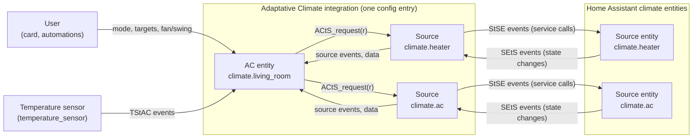

- **AC entity**: the Adaptative Climate `climate` entity seen by the user.
  It decides the mode and drives its sources (§1.3).
- **Source**: one local object per source entity (§1.2). It follows its
  source entity, stores its data, and carries out the requests of the AC
  entity. The AC entity never talks to a source entity directly.
- **Source entity**: a `climate` entity of Home Assistant (heater, AC,
  heat pump...), configured for one or more modes of the AC entity.
- **Temperature sensor**: the optional sensor giving the reference temperature (`temperature_sensor`,
  §3.1.3).

#### 1.1.2 Events exchanged

Between the user and the AC entity:

| Event | Direction | Meaning |
|---|---|---|
| `UtAC_set_mode(m)` | user → AC entity | The user asks for the mode `m` (`off` included): card, `set_hvac_mode`, `turn_on` (last mode), `turn_off`. |
| `UtAC_set_settings(s)` | user → AC entity | The user sets settings `s`: temperature targets (`set_temperature`), fan, swing, horizontal swing. |

Between the temperature sensor and the AC entity:

| Event | Direction | Meaning |
|---|---|---|
| `TStAC_temperature(t)` | temperature sensor → AC entity | The temperature sensor has a new valid value `t` (converted to the unit of Home Assistant). |

Between the AC entity and a source:

| Event | Direction | Meaning |
|---|---|---|
| `ACtS_request(r)` | AC entity → source | Put the source entity in `r` (an HVAC mode, or `off`). |
| `ACtS_settings(s)` | AC entity → source | Settings `s` (targets, fan/swing) for the source entity (§1.2.5). |
| `StAC_settings(s)` | source → AC entity | Settings `s` changed on the source entity (takeover), outside a request confirmation and `SETTLE(m)` (§1.2.5). |
| `StAC_temperature(t)` | source → AC entity | The current temperature `t` of the source entity changed (§1.2.3.1). |
| `StAC_undiscovered` | source → AC entity | The source enters `UNDISCOVERED`. |
| `StAC_off` | source → AC entity | The source enters `OFF`. |
| `StAC_on(m)` | source → AC entity | The source enters `ON(m)`. |
| `StAC_unusable` | source → AC entity | The source enters `UNUSABLE`. |
| `StAC_usable` | source → AC entity | The source leaves `UNUSABLE` (it goes back to its stored state, which the AC entity already knows). |
| data | AC entity reads the source | The stored data of the source (capabilities), read when needed, whatever the state of the source. |

Between a source and its source entity:

| Event | Direction | Meaning |
|---|---|---|
| `StSE_set_hvac_mode(r)` | source → source entity | Service call `climate.set_hvac_mode` carrying out a request. |
| `StSE_set_temperature(t)`, `StSE_set_fan_mode(f)`, `StSE_set_swing_mode(w)`, `StSE_set_swing_horizontal_mode(h)` | source → source entity | Service calls carrying out a settings request (§1.2.5). |
| `SEtS_off`, `SEtS_on(m)`, `SEtS_unavailable`, `SEtS_unknown`, `SEtS_attributes` | source entity → source | Changes of the source entity (§1.2.1). |

Settings (targets, fan/swing): §1.2.5.

### 1.2 Source behavior

A source has four functions:

- **stored data management** (§1.2.2): permanent, it does not depend on
  the state of the source;
- **state management** (§1.2.3): the state machine of the source. Its
  state is a **local** state, kept in sync with the source entity; it is
  not the state of the source entity itself;
- **request confirmation** (§1.2.4): confirmation, retries and settle time
  of a request, in parallel with the state machine;
- **settings request** (§1.2.5): temperature targets and fan/swing settings sent to
  the source entity.

#### 1.2.1 Events

| Event | Meaning |
|---|---|
| `start` | The config entry is set up (HA start, entry reload). |
| `restored` | The first restore of the stored data is done (§1.2.2). |
| `data_available` | The data of a source becomes available: restored or read at start (SRC-DATA-4), or read later (SRC-DATA-6). |
| `SEtS_off` | The source entity changed to `off`. |
| `SEtS_on(m)` | The source entity changed to the HVAC mode `m`. |
| `SEtS_unavailable` | The source entity changed to `unavailable`, or was removed from Home Assistant. |
| `SEtS_unknown` | The source entity changed to `unknown`. |
| `SEtS_attributes` | Only attributes of the source entity changed (its state stays the same). |
| `ACtS_request(r)` | The entity asks the source entity for `r` (an HVAC mode, or `off`). |
| `ACtS_settings(s)` | The entity gives the settings `s` (targets, fan/swing) for the source entity (§1.2.5). |

#### 1.2.2 Stored data management

##### 1.2.2.1 Stored data

Stored data of a source, saved across restarts:

| Data | Kept per | Content |
|---|---|---|
| State | source | The last usable state: `OFF` or `ON(m)`. Never `UNDISCOVERED` / `UNUSABLE`. Written by the mode management. |
| `hvac_modes` | source | The HVAC modes of the source entity. The same whatever its mode. |
| Mode capabilities | (source, mode) | `supported_features`, `min_temp`, `max_temp`, `target_temp_step`, `fan_modes`, `swing_modes`, `swing_horizontal_modes`, as last read **while the source entity was in that mode**. |
| `low_high_seen` | (source, mode) | The source entity has shown numeric `target_temp_low` / `target_temp_high` once while in that mode. Never cleared. |

- **SRC-DATA-1** The mode capabilities are **discovered** as the modes are
  used: those of a mode are read only while the source entity runs in it
  (source state `ON(m)`). A mode of `hvac_modes` with no stored
  capabilities (never run) gets the Home Assistant defaults:

  | Capability | Default |
  |---|---|
  | `supported_features` | 0: no temperature target, no fan, no swing |
  | `min_temp` / `max_temp` | 7 °C / 35 °C, converted to the unit of Home Assistant |
  | `target_temp_step` | none |
  | `fan_modes`, `swing_modes`, `swing_horizontal_modes` | none |
  | `low_high_seen` | no |

- **SRC-DATA-2** Nothing is read for `off` (useless).
- **SRC-DATA-3** The data is **available** once `hvac_modes` is known
  (restored or read). Mode capabilities may still be missing: Home
  Assistant defaults (SRC-DATA-1).
- What the entity does with a mode not discovered yet: ENT-CAP-3 to ENT-CAP-6
  (§1.3).

##### 1.2.2.2 Restore (at `start`):

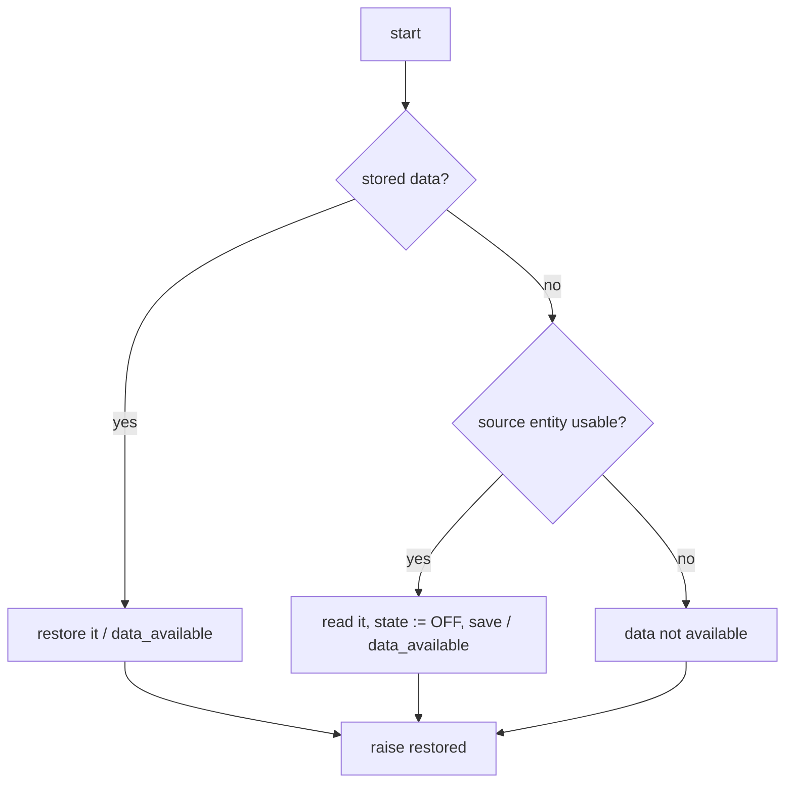

- **SRC-DATA-4** At `start`, the stored data is read. 
  - Without stored data, the
  source entity is read (`hvac_modes`, and the mode capabilities if it
  runs in a mode), and the stored state is set to `OFF`: the source was
  never used, so it starts from a clean state (its entry turns the
  source entity off if it runs, SRC-STATE-2).
  - If it cannot be read (not usable), the data is not
  available. 
  - Data restored or read raises `data_available`. The end of
  this first restore raises `restored`.
- **SRC-DATA-5** A stored value that is not valid (corrupted) is dropped; the
  other stored data is restored.

##### 1.2.2.3 Update (on each change of the source entity):

- **SRC-DATA-6** On every change of a usable source entity (`SEtS_off`,
  `SEtS_on(m)`, `SEtS_attributes`):
  - data not available yet → it is read and saved: data available
    (`data_available`);
  - `hvac_modes` is read again;
  - if the source entity runs in a mode `m`, the capabilities of `m`
    are read again;
  - each value read is compared with the stored one:
    - no change → nothing; 
    - a new or updated value that removes nothing (a first value, a new number, a list with more items) → stored and saved at once; 
    - a value no longer shown (attribute missing or `None`), or a list that lost items (`fan_modes` without `turbo`) → removal confirmation (below).
- **SRC-DATA-7** A source entity that is not usable is not read: the stored
  data stays as it is.
- **SRC-DATA-8** `low_high_seen` of mode `m` is set when numeric low/high
  values are shown while the source entity runs in `m`. It is never
  removed.
- **SRC-DATA-9** Only the configured source entities keep their data: a
  source entity removed from the configuration loses it.

`change` in this diagram: `SEtS_off`, `SEtS_on(m)` or `SEtS_attributes`.

**Removal confirmation** (one per value no longer shown or list that lost
items: `hvac_modes`, or a capability of a mode):

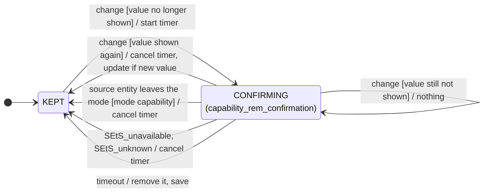

- **SRC-DATA-10** A value no longer shown, or a list that lost items, is kept
  as it is for `capability_rem_confirmation` (§3.1.4, 60 s by default). The
  timer is cancelled when the full value is shown again; other changes of
  the source entity (current temperature...) let it run. At the end of the
  timer, the value is removed (or replaced by the shorter list now shown)
  and the data is saved.
- **SRC-DATA-11** A capability of mode `m` is only judged while the source
  entity runs in `m`: the source entity leaving `m` cancels its timer.
  The source entity becoming not usable cancels every timer (SRC-DATA-7).

#### 1.2.3 State management

##### 1.2.3.1 State machine

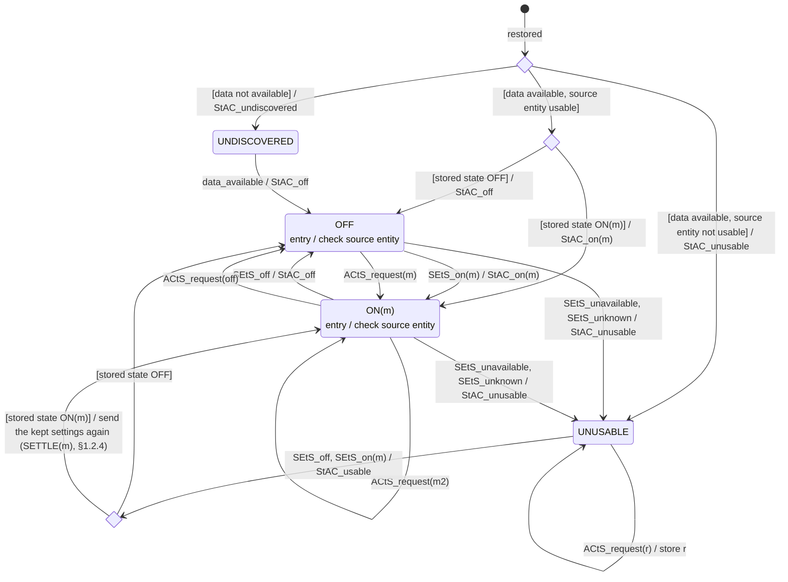

"check source entity" (entry of `OFF` and `ON(m)`): if the source entity
does not show the state (`off`, or `m`), the state is sent to it and the
request confirmation starts (§1.2.4).

- **SRC-STATE-1** After `start`, the source waits for the end of the first
  restore (`restored`), then:
  - data not available → `UNDISCOVERED`, reported to the entity;
  - data available and source entity not usable → `UNUSABLE`,
    reported to the entity;
  - data available and source entity usable → the stored state (`OFF`
    when the data was read from the source entity, SRC-DATA-4), reported to
    the entity (`OFF` or `ON(m)`).
- **SRC-STATE-2** On entry of `OFF` or `ON(m)`, however it is entered (request,
  restore, back from `UNUSABLE`), the state is compared with the source
  entity: if it differs, the state is sent to the source entity and the
  request confirmation starts (§1.2.4). Entered from a change of the
  source entity, it is the same: nothing is sent.
- **SRC-STATE-3** In `OFF` or `ON(m)`, a request from the entity 
  - moves the state
  at once to the state asked (`ON(m)` or `OFF`); 
  - its entry sends it
  (SRC-STATE-2). 
  - `ON(m)` → `ON(m2)` is a new entry. 
  - No `StAC_` event is sent:
  the entity asked for it. A `StAC_off` / `StAC_on(m)` always means a
  change made on the source entity, never the result of a request.
- **SRC-STATE-4** In `UNUSABLE`, a request from the entity is stored as the
  stored state; nothing is sent.
- **SRC-STATE-5** In `OFF` or `ON(m)`, a change of the source entity
  (`SEtS_off`, `SEtS_on(m)`) moves the state, and the new state is reported to the entity.
  During a request confirmation, these changes are handled by the
  confirmation (§1.2.4) and do not reach the state machine.
- **SRC-STATE-6** In `OFF` or `ON(m)`, `SEtS_unavailable` or `SEtS_unknown` always moves the source to
  `UNUSABLE`, even during a request confirmation, which ends (the state
  asked stays the stored state, sent again on return: SRC-STATE-7). Reported to
  the entity.
- **SRC-STATE-7** In `UNUSABLE`, the source entity back (`SEtS_off` or
  `SEtS_on(m)`) moves the source to its **stored** state, not to the state
  shown.
  - The entry of that state sends it if needed (SRC-STATE-2).
  - When the stored state is `ON(m)`, the source always goes through
    `SETTLE(m)` (§1.2.4), even if the source entity already shows `m`: it
    sends its kept settings, ignores during `settle_timer` the values the
    device reports while reconnecting, and sends them again at the end if
    needed (SRC-SET-5).
  - The entity gets only `StAC_usable`: the stored state is the one it
    already knows.
- **SRC-STATE-8** In `UNDISCOVERED`, no request is made (the entity refuses the mode
  before). When the data becomes available, the source goes to `OFF`,
  reported to the entity; its entry turns the source entity off if it
  runs (SRC-STATE-2).
- **SRC-STATE-9** Every change of state is saved as the stored state (except
  `UNDISCOVERED` / `UNUSABLE`, which keep the last usable one).
- **SRC-STATE-10** Resynchronization: at start, and when the source entity comes
  back from unavailable, **Home Assistant wins**: the stored state is sent
  to the source entity (SRC-STATE-2, SRC-STATE-7), whatever was changed on the device
  meanwhile. At start, everything is resynchronized (several sources left
  on would give odd effects); after unavailability, there was a problem,
  so everything is resynchronized when it ends. The source entity has the
  upper hand (takeover) only in nominal operation: `OFF` / `ON(m)`,
  outside a request confirmation (SRC-STATE-5).

- **SRC-STATE-11** In `OFF` or `ON(m)`, a change of the current
  temperature of the source entity (`current_temperature`, in
  `SEtS_attributes`) is reported to the entity: `StAC_temperature(t)`, as
  read (the entity removes the offset of the mode, §3.1.3).

##### 1.2.3.2 UNDISCOVERED state

The data of the source is not available.

- The first usable change of the source entity makes the data available
  (SRC-DATA-6): `data_available` moves the source to `OFF` (SRC-STATE-8).
- **SRC-UNDISC-1** The source offers nothing: no capability (the entity does
  not count it for the step, uses Home Assistant default ranges 7–35 °C,
  no options), no HVAC mode (its modes are not judged as offered or not).

##### 1.2.3.3 OFF state

The source entity is off.

- Settings: see §1.2.5.

##### 1.2.3.4 ON(m) state

The source entity runs in `m`, any HVAC mode other than `off`.

- **SRC-ON-1** The source does not know which modes the entity uses it for:
  `ON(m)` is just the HVAC mode of the source entity. Whether `m` is a mode
  the source serves here (or a foreign mode) is decided by the entity.
- Settings: see §1.2.5.

##### 1.2.3.5 UNUSABLE state

The source entity is not usable (`unavailable`, `unknown`, or missing in
Home Assistant), but the data of the source is available.

- The stored data stays as it is (SRC-DATA-7): the entity keeps reading the
  capabilities of the source as they were when it was last usable.

#### 1.2.4 Request confirmation

Runs in parallel with the state machine of §1.2.3.1. `send(r)` is the
entry check of `OFF` / `ON(m)` sending `r` to the source entity (SRC-STATE-2).
It works the same way to turn a source entity on in a mode (`r` = `m`)
and to turn it off (`r` = `off`).

`monitoring up` raises the problem "source out of sync" of this source
(MON-SRC-3); `monitoring down` clears it (nothing to do if it is not raised).

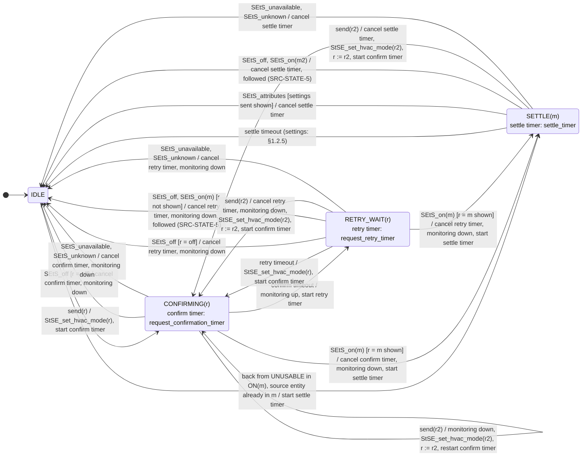

- **SRC-REQ-1** During the confirmation, the changes of the source entity
  that do not show `r` are ignored: a device may still show its previous
  mode, or go through `off`, before showing the mode asked. Cloud devices
  may take a while. Exception: `SEtS_unavailable` / `SEtS_unknown` ends the confirmation
  (SRC-STATE-6).
- **SRC-REQ-2** The source entity showing `r` ends the confirmation: the
  source is in the state asked. When `r` is a mode (`ON(m)`), the source
  enters `SETTLE(m)`: the settings (targets, fan/swing) are sent and, for
  `settle_timer` (§3.1.4, 12 s by default), the settings shown by the source
  entity are ignored
  (§1.2.5, SRC-SET-5).
- **SRC-REQ-3** `SETTLE(m)` 
  - ends 
    - at the end of the settle timer, 
    - or earlier
  when the source entity shows the settings sent. 
  - It also stops (settle
  timer cancelled) 
    - when the source leaves `m`: a change of the source
  entity (`SEtS_off`, `SEtS_on(m2)`, followed: SRC-STATE-5), 
    - a new request
  (a new confirmation starts), 
    - or `SEtS_unavailable` / `SEtS_unknown`.
- **SRC-REQ-4** The call to the source entity fails: the error is logged;
  the confirmation goes on until its timeout (SRC-REQ-6).
- **SRC-REQ-5** A new send (new request) during the confirmation or the
  retry wait replaces the previous one: the state confirmed becomes the
  new one (`r := r2`), and a new confirmation starts.
- **SRC-REQ-6** Timeout of the confirmation while the source entity does not
  show `r` (call failed, or the device did not follow): the monitoring
  reports the source entity out of sync (MON-SRC-3), and the source waits
  `request_retry_timer` (§3.1.4, 5 min by default: retry wait).
- **SRC-REQ-7** At the end of the retry wait, `r` is sent again and a new
  confirmation (`request_confirmation_timer`, §3.1.4, 30 s by default) starts, with
  the same behavior. This goes on every `request_retry_timer` as long as the
  source entity does not show `r`.
- **SRC-REQ-8** The confirmation and the retries stop only when the source
  entity shows `r`, or when the source leaves the state that started them
  (new request: SRC-REQ-5; `SEtS_unavailable` / `SEtS_unknown`: SRC-STATE-6; change of the source entity
  during the retry wait: SRC-REQ-9).
- **SRC-REQ-9** During the retry wait, the source entity is master: a change
  of the source entity to another state than `r` (remote, app) stops the
  retries and is followed as a takeover (SRC-STATE-5): the state moves and is
  reported to the entity.
- **SRC-REQ-10** When the settle time applies. `SETTLE(m)` protects the
  settings Home Assistant has just **pushed**: right after entering a
  mode, some devices report their own stored value for that mode a few
  seconds later, which must not be taken for a takeover.
  - Settle: after a request confirmed by the source entity (Home
    Assistant asked for the mode and pushes its settings).
  - Settle: when the source comes back from `UNUSABLE` in `ON(m)`
    (resynchronization, Home Assistant wins and pushes its settings,
    SRC-STATE-7).
  - No settle: on a mode change made on the device (`SEtS_on(m)` outside
    a confirmation). The source wins: nothing is pushed, the settings of
    the device are adopted (SRC-SET-10), and the values it reports in the
    next seconds are adopted too.

#### 1.2.5 Settings request

Settings `s`: any of the temperature targets (`temperature`, or `target_temp_low` and
`target_temp_high`, already computed by the entity: offset (§3.1.3), step,
range),
`fan_mode`, `swing_mode`, `swing_horizontal_mode`. Each one is sent with
its own service call (`StSE_set_temperature`, `StSE_set_fan_mode`,
`StSE_set_swing_mode`, `StSE_set_swing_horizontal_mode`). The settle time
comes from the request confirmation (`SETTLE(m)`, §1.2.4).

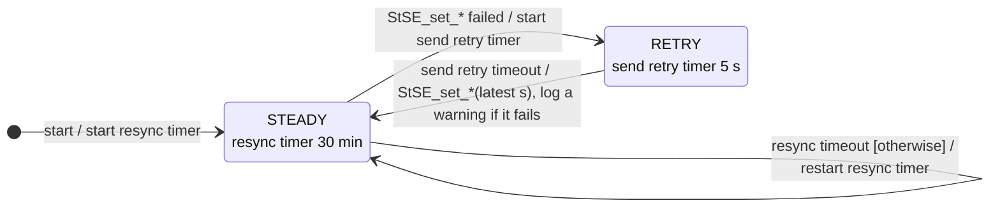

- **SRC-SET-1** The source keeps the last settings received
  (`ACtS_settings(s)`) for its current mode: settings depend on the mode.
  - When the mode of the source changes (`ACtS_request(r)` for another
  state, or a change of the source entity followed: `SEtS_off`,
  `SEtS_on(m2)`), the kept settings are **withdrawn**. 
  - After a request,
  the entity sends the settings of the new mode (`ACtS_settings(s)`).
  - In `UNUSABLE`, they are kept, unless a request for another state is
  received: the state asked is stored (SRC-STATE-4) and the kept settings are
  withdrawn, as for any mode change.
- **SRC-SET-2** In `ON(m)` outside a request confirmation, a settings request
  is sent to the source entity at once, except the settings it already
  shows. Low and high targets go together.
- **SRC-SET-3** In `OFF`, `UNDISCOVERED`, `UNUSABLE`, and during a request
  confirmation (`CONFIRMING`, `RETRY_WAIT`), nothing is sent: the
  settings are kept, and sent when the source enters `SETTLE(m)`.
- **SRC-SET-4** Fan and swing values are matched to the options of the source
  entity in that mode ignoring case, and sent as the source entity spells
  them. A value it does not offer is not sent.
- **SRC-SET-5** On entry of `SETTLE(m)` (§1.2.4), the kept settings the
  source entity does not show are sent. During `SETTLE(m)`, the settings
  shown by the source entity are ignored (a device may report its own
  values for the mode a few seconds later). 
- **SET-x** At the end of the settle
  timer, if the source entity showed other settings meanwhile, the kept
  settings are sent again; if it showed nothing, nothing is sent. Known
  limitation: a source entity already at the settings gets nothing, so
  nothing ends `SETTLE(m)` early: its settings are ignored for the full
  `settle_timer`.
- **SRC-SET-6** Retry on error: a call that fails is tried again **once**,
  5 s later, with the settings of that time. If it fails again, a warning
  is logged. Only a call error triggers it, not a source entity that
  accepts the call without applying the setting.
- **SRC-SET-7** Resync: the resync timer runs all the time (started at
  `start`, restarted at each timeout). Every 30 minutes, the settings the source entity does
  not show (compared with those sent) are sent again (a command lost by
  the device, a device back to its own value without telling).
- **SRC-SET-8** Monitoring: a setting sent and not shown by the source entity
  is a problem (MON-SRC-4). Not judged during `SETTLE(m)` or a request
  confirmation.
- **SRC-SET-9** Setting not applied (the source entity accepts the call, or
  fails, and its value **does not change**): the source keeps the setting
  received from the entity, which stays the reference (Home Assistant wins). It is sent
  again (SRC-SET-6, SRC-SET-7) and the monitoring reports it (MON-SRC-4). Nothing is
  sent to the entity: its setting is unchanged.
- **SRC-SET-10** Takeover (a value of the source entity **changes** to another
  value than the one sent: remote, app): in `ON(m)`, outside a request
  confirmation and `SETTLE(m)`, the source keeps the new value as its
  setting and sends `StAC_settings(s)` (the settings changed) to the
  entity, which adopts them. During a confirmation or `SETTLE(m)`, such
  changes are ignored (SRC-REQ-1, SRC-SET-5). After a mode change made on the
  source entity (`SEtS_on(m)` followed, SRC-STATE-5), the source sends its
  current settings at once (`StAC_settings(s)`, the settings shown by the
  source entity in `m`): the entity adopts them (the source wins).
- **SRC-SET-11** At the end of `SETTLE(m)`, the source reports to the
  entity (`StAC_settings`) the values its source entity shows for the
  settings it did not get (no value kept): the first time a mode is used,
  the entity adopts the settings of the source (ENT-FANV-5).
- How the entity computes the temperature targets (offsets, steps, ranges) and
  remembers fan/swing per mode: §1.3.5.3, §1.3.5.4.

### 1.3 Entity behavior

The AC entity has four functions:

- **state management** (§1.3.2): its own state machine, which drives the
  sources;
- **mode management** (§1.3.3): mono-source and bi-source modes, and the
  phases of a bi-source mode;
- **capabilities management** (§1.3.4): its capabilities, from those of
  its sources;
- **settings management** (§1.3.5): temperature targets and fan/swing settings.

#### 1.3.1 Events

| Event | Direction | Meaning |
|---|---|---|
| `UtAC_set_mode(m)` | user → AC entity | The user asks for the mode `m` (`off` included): card, `set_hvac_mode`, `turn_on` (last mode), `turn_off`. |
| `UtAC_set_settings(s)` | user → AC entity | The user sets settings `s`: temperature targets (`set_temperature`), fan, swing, horizontal swing. |
| `TStAC_temperature(t)` | temperature sensor → AC entity | See §1.1.2. |
| `StAC_undiscovered`, `StAC_off`, `StAC_on(m)`, `StAC_unusable`, `StAC_usable`, `StAC_settings(s)`, `StAC_temperature(t)` | source → AC entity | See §1.1.2. Each one comes from one source. |
| `ACtS_request(r)`, `ACtS_settings(s)` | AC entity → source | See §1.1.2. |

Words used below:

- **source of `m`**: the source configured for the mode `m` of the
  entity;
- **active source**: the source of the current mode;
- **available source**: a source in `OFF` or `ON(x)` (not `UNDISCOVERED`, not
  `UNUSABLE`);
- **served / foreign**: `StAC_on(x)` from a source `S` is **served** when
  `S` is the source of the mode `x` of the entity, **foreign** otherwise
  (a heater set to `fan_only` on its remote).

#### 1.3.2 State management

##### 1.3.2.1 State machine

Activities on the transitions:

| Activity | What is sent |
|---|---|
| `apply(m)` | To the source of `m`: `ACtS_request(m)` (the phase for a bi-source mode) and `ACtS_settings(s)` (the settings of `m`, §1.3.5).<br> To every other source not `OFF` (`UNUSABLE` included): `ACtS_request(off)`. |
| `apply(off)` | To every source not `OFF` (`UNUSABLE` included): `ACtS_request(off)`. |
| `follow(S)` | Takeover by `S` in a **served** mode only. To every source not `OFF` other than `S` (`UNUSABLE` included): `ACtS_request(off)`. Nothing to `S`. |

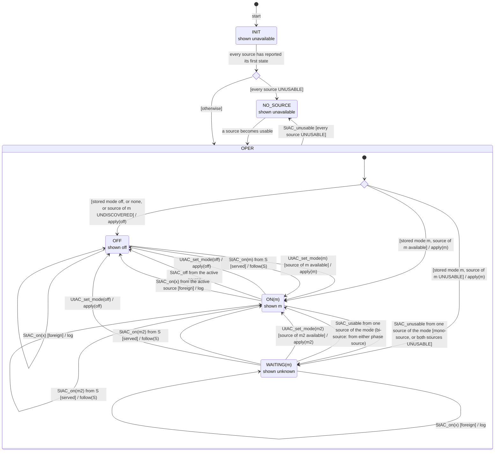

- **ENT-STATE-1** The entity stores its mode (`off` or `m`), saved across
  restarts. `INIT` and `NO_SOURCE` keep it.
- **ENT-STATE-2** The entity also stores its **last used mode**: the mode of
  its last `ON(m)` (`heat_cool` for a bi-source `heat_cool`). It is saved
  across restarts. It is used:
  - by `turn_on`, which asks for the last used mode, or for the first
    configured mode when no mode was ever used (`UtAC_set_mode`);
  - in `OFF`, for the temperature targets shown and set when the entity
    has no low/high (ENT-TGT-6, ENT-TGT-10: "the mode `turn_on` would
    start");
  - in `OFF`, for the reference temperature (ENT-REF-2: the last used
    source).
- **ENT-STATE-3** **A change asked by the user** (`UtAC_set_mode`) is sent to
  the sources (`apply`). **A change coming from a source** (`StAC_`) is
  followed, and nothing is sent to that source: the source wins
  (takeover). The other sources are still turned off (`follow`).
- **ENT-STATE-4** A user mode change goes to the mode asked if its source is
  available (`OFF` or `ON`). `off` is always accepted. Otherwise it is
  refused with an error.
- **ENT-STATE-5** A source mode change:
  - `StAC_on(x)` **served**: takeover, the entity goes to `ON(x)` and
    turns the other sources off (`follow`);
  - `StAC_on(x)` **foreign** from the currently active source (it left
    its mode for a foreign one): the entity goes `OFF`; nothing is sent
    to any source (the source keeps running);
  - `StAC_on(x)` **foreign** from any other source: nothing happens
    (logged, listed in the `foreign_modes` attribute);
  - `StAC_off` from the active source: the entity goes `OFF`.
- **ENT-STATE-6** Main states: `INIT`, `OPER` (sub-states `OFF`, `ON(m)`,
  `WAITING(m)`) and `NO_SOURCE`. Entering `OPER` goes through the choice
  `resume`. `every source UNUSABLE` leaves `OPER` for `NO_SOURCE`, whatever
  the sub-state, and wins over the other transitions.
- **ENT-STATE-7** Bi-source mode (`heat_cool` with the heat and cool
  sources): `ON(heat_cool)` has phase sub-states (§1.3.3.2); "source of
  `m` available" means at least one of the two sources usable
  (ENT-TYPE-9).
- **ENT-STATE-8** `turn_on` only acts in `OFF`:
  - in `OFF`, it asks for the last used mode (ENT-STATE-2);
  - in `ON(m)` and `WAITING(m)`, it does nothing: no request, no error
    (the entity is already on; in `WAITING(m)`, it waits for its source);
  - in `INIT` and `NO_SOURCE`, the entity is unavailable, so Home
    Assistant does not call it (ENT-NOSRC-2).

##### 1.3.2.2 INIT state

- **ENT-INIT-1** At `start`, the entity waits until every source has reported
  its first state (`StAC_undiscovered`, `StAC_off`, `StAC_on(m)` or
  `StAC_unusable`, SRC-STATE-1); a source in `UNDISCOVERED` counts. It then goes
  to its stored mode if it can, else `OFF` (choice `resume`), and
  resynchronizes the sources (`apply`).
- **ENT-INIT-2** Stored mode `m` whose source is `UNDISCOVERED`: `OFF`. The source
  is seen for the first time; a stored mode whose source is unknown only
  happens after a configuration change with persistent data, which is not
  recommended.
- **ENT-INIT-3** Shows: the entity is **unavailable** (no mode, no action, no
  temperature target, no setting).
- **ENT-INIT-4** A change of the configuration (options in the UI, or
  YAML) reloads the entry. A reload is a restart: everything goes through
  `INIT` again, as when Home Assistant starts (stored data, stored mode,
  phase, last used mode, settings), then the sources are resynchronized
  (`apply`).
  - If the stored mode is no longer configured (for example the entity
    was in `dry`, and `dry_entity` was removed), the entity goes to `OFF`.
  - If the last used mode is no longer configured, `turn_on` asks for the
    first configured mode (ENT-STATE-2).
  - A source entity removed from the configuration is no longer managed:
    if it runs, it keeps running, since the entity only sends requests to
    its configured sources. Its stored data is dropped (SRC-DATA-9).
  - If `heat_cool` changes type, it stays configured and is resumed.
    Becoming mono-source, its stored phase is ignored. Becoming
    bi-source, its phase is chosen again when entering it (`wanted`,
    §1.3.3.2.2).

##### 1.3.2.3 OFF state

Every source is asked to be off.

- **ENT-OFF-1** Shows: the entity is available; `hvac_mode` `off`;
  `hvac_action` `off`. Capabilities and settings shown: §1.3.4, §1.3.5.

##### 1.3.2.4 ON(m) state

The source of `m` runs `m`; every other source is asked to be off.

- **ENT-ON-1** Shows: the entity is available; `hvac_mode` `m`;
  `hvac_action` read from the active source (the phase source for
  a bi-source mode). Capabilities and settings shown: those of `m`
  (§1.3.4, §1.3.5).

##### 1.3.2.5 WAITING(m) state

The source of the current mode `m` is `UNUSABLE`; the mode is kept.

- Entered on `StAC_unusable` from the active source.
- Left when the source is back (`StAC_usable` → `ON(m)`: the source
  resynchronizes itself, SRC-STATE-7; its settings are kept, SRC-SET-1), when the
  user asks for another mode, or on a takeover by another source.
- **ENT-WAIT-1** Shows: the entity is available; `hvac_mode` unknown
  (`None`); `hvac_action` unknown (`None`). Capabilities and settings
  shown: those of `m`, as last known (§1.3.4, §1.3.5). The
  `monitoring_sources` binary sensor (§4.2) tells which source is
  away.

##### 1.3.2.6 NO_SOURCE state

Every source is `UNUSABLE`.

- **ENT-NOSRC-1** Shows: the entity is **unavailable** (no mode, no action, no
  temperature target, no setting). The stored mode is kept for the return.

- Left as soon as a source becomes available (choice `resume`): stored
  mode `off` → `OFF`; source of `m` available → `ON(m)`; otherwise
  `WAITING(m)`. The sources are resynchronized (`apply`).
- **ENT-NOSRC-2** No user event in `NO_SOURCE` (nor in `INIT`): Home
  Assistant does not call a service on an unavailable entity (the call
  is skipped without error, also from an automation).

#### 1.3.3 Mode management

##### 1.3.3.1 Mono-source and bi-source modes

The sources of the modes are configured in §3.1.2. From that configuration,
each mode is mono-source or bi-source. The following table describes the possible options from the configuration:

| Mode | Configuration | Type | Sources |
|---|---|---|---|
| `heat`, `cool`, `auto`, `dry`, `fan_only` | `<mode>_entity` set | mono-source | its source |
| `heat_cool` | `heat_cool_entity` set | mono-source | its source |
| `heat_cool` | no `heat_cool_entity`, `heat_entity` and `cool_entity` set | **bi-source** | the heat source (phase `heat`) and the cool source (phase `cool`) |
| any | no source | not offered | — |

When `heat_cool` is bi-source (no `heat_cool_entity`), it uses the heat
and cool sources, one per phase:

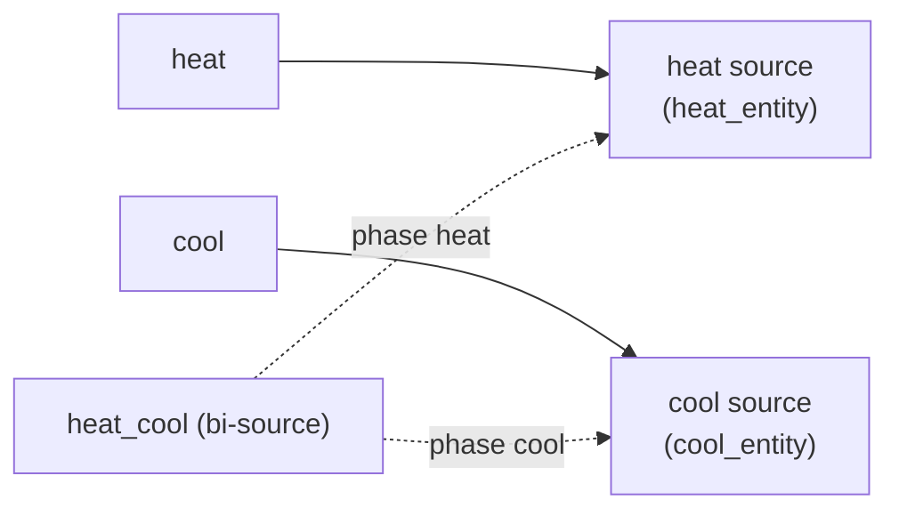

Otherwise (`heat_cool_entity` declared), `heat_cool` is mono-source and
uses its own source, like the other modes.

- **ENT-TYPE-1** Each mode has at most one source entity of its own. A
  source entity can serve several modes.
- **ENT-TYPE-2** At least one mode has a source.
- **ENT-TYPE-3** A source cannot be an Adaptative Climate entity (calls
  would loop).
- **ENT-TYPE-4** A source entity that is loaded and usable must offer the
  mode it serves (`hvac_modes`); a source entity unavailable or unknown
  is not checked (it is checked again when it becomes usable).
- **ENT-TYPE-5** A configuration change reloads the entry.
- **ENT-TYPE-6** Whether a mode is mono-source or bi-source is set by the
  **configuration only** (§3.1.2): it never changes while running, only
  when the configuration changes (the entry is reloaded). The same mode
  can be either, depending on the configuration (today only `heat_cool`).
- **ENT-TYPE-7** Mono-source mode `m`: the source mode is `m`; the active
  source is the source of `m`.
- **ENT-TYPE-8** Bi-source mode: two sources, one per **phase** (`heat`,
  `cool`); one runs at a time (§1.3.3.2). The source mode is the phase; the
  active source is the source of the phase. Both sources can be the same
  entity (a heat pump switches its own mode).
- **ENT-TYPE-9** A bi-source mode is available as long as at least one of
  its two sources is usable, and both sources offer their phase
  (ENT-HVAC-3). Otherwise, a user request for it is refused
  (ENT-STATE-4).
- **ENT-TYPE-10** In `ON(heat_cool)` bi-source, a mode change made on one
  of the two phase sources (`StAC_on(x)`, `x` = `heat` or `cool`) is a
  takeover: the source wins, and the entity leaves `heat_cool` for the
  **mono-source** mode `x` (`ON(x)`). Examples:
  - phase `heat`, the AC (cool source) is set to `cool` on its remote →
    `ON(cool)`;
  - phase `heat`, a heat pump serving both is set to `cool` on its
    remote → `ON(cool)`;
  - phase `cool`, the radiator (heat source) is turned on in `heat` →
    `ON(heat)`.

  Setting the phase source to the mode it already runs (radiator set to
  `heat` in phase `heat`) changes nothing on the source entity: no event,
  the entity stays `heat_cool`.

##### 1.3.3.2 Bi-source mode: phase management

###### 1.3.3.2.1 Phase management

When `heat_cool` is bi-source, `ON(heat_cool)` has two sub-states. Both
are written with the current phase `p` (`heat` or `cool`):

- `PHASE(p)`: the source of `p` is usable and runs `p`;
- `WAITING_PHASE(p)`: the source of `p` is `UNUSABLE`. The phase `p` is
  kept, and its source gets the request when it comes back (SRC-STATE-4),
  like `WAITING(m)` for a mode.

`p'` is the other phase (`cool` when `p` is `heat`, and the reverse).

The entity chooses the phase from the reference temperature and the temperature targets
(see `wanted` below).

Entering a phase `p` is written `apply(p)`:

- the source of `p` is asked to run `p`, with the settings of that phase
  (`ACtS_request(p)`, `ACtS_settings`);
- every other source that is not off is asked to turn off
  (`ACtS_request(off)`), the source of the other phase included. Except
  when both phases use the same entity (a heat pump): it just switches
  from one mode to the other.

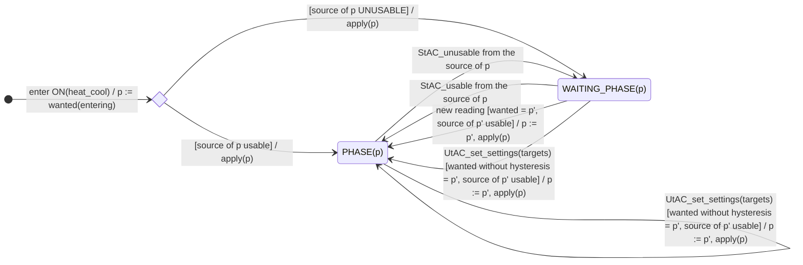

Leaving: both phase sources `UNUSABLE` → `WAITING(heat_cool)` (ENT-PHASE-6);
a change made on a phase source → takeover (ENT-PHASE-4).

"new reading": a new value of the reference, local high or local low
temperature (§1.3.3.2.2): `TStAC_temperature`, or `StAC_temperature` from
the heat or cool source.

- **ENT-PHASE-1** The phase is stored with the mode, and saved across
  restarts.
- **ENT-PHASE-2** The phase is checked on every new reading, and on every
  change of the temperature targets by the user (`wanted`, below). A change of the
  temperature targets by the user ignores the hysteresis (`phase_hysteresis` = 0): the
  user asked for it, the phase follows at once.
- **ENT-PHASE-3** A phase switch is an `apply` of the new phase: its
  source gets the request (confirmed by the source, §1.2.4), the other
  phase source is turned off (confirmed by the source, §1.2.4).
- **ENT-PHASE-4** Leaving the phase from a source (phase source turned off
  or set to another served mode elsewhere) follows the state machine
  (ENT-STATE-5, ENT-TYPE-10).
- **ENT-PHASE-5** A phase switch follows the request confirmation of the
  sources (§1.2.4): the new phase source confirms its mode (retries,
  monitoring, settle time), the other one confirms `off`. The entity does
  not wait nor judge anything meanwhile: a source sends no `StAC_` event
  for a request it confirms (SRC-STATE-3).
- **ENT-PHASE-6** One phase source `UNUSABLE`:
  - the entity stays in `ON(heat_cool)`, in `WAITING_PHASE(p)` if it is the
    source of the current phase;
  - the phase is kept, and its source gets the request when it comes back
    (SRC-STATE-4);
  - the other phase can still start if the temperatures ask for it, and
    if its source is usable.
- **ENT-PHASE-7** Both phase sources `UNUSABLE`: the entity goes to
  `WAITING(heat_cool)` (§1.3.2). It goes back to `ON(heat_cool)` as soon
  as one of them is usable again.
- **ENT-PHASE-8** The entity switches to the other phase only if the
  source of that phase is usable.

###### 1.3.3.2.2 Wanted phase

Phase choice (`wanted`). It uses three temperatures:

- the **reference temperature** (§1.3.5.1);
- the **local high temperature**: the temperature that must be above the
  high target to switch to `cool`;
- the **local low temperature**: the temperature that must be below the
  low target to switch to `heat`.

| Temperatures available (§1.3.5.1) | Local high temperature | Local low temperature |
|---|---|---|
| `temperature_sensor` with a valid value | the sensor | the sensor |
| no valid sensor, both source temperatures | the **lowest** of the two | the **highest** of the two |
| no valid sensor, one source temperature | that one | that one |
| none | none | none |

Hysteresis `h`:

- on a new reading: `h` = `phase_hysteresis` (§3.1.3);
- on a change of the temperature targets by the user: `h` = 0 ("wanted without
  hysteresis", ENT-PHASE-2).

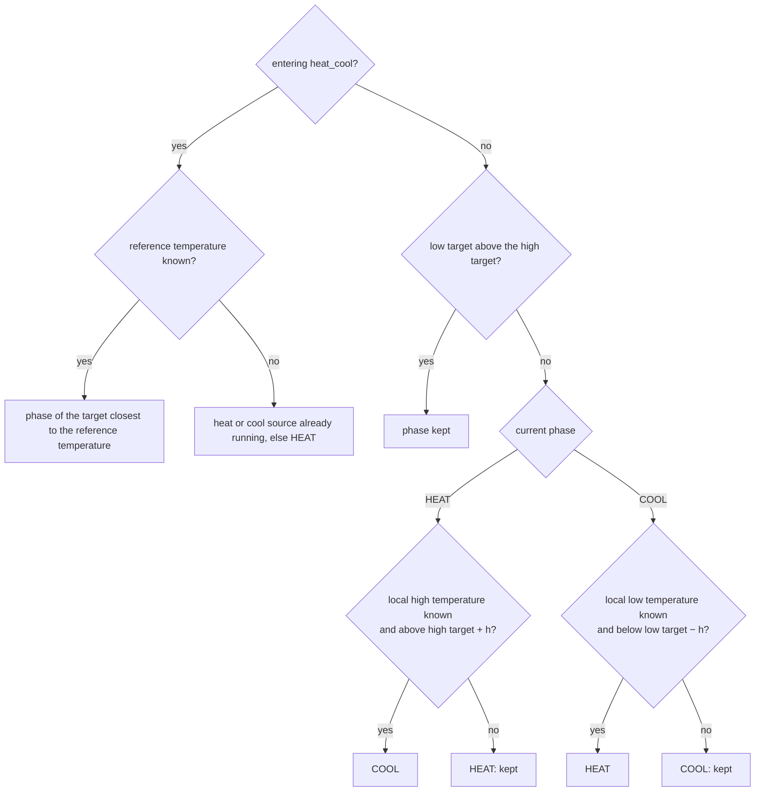

- **ENT-WANT-1** Entering `heat_cool`: the phase is the one of the temperature target
  closest to the reference temperature. Without reference temperature:
  the heat or cool source already running, else `heat`.
- **ENT-WANT-2** Local high and low temperatures: see the table above.
- **ENT-WANT-3** Switching phase (after entering):
  - in phase `heat`, the phase switches to `cool` when the local high
    temperature is above the high target plus `h`;
  - in phase `cool`, the phase switches to `heat` when the local low
    temperature is below the low target minus `h`;
  - otherwise the phase is kept. This covers: a temperature in between,
    an unknown local temperature, and the low target above the high one
    (after a takeover).
> **Note — why the lowest and the highest:** each source reads near its
> own device, so the two may disagree. Switching to `cool` only when even
> the lowest one is above the high target (and to `heat` only when even
> the highest one is below the low target) means the two sources agree.
> When they contradict each other, the phase is kept: no oscillation.

> **Note — why the hysteresis:** with close temperature targets, or a temperature
> near a temperature target, the phase would switch back and forth (short cycles).
> This wears the compressors and wastes energy. A change of the temperature targets
> by the user is not concerned: the phase follows at once (`h` = 0).

#### 1.3.4 Capabilities management

Capabilities of the modes and temperatures (§1.3.4.1 to §1.3.4.5), then of fan and swing (§1.3.4.6).

##### 1.3.4.1 Principle

- **ENT-CAP-1** The entity builds its own capabilities (modes, range, step,
  temperature targets, options) from the capabilities of its sources (§1.2.2).
  - It uses them whatever the state of the sources.
  - A source in `UNUSABLE` keeps the capabilities it showed last.
- **ENT-CAP-2** The capabilities of a mode `m` come from the source of `m`,
  as it showed them while running in `m`.
  - They are stored per source and per mode (SRC-DATA-1).
  - For a bi-source `heat_cool`, they come from the heat source running in
    `heat`, and from the cool source running in `cool`.

> **Note:** the entity does not need to handle a capability that
> disappears for a while (a device that hides an attribute while it
> restarts, or in some states): the source keeps it until its removal is
> confirmed (SRC-DATA-10, SRC-DATA-11). The entity always reads stable
> capabilities.

A mode is **not discovered yet** when its source has never run in it
(SRC-DATA-1):

- **ENT-CAP-3** The mode is offered as soon as its source offers it (in its
  `hvac_modes`). The entity can switch to it, even if it was never
  discovered.
- **ENT-CAP-4** Until its first activation, the mode has no capability.
  - The entity shows no temperature target and no fan/swing for it.
  - Its range is the Home Assistant default range, 7–35 °C.
  - The temperature targets and fan/swing settings the user sets for it meanwhile are
    kept, but not sent.
- **ENT-CAP-5** When the mode is activated for the first time, the entity
  only sends the mode.
  - No temperature target and no fan/swing setting is sent: the entity does not know
    yet what the source accepts in that mode.
  - The entity never uses the capabilities of another mode to decide what
    to send.
- **ENT-CAP-6** At the first update of the source in that mode, the
  capabilities of the mode are discovered (SRC-DATA-6).
  - The kept temperature targets and fan/swing settings are then sent, within these
    capabilities (range, step, options).
  - Until then, the source runs with its own settings. This happens
    during the settle time.

##### 1.3.4.2 Modes offered

- **ENT-HVAC-1** The entity offers `off` and every configured mode
  (§1.3.3.1).
  - `heat_cool` is offered when it is configured, mono-source or
    bi-source.
  - The list comes from the configuration. It does not change while
    running, so the card always shows the same modes.
- **ENT-HVAC-2** A mode can be in the list without being available. A
  mono-source mode is not available when:
  - its source is `UNDISCOVERED` or `UNUSABLE`;
  - or its source does not offer it (in the `hvac_modes` it showed last,
    §1.2.2).
- **ENT-HVAC-3** A bi-source mode is not available when:
  - **both** sources are `UNDISCOVERED` or `UNUSABLE` (one usable source is
    enough, ENT-PHASE-6);
  - or one of the sources does not offer its phase.
- **ENT-HVAC-4** A mode that is not available:
  - stays in the list;
  - is listed in the `unavailable_modes` attribute;
  - is refused when the user asks for it (ENT-STATE-4).
- **ENT-HVAC-5** When a source does not offer the mode it serves:
  - a warning is logged, and a Repairs issue
    (`<entry>_<mode>_not_supported`) is raised;
  - the issue is removed when the source offers the mode again, and when
    the entry unloads;
  - a source never seen is not judged.

##### 1.3.4.3 Temperature targets used by each mode

The entity keeps three temperature targets:

- **low**: the heating setpoint;
- **high**: the cooling setpoint;
- **T**: the single temperature target.

Each mode uses some of them. It shows them either in the single target
attribute (`temperature`), or in the low/high attributes
(`target_temp_low`, `target_temp_high`).

| Mode | Temperature targets used | Shown as |
|---|---|---|
| `heat` | low | `temperature` |
| `cool` | high | `temperature` |
| `heat_cool` bi-source | low, high | `target_temp_low`, `target_temp_high` |
| `heat_cool` mono-source, source with low/high | low, high | `target_temp_low`, `target_temp_high` |
| `heat_cool` mono-source, source with a single temperature target | T | `temperature` |
| `auto`, source with low/high | low, high | `target_temp_low`, `target_temp_high` |
| `auto`, source with a single temperature target | T | `temperature` |
| `dry`, source with a single temperature target | T | `temperature` |
| `auto` or `dry`, source without temperature target | none | nothing |
| `fan_only` | none | nothing |

- **ENT-FEAT-1** What a mode uses depends on what its source supports in
  that mode. The source is in one of three cases:
  - **with low/high**: the source uses two setpoints, `target_temp_low`
    and `target_temp_high` (ENT-FEAT-2);
  - **with a single temperature target**: the source uses one setpoint,
    `temperature`. It declares the feature `TARGET_TEMPERATURE`, and is
    not "with low/high";
  - **without temperature target**: the source has no temperature setpoint at all, for example a
    dehumidifier in `dry`. It declares neither `TARGET_TEMPERATURE` nor
    `TARGET_TEMPERATURE_RANGE`. The entity then shows no temperature target in that
    mode, and sends none.
- **ENT-FEAT-2** A source is "with low/high" in the mode `m` when it
  declares the feature `TARGET_TEMPERATURE_RANGE`.
  - If it declares only `TARGET_TEMPERATURE_RANGE`, that is enough.
  - If it also declares `TARGET_TEMPERATURE`, one more condition is
    needed: it offers the `heat_cool` mode, or it has already shown
    numeric low/high values while running in `m` (`low_high_seen`,
    SRC-DATA-8).
  - Why: some sources declare both features but only use the single
    temperature target. For example, a template climate with only `set_temperature`.

> **Note — known limitation:** if the device behind a source entity is
> replaced, and the entity id stays the same, the source keeps its
> `low_high_seen`. Only deleting the entry clears it.

- **ENT-FEAT-3** Features declared by the entity:
  - it always declares `TURN_ON` and `TURN_OFF`;
  - it declares `TARGET_TEMPERATURE` when at least one configured mode
    shows a single temperature target (`temperature`);
  - it declares `TARGET_TEMPERATURE_RANGE` when at least one configured
    mode shows low/high;
  - these features do not change with the current mode;
  - the other features of the sources (presets, humidity) are not
    exposed.

##### 1.3.4.4 Step

- **ENT-STEP-1** The entity has one step (`target_temp_step`). It is
  computed from the steps of all the sources, in all their discovered
  modes.
  - The step of the entity is the largest value that divides every step
    of the sources exactly.
  - Examples: steps 0.5 and 1 give 0.5. Steps 0.5 and 0.2 give 0.1.
  - A source without step counts as 0.5 °C (1 °F), as the Home Assistant
    card does.
  - If no step is known yet, the step is 0.5 °C (1 °F).
- **ENT-STEP-2** The step does not change with the state or the mode. So a
  temperature target keeps the same value when the mode changes.

##### 1.3.4.5 Range

- **ENT-RANGE-1** The range of a mode comes from its source.
  - It is the `min_temp` / `max_temp` of the source in that mode, minus the
    offset of the mode (§3.1.3).
  - For a bi-source `heat_cool`, it is the widest range of the two phases:
    the lowest minimum and the highest maximum.
  - For a mode not discovered yet, it is 7–35 °C (ENT-CAP-4).
- **ENT-RANGE-2** The range shown by the entity:
  - in `ON(m)` and `WAITING(m)`: the range of `m`;
  - in `OFF`: the widest range of all the modes.
- **ENT-RANGE-3** The limits `min_temp` / `max_temp` (§3.1.6):
  - they can only narrow the range, never widen it;
  - a limit outside the range is ignored;
  - they apply to the reference temperature, before the offset.
- **ENT-RANGE-4** When the entity sends a temperature target to the source
  of a mode, it first brings it into the range of that mode
  (ENT-RANGE-1, ENT-RANGE-3). A value below the minimum is sent as the
  minimum, and a value above the maximum is sent as the maximum. The
  value kept by the entity does not change.
- **ENT-RANGE-5** The entity keeps each temperature target within the
  widest range of all the modes that use it (§1.3.4.3). For example, the
  low target is used by `heat`, and by `heat_cool` and `auto` when their
  source has low/high: the low target can take any value that at least
  one of these modes accepts.
- **ENT-RANGE-6** This way, a value is not lost because one mode cannot
  reach it. For example, with a radiator at 5–30 °C for `heat` and a heat
  pump at 18–30 °C for `heat_cool`, a low target of 14 °C is kept at
  14 °C. The radiator gets 14 °C, and the heat pump gets 18 °C.

##### 1.3.4.6 Fan and swing

The three settings `fan_mode`, `swing_mode` and `swing_horizontal_mode` are
handled the same way. This section only covers their options; the values
kept for each mode are part of the settings (§1.3.5).

- **ENT-FAN-1** The options of a mode for a setting are the options its
  source showed while running in that mode (`fan_modes`, `swing_modes`,
  `swing_horizontal_modes`), when it declares the matching feature in
  that mode.
  - For a bi-source `heat_cool`, they are the options of the source of
    the current phase.
  - A mode not discovered yet has no option (ENT-CAP-4).
- **ENT-FAN-2** The entity declares the features `FAN_MODE`, `SWING_MODE`
  and `SWING_HORIZONTAL_MODE` as soon as at least one configured mode has
  options for that setting. These features do not change with the mode,
  so the card keeps the same size.
- **ENT-FAN-3** The options shown by the entity depend on its state:
  - in `ON(m)` and `WAITING(m)`, it shows the options of `m` (in
    `WAITING(m)`, the ones known last);
  - in `ON(heat_cool)` bi-source, it shows the options of the current
    phase, or the options shared by the two phases when `bi_source_sync`
    is on (ENT-FAN-8);
  - in `OFF`, it shows the options shared by the synchronized modes when
    **every** configured mode is in `sync_modes` (ENT-FAN-6); otherwise,
    it shows none (it does not show the options of the mode `turn_on`
    would start).
- **ENT-FAN-4** When the current mode has no option for a setting, the
  entity shows none for it, and refuses a user request for that setting
  with a clear error.
- **ENT-FAN-5** Values are compared without taking the case into account:
  `Low` and `low` are the same value. Each source gets the value written
  as it writes it. Other names are not matched: `1` is not `low`.
- **ENT-FAN-6** The options shared by the synchronized modes (`sync_modes`,
  §3.1.7) are the options offered by **all** of them, without taking the
  case into account. They are written as the first synchronized mode
  writes them, in mode order.
- **ENT-FAN-7** Configuration errors of `sync_modes`, each one reported by
  a warning and a Repairs issue, removed once the cause is gone:
  - a synchronized mode whose source does not have a setting at all (a
    radiator without fan): that mode is ignored for that setting, so that
    the others still share their options;
  - `heat_cool` listed while it is bi-source: it is ignored in
    `sync_modes`. A bi-source `heat_cool` is synchronized with
    `bi_source_sync` instead (ENT-FAN-8). `heat_cool` always stays in the
    list of choices of `sync_modes`.
- **ENT-FAN-8** `bi_source_sync` (§3.1.7) synchronizes the two phases of a
  bi-source `heat_cool`, with the same principle as `sync_modes`:
  - the options shown in `ON(heat_cool)` are the options offered by both
    phase sources (the heat source in `heat`, the cool source in `cool`),
    without taking the case into account;
  - a phase source that does not have a setting at all is reported like
    in ENT-FAN-7, and ignored for that setting.

#### 1.3.5 Settings management

- **ENT-SET-1** `UtAC_set_settings(s)`: the settings are kept by the entity
  for the current mode (for `next_mode` when off).
  - In `ON(m)`, they are sent to the active source (`ACtS_settings(s)`).
  - In `WAITING(m)` and `WAITING_PHASE(p)`, they are sent too: the source
    is `UNUSABLE` and keeps them (SRC-SET-1), then sends them when it
    comes back (SRC-STATE-7).
- **ENT-SET-2** `StAC_settings(s)` from the active source (takeover of a
  setting, or of the mode: SRC-SET-10): the entity adopts them.
- Temperature targets: §1.3.5.3. Fan and swing values: §1.3.5.4.

##### 1.3.5.1 Reference temperature

The temperature the entity regulates on, and shows as its current
temperature.

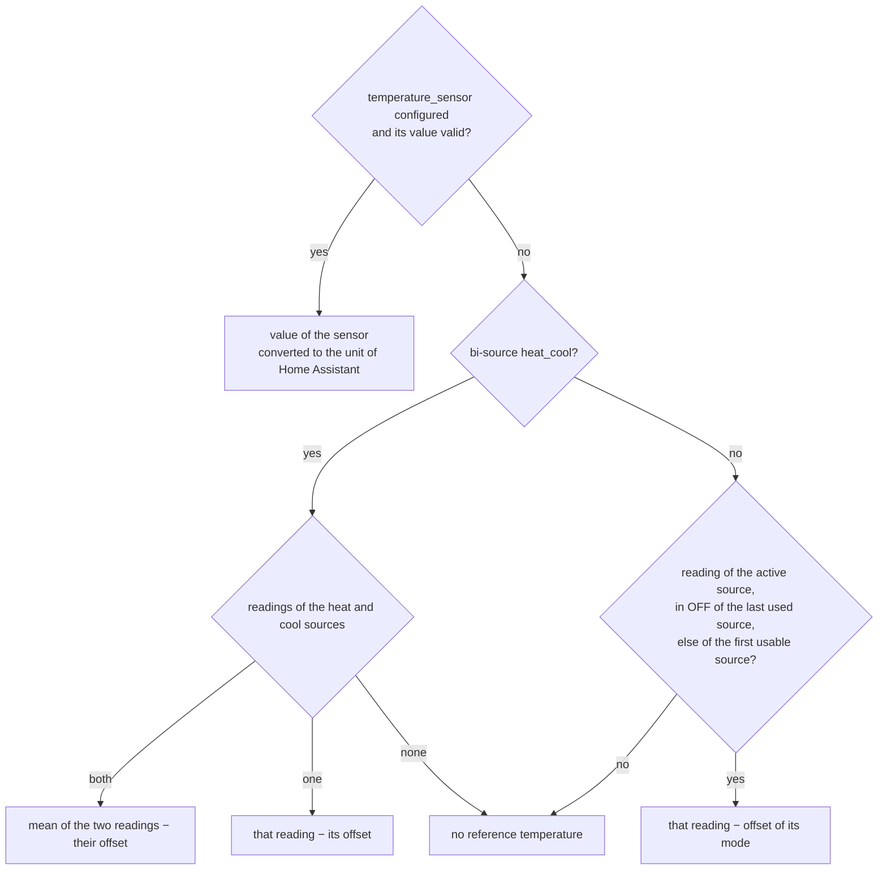

- **ENT-REF-1** With `temperature_sensor` (§3.1.3), the reference
  temperature is its value (`TStAC_temperature`), converted to the unit of
  Home Assistant. A value that is not a valid number (`unavailable`,
  `unknown`, text, infinite) is ignored.
- **ENT-REF-2** Without `temperature_sensor`, or while it has no valid
  value, the reference temperature is the current temperature
  (`StAC_temperature`) minus the offset of its mode (§3.1.3) of:
  - the active source, in `ON(m)` and `WAITING(m)`;
  - the **last used source** in `OFF`: the source of the last used mode
    (ENT-STATE-2, saved across restarts);
  - in `OFF` when no mode was ever used, the **first usable source**, in
    mode order;
  - in `ON(heat_cool)` and `WAITING(heat_cool)` **bi-source**, from the
    readings of the heat and cool sources (each one minus the offset of
    its mode):
    - both readings available: their **mean**;
    - only one (the other source `UNUSABLE`, or without current
      temperature): that one;
    - none: no reference temperature (ENT-REF-3).
- **ENT-REF-3** No reference temperature (no valid sensor value, and no
  reading from that source: unusable, or no `current_temperature`): the
  entity shows no current temperature
  (`None`). The users of the reference temperature handle its absence
  (for the phase choice: ENT-WANT-1, ENT-WANT-3).
- **ENT-REF-4** The entity shows the reference temperature as its
  `current_temperature`, in every sub-state of `OPER` (in `INIT` and
  `NO_SOURCE` the entity is unavailable).
- **ENT-REF-5** A reading of a source is always taken minus the offset of
  the mode it serves (§3.1.3): a well set offset makes the source read the
  reference temperature.
- **ENT-REF-6** Bi-source mode without valid sensor:
  - the entity shows the reference temperature, the mean of the two
    source temperatures; it is also used when entering `heat_cool`
    (ENT-WANT-1);
  - to switch phase, the entity uses the local high and low temperatures
    instead (the lowest and the highest of the two, ENT-WANT-2), so that
    two sources that disagree do not make the phase oscillate
    (§1.3.3.2.2).

##### 1.3.5.2 External sensors

- **ENT-EXT-1** For each mode with `<mode>_external_sensor` (§3.1.3), the
  entity writes the value of the temperature sensor to that entity **on
  every `TStAC_temperature` event**, whatever the state of the entity and
  of the source (even off, even when the mode is not the current one).
- **ENT-EXT-2** The value is converted to the unit of the external sensor
  entity and rounded to its step. It is not written when the external
  sensor entity is unavailable, or when the value is out of its range
  (warning logged). A write error is logged.
- **ENT-EXT-3** The offset of a mode with an external sensor is 0: its
  source regulates on the reference temperature.
- **ENT-EXT-4** While the temperature sensor has a valid value, that value
  is written again every `external_sensor_resend` (§3.1.4, 900 s by default),
  even unchanged: some devices (thermostatic valves) go back to their own
  sensor when the external temperature is not updated for a while.
- **ENT-EXT-5** Temperature sensor without valid value (`unavailable`,
  `unknown`, `None`, not a number): nothing is written, and the periodic
  rewrite stops, so that the device does not regulate on a stale value: a
  device that watches the updates goes back to its own sensor. Writing
  resumes with the next valid value. The monitoring reports the sensor
  (MON-TEMP-4). An external sensor entity cannot be made invalid from Home
  Assistant (a `number` only takes a number in its range).

##### 1.3.5.3 Temperature targets

The temperature targets used and shown by each mode are listed in
§1.3.4.3 (low, high, T).

**What the entity keeps**

- **ENT-TGT-1** The temperature targets belong to the entity, not to the
  sources.
  - Switching mode keeps them, and the source of the new mode gets them.
  - They are temperatures of the reference (§1.3.5.1): the offset is only
    added when a temperature target is sent to a source (ENT-TGT-7).
  - The `saved_targets` attribute shows the three values as kept.
- **ENT-TGT-2** The temperature targets are kept:
  - across restarts;
  - while the entity is `OFF`, in `fan_only`, in a mode without
    temperature target, and in `WAITING(m)`.
- **ENT-TGT-3** A value kept is always on the step of the entity
  (ENT-STEP-1), and within the range of the temperature target (ENT-RANGE-5).

**Gap between low and high**

- **ENT-TGT-4** The low target stays at least `min_gap` (§3.1.6) below the
  high target.
- **ENT-TGT-5** When one temperature target is set, the other one moves if needed:
  - a low target raised close to the high one pushes the high one up;
  - a high target lowered close to the low one pulls the low one down;
  - the temperature target that moves is rounded away from the other one, on the
    step of the entity, so that the gap is kept;
  - if it cannot move (the end of its range is reached), the temperature target just
    set gives way instead;
  - when both are set in the same request, the high target moves.

**Set by the user**

- **ENT-TGT-6** `UtAC_set_settings` with temperature targets:
  - a single `temperature` sets the temperature target the current mode shows as
    `temperature` (§1.3.4.3): low in `heat`, high in `cool`, T in the
    other modes. In `OFF`, it sets the temperature target of the mode `turn_on` would
    start;
  - `target_temp_low` / `target_temp_high` set low / high;
  - with an `hvac_mode` in the same request, the mode and the temperature
    targets are handled together: the entity switches to the new mode
    (`UtAC_set_mode`), and the temperature targets are set for that new
    mode (§1.3.4.3). The source of the new mode gets the mode and the
    temperature targets in the same `apply` (`ACtS_request` then
    `ACtS_settings`).

**Sent to the source**

- **ENT-TGT-7** The entity sends to the active source the temperature targets its
  mode uses (`ACtS_settings`), each one:
  - plus the offset of the mode (§3.1.3);
  - brought into the range of the mode (ENT-RANGE-4);
  - rounded to the step of that source (not the step of the entity).

  Low and high are sent together. Example: with a radiator at step 0.5
  and an AC at step 1, a high target of 24.5 °C stays 24.5 °C in the
  entity, and the AC gets 25 °C.

**Changed on the source (takeover)**

- **ENT-TGT-8** A temperature target changed on the active source (`StAC_settings`)
  becomes the temperature target of the entity. The source wins:
  - the value taken is the value of the source minus the offset of its
    mode, rounded to the step of the entity;
  - it is kept even outside the limits and the range of the entity;
  - it is not sent back to the source;
  - the other temperature target moves to keep the gap; the temperature target taken never gives
    way.

**First temperature targets**

- **ENT-TGT-9** When no temperature target is saved yet (first start), the entity
  takes its first temperature targets from the sources, once one is usable. Each
  value is minus the offset of its mode, and rounded to the step of the
  entity.
  - T: the single target of the active source, else of any source, else
    the middle of the range.
  - low and high: the low/high targets of a `heat_cool` source that has
    them; else low from the temperature target of the heat source, and high from the
    temperature target of the cool source; for the missing ones, the low/high pair of
    another source, else T − 1 and T + 1.
  - The gap is then applied (ENT-TGT-5).

**Shown**

- **ENT-TGT-10** The entity shows the temperature targets of its current mode
  (§1.3.4.3). In `OFF`:
  - if the entity has low/high (ENT-FEAT-3), it shows low and high, so
    that they can be set before turning on;
  - otherwise, it shows the temperature targets of the mode `turn_on` would start.
- **ENT-TGT-11** A temperature target is shown within what can be reached:
  - in `ON(m)` and `WAITING(m)`, within the range of `m`: the range of its
    source minus the offset of the mode (ENT-RANGE-1), narrowed by
    `min_temp` / `max_temp` (ENT-RANGE-3);
  - in `OFF`, within the range of the temperature target (ENT-RANGE-5),
    narrowed by `min_temp` / `max_temp`;
  - beyond, the temperature target cannot be reached, so it is not shown
    beyond. The value kept does not change (it may be outside, for
    example after a takeover, ENT-TGT-8).
- **ENT-TGT-12** The `target_gaps` attribute of the AC entity lists the
  temperature targets shown otherwise than they are kept: the target
  kept cannot be reached by the current mode, and the entity shows it
  within what can be reached (ENT-TGT-11).
  - Each entry gives `attribute`, `saved` (the value kept) and `shown`
    (the value shown). The list is empty when every target is shown as
    kept.
  - Example: a low target kept at 14 °C, in `heat_cool` on a heat pump
    whose minimum is 18 °C: the entity shows 18 °C, and `target_gaps`
    holds `{attribute: target_temp_low, saved: 14, shown: 18}`.
  - It is informative, not a problem: the temperature target comes back
    when a mode that can reach it runs.

##### 1.3.5.4 Fan and swing values

The options of each mode are in §1.3.4.6. This section covers the values
the entity keeps, shows and sends for `fan_mode`, `swing_mode` and
`swing_horizontal_mode`.

**Memory**

- **ENT-FANV-1** The entity remembers the fan and swing values of each
  mode, so that a mode finds the values it was left with. The memory is
  saved across restarts, for the configured modes only. The
  `saved_settings` attribute shows it.
- **ENT-FANV-2** Each mode has its own memory, except:
  - the modes in `sync_modes` share one memory (a fan speed chosen in
    `cool` is used in `dry` too);
  - for a bi-source `heat_cool`, the phase `heat` uses the memory of the
    `heat` mode, and the phase `cool` the memory of the `cool` mode;
  - with `bi_source_sync`, the two phases share one memory of their own.
- **ENT-FANV-3** A shared memory only keeps a value offered by all the
  modes that share it (the shared options, ENT-FAN-6, ENT-FAN-8).
  - A value offered by some of them only (a `turbo` speed) can still be
    chosen and sent, but it is not remembered: the shared memory keeps
    its previous value.
  - When a value kept is no longer offered by all of them (the options of
    a source changed), it is replaced by the current value of the source,
    if that one is shared.

**Filled**

- **ENT-FANV-4** The memory of a mode is updated:
  - when the user sets a value (`UtAC_set_settings`);
  - when a value is changed on the active source (`StAC_settings`,
    takeover): the source wins;
  - the first time a mode is used, with the values the source already
    has: a mode without memory keeps the settings of its source.
- **ENT-FANV-5** The first time a mode is used, the entity has no value for
  it, so it sends none. At the end of the settle time, the source reports
  the values its source entity shows (`StAC_settings`, SRC-SET-11). The
  entity adopts these values, and remembers them for that mode.

**Sent**

- **ENT-FANV-6** On entering a mode (`apply`), the entity sends the
  remembered values of that mode to its source (`ACtS_settings`).
  - A setting without remembered value is not sent: the source keeps its
    own value.
  - This only happens the first time the mode is used (ENT-FANV-5), or
    when a shared value was dropped because it is no longer offered by
    all the modes, and the current value of the source is not shared
    either (ENT-FANV-3).
- **ENT-FANV-7** A value set by the user is sent to the active source in
  `ON(m)`, and in `WAITING(m)` / `WAITING_PHASE(p)` (ENT-SET-1).

**Shown**

- **ENT-FANV-8** The entity shows:
  - in `ON(m)`: the value of the active source (the source wins);
  - in `WAITING(m)`: the value remembered for `m`;
  - in `OFF`: the value of the shared memory when every configured mode
    is in `sync_modes`; otherwise, none (ENT-FAN-3).
- **ENT-FANV-9** In `OFF` with every mode synchronized, a value set by the
  user is remembered in the shared memory, and sent when a mode starts.

<a id="2-entities-new"></a>

## 2. Entities and attributes

### 2.1 Entities created

Each config entry creates one AC entity and two monitoring binary
sensors. Their names come from the `name` of the entry (§3.1.1).

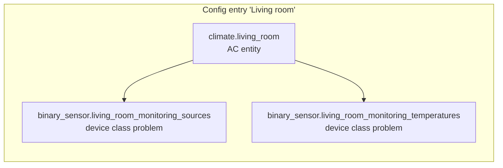

| Entity | Role | Detail |
|---|---|---|
| `climate.<name>` | The AC entity. | §1.3, §2.2 |
| `binary_sensor.<name>_monitoring_sources` | On while the source devices do not respond or do not obey (device class problem). | §4.2 |
| `binary_sensor.<name>_monitoring_temperatures` | On while the temperature readings are not consistent (device class problem). | §4.3 |

- **MON-ENT-1** The two monitoring binary sensors are always available,
  even when the AC entity or its sources are not: they report on them.

### 2.2 Attributes of the AC entity

Standard attributes of a Home Assistant `climate` entity:

| Attribute | Content | Detail |
|---|---|---|
| `hvac_mode` | The current mode; unknown in `WAITING(m)`. | §1.3.2 |
| `hvac_modes` | `off` and the configured modes. | ENT-HVAC-1 |
| `hvac_action` | The action of the active source. | ENT-ON-1 |
| `current_temperature` | The reference temperature. | §1.3.5.1 |
| `temperature`, `target_temp_low`, `target_temp_high` | The temperature targets shown by the current mode. | §1.3.4.3, ENT-TGT-10 |
| `min_temp`, `max_temp` | The range shown. | ENT-RANGE-2 |
| `target_temp_step` | The step of the entity. | ENT-STEP-1 |
| `fan_mode(s)`, `swing_mode(s)`, `swing_horizontal_mode(s)` | The fan and swing options and values. | §1.3.4.6, §1.3.5.4 |

Extra attributes:

| Attribute | Content | Detail |
|---|---|---|
| `active_entity_id` | The active source, or `None`. | §1.3.1 |
| `mode_entity_ids` | `{mode: source}`, as configured. | §3.1.2 |
| `unavailable_modes` | The modes listed but not available. | ENT-HVAC-4 |
| `foreign_modes` | `{source: mode}` of the sources running a mode they do not serve. | ENT-STATE-5 |
| `saved_targets` | The three temperature targets, as kept. | ENT-TGT-1 |
| `saved_settings` | The fan and swing values remembered for each mode (not recorded in the history). | ENT-FANV-1 |
| `target_gaps` | The temperature targets shown otherwise than they are kept. | ENT-TGT-12 |

The attributes of the monitoring sensors are in §4.

### 2.3 Home Assistant versions

- **ENT-HA-1** The entities work with Home Assistant before and after
  2026.11. From 2026.11, Home Assistant reads the temperature properties
  of a `climate` entity under new names (`native_temperature_unit`,
  `native_current_temperature`, `native_target_temperature`,
  `native_target_temperature_low`, `native_target_temperature_high`);
  before, it reads them without `native_`. The AC entity provides both.
- **ENT-HA-2** The tests run on a version before 2026.11 and on a version
  from 2026.11, so that both paths are checked.

<a id="3-configuration-new"></a>

## 3. Configuration

### 3.1 Configuration parameters

#### 3.1.1 General

| Option | Type | Default | Effect |
|---|---|---|---|
| `name` | string, unique | — | Title of the entry, and name of the AC entity (the monitoring sensors are named after it, §2.1). In YAML, it identifies the entry (§4.1). |


#### 3.1.2 Modes

| Option | Type | Default | Effect |
|---|---|---|---|
| `heat_entity` | `climate.*` | none | Source entity of the `heat` mode. |
| `cool_entity` | `climate.*` | none | Source entity of the `cool` mode. |
| `heat_cool_entity` | `climate.*` | none | Source entity of the `heat_cool` mode (mono-source). |
| `auto_entity` | `climate.*` | none | Source entity of the `auto` mode. |
| `dry_entity` | `climate.*` | none | Source entity of the `dry` mode. |
| `fan_only_entity` | `climate.*` | none | Source entity of the `fan_only` mode. |

Declaring `heat_entity` and `cool_entity` gives a **bi-source**
`heat_cool` mode, unless `heat_cool_entity` is also declared: `heat_cool`
is then mono-source, with that source (§1.3.3.1).

#### 3.1.3 Temperature sensor

| Option | Type | Default | Effect |
|---|---|---|---|
| `temperature_sensor` | `sensor.*` | none | Reference temperature: sent to the entity as `TStAC_temperature` (§1.1.2), converted to the unit of Home Assistant. Without it, the readings of the sources are used. |
| `heat_offset` | °C (unit of Home Assistant), -10 to 10 | 0 | Offset of the source of the `heat` mode. |
| `cool_offset` | °C (unit of Home Assistant), -10 to 10 | 0 | Offset of the source of the `cool` mode. |
| `heat_cool_offset` | °C (unit of Home Assistant), -10 to 10 | 0 | Offset of the source of the `heat_cool` mode. |
| `auto_offset` | °C (unit of Home Assistant), -10 to 10 | 0 | Offset of the source of the `auto` mode. |
| `dry_offset` | °C (unit of Home Assistant), -10 to 10 | 0 | Offset of the source of the `dry` mode. |
| `fan_only_offset` | °C (unit of Home Assistant), -10 to 10 | 0 | Offset of the source of the `fan_only` mode. |
| `heat_external_sensor` | `number.*` / `input_number.*` | none | External temperature input of the source of the `heat` mode (§1.3.5.2). Needs `temperature_sensor`. |
| `cool_external_sensor` | `number.*` / `input_number.*` | none | External temperature input of the source of the `cool` mode (§1.3.5.2). Needs `temperature_sensor`. |
| `heat_cool_external_sensor` | `number.*` / `input_number.*` | none | External temperature input of the source of the `heat_cool` mode (§1.3.5.2). Needs `temperature_sensor`. |
| `auto_external_sensor` | `number.*` / `input_number.*` | none | External temperature input of the source of the `auto` mode (§1.3.5.2). Needs `temperature_sensor`. |
| `dry_external_sensor` | `number.*` / `input_number.*` | none | External temperature input of the source of the `dry` mode (§1.3.5.2). Needs `temperature_sensor`. |
| `fan_only_external_sensor` | `number.*` / `input_number.*` | none | External temperature input of the source of the `fan_only` mode (§1.3.5.2). Needs `temperature_sensor`. |
| `phase_hysteresis` | °C (unit of Home Assistant), ≥ 0 | 1 | Bi-source mode: margin beyond a temperature target before the phase switches (ENT-WANT-3), to avoid short cycles. 0: switch as soon as the temperature target is passed. |

Offset (`<mode>_offset`): how much warmer than the reference temperature
the source of that mode reads (negative: colder). A reading of that
source minus the offset is a reference temperature; a temperature target sent to it
is the temperature target plus the offset. The offset belongs to the mode, not to the
source entity: an entity serving two modes can have two offsets. An
external sensor forces it to 0 (§1.3.5.2).

External sensor (`<mode>_external_sensor`): some source devices can
regulate with an external temperature (a thermostatic valve with an
"external temperature" number entity, a thermostat following a probe).
That entity gets the reference temperature, so the source regulates on
it. It needs `temperature_sensor` (a configuration without it is
refused), and the offset of that mode is then 0.

#### 3.1.4 Timers and durations

| Option | Type / range | Default | Effect |
|---|---|---|---|
| `capability_rem_confirmation` | seconds, ≥ 0 | 60 | How long a capability no longer shown by a source entity is kept before it is removed (SRC-DATA-10). 0: removed at once. |
| `request_confirmation_timer` | seconds, > 0 | 30 | How long a source waits for its source entity to show the state asked before the monitoring reports it out of sync (§1.2.4). |
| `settle_timer` | seconds, > 0 | 12 | After the source entity enters a mode asked, how long the settings it shows are ignored (§1.2.4, §1.2.5). 12 s by default: integrations that poll their device usually refresh right after a command, then at most every 10 s (Home Assistant debounce of refresh requests); a value reported late by the device arrives within that time, plus a margin. |
| `external_sensor_resend` | seconds, > 0 | 900 | How often the value of the temperature sensor is written again to the external sensors, even unchanged (ENT-EXT-4). 15 min by default: a margin for devices that need an update at least every 30 min, without loading battery devices. |
| `request_retry_timer` | seconds, ≥ `request_confirmation_timer` | 300 | How long a source waits, after a request confirmation timed out, before sending the state asked again (§1.2.4). |

- **CFG-TIMER-1** `request_retry_timer` must be greater than or equal to
  `request_confirmation_timer`: a configuration that breaks it is refused.

#### 3.1.5 Monitoring

| Option | Type / range | Default | Effect |
|---|---|---|---|
| `monitoring_gap` | °C (unit of Home Assistant), > 0 | 2 | Largest gap between two temperature readings before it is a problem (MON-TEMP-1). |
| `monitoring_duration` | seconds, ≥ 0 | 900 | How long a problem lasts before the monitoring reports it (MON-SRC-4; 30 s at least for a setting not shown). 0: at once. |

#### 3.1.6 Temperature limits and gap

| Option | Type | Default | Effect |
|---|---|---|---|
| `min_temp` | °C (unit of Home Assistant) | none | Lowest temperature of the entity: narrows the range of the sources (ENT-RANGE-3). |
| `max_temp` | °C (unit of Home Assistant) | none | Highest temperature of the entity: narrows the range of the sources (ENT-RANGE-3). |
| `min_gap` | °C (unit of Home Assistant), ≥ 1 | 1 | Smallest gap between the low and high targets (ENT-TGT-4). |

- **CFG-LIM-1** `min_temp` must be lower than `max_temp`: a configuration
  that breaks it is refused.

#### 3.1.7 Fan and swing

| Option | Type | Default | Effect |
|---|---|---|---|
| `sync_modes` | list of modes | empty | The modes listed share their fan and swing values: a fan speed chosen in one of them is used in the others (ENT-FAN-6). A mode listed without a source is ignored; a bi-source `heat_cool` listed is reported (ENT-FAN-7). |
| `bi_source_sync` | boolean | off | Bi-source `heat_cool` only: its two phases share their fan and swing values, and show the options offered by both (ENT-FAN-8). |

### 3.2 YAML

The entries can also be declared in `configuration.yaml`:

```yaml
adaptative_climate:
  - name: Living room
    heat_entity: climate.heater
    cool_entity: climate.air_conditioner
    temperature_sensor: sensor.living_room_temperature
```

- **CFG-YAML-1** Each YAML entry is imported as a config entry when Home
  Assistant starts. The options are those of §3.1.
- **CFG-YAML-2** The `name` identifies the entry, so it must be unique in
  the YAML: two entries with the same name are refused.
- **CFG-YAML-3** YAML wins over the UI:
  - an entry changed in the YAML is updated;
  - an entry removed from the YAML is deleted;
  - an imported entry has no options in the UI (they would be
    overwritten by the YAML).
- **CFG-YAML-4** The entries created from the UI are not affected by the
  YAML. Their options flow saves every option at once: the options
  replace the whole configuration of the entry.
- **CFG-YAML-5** The same checks apply to the YAML and to the UI (§3.1); an
  invalid YAML entry is not imported, and the error is logged.

<a id="4-monitoring-new"></a>

## 4. Monitoring

### 4.1 Monitoring sensors

The monitoring uses two binary sensors (§2.1), grouped by what the user
has to do when one turns on:

| Binary sensor | Device class | Groups | What to do |
|---|---|---|---|
| `binary_sensor.<name>_monitoring_sources` | problem | The source devices do not respond or do not obey: source unusable, mode not followed, setting not applied (§4.2). | Check the device: connection, integration, state. |
| `binary_sensor.<name>_monitoring_temperatures` | problem | The temperature readings are not consistent: gaps between the sensor and the sources, or between sources; sensor without valid value (§4.3). | Set the offsets, move or repair the sensor. |

- **MON-SENS-1** A sensor is on while at least one of its problems is
  reported (§4.4).
- **MON-SENS-2** Attributes of both sensors:
  - `problems`: one entry per problem reported, with its type and what it
    is about (source, setting, temperatures, gap);
  - `max_gap` (`monitoring_temperatures` only): the value of
    `monitoring_gap`.
- **MON-SENS-3** Each problem keeps its own delay before it is reported,
  given in §4.2 and §4.3.

### 4.2 Sources (`monitoring_sources`)

| Problem | Up (reported) | Down |
|---|---|---|
| Source unusable (per source, MON-SRC-1) | at once, when a source of the stored mode is `UNUSABLE` | the source is usable again, or the stored mode no longer uses it |
| Source out of sync (per source, MON-SRC-3) | timeout of a request confirmation: the source entity does not show the state asked after `request_confirmation_timer` (SRC-REQ-6) | the source entity shows the state asked; or the retries stop: new request, `SEtS_unavailable` / `SEtS_unknown`, change of the source entity during the retry wait (SRC-REQ-8) |
| Setting not applied (per source and setting, MON-SRC-4) | the source entity in `ON(m)` shows another setting (temperature target, fan, swing) than the one sent, outside the settle time and the request confirmation, for `monitoring_duration` (§3.1.5, 900 s by default, 30 s at least) | the source entity shows the setting sent |

- **MON-SRC-1** Source unusable: reported at once while the stored mode is
  not `off` and a source of that mode is `UNUSABLE`:
  - the source of the current mode, in `WAITING(m)`;
  - either phase source of a bi-source `heat_cool` (`WAITING_PHASE(p)`,
    or the other phase source);
  - every source, in `NO_SOURCE`.
- **MON-SRC-2** Source unusable is never reported while the stored mode is
  `off`.
- **MON-SRC-3** Source out of sync:
  - reported at the first timeout of a request confirmation (§1.2.4);
  - it stays reported during the retries (every `request_retry_timer`);
  - it ends on every exit of the confirmation or of the retry wait: the
    source entity shows the state asked, a new request (a new
    confirmation starts, and the problem is reported again at its
    timeout if needed), `SEtS_unavailable` / `SEtS_unknown`, or a change
    of the source entity during the retry wait (followed as a takeover).
- **MON-SRC-4** Setting not applied: the source entity shows another
  setting (temperature target, fan, swing) than the one sent to it
  (§1.2.5), and it is not a takeover. Reported after `monitoring_duration`
  (30 s at least: a device may take that long to show it). It ends when
  the source entity shows the setting sent.

### 4.3 Temperatures (`monitoring_temperatures`)

| Problem | Up (reported) | Down |
|---|---|---|
| Gap between the sensor and a source (per reading, MON-TEMP-1) | the temperature sensor and a source reading differ by more than `monitoring_gap`, for `monitoring_duration` (§3.1.5) | the gap is back below `monitoring_gap` |
| Gap between two sources (per pair of readings, MON-TEMP-1) | two readings of different source entities differ by more than `monitoring_gap`, for `monitoring_duration` | the gap is back below `monitoring_gap` |
| Sensor without valid value (MON-TEMP-4) | `temperature_sensor` is configured and has no valid value (`unavailable`, `unknown`, not a number) for `monitoring_duration` | the sensor has a valid value again |

- **MON-TEMP-1** Temperature gaps: a source that does not read the
  reference temperature keeps the room away from the temperature target.
  The monitoring compares the temperature sensor (`TStAC_temperature`)
  with each source reading, and the readings of two **different** source
  entities with each other. A gap is reported when it stays above
  `monitoring_gap` for `monitoring_duration`, and ends when it is back
  below.
- **MON-TEMP-2** Readings compared:
  - each source gives one reading: its current temperature
    (`StAC_temperature`) minus the offset of its mode (§3.1.3). A well set
    offset clears the problem;
  - a source entity serving two modes (an AC for `cool` and `dry`) gives
    one reading if both modes have the same offset. With different
    offsets, it gives one reading per offset; these readings come from
    the same thermometer, so they are not compared with each other (only
    with the sensor and the other source entities);
  - a source `UNUSABLE`, or without current temperature, gives no
    reading.
- **MON-TEMP-3** The readings of sources that are `OFF` are compared too.
- **MON-TEMP-4** Sensor without valid value: reported when
  `temperature_sensor` (§3.1.3) has no valid value for
  `monitoring_duration`. It ends as soon as the sensor has one again.
  Meanwhile, the external sensors are not written (ENT-EXT-5), and the
  reference temperature comes from the sources (ENT-REF-2).

### 4.4 Problem lifecycle, logs and events

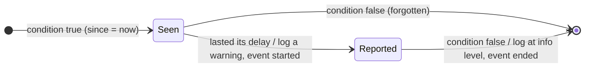

- **MON-LIFE-1** A problem is reported once it lasted its delay (§4.2,
  §4.3). A problem that goes away starts again from zero when it comes
  back, and after a restart.
- **MON-LIFE-2** When a problem is reported, a warning is logged, and an
  `adaptative_climate_problem` event is fired with `status: started`. When
  it ends, it is logged at info level, and the event is fired with
  `status: ended`.
- **MON-LIFE-3** Event data: `entry_id`, `name`, `entity_id` (the
  monitoring sensor of the problem), `status`, `message` (as logged),
  `problem` (as in the `problems` attribute). Automations can use it to
  send notifications.
