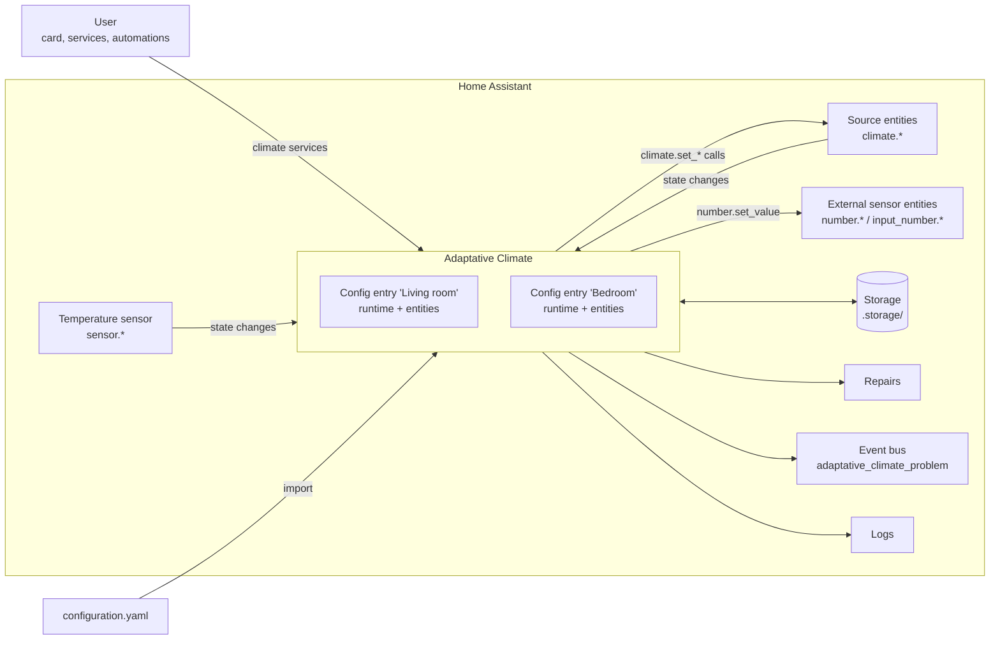
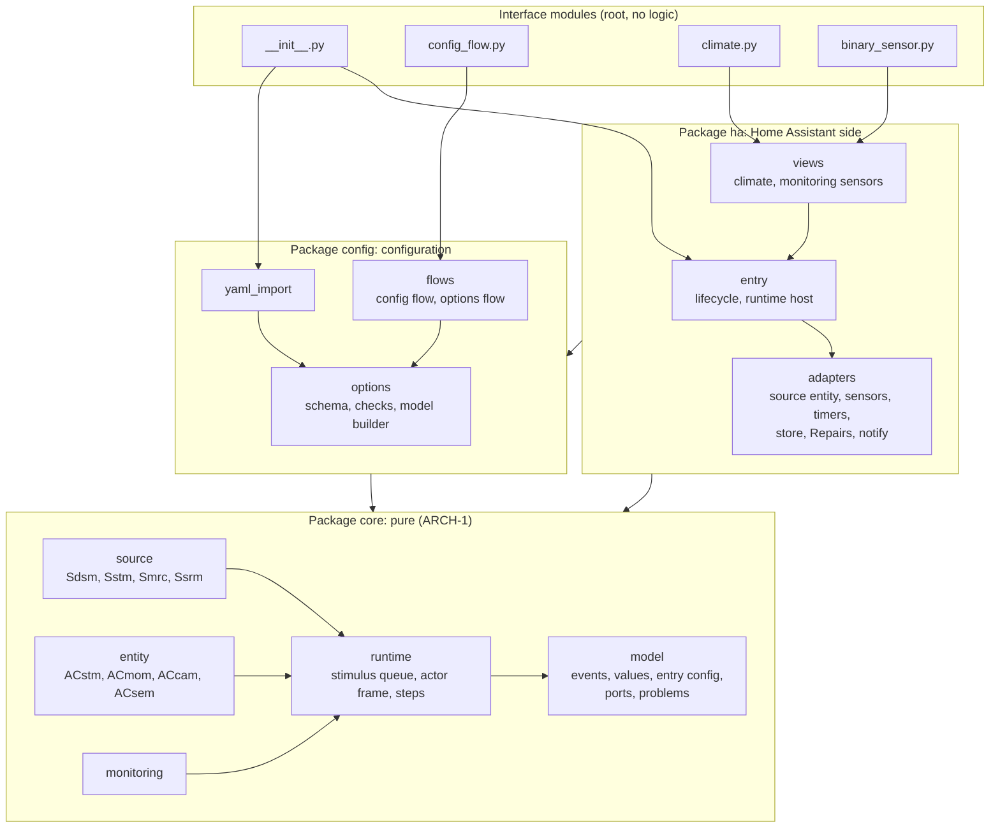
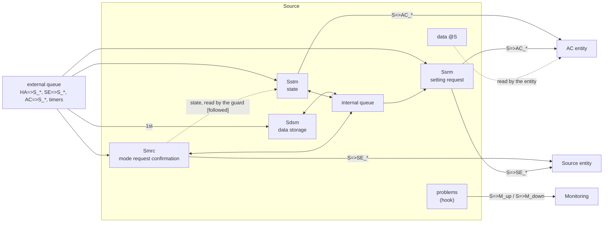
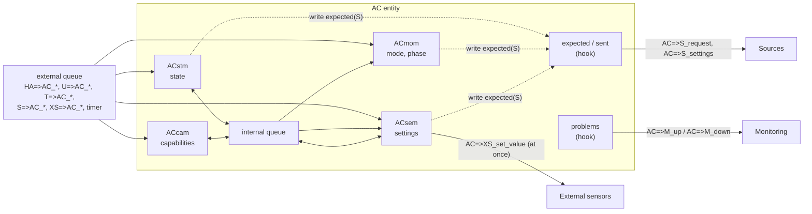
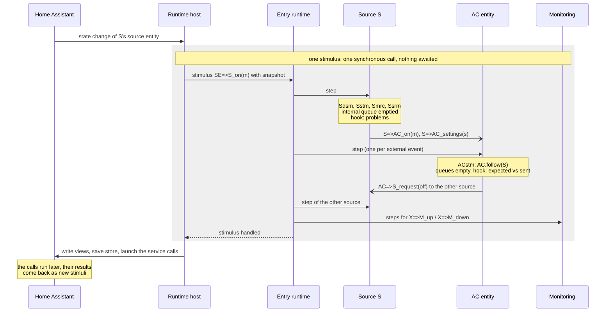
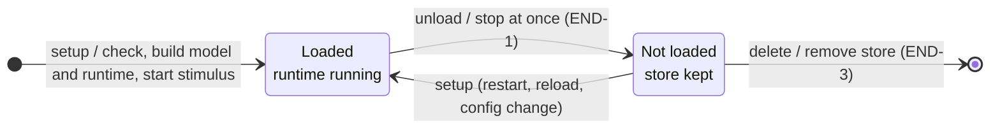

# Adaptative Climate — Architecture

Status: **draft** (2026-11-17), built from `SPEC.md` (agreed 2026-11-17).

This document says how the code carries out the spec: the components, how
the execution model of the spec runs inside Home Assistant, where each
function of the spec lives, and how the Python package is split. It does
not restate the behavior: **the spec is the reference for what the
integration does**; this document is the reference for where and how it
is done. When they seem to disagree, the spec wins and this document is
fixed.

Conventions:

- The terms of this document are defined in §0, before their first use;
  the other words have the meaning of the glossary of the spec (§0 of
  `SPEC.md`). Events and data are named as in the spec (`S=>AC_on(m)`,
  `state@S`).
- `§` alone points to this document. "§... of the spec" (or "spec §..."
  where space is short), the columns titled "Spec", and the rule ids
  (`EXEC-1`, `ENT-SEND-3`...) point to the spec.
- Design decisions are named `ARCH-<n>`, each with why it is taken.
- Diagrams are Mermaid, as in the spec.

## Table of contents

- [0. Terms](#0-terms)
- [1. System context](#1-system-context)
- [2. Principles](#2-principles)
- [3. Components](#3-components)
- [4. Inside the actors](#4-inside-the-actors)
  - [4.1 Source](#41-source)
  - [4.2 AC entity](#42-ac-entity)
  - [4.3 Monitoring](#43-monitoring)
- [5. Runtime: one stimulus](#5-runtime-one-stimulus)
- [6. Ports and adapters](#6-ports-and-adapters)
- [7. Persistence](#7-persistence)
- [8. Entry lifecycle](#8-entry-lifecycle)
- [9. Configuration](#9-configuration)
- [10. Home Assistant integration points](#10-home-assistant-integration-points)
- [11. Python package layout](#11-python-package-layout)
- [12. Traceability](#12-traceability)

## 0. Terms

Each term is used with this meaning only. The first group comes from the
spec (its glossary, §0 of the spec); the second is proper to this
document.

**Execution (from the spec)**

| Term | Meaning | More |
|---|---|---|
| **Event** | A message `X=>Y_name` sent by `X` to `Y`, which triggers something in `Y`. Always asynchronous: the sender never waits (EVT-1). The end of a timer is an event too. | §1.1.2 of the spec, §5 |
| **Data** | A value `name@X` that `X` makes readable (`state@S`). Read when needed: reading sends no event (EVT-3). | ARCH-6 |
| **Actor** | What handles its own events, one step at a time, with its own queues: the AC entity, each source, the monitoring (EXEC-1). | §4 |
| **Function** | A part of an actor, with its own state machine: `Sdsm`, `Sstm`, `Smrc`, `Ssrm` in a source; `ACstm`, `ACmom`, `ACcam`, `ACsem` in the entity. The monitoring has none. | §4 |
| **State machine** | States and transitions, as drawn in the spec (`event [guard] / activity`): one per function; in the monitoring, one per problem. | §4 |
| **Queue** | First in, first out. Each actor has an **external queue** (events from outside it); the entity and each source also have an **internal queue** (events between their functions). | §4, §5 |
| **Stimulus** | What comes from outside the entry: its start, its unload, a state change of an entity it watches, a service call on the AC entity, the end of a timer. Handled to the end before the next one (EXEC-3). | ARCH-3, §5 |
| **Step** | One actor handles one event of its external queue, then empties its internal queue (EXEC-1). | §4.1, §5 |

**Code (this document)**

| Term | Meaning | More |
|---|---|---|
| **Core** | The code that carries out the actors of the spec, pure Python (package `core`). | ARCH-1, §3 |
| **Runtime** | The part of the core that runs one entry: the stimulus queue, the queues of the actors, the steps. One per entry. | ARCH-3, §5 |
| **Stimulus queue** | The queue of the stimuli of an entry, separate from the queues of the actors. | ARCH-3 |
| **Hook** | What the runtime calls when both queues of an actor are empty, at the end of a step: the send of the entity, the problems told to the monitoring. | ARCH-5 |
| **Port** | What the core needs from outside, said in its own words: "send `set_hvac_mode` to my source entity", "start a timer", "save my data". | ARCH-2, §6 |
| **Adapter** | The implementation of a port with Home Assistant. | ARCH-2, §6 |
| **Runtime host** | The Home Assistant side of a runtime: turns the callbacks of Home Assistant into stimuli, launches the outgoing calls, writes the views and the store. | §3 |
| **View** | A Home Assistant entity of the integration (`climate`, monitoring binary sensors) that only shows the state of the core. | ARCH-8 |
| **Package**, **component**, **module** | The three levels of the code: a directory under the integration, a directory of a package, a Python file of a component. | §3, §11 |
| **Interface module** | A module at the root that Home Assistant requires there, with no logic: it calls a component. | §3, §11 |
| **Dependency** | `A` imports `B` and uses what it defines. Not a call. | §3 |

## 1. System context



Each config entry is independent: its own runtime, actors, stored data and
entities. Two entries that share a source entity each have their own
source for it (§0 of the spec: a source is local to its entry); they only meet on the
source entity itself, as the spec accepts (CFG-SENS-5).

## 2. Principles

- **ARCH-1 Pure synchronous core.** The actors of the spec (the AC
  entity, the sources, the monitoring) and their functions are plain
  Python: no `homeassistant` import, no `await`, no I/O.
  *Why:* a step runs with no wait (EXEC-1), and the state machines of the
  spec can then be tested event by event, without Home Assistant.
- **ARCH-2 Ports and adapters.** Everything outside the entry is reached
  through ports, implemented by adapters on the Home Assistant side:
  service calls, reads of other entities, state writes, storage, timers,
  Repairs, events, logs. The adapters turn what happens in Home Assistant
  into the events of the spec (`SE=>S_*`, `T=>AC_temperature`,
  `XS=>AC_*`, `U=>AC_*`, `HA=>X_start`, `HA=>X_unload`).
  *Why:* the core speaks only the language of the spec; Home Assistant
  details (versions, units, service names) stay at the edge (ENT-HA-1).
- **ARCH-3 One runtime per entry, one stimulus at a time.** The runtime of
  an entry has two levels of queues:
  - the **stimulus queue**, first in, first out: every stimulus enters
    it. The host turns each Home Assistant callback (setup, unload, a
    state change of a watched entity, a service call on the AC entity,
    the end of a timer) into one stimulus and puts it there;
  - the **queues of the actors**, external and internal (EXEC-1): they
    hold only the events of the stimulus being handled, never those of
    the next one.

  The handling of a stimulus **begins** when the runtime takes it from
  the stimulus queue and puts its initial events in the external queues
  of the actors (§5). It runs steps, and **ends** when every queue of
  every actor is empty, end-of-step hooks included (ARCH-5). Only then
  does the runtime take the next stimulus.

  The stimulus queue is most of the time empty: a handling is
  synchronous (ARCH-1), so Home Assistant runs no other callback
  meanwhile, and the next stimulus arrives after the end. It fills only
  when Home Assistant calls back the entry synchronously during a
  handling (a state written by the entry).

  The start of the entry is one stimulus: `HA=>AC_start` is put before the
  `HA=>S_start` of the sources and `HA=>M_start` (EXEC-4).
  *Why:* EXEC-3 requires each stimulus to be handled to the end before
  the next one; a queue of stimuli separate from the queues of the actors
  makes it hold even when Home Assistant calls back synchronously.
- **ARCH-4 Outgoing calls are fire-and-forget.** The core does not wait
  for a service call to a source entity (`S=>SE_*`) or to an external
  sensor entity (`AC=>XS_set_value`). It hands the call to the runtime
  host and goes on at once; the host launches it as an asynchronous Home
  Assistant task, in the order it was sent. The call itself runs
  asynchronously, after the end of the stimulus, since the stimulus never
  yields (ARCH-1). Nothing comes back to the sender as a return value:
  the error of the call comes back later as a new stimulus
  (`SE=>S_call_failed(c)`, `XS=>AC_call_failed`), and its effect as a
  state change of the entity called.
  *Why:* a step never waits (EXEC-1), every event is asynchronous with
  any answer as another event (EVT-1), and the result of a call is a new
  stimulus (EXEC-3).
- **ARCH-5 End-of-step hooks.** When the two queues of an actor are empty,
  the runtime calls its hook: for the entity, the send of the difference
  between `expected(S)` and `sent(S)` (ENT-SEND-3); for the entity and each
  source, the diff of the problems told to the monitoring (MON-SEND-1).
  *Why:* the spec decides there, and only the final value counts
  (ENT-SEND-3).
- **ARCH-6 Data are read-only queries.** `state@S`, `capabilities@S`,
  `temperature@S`, `action@S`, `settings@S` are read-only accessors of the
  source; `temperature@T` and `attributes@XS` are read through a port.
  Reading changes nothing and sends nothing.
  *Why:* EVT-3.
- **ARCH-7 Timers: decided in the core, waited by Home Assistant.** A
  timer of the spec has two sides:
  - **the decision**, in the core: the function that names the timer
    (`Smrc` for `Smrc_confirm_timeout`, `Sdsm` for
    `Sdsm_removal_timeout`...) decides when it starts, restarts or is
    cancelled, knows whether it runs, and handles its end;
  - **the wait**, in Home Assistant: the core asks the timer port to
    start or cancel the timer; the adapter schedules a Home Assistant
    callback (`async_call_later`) and keeps its cancel function. The core
    never waits and never reads the time.

  At the end, Home Assistant calls the adapter back, which puts the end
  of the timer (`Smrc_confirm_timeout` for the source `S`) in the
  stimulus queue (ARCH-3): a stimulus like the others. Each start carries
  a number; an end whose timer was cancelled or restarted since is
  ignored. At unload, every timer is cancelled (END-1).

  ```mermaid
  sequenceDiagram
      participant C as Core (Smrc)
      participant P as Timer adapter
      participant L as HA event loop
      participant R as Runtime

      C->>P: start confirm timer (30 s)
      P->>L: async_call_later(30 s, callback)
      Note over C,R: the stimulus ends, the core returns<br/>nothing runs in the core during the 30 s
      L->>P: callback, 30 s later
      P->>R: stimulus Smrc_confirm_timeout (source S)
      R->>C: step of S, Smrc gets the event
  ```

  *Why:* the core stays pure (ARCH-1) and testable with a fake clock,
  with no real wait; the end of a timer is an event of its function (§1.2.1, §1.3.1,
  §4.4 of the spec).
- **ARCH-8 Home Assistant entities are views.** The `climate` entity and
  the two monitoring binary sensors only show the state of the core and
  forward the user requests to the runtime. Their state is written once
  per stimulus, after it, when it changed.
  *Why:* the behavior lives in one place; the card sees a consistent state
  (ENT-CAP-7: "the entity writes its state in Home Assistant").
- **ARCH-9 Stored data saved per stimulus.** Each actor marks its stored
  data changed (`save` in the spec); the runtime writes them after the
  stimulus. The data of the entity and of each source are validated and
  restored independently.
  *Why:* the stored data are saved at each change (END-1); a loss on one
  side changes nothing on the other (SRC-DATA-5, ENT-DATA-2).
- **ARCH-10 The configuration is frozen per load.** The configuration is
  read once when the entry is set up, checked, and turned into an
  immutable model given to the core (modes configured, mono-/bi-source,
  served modes and options per source entity). A change of configuration
  is a reload.
  *Why:* ENT-TYPE-1, ENT-INIT-4.
- **ARCH-11 Loop guard.** By the spec, the handling of a stimulus is
  short and always ends: a source never answers a request of the entity
  (SRC-STATE-3, SRC-SET-2), the entity does not send back what a source
  reported (ENT-SEND-2), and the monitoring sends nothing (MON-ROLE-1).
  The queues have no maximum size (bounds: §5). As a guard against a bug
  (two functions that keep triggering each other), the runtime counts the
  steps of each stimulus. Beyond a wide limit (1000 steps), it logs an
  error with the last events handled, drops the events left in the
  queues, and ends the stimulus. The entry keeps running: the next
  stimulus is handled as usual. The state may be inconsistent until then;
  the log points to a bug to fix, not to a behavior.
  *Why:* a loop would block the event loop of Home Assistant, and every
  integration with it. With the guard, the bug shows in the logs and the
  entry keeps running.

## 3. Components

The code has three levels, the same in this document and in the tree of
the code (§11):

- a **package** is a directory under the integration: `core`, `ha`,
  `config`;
- a **component** is a directory of a package: `core/source`,
  `ha/adapters`...;
- a **module** is a Python file of a component: `core/source/state.py`.

At the root of the integration, the **interface modules** are only the
entry points Home Assistant requires at that place (`__init__.py`,
`config_flow.py`, `climate.py`, `binary_sensor.py`). They hold no logic:
each one imports a component and calls it (§11). How Home Assistant sees
the integration through them: §10.



An arrow `A → B` is a **dependency**: `A` imports `B` and uses what it
defines. It is not a call: at run time, calls also go against the
arrows. The runtime calls the actors through the frame of `runtime`,
which `source`, `entity` and `monitoring` depend on; the core calls the
adapters through the ports of `model`, which `ha/adapters` implements. An
arrow to a package stands for arrows to its components.

| Package | Component | Role | Spec |
|---|---|---|---|
| `core` | `runtime` | Stimulus queue, frame of an actor (external and internal queues, steps, end-of-step hooks), start order, loop guard. | §1.1.3, ARCH-3, ARCH-5, ARCH-11 |
| | `source` | The source actor: its four functions, its data `@S`, its problems. | §1.2 |
| | `entity` | The AC entity actor: its four functions, `expected` / `sent`, its problems. | §1.3 |
| | `monitoring` | The monitoring actor: one state machine per problem, the delays. | §4 |
| | `model` | Events, values (modes and their order, settings, capabilities, comparison of values), configuration model, ports, problem types. | §0, §1.1.2, ARCH-2, ARCH-10 |
| `ha` | `entry` | Lifecycle of an entry (setup, unload, reload, delete), and the runtime host: subscribes to the entities watched, turns callbacks into stimuli, launches the outgoing calls, writes the views and the store after each stimulus. | §1.1.4, ARCH-3, ARCH-4, ARCH-8, ARCH-9 |
| | `views` | The `climate` entity and the two monitoring binary sensors, as views of the core. | §2, ARCH-8 |
| | `adapters` | The ports of the core implemented with Home Assistant (§6). | ARCH-2 |
| `config` | `options` | The options and their schema, the checks shared by the UI and the YAML, the builder of the configuration model. | §3.1, §3.3, ARCH-10 |
| | `flows` | Config flow and options flow (UI). | §3, CFG-YAML-4 |
| | `yaml_import` | Import and sync of the YAML entries. | §3.2 |

Dependency rules:

- between packages: `ha` → `config` → `core`, and `ha` → `core`. The core
  imports nothing from the other packages, nor from `homeassistant`
  (ARCH-1). The interface modules import only the components they call;
- inside `core`: every component uses `model`; `source`, `entity` and
  `monitoring` use the actor frame of `runtime`. The runtime knows actors
  only through that frame: the actors are built by `ha/entry` and given to
  it;
- inside `ha`: `views` forward the user requests to `entry`, which owns
  the runtime; `entry` builds the `adapters` and gives them to the core as
  its ports.

## 4. Inside the actors

Terms used here (actor, function, state machine, queue, step): §0.

The AC entity and each source have the same frame, given by the runtime:
an external queue, an internal queue, their four functions, and an
end-of-step hook (EXEC-1). A function handles the events its state
machine knows, ignores the others, and sends events to the other
functions of its actor (internal queue) or to other actors (their
external queue, through the runtime). The monitoring is the exception:
an external queue only, no functions (§4.3).

### 4.1 Source



Arrows of §4.1 and §4.2: a **solid** arrow is a flow of events (who
sends events to whom); a **dotted** arrow is a flow of data, read or
written with no event (EVT-3). Only the data flows the text discusses are
drawn. Neither kind is a dependency between modules (§3).

- A step of the source has two phases (EXEC-1):
  1. the external event is given to the four functions, `Sdsm` first,
     then `Sstm`, `Smrc` and `Ssrm`. The internal events they send
     (`Sdsm=>Sstm_*`, `Sstm=>Smrc_send`, `Sstm=>Ssrm_*`,
     `Smrc=>Ssrm_confirmed`) wait in the internal queue;
  2. once the four functions have had it, the internal queue is emptied,
     in the order of sending; the internal events sent meanwhile are
     added at its end.

  So each function judges the external event in the state it was in
  when the event arrived, never after a reaction to that same event.
  Example: on `SE=>S_on(cool)` in `CONFIRMING(cool)`, `Ssrm` gets the
  event in `HOLD` and ignores it; only then does it get
  `Smrc=>Ssrm_confirmed(cool)` and enter `SETTLE` (§5.1 of the spec). The
  same holds for the entity (§4.2).
- In `CONFIRMING(r)`, a change of the source entity that does not show `r`
  is not followed by `Sstm` (SRC-STATE-5, SRC-REQ-1). `Sstm` gets every
  external event like the other functions; its transitions on a change of
  the source entity carry the guard `[followed]` (§1.2.3.1 of the spec),
  which reads the state of `Smrc`: a read of data, not an event. `Sstm`
  gets the event before `Smrc`, so it reads the state of `Smrc` as it was
  when the event arrived (EXEC-1).
- The source keeps the last snapshot of its source entity given by the
  adapter (state and attributes). `settings@S`, `temperature@S` and
  `action@S` are read from it; `Sdsm` reads it on each change
  (SRC-DATA-6).
- The removal confirmations (SRC-DATA-10) are timers of `Sdsm`, one per
  value or item no longer shown.
- The problem hook judges source not discovered (from `Sstm`), out of
  sync (from `Smrc`, SRC-REQ-9) and setting not applied (from `Ssrm`,
  SRC-SET-9).

### 4.2 AC entity



- A step of the entity has the same two phases as a step of a source
  (§4.1): the external event is given to the four functions, then the
  internal queue is emptied. The spec fixes no order between the
  functions of the entity; the code gives the event in the order of §1.3
  of the spec (`ACstm`, `ACmom`, `ACcam`, `ACsem`), so that a step is
  deterministic.
- `AC.apply(m)`, `AC.apply(off)`, `AC.follow(S)` (§1.3.2.1 of the spec) and
  `AC.apply(p)` (§1.3.3.2.1 of the spec) only change `expected(S)` (ENT-SEND-1). The
  hook sends the difference with `sent(S)`, request first, then one
  `AC=>S_settings` (ENT-SEND-3), and nothing to an `UNDISCOVERED` source.
- The writes to the external sensor entities are the one exception: sent
  at once, not by the hook (ENT-EXT-1).
- `ACsem` gathers four parts, each in its own module of `core/entity`: reference
  temperature, external sensors, temperature targets, fan/swing values and
  memories (§1.3.5.1 to §1.3.5.4 of the spec).
- The problem hook judges source unusable (MON-SRC-1, from the stored
  mode, the state and the phase) and the temperature problems (MON-TEMP-5,
  from `temperature@T` and `temperature@S`).
- Repairs issues (ENT-HVAC-5, ENT-FAN-7, ENT-FAN-8) are raised and cleared
  through the Repairs port, at once: they are not monitoring problems.

### 4.3 Monitoring

An actor with an external queue only: no functions, so no internal queue
(EXEC-1). Instead of functions, it keeps one state machine per problem
(`Seen` / `Reported`, §4.4 of the spec), created on `X=>M_up(p)` and
removed when the problem ends, each with its delay timer. It writes the state of
the two binary sensors, logs, and fires `adaptative_climate_problem`
through the notify port. It reads no data of the other actors and sends
them nothing (MON-ROLE-1).

## 5. Runtime: one stimulus

Three levels, one inside the other (terms: §0), with when each begins and
ends:

| Level | What it is | Begins | Ends |
|---|---|---|---|
| **Stimulus** | What comes from outside the entry (EXEC-3), as one Home Assistant callback. | Taken from the stimulus queue: its initial events are put in the external queues of the actors (ARCH-3). | Every queue of every actor is empty, hooks included. |
| **Step** | One actor handles one event of its external queue, then empties its internal queue (EXEC-1). | The actor takes the event. | Its internal queue is empty. |
| **Event** | A message `X=>Y_name` (§0). | Sent. | Handled. |

An event in an external queue is either an **initial event** of the
stimulus, or an event **caused** by it. Its sender tells which, always the
same way; nothing needs to mark it:

| Initial events: sender outside the entry | Caused events: sender in the entry |
|---|---|
| `HA=>X_start`, `HA=>X_unload` | `S=>AC_*` |
| `U=>AC_set_mode`, `U=>AC_set_settings` | `AC=>S_request`, `AC=>S_settings` |
| `T=>AC_temperature` | `S=>M_up/down`, `AC=>M_up/down` |
| `SE=>S_*`, `SE=>S_call_failed` included | every event of an internal queue |
| `XS=>AC_usable`, `XS=>AC_call_failed` | |
| the ends of timers (`Smrc_confirm_timeout`, `M_delay_timeout`...) | |

Most stimuli have one initial event (`SE=>S_on(m)` to a source, a timer
end to the actor that owns the timer); the start and the unload have one
per actor (EXEC-4). Only the runtime takes a stimulus from the stimulus
queue; an actor can only send an event inside the current stimulus.

Example: a source entity changes, the source follows it (takeover), and
the entity turns another source off.



- The grey box is the stimulus, from the moment the runtime takes it to
  "stimulus handled". It is one synchronous call: nothing is awaited
  inside it (ARCH-1). What follows the box (views written, store saved,
  calls launched) is after the stimulus (ARCH-4, ARCH-8, ARCH-9).
- The runtime keeps the order of each sender (EXEC-2): an actor's
  events to another one are delivered in the order they were sent. The
  order between senders is the order of sending in the entry.
- User requests (`U=>AC_set_mode`, `U=>AC_set_settings`) are stimuli
  too. The runtime returns the outcome of the stimulus to the climate
  view, which turns a refusal (ENT-STATE-4, ENT-FAN-4) into a service
  error.

**Bounds of the queues.** Since no exchange loops (ARCH-11), the longest
chain in a stimulus is: source entity change → source → entity → hook →
other sources → monitoring. Orders of magnitude per stimulus:

| Queue | At most, per stimulus |
|---|---|
| External queue of the entity | about 5: one update of a source can give `S=>AC_capabilities`, `S=>AC_off` / `S=>AC_on(m)`, `S=>AC_settings`, `S=>AC_temperature`, `S=>AC_action` |
| External queue of a source | the event of the stimulus, then `AC=>S_request` and `AC=>S_settings` |
| External queue of the monitoring | the problems that change in the stimulus |
| Internal queues | a few events in a chain (`Sdsm` → `Sstm` → `Smrc` → `Ssrm`, `ACcam` → `ACsem` → `ACmom`) |

Between two stimuli, every queue of the actors is empty (EXEC-3): a
steady stream of stimuli waits in the stimulus queue (ARCH-3), never piles
up events in the queues of the actors, and never delays a hook.

## 6. Ports and adapters

The core declares the ports (`core/model/ports.py`); the component
`ha/adapters` implements them with Home Assistant.

| Port | Used by | Does | Adapter (`ha/adapters/`) |
|---|---|---|---|
| Source entity | source | `S=>SE_set_hvac_mode`, `S=>SE_set_*` (launched, not awaited, ARCH-4); reads the snapshot at start (SRC-DATA-4). | `source_entity.py`: also turns state changes into `SE=>S_off`, `SE=>S_on(m)`, `SE=>S_unavailable`, `SE=>S_unknown`, `SE=>S_attributes` with the snapshot, and call errors into `SE=>S_call_failed(c)`. |
| Temperature sensor | entity | `temperature@T`: value converted to the unit of Home Assistant, `None` when not valid (CFG-SENS-6). | `sensors.py`: also turns changes into `T=>AC_temperature(t)`. |
| External sensor | entity | `attributes@XS`; `AC=>XS_set_value(v)`. | `sensors.py`: also gives `XS=>AC_usable`, `XS=>AC_call_failed`. |
| Timers | every actor | start, restart, cancel a named timer. | `timers.py`: Home Assistant scheduled callbacks, each end a stimulus; all cancelled at unload (ARCH-7). |
| Store | every actor | restore at start; mark changed. | `store.py` (§7). |
| Repairs | entity | raise, clear an issue. | `repairs.py`. |
| Notify | monitoring, every actor | log at a level; fire `adaptative_climate_problem`. | `notify.py`. |
| Clock | monitoring | now (`since`, spec §4.4). | `timers.py`: Home Assistant time. |

Units and versions stay in the adapters: the core works in the unit of
Home Assistant (CFG-UNIT-1); the climate view provides both the `native_*`
and the former property names (ENT-HA-1). Offsets are applied by the
entity, not by the adapters (CFG-SENS-1).

## 7. Persistence

One Home Assistant `Store` per entry, keyed by the entry id, with one part
for the entity and one per source entity configured.

| Part | Content | Spec |
|---|---|---|
| Entity | mode, last used mode, phase, temperature targets, fan/swing memory; plus the configuration fingerprint, an internal value (§8) | §1.3.6 |
| Source (one per source entity) | state, `hvac_modes`, mode capabilities and `low_high_seen` per mode, kept settings | §1.2.2.1 |

- **Restore** (`HA=>AC_start`, `HA=>S_start`): each part, and each value in
  it, is validated alone; a missing or invalid value is handled as the
  spec says (SRC-DATA-4, SRC-DATA-5, ENT-DATA-1, ENT-DATA-2). A part of a
  source entity no longer configured is dropped (SRC-DATA-9); the memory
  of a mode no longer configured is dropped (ENT-DATA-1).
- **Save**: after each stimulus that changed a stored value (ARCH-9). The
  `Store` object is kept by the integration across reloads, so that a
  write still pending is not lost when the entry reloads; Home Assistant
  writes the pending data when it stops.
- **Delete**: the store of the entry is removed (END-3).

## 8. Entry lifecycle



- **Setup**: the configuration is read and turned into the model
  (ARCH-10); the store is loaded; the runtime, the actors and the adapters
  are built; the host subscribes to the source entities, the temperature
  sensor and the external sensor entities; then the start stimulus runs
  (`HA=>AC_start`, `HA=>S_start`, `HA=>M_start`, EXEC-4). The views are
  added to Home Assistant before the start stimulus, so that the first
  state is written at its end.
- **Unload** (END-1): the host unsubscribes, every timer is cancelled, the
  stimuli waiting in the stimulus queue are dropped, the Repairs issues of the entry are
  removed. Nothing is sent to the source entities and no event is fired.
  Calls already launched are left to end; their results find no runtime
  and are ignored.
- **Reload on a change of configuration**: an options flow saved, or a
  YAML entry changed, reloads the entry: unload then setup. The spec then
  wants the entity in `OFF` (ENT-INIT-4), while a reload or a restart
  without change resumes the stored mode. The setup cannot tell the two
  apart by itself: a YAML entry can change while Home Assistant is
  stopped, and is then updated before the entry is set up. So the entity
  remembers which configuration it last ran with:
  - the configuration model carries a **fingerprint**, a digest of the
    configuration of the entry (`core/model/entry_config.py`, computed by
    `config/options/builder.py`);
  - the entity stores the fingerprint it ran with, beside its stored data
    (§7). It is an internal value, not data of the spec;
  - at `HA=>AC_start`, the entity compares the stored fingerprint with the
    one of the model (`core/entity/stored.py`). Different: the
    configuration changed, the stored mode becomes `off` and the phase is
    forgotten (ENT-INIT-4). The same: a restart, the stored mode is
    resumed. Then it stores the new fingerprint.

  The same rule covers the options flow, the YAML changed while running,
  and the YAML changed while Home Assistant was stopped.
- **Delete** (END-3): after the unload, the store is removed. Home
  Assistant removes the entities.

## 9. Configuration

The package `config` (§3), plus the configuration model of `core/model`.

- **Schema** (`config/options/schema.py`): the options of §3.1 of the spec with their types,
  ranges and defaults, in the unit of Home Assistant (CFG-UNIT-1).
- **Checks** (`config/options/checks.py`): one function judges a configuration
  for the UI and the YAML alike (CFG-YAML-5), and gives the errors of
  CFG-CHECK-1. It reads Home Assistant for what depends on it: the
  `hvac_modes` shown by the source entities (CFG-MODE-5), the unit of the
  temperature sensor (CFG-SENS-6), the AC entities (CFG-MODE-2), the other
  entries (CFG-NAME-1, CFG-SENS-5). At a start with an unchanged
  configuration, nothing is refused (CFG-MODE-5, CFG-CHECK-1).
- **Config flow and options flow** (`config/flows/`): the UI; the options
  flow saves the whole configuration at once (CFG-YAML-4). An imported
  entry has no options flow (CFG-YAML-3).
- **YAML import** (`config/yaml_import/`): at Home Assistant start, the
  YAML entries are matched to the imported entries by `name`; an entry is
  created, updated or deleted to match the YAML (CFG-YAML-1 to
  CFG-YAML-3). An invalid entry is not imported and the error is logged.
- **Configuration model** (`core/model/entry_config.py`, built by
  `config/options/builder.py`): built from a checked
  configuration, immutable (ARCH-10). It gives the core what it derives
  from the configuration: the modes configured in mode order, whether
  `heat_cool` is bi-source (CFG-MODE-3), one source per source entity
  with its served modes, offset and external sensor (CFG-SENS-3,
  CFG-SENS-4), the external sensor entities kept once (ENT-EXT-1), the
  timers and limits.

## 10. Home Assistant integration points

The other perspective on §3: what Home Assistant sees of the integration,
and which component answers. Home Assistant enters through the interface
modules at the root, or through the callbacks and calls the components
register themselves.

| Integration point | Entered through | Component | Spec |
|---|---|---|---|
| Setup, unload, removal of a config entry | `__init__.py` | `ha/entry` | §1.1.4 |
| YAML (`adaptative_climate:` in `configuration.yaml`) | `__init__.py` | `config/yaml_import` | §3.2 |
| Config flow, options flow | `config_flow.py` | `config/flows` | §3 |
| `climate.<name>`: state, attributes, features, `available` false in `INIT` and `NO_SOURCE`; `set_hvac_mode`, `turn_on`, `turn_off`, `set_temperature`, `set_fan_mode`, `set_swing_mode`, `set_swing_horizontal_mode` | `climate.py` | `ha/views` | §1.3.2, §1.3.4, §2.1, §2.2, ENT-HA-1 |
| `binary_sensor.<name>_monitoring_sources`, `..._monitoring_temperatures`: device class problem, never `unavailable` while loaded, attributes `problems`, `max_gap` | `binary_sensor.py` | `ha/views` | §4.1, MON-SENS-4 |
| State changes of the source entities, the temperature sensor, the external sensor entities | callbacks registered at setup | `ha/entry`, `ha/adapters` | §1.1.2, §1.1.3 |
| Scheduled callbacks (timers), tasks of the outgoing calls | callbacks and tasks | `ha/adapters`, `ha/entry` | ARCH-4, ARCH-7 |
| Storage | `Store` | `ha/adapters` | §1.2.2.1, §1.3.6 |
| Repairs issues | Repairs API | `ha/adapters` | ENT-HVAC-5, ENT-FAN-7, ENT-FAN-8 |
| Event `adaptative_climate_problem`, logs | event bus, logger | `ha/adapters` | MON-LIFE-2, MON-LIFE-3 |

## 11. Python package layout

The tree follows the levels of §3: package / component / module. Each
component directory is a Python package (`__init__.py`, not shown).

```text
custom_components/adaptative_climate/
  __init__.py                interface: setup, unload, remove → ha/entry;
                             YAML at start → config/yaml_import
  config_flow.py             interface: exposes the flows of config/flows
  climate.py                 interface: platform setup → ha/views
  binary_sensor.py           interface: platform setup → ha/views
  const.py                   the domain name, shared by every package
  manifest.json, strings.json, translations/

  core/                      package: pure Python, no homeassistant import (ARCH-1)
    runtime/
      stimulus_queue.py      stimulus queue (ARCH-3)
      actor.py               frame of an actor: queues, steps, hooks (EXEC-1, ARCH-5)
      runtime.py             entry runtime: start order, stimulus handling,
                             loop guard (EXEC-3, EXEC-4, ARCH-11)
    model/
      events.py              the events of spec §1.1.2, §1.2.1, §1.3.1, §4.4
      values.py              modes and their order, settings, capabilities,
                             comparison of values (SRC-SET-4)
      entry_config.py        configuration model and its fingerprint (ARCH-10, §8)
      ports.py               the ports of §6
      problems.py            problem types, diff of the problems told (MON-SEND)
    source/
      source.py              source actor, data @S, problems of the source
      storage.py             Sdsm: stored data, restore, update,
                             removal confirmation (spec §1.2.2)
      state.py               Sstm (spec §1.2.3)
      confirmation.py        Smrc (spec §1.2.4)
      settings.py            Ssrm (spec §1.2.5)
    entity/
      entity.py              AC entity actor, problems of the entity
      state.py               ACstm: AC.apply, AC.follow (spec §1.3.2)
      mode.py                ACmom: mono/bi-source, phase, AC.wanted (spec §1.3.3)
      capabilities.py        ACcam (spec §1.3.4)
      settings.py            ACsem: entry point of the four parts below (spec §1.3.5)
      reference.py           reference temperature (spec §1.3.5.1)
      external_sensors.py    external sensors (spec §1.3.5.2)
      targets.py             temperature targets (spec §1.3.5.3)
      fan_swing.py           fan/swing values and memories (spec §1.3.5.4)
      sending.py             expected / sent (ENT-SEND)
      stored.py              stored data of the entity (spec §1.3.6),
                             fingerprint check at start (§8)
    monitoring/
      monitoring.py          monitoring actor (§4.3, spec §4)
      problem_lifecycle.py   Seen / Reported state machine of one problem (spec §4.4)

  ha/                        package: Home Assistant side
    entry/
      lifecycle.py           setup, unload, reload, delete of an entry (§8)
      host.py                runtime host: listeners, stimuli, tasks, view writes,
                             store saves (ARCH-3, ARCH-4, ARCH-8, ARCH-9)
    views/
      climate_view.py        the climate entity (ARCH-8, ENT-HA-1)
      monitoring_sensors.py  the two monitoring binary sensors (spec §4.1)
    adapters/
      source_entity.py       source entity port
      sensors.py             temperature sensor and external sensor ports
      timers.py              timer and clock ports (ARCH-7)
      store.py               store port (§7)
      repairs.py             Repairs port
      notify.py              logs and problem events

  config/                    package: configuration
    options/
      schema.py              options of spec §3.1: types, ranges, defaults
      checks.py              CFG-CHECK-1, shared by the UI and the YAML
      builder.py             builds the configuration model and its fingerprint (ARCH-10)
    flows/
      config_flow.py         config flow (UI)
      options_flow.py        options flow (UI)
    yaml_import/
      yaml_import.py         import and sync of the YAML entries (CFG-YAML)
```

- **Interface modules**: Home Assistant requires them at the root, under
  these names. Each one only imports a component and calls it, or exposes
  its class (`config_flow.py` exposes the config flow class of
  `config/flows`, which Home Assistant looks for there). They hold no
  logic.
- `const.py` is the only other module at the root: it holds the
  domain name, imports nothing, and every package can import it.

## 12. Traceability

| Spec | Component | Modules |
|---|---|---|
| §1.1.2 Events and data | `core/model` | `events.py`, `ports.py` |
| §1.1.3 Execution model (EXEC) | `core/runtime`, `ha/entry` | `stimulus_queue.py`, `actor.py`, `runtime.py`; `host.py` |
| §1.1.4 End of an entry (END) | `ha/entry`, `ha/adapters` | `lifecycle.py`, `host.py`; `store.py`, `timers.py` |
| §1.2.2 Data storage management (SRC-DATA) | `core/source` | `storage.py` (`Sdsm`) |
| §1.2.3 State management (SRC-STATE, SRC-UNDISC, SRC-ON, SRC-UNUS) | `core/source` | `state.py` (`Sstm`) |
| §1.2.4 Mode request confirmation (SRC-REQ) | `core/source` | `confirmation.py` (`Smrc`) |
| §1.2.5 Setting request management (SRC-SET) | `core/source` | `settings.py` (`Ssrm`) |
| §1.3.2 State management (ENT-STATE, ENT-SEND, ENT-INIT, ENT-OFF, ENT-ON, ENT-WAIT, ENT-NOSRC) | `core/entity` | `state.py` (`ACstm`), `sending.py` |
| §1.3.3 Mode management (ENT-TYPE, ENT-PHASE, ENT-WANT) | `core/entity` | `mode.py` (`ACmom`) |
| §1.3.4 Capabilities management (ENT-CAP, ENT-HVAC, ENT-FEAT, ENT-STEP, ENT-RANGE, ENT-FAN) | `core/entity` | `capabilities.py` (`ACcam`) |
| §1.3.5 Settings management (ENT-SET) | `core/entity` | `settings.py` (`ACsem`) |
| §1.3.5.1 Reference temperature (ENT-REF) | `core/entity` | `reference.py` |
| §1.3.5.2 External sensors (ENT-EXT) | `core/entity`, `ha/adapters` | `external_sensors.py`; `sensors.py` |
| §1.3.5.3 Temperature targets (ENT-TGT) | `core/entity` | `targets.py` |
| §1.3.5.4 Fan and swing values (ENT-FANV) | `core/entity` | `fan_swing.py` |
| §1.3.6 Stored data (ENT-DATA) | `core/entity`, `ha/adapters` | `stored.py`; `store.py` |
| §2 Entities and attributes (ENT-HA) | `ha/views` | `climate_view.py`, `monitoring_sensors.py` |
| §3 Configuration (CFG) | `config/options`, `config/flows`, `config/yaml_import`, `core/model` | `schema.py`, `checks.py`, `builder.py`; `config_flow.py`, `options_flow.py`; `yaml_import.py`; `entry_config.py` |
| §4.1 Monitoring sensors (MON-SENS) | `ha/views` | `monitoring_sensors.py` |
| §4.2, §4.3 Problems (MON-SRC, MON-TEMP) | `core/source`, `core/entity`, `core/model` | `source.py`; `entity.py`; `problems.py` |
| §4.4 Lifecycle (MON-SEND, MON-LIFE, MON-ROLE) | `core/monitoring`, `ha/adapters` | `monitoring.py`, `problem_lifecycle.py`; `notify.py` |
