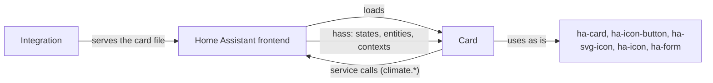

# Adaptative Climate card — Architecture

This document says how the code of the card carries out
[CARD_SPEC.md](CARD_SPEC.md). It does not restate the behavior. When they
seem to disagree, the spec wins and this document is fixed.

How the integration provides the card file: [ARCHITECTURE.md
§13](ARCHITECTURE.md#13-card-and-release).

Conventions:

- Design decisions are named `CARD-ARCH-<n>`. Each one may have a **Why**
  block.
- Rule ids (`CARD-PHASE-1`) point to [CARD_SPEC.md](CARD_SPEC.md).
- Short sentences. What is defined elsewhere is linked, not repeated.

## Table of contents

- [0. Terms](#0-terms)
- [1. Context](#1-context)
- [2. Principles](#2-principles)
- [3. Source tree](#3-source-tree)
- [4. Copied code](#4-copied-code)
- [5. Components of the card](#5-components-of-the-card)
- [6. Layout of the features](#6-layout-of-the-features)
- [7. Update of the copy](#7-update-of-the-copy)
- [8. Build](#8-build)
- [9. Traceability](#9-traceability)

## 0. Terms

| Term | Meaning |
|---|---|
| **Copy** | The files of the Home Assistant frontend that we copy, in `frontend/src/ha/`. |
| **Source tag** | The tag of the Home Assistant frontend the copy comes from: `20261028.6` (Home Assistant 2026.11.2). |
| **Minimum frontend** | The frontend of the oldest Home Assistant the card supports: `20260527.4` (Home Assistant 2026.6.0, [CARD-GEN-3](CARD_SPEC.md#card-gen-3)). |
| **AC code** | Our code, in `frontend/src/ac/`. |
| **Patch** | A small change to a copied file, kept as a file in `frontend/ha-patches/`. |
| **Shim** | A file we write at the path of a frontend file that we do not copy. It holds only what the copy needs from it. |
| **Element used as is** | An element of the Home Assistant frontend that the card uses without copying it (`ha-card`...). |
| **Prefix** | `ac-`, added to the tag name of each copied element. |

## 1. Context



The card runs in the browser, inside the Home Assistant frontend. It reads
the `hass` object and the contexts the frontend provides. It calls services
through them. It holds no logic of the integration
([CARD-GEN-4](CARD_SPEC.md#card-gen-4)).

## 2. Principles

- **CARD-ARCH-1**<a id="card-arch-1"></a> **Copy, not inheritance.** The dial
  comes from a copy of the Home Assistant frontend, compiled into the card
  file.

  > **Why:** the elements of the frontend are not a public API. A copy
  > changes only when we update it.

- **CARD-ARCH-2**<a id="card-arch-2"></a> **Copy and AC code apart.** The copy
  lives in `src/ha/`, the AC code in `src/ac/`. No logic is written in
  `src/ha/`.

  > **Why:** the copy can then be updated from a new tag
  > ([§7](#7-update-of-the-copy)).

- **CARD-ARCH-3**<a id="card-arch-3"></a> **Three levels of change**, from
  the least to the most intrusive:
  - **a.** from outside: properties, CSS variables, elements around;
  - **b.** a subclass of a copied class, in `src/ac/`;
  - **c.** a patch, as small as possible, marked `// AC-PATCH: <reason>`.

  A level is used only when the previous one cannot do it.
- **CARD-ARCH-4**<a id="card-arch-4"></a> **Copy or use as is.** An element of
  the frontend is used as is when:
  1. we do not change it;
  2. its interface is the same from the minimum frontend to the source tag;
  3. the frontend always loads it.

  Otherwise it is copied.

  > **Why:** an element loaded on demand may be missing when the card
  > shows. An element that changed between versions breaks on one of them.

- **CARD-ARCH-5**<a id="card-arch-5"></a> **Own card shell.** The card itself
  is AC code. It does not copy `hui-thermostat-card`. It copies the dial
  and what the dial needs.

  > **Why:** the card changes the shell in many places: monitoring in the
  > header, its own features, no water heater, no theme. Writing the shell
  > (about 150 lines) is simpler than patching it. The dial, which we keep
  > almost as is, is what benefits from updates.

- **CARD-ARCH-6**<a id="card-arch-6"></a> **Contexts kept.** The copy reads
  the contexts of the frontend (`hassApi`, `hassConfig`, `hassFormatters`,
  `hassInternationalization`) as it does in Home Assistant.

  > **Why:** the minimum frontend provides them. Replacing them would
  > mean patches.

## 3. Source tree

```text
frontend/
  package.json, package-lock.json, tsconfig.json, vite.config.ts
  ha-source.json        source tag, copied files, shims, elements used as is
  ha-patches/           one patch per change of level c
  scripts/
    update-ha.sh        copy from a tag, mechanical changes, patches (§7)
    compat-scan.py      what the copy needs from the minimum frontend (§7)
  src/
    index.ts            entry: registers the elements, the card in "Add card"
    ha/                 the copy (§4), with NOTICE (Apache 2.0)
    ac/                 the AC code (§5)
custom_components/adaptative_climate/frontend/
  adaptative-climate-card.js   the build (§8), not in git
```

## 4. Copied code

The copy keeps the paths of the frontend under `src/ha/`. It has 32 files,
about 4,300 lines, listed in `ha-source.json`:

| Element or module | Role |
|---|---|
| `ha-state-control-climate-temperature` | The dial of a climate entity. |
| `ha-control-circular-slider` | The arc and its handles. |
| `ha-big-number` | The large number in the center. |
| `state-control-circular-slider-style` | The styles of the dial. |
| `ha-control-select` | The bar of buttons, for the mode bar and the lists in `icons` style. |
| `common/…`, `data/climate`, `resources/svg-arc`, `util/…` | What these elements import. |

**Mechanical changes**, made by the update script on every copy:

- the prefix on each copied element: `ac-ha-state-control-climate-temperature`,
  `ac-ha-control-circular-slider`, `ac-ha-big-number`,
  `ac-ha-control-select`;
- the imports of the elements used as is are removed.

**Patches** (level c):

| Patch | File | Change | Rule |
|---|---|---|---|
| `emphasis-slider` | `ha-control-circular-slider` | A property `emphasis` (`low`, `high`). The handle it names is filled with its color. | [CARD-PHASE-1](CARD_SPEC.md#card-phase-1) |
| `emphasis-dial` | `ha-state-control-climate-temperature` | The same property, passed to the slider. | [CARD-PHASE-1](CARD_SPEC.md#card-phase-1) |
| `plus-minus-buttons` | `ha-state-control-climate-temperature`, `state-control-circular-slider-style` | `ha-outlined-icon-button` becomes `ha-icon-button`, with a round outline in CSS. | [CARD-DIAL-1](CARD_SPEC.md#card-dial-1) |

**Shims** (written by us, never overwritten by the update script):

| Path | What it holds |
|---|---|
| `src/types.ts` | The part of `HomeAssistant` the copy uses. |
| `src/panels/lovelace/types.ts`, `src/panels/lovelace/cards/types.ts` | The card types the copy uses. |
| `src/data/entity/entity_registry.ts`, `src/data/home_shortcuts.ts` | The types the copy imports from them. |
| `src/data/context/index.ts` | The four contexts, with the same keys as the frontend. |

**Elements used as is:** `ha-card`, `ha-icon-button`, `ha-svg-icon`,
`ha-icon`, and `ha-form` in the editor. They meet
[CARD-ARCH-4](#card-arch-4).

## 5. Components of the card

All in `src/ac/`.

| Component | Element | Role | Rules |
|---|---|---|---|
| Card | `adaptative-climate-card` | The shell: `ha-card`, header, dial, features. Checks the configuration. Grid size, start configuration. | [§1](CARD_SPEC.md#1-general), [§2](CARD_SPEC.md#2-layout-and-look), [§7](CARD_SPEC.md#7-missing-data), [CARD-CONF-1 to 3, 6](CARD_SPEC.md#8-configuration) |
| Phase | (in the card) | Turns `phase` into the `emphasis` of the dial. | [§3](CARD_SPEC.md#3-phase) |
| Monitoring | `ac-monitoring` | Finds the two monitoring sensors, shows their indicators. | [§6](CARD_SPEC.md#6-monitoring) |
| Features | `ac-features` | Shows the features in order, groups and packs the lists ([§6](#6-layout-of-the-features)). | [CARD-LOOK-1, 2, 4 to 7](CARD_SPEC.md#2-layout-and-look) |
| Device line | `ac-device-feature` | Mode icon, device name, status icon, its text on hover and press. | [§4](CARD_SPEC.md#4-device-line) |
| Mode bar | `ac-hvac-modes-feature` | On `ac-ha-control-select`. Tooltips, greyed modes. | [§5.1](CARD_SPEC.md#51-mode-bar) |
| Lists | `ac-list-feature` | Preset, fan, swing, horizontal swing. `dropdown` or `icons` style. | [§5.2](CARD_SPEC.md#52-lists) |
| Dropdown | `ac-dropdown` | Our own list: button, menu, keyboard, `listbox` / `option` roles. | [CARD-LIST-2, 3](CARD_SPEC.md#52-lists) |
| Editor | `adaptative-climate-card-editor` | `ha-form` for the options. Its own list of features: add, remove, up, down, options. | [CARD-CONF-4, 5](CARD_SPEC.md#8-configuration) |
| Texts | `localize.ts`, `translations/en.json`, `fr.json` | The texts of the card. The other texts come from the frontend. | [§9](CARD_SPEC.md#9-languages) |

Decisions on the components:

- **CARD-ARCH-7**<a id="card-arch-7"></a> The monitoring sensors are found
  in `hass.entities`: same `device_id` as the AC entity, platform
  `adaptative_climate`, translation key `monitoring_sources` or
  `monitoring_temperatures`.

  > **Why:** the entity ids can be renamed by the user. The device and the
  > translation keys cannot.

- **CARD-ARCH-8**<a id="card-arch-8"></a> The configuration is checked with
  `superstruct`, as the frontend does for its cards.
- **CARD-ARCH-9**<a id="card-arch-9"></a> The editor makes sure `ha-form` is
  loaded before it shows. If it is not, it asks the frontend for the editor
  of a built-in card that uses it.

  > **Why:** the frontend loads `ha-form` on demand
  > ([CARD-ARCH-4](#card-arch-4) does not hold for it). This is the usual way
  > for custom cards.

## 6. Layout of the features

The card measures itself, as the thermostat card does for its dial.

- **CARD-ARCH-10**<a id="card-arch-10"></a> The height of the card is
  **automatic** when the dashboard does not set it: not in a grid
  (`layout` not `grid`), or `grid_options.rows` is `auto`.
- **CARD-ARCH-11**<a id="card-arch-11"></a> Otherwise, the card has **room in
  height** when its measured height holds the dial and every list on its own
  row.
- **CARD-ARCH-12**<a id="card-arch-12"></a> The grid size the card asks for
  (`getGridOptions`) counts the lists packed two per row.

  > **Why:** the card starts compact, in a grid as in masonry. Making it
  > taller puts one list per row
  > ([CARD-LOOK-5](CARD_SPEC.md#card-look-5)).

- **CARD-ARCH-13**<a id="card-arch-13"></a> Two lists fit side by side when
  the measured width gives each a minimum width. The value (about 140 px)
  is set in the code and tuned in the manual tests.

## 7. Update of the copy

`frontend/scripts/update-ha.sh <tag>`:

1. Gets the files of `ha-source.json` at the new tag.
2. Makes the mechanical changes ([§4](#4-copied-code)).
3. Applies the patches. A patch that does not apply stops the script, and
   says where.
4. Runs `compat-scan.py` against the minimum frontend.

`compat-scan.py` lists what the copy needs from the host frontend, and
checks it exists in the minimum frontend:

- the contexts consumed, and the members used;
- the `--ha-*` CSS variables used without a fallback;
- the members of `hass` used;
- the translation keys;
- the elements used as is: they exist, and their properties, events and
  CSS variables are the same in both frontends;
- the calls to the backend.

It fails on anything missing.

- **CARD-ARCH-14**<a id="card-arch-14"></a> After an update, the copy shows
  the same as the thermostat card of the new version, side by side, before
  the AC changes are checked.

  > **Why:** it shows that the copy, the mechanical changes and the patches
  > are right.

## 8. Build

- Vite in library mode builds `src/index.ts` into one ES file:
  `custom_components/adaptative_climate/frontend/adaptative-climate-card.js`.
- TypeScript with `experimentalDecorators` and
  `useDefineForClassFields: false`, as the frontend.
- Dependencies bundled in the file: `lit`, `@lit/context`,
  `@lit-labs/observers`, `@egjs/hammerjs`, `@mdi/js`, `superstruct`.
- The version of `package.json` is the version of the integration
  ([ARCHITECTURE.md §13](ARCHITECTURE.md#13-card-and-release)). The card logs
  it in the browser console when it loads.
- In development, `vite build --watch` rebuilds the file on each change. The
  Home Assistant of development sees it through its link to the repository.

## 9. Traceability

| Spec | Components |
|---|---|
| [§1 General](CARD_SPEC.md#1-general) | Card |
| [§2 Layout and look](CARD_SPEC.md#2-layout-and-look) | Card, Features, the copy |
| [§3 Phase](CARD_SPEC.md#3-phase) | Card (phase), patches `emphasis-*` |
| [§4 Device line](CARD_SPEC.md#4-device-line) | Device line |
| [§5.1 Mode bar](CARD_SPEC.md#51-mode-bar) | Mode bar, `ac-ha-control-select` |
| [§5.2 Lists](CARD_SPEC.md#52-lists) | Lists, Dropdown, `ac-ha-control-select` |
| [§6 Monitoring](CARD_SPEC.md#6-monitoring) | Monitoring |
| [§7 Missing data](CARD_SPEC.md#7-missing-data) | Card, Features |
| [§8 Configuration](CARD_SPEC.md#8-configuration) | Card, Editor |
| [§9 Languages](CARD_SPEC.md#9-languages) | Texts |
