# Adaptative Climate — Specification

Status: **agreed** (2026-11-17, after three reviews). The code will
follow the spec.

Conventions:

- Rules are named `<SCOPE>-<SECTION>-<n>` (`SRC-DATA-3`, `ENT-INIT-1`...),
  so we can refer to them. A rule is what the integration **must** do.
  Within a prefix, the numbers go up in the order of the text.
- What is not a rule has no number: the glossary and the notation; the
  tables and the diagrams with their legends, identified by their
  section and the names in them (events, data, states, activities,
  options, attributes); the introductions that sum up a section with
  references; the notes, the examples and §5.
- Words have the meaning the glossary gives them (§0), one word per
  notion.
- Diagrams are Mermaid (rendered by GitHub and the VS Code Markdown preview
  with the Mermaid extension).

## Table of contents

- [0. Glossary](#0-glossary)
- [1. Overall behavior](#1-overall-behavior)
  - [1.1 Introduction](#11-introduction)
    - [1.1.1 Overview](#111-overview)
    - [1.1.2 Events and data](#112-events-and-data)
    - [1.1.3 Execution model](#113-execution-model)
    - [1.1.4 End of an entry](#114-end-of-an-entry)
  - [1.2 Source behavior](#12-source-behavior)
    - [1.2.1 Events](#121-events)
    - [1.2.2 Data storage management](#122-data-storage-management)
      - [1.2.2.1 Stored data](#1221-stored-data)
      - [1.2.2.2 Restore (at `HA=>S_start`)](#1222-restore-at-has_start)
      - [1.2.2.3 Update (on each change of the source entity)](#1223-update-on-each-change-of-the-source-entity)
    - [1.2.3 State management](#123-state-management)
      - [1.2.3.1 State machine](#1231-state-machine)
      - [1.2.3.2 UNDISCOVERED state](#1232-undiscovered-state)
      - [1.2.3.3 OFF state](#1233-off-state)
      - [1.2.3.4 ON(m) state](#1234-onm-state)
      - [1.2.3.5 UNUSABLE state](#1235-unusable-state)
    - [1.2.4 Mode request confirmation](#124-mode-request-confirmation)
    - [1.2.5 Setting request management](#125-setting-request-management)
  - [1.3 Entity behavior](#13-entity-behavior)
    - [1.3.1 Events](#131-events)
    - [1.3.2 State management](#132-state-management)
      - [1.3.2.1 State machine](#1321-state-machine)
      - [1.3.2.2 INIT state](#1322-init-state)
      - [1.3.2.3 OFF state](#1323-off-state)
      - [1.3.2.4 ON(m) state](#1324-onm-state)
      - [1.3.2.5 WAITING(m) state](#1325-waitingm-state)
      - [1.3.2.6 NO_SOURCE state](#1326-no_source-state)
    - [1.3.3 Mode management](#133-mode-management)
      - [1.3.3.1 Mono-source and bi-source modes](#1331-mono-source-and-bi-source-modes)
      - [1.3.3.2 Bi-source mode: phase management](#1332-bi-source-mode-phase-management)
        - [1.3.3.2.1 Phase management](#13321-phase-management)
        - [1.3.3.2.2 Wanted phase](#13322-wanted-phase)
    - [1.3.4 Capabilities management](#134-capabilities-management)
      - [1.3.4.1 Principle](#1341-principle)
      - [1.3.4.2 Modes listed](#1342-modes-listed)
      - [1.3.4.3 Temperature targets used by each mode](#1343-temperature-targets-used-by-each-mode)
      - [1.3.4.4 Step](#1344-step)
      - [1.3.4.5 Range](#1345-range)
      - [1.3.4.6 Fan and swing](#1346-fan-and-swing)
    - [1.3.5 Settings management](#135-settings-management)
      - [1.3.5.1 Reference temperature](#1351-reference-temperature)
      - [1.3.5.2 External sensors](#1352-external-sensors)
      - [1.3.5.3 Temperature targets](#1353-temperature-targets)
      - [1.3.5.4 Fan and swing values](#1354-fan-and-swing-values)
    - [1.3.6 Stored data](#136-stored-data)
- [2. Entities and attributes](#2-entities-and-attributes)
  - [2.1 Entities created](#21-entities-created)
  - [2.2 Attributes of the AC entity](#22-attributes-of-the-ac-entity)
  - [2.3 Home Assistant versions](#23-home-assistant-versions)
  - [2.4 Dashboard card](#24-dashboard-card)
- [3. Configuration](#3-configuration)
  - [3.1 Configuration parameters](#31-configuration-parameters)
    - [3.1.1 General](#311-general)
    - [3.1.2 Modes](#312-modes)
    - [3.1.3 Temperature readings](#313-temperature-readings)
    - [3.1.4 Timers and durations](#314-timers-and-durations)
    - [3.1.5 Monitoring](#315-monitoring)
    - [3.1.6 Temperature limits and gap](#316-temperature-limits-and-gap)
    - [3.1.7 Fan and swing](#317-fan-and-swing)
  - [3.2 YAML](#32-yaml)
  - [3.3 Checks](#33-checks)
- [4. Monitoring](#4-monitoring)
  - [4.1 Monitoring sensors](#41-monitoring-sensors)
  - [4.2 Sources (`monitoring_sources`)](#42-sources-monitoring_sources)
  - [4.3 Temperatures (`monitoring_temperatures`)](#43-temperatures-monitoring_temperatures)
  - [4.4 Problem lifecycle, logs and events](#44-problem-lifecycle-logs-and-events)
- [5. Sequence examples (informative)](#5-sequence-examples-informative)
  - [5.1 Mode change by the user](#51-mode-change-by-the-user)
  - [5.2 Takeover on the device](#52-takeover-on-the-device)
  - [5.3 The device shows its own value during the settle time](#53-the-device-shows-its-own-value-during-the-settle-time)
  - [5.4 Discovery of a mode](#54-discovery-of-a-mode)
  - [5.5 Bi-source `heat_cool`: a target change switches the phase](#55-bi-source-heat_cool-a-target-change-switches-the-phase)
  - [5.6 Restart, source entity already loaded](#56-restart-source-entity-already-loaded)
  - [5.7 Restart, source entity loaded later](#57-restart-source-entity-loaded-later)
  - [5.8 One update changes a capability and a target](#58-one-update-changes-a-capability-and-a-target)

## 0. Glossary

The spec uses each of these words with this meaning only, and one word
per notion. The rules are in the sections cited.

**Actors and objects**

| Term | Meaning |
|---|---|
| **Entry** | A config entry of Adaptative Climate: one entity, its sources and its monitoring (§1.1.1). |
| **Entity**, **AC entity** | The Adaptative Climate `climate` entity, one per entry (§1.3). |
| **Source entity** | A `climate` entity of Home Assistant configured for a mode (`<mode>_entity`). One source entity can serve several modes. |
| **Device** | The appliance behind a source entity (heater, AC unit, heat pump...), with its own remote or app. |
| **Source** | The local object that follows one source entity, one per source entity, with four functions (§1.2). It carries out the requests of the entity, which never talks to a source entity directly. |
| **Temperature sensor** | The optional sensor `temperature_sensor` (§3.1.3), actor `T`. |
| **External sensor entity** | A `number` / `input_number` entity of a device (`<mode>_external_sensor`, CFG-SENS-2), to which the entity writes the value of the temperature sensor (§1.3.5.2). |
| **Monitoring** | One per entry (§4), actor `M`. The sources and the entity tell it their **problems**; it reports a problem once it lasted its delay. |

**States and availability**

| Term | Meaning |
|---|---|
| **Usable** | Said of an entity of Home Assistant (source entity, external sensor entity): it exists, and its state is not `unavailable` / `unknown`. |
| **`unavailable`** | Always the Home Assistant state: of a source entity (not usable), or of the entity in `INIT` and `NO_SOURCE` (ENT-INIT-3, ENT-NOSRC-2). |
| **Discovered** | Seen once on the source entity, and stored (§1.2.2). A **source** is discovered once its `hvac_modes` is known, restored or read (SRC-DATA-3); before, it is `UNDISCOVERED`. A **mode** of a source is discovered once the source entity has run in it: its capabilities are read (SRC-DATA-1, ENT-CAP-3). A **capability** (a fan/swing setting) is discovered once its mode is discovered and the source declares it there, an **option** once it is among the options read for a discovered mode (ENT-FAN-4). The **discovery** is that first time. |
| **Provisional capabilities** | What a source entity shows now, whatever its mode (`off` included): its features, range, step and options, read as the capabilities of its modes not discovered yet, until their discovery (SRC-DATA-13, ENT-CAP-4). Never stored, never used to send. |
| **Available** | Said of a source: in `OFF` or `ON(x)`, neither `UNDISCOVERED` nor `UNUSABLE` (read in `state@S`). It **becomes available** when it enters `OFF` or `ON(x)` from `UNUSABLE` (`S=>AC_usable`) or from `UNDISCOVERED` (`S=>AC_off`, SRC-STATE-8). **No source available**: every source is `UNUSABLE` or `UNDISCOVERED`. Said of a mode: its source is available (ENT-HVAC-2; bi-source: one phase source is enough, ENT-TYPE-4). Never said of an entity of Home Assistant: see usable and `unavailable`. |

**Modes and sources**

| Term | Meaning |
|---|---|
| **Mode order** | The order of the HVAC modes in Home Assistant (`HVACMode`): `off`, `heat`, `cool`, `heat_cool`, `auto`, `dry`, `fan_only`. The **first configured mode** is the first mode configured in that order (`off` excepted). |
| **Mono-source**, **bi-source** | A mode is mono-source with one source of its own, or bi-source with two, one per phase: `heat_cool` without `heat_cool_entity`, with `heat_entity` and `cool_entity` (§1.3.3.1). Set by the configuration only (CFG-MODE-3, ENT-TYPE-1). |
| **Phase** | A half of a bi-source `heat_cool`: `heat` or `cool`, one running at a time (§1.3.3.2). The **phase source** of `heat` is the **heat source** (`heat_entity`), the one of `cool` the **cool source** (`cool_entity`); both can be the same source entity. The **current phase** `p` is the one the mode management has chosen, `p'` the other one. In a phase, its source is handled as in the mode of the same name (ENT-TGT-8). |
| **Source of `m`** | The source configured for the mode `m` of the entity. For a bi-source `heat_cool`, its two phase sources: "source of `m` available" then means one of them (ENT-STATE-7). |
| **Current mode** | The mode `m` of the entity in `ON(m)` and `WAITING(m)`. |
| **Active source** | The source of the current mode; for a bi-source `heat_cool`, the source of the current phase. None in `OFF`. |
| **Stored mode** | The mode of the entity (`off` or `m`) in its stored data (ENT-STATE-1): the choice `resume` goes back to it. |
| **Last used mode** | The mode of the last `ON(m)` of the entity, stored (ENT-STATE-2). Its source is the **last used source** (ENT-REF-2). |
| **Source mode** | The HVAC mode sent to a source: the mode, or the phase of a bi-source `heat_cool` (§1.3.3.1). |
| **Served modes** | The modes of the entity a source entity is configured for, known by the entity. The source gets its **served source modes** (the source mode of each) at its creation, only to judge whether it is `UNUSABLE` (§1.2.3.5). |
| **Served**, **foreign** | A mode a source entity runs is **served** when it is one of its served modes, **foreign** otherwise: set on the device, or `heat_cool` on a phase source of a bi-source `heat_cool`, which has no source of its own (ENT-TYPE-5). It depends on the configuration only, not on the current mode: `S=>AC_on(x)` is served when `S` is the source of `x`. What the entity does with a foreign mode: ENT-STATE-5. |

**Settings and temperatures**

| Term | Meaning |
|---|---|
| **Settings** | The temperature targets and the fan/swing values (`s` in `U=>AC_set_settings(s)`, `AC=>S_settings(s)`, `S=>AC_settings(s)`). |
| **Temperature target** | A target the entity keeps: **low** and **high** (a pair: low to heat, high to cool), **T** (single target). Each mode uses some of them (§1.3.4.3). "Target" alone is a temperature target. |
| **Fan/swing** | The three settings `fan_mode`, `swing_mode` and `swing_horizontal_mode`, handled the same way (§1.3.4.6, §1.3.5.4). Their **options** are the values a source offers for one of them in a mode (`fan_modes`, `swing_modes`, `swing_horizontal_modes`). |
| **Capability** | A capability attribute of a source entity (Home Assistant `capability_attributes` of `climate`), or `supported_features`, stored by the source (§1.2.2). Managed: `hvac_modes` (per source); `supported_features`, `min_temp`, `max_temp`, `target_temp_step`, `fan_modes`, `swing_modes`, `swing_horizontal_modes` (per source and mode). Not managed for now: `min_humidity`, `max_humidity`, `target_humidity_step`, `preset_modes`. |
| **Reference temperature** | The temperature the entity regulates on: the temperature sensor (`temperature_sensor`) when it has a valid value, else the readings of the sources (§1.3.5.1). |
| **Reading** | The **reading of a source**: its current temperature (`temperature@S`) minus the offset of the mode it serves (ENT-REF-5). A **new reading** is an event that can change the wanted phase (ENT-PHASE-2). |
| **Offset** | How much warmer than the reference temperature a source reads (`<mode>_offset`, CFG-SENS-1). What the entity reads from a source is taken minus the offset, what it sends plus the offset. |
| **Step** (temperature) | The step of the temperature targets: of a source in a mode (`target_temp_step`), of the entity (ENT-STEP-1). Not the step of an actor (below). |

**Requests and takeovers**

| Term | Meaning |
|---|---|
| **Request** | A mode request: the entity asks a source to put its source entity in `r`, an HVAC mode or `off` (`AC=>S_request(r)`); `r` is the **state asked**. "Request" alone is a mode request. |
| **Setting request** | The entity gives settings to a source (`AC=>S_settings(s)`). The source keeps them, and sends them to its source entity (§1.2.5). |
| **User request** | A call of the user on the entity (card, service, automation): `U=>AC_set_mode`, `U=>AC_set_settings`. |
| **Mode request confirmation** | The function of a source that sends the state asked to its source entity and checks that it is shown, with retries (§1.2.4). It is **running** in `CONFIRMING(r)` and `RETRY_WAIT(r)`. The source entity is **out of sync** from a confirm timeout where `r` is not shown (SRC-REQ-9). |
| **Settle time** | `SETTLE`: for `settle_timer` after a mode entered at the request of Home Assistant, or a return from `UNUSABLE`, the source ignores the values its source entity shows for the kept settings (SRC-SET-13). |
| **Takeover** | A change made directly on a source entity (remote, app), of its mode or of a setting, that the entity follows: **the source wins**. Which changes are takeovers: SRC-STATE-5 (mode), SRC-SET-11 (setting); how the entity follows them: ENT-STATE-5, ENT-TGT-9, ENT-FANV-4. |
| **Resynchronization** | At start, and when a source comes back from `UNUSABLE`, **Home Assistant wins**: the stored state and the kept settings are sent to the source entity, whatever was changed on the device meanwhile (SRC-STATE-10). |
| **Removal confirmation** | A value or an item no longer shown by a source entity stays stored for `removal_confirmation_timer` before it is removed (SRC-DATA-10). |

**Data and memory**

| Term | Meaning |
|---|---|
| **Stored** | The **stored data** of an actor is what survives restarts, in the storage of Home Assistant: for a source, its state, `hvac_modes`, capabilities, `low_high_seen` and kept settings (§1.2.2.1); for the entity, its mode, last used mode, phase, temperature targets and fan/swing memory (§1.3.6). The **stored** value of something is its value there (stored state, stored mode, stored phase). `save` writes the stored data; **saved across restarts** means part of it. |
| **Kept** | Said of the settings an actor holds as the reference it imposes: the temperature targets of the entity (ENT-TGT-1), and the **kept settings** of a source (SRC-SET-1). They are stored. |
| **Memory**, **remembered** | The fan/swing values the entity holds for each mode (ENT-FANV-1): a mode has a memory of its own, or a **shared memory** with the other **synchronized modes** (`sync_modes`) or with the other phase (`bi_source_sync`), which holds only their **shared options** (ENT-FAN-6, ENT-FAN-8). A value in a memory is **remembered**; a memory with no value for a setting is **empty** (ENT-FANV-5). The memory is stored. |
| **Data** | `name@X`: a value an actor makes readable to another, read when needed (§1.1.2). Not to be confused with the stored data. |

**Execution**

| Term | Meaning |
|---|---|
| **Actor** | The entity, each source, and the monitoring: each one handles its own events, one at a time (§1.1.3). |
| **Function** | A part of an actor, with its own abbreviation: `Sdsm`, `Sstm`, `Smrc`, `Ssrm` for a source, `ACstm`, `ACmom`, `ACcam`, `ACsem` for the entity (§1.1.2). The monitoring has none. |
| **Stimulus** | What comes from outside the entry (its start, its unload, a change of an entity it watches, a user request, the end of a timer), handled to the end before the next one (EXEC-3). |
| **Step** (of an actor) | The handling of one event of its external queue, then of its internal queue until it is empty (EXEC-1). The entity sends to its sources, and the actors tell the monitoring their problems, at the end of a step. Not the temperature step. |

Diagram notation: UML state diagrams (run-to-completion semantics: each
state machine handles one event at a time, to the end; how the events are
queued: §1.1.3), transitions written `event [guard] / activity`. A
reaction that does not change the state is written in the box of the
state, in the same form (UML internal transition). An event that the
current state handles neither way is ignored by that machine; the other
functions of the actor still get it (EXEC-1). Events are named as in
§1.1.2. Activities:

- sending an event: its name (`S=>AC_off`, `AC=>S_request(r)`...);
- **composite activity** `X.name`, defined once by its owner `X` and
  reused: `AC.apply(m)`, `AC.apply(off)`, `AC.follow(S)` (§1.3.2.1),
  `AC.apply(p)` (§1.3.3.2.1); a computation of the owner is written the
  same way (`AC.wanted`, §1.3.3.2.2);
- **elementary action** on the data of the machine where it is written,
  without prefix: `start T`, `cancel T`, `restart T` (a timer `T` of that
  machine), `x := v`, `store x`, `save` (write the stored data), `log`
  (at warning level unless said otherwise).

## 1. Overall behavior

### 1.1 Introduction

#### 1.1.1 Overview

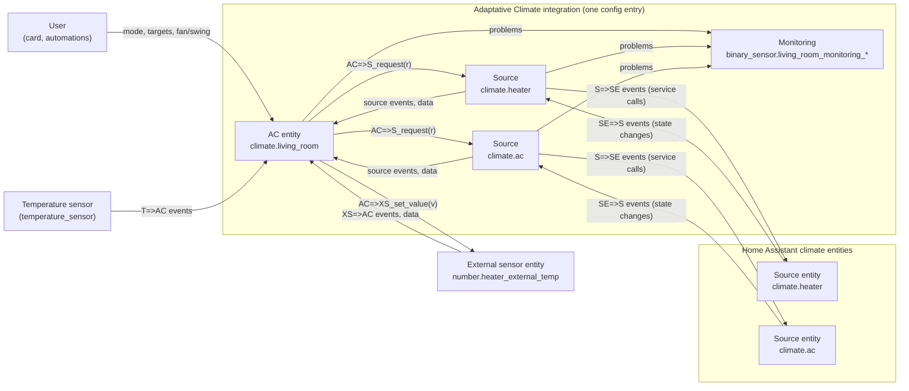

- **AC entity**: the Adaptative Climate `climate` entity seen by the user.
  It decides the mode and drives its sources (§1.3).
- **Source**: one local object per source entity (§1.2). It follows its
  source entity, stores its data, and carries out the requests of the AC
  entity. The AC entity never talks to a source entity directly.
- **Source entity**: a `climate` entity of Home Assistant (heater, AC,
  heat pump...), configured for one or more modes of the AC entity.
- **Temperature sensor**: the optional sensor giving the reference temperature (`temperature_sensor`,
  §3.1.3).
- **External sensor entity**: an optional `number` / `input_number`
  entity of a source device (`<mode>_external_sensor`, CFG-SENS-2), to which
  the AC entity writes the value of the temperature sensor (§1.3.5.2).
- **Monitoring**: one per config entry (§4). The sources and the AC
  entity tell it their problems; it reports them on two binary sensors,
  in the logs and with events. It sends nothing back: nothing depends on
  it.

#### 1.1.2 Events and data

Two kinds of exchanges:

- **Event** `X=>Y_name`: sent by `X` to `Y`, it triggers something in `Y`
  (a transition, a reaction). `X` and `Y`: `HA` Home Assistant, `U`
  user, `T` temperature sensor, `AC` AC entity, `S` source, `SE` source
  entity, `XS` external sensor entity, `M` monitoring. Example:
  `AC=>S_request(r)`. An event sent to `S` or `AC` reaches all its
  functions (EXEC-1).
  - Between two functions of the same source, `X` and `Y` name the
    functions: `Sdsm` data storage management (§1.2.2), `Sstm` state
    management (§1.2.3), `Smrc` mode request confirmation (§1.2.4), `Ssrm`
    setting request management (§1.2.5). Example: `Sstm=>Smrc_send(r)`.
  - Between two functions of the entity, the same way: `ACstm` state
    management (§1.3.2), `ACmom` mode management (§1.3.3), `ACcam`
    capabilities management (§1.3.4), `ACsem` settings management
    (§1.3.5). Example: `ACsem=>ACmom_targets_changed`.
  - `Sx` as `Y`: an event sent to several functions of the source; the
    table of §1.2.1 names them. Example: `Sdsm=>Sx_served_mode_lost`.
  - **Timer** `X_name_timeout`: the end of a timer of `X`, an event of
    `X` to itself. Example: `Smrc_confirm_timeout`.
  - `*` stands for several events with the same beginning: `S=>SE_set_*`
    (the service calls that send settings), `S=>AC_*` (every event of a
    source to the entity). `X` as sender stands for any sender the table
    allows: `X=>M_up(p)` is `S=>M_up(p)` or `AC=>M_up(p)`.
- **Data** `name@X`: a value that `X` makes readable. Example:
  `action@S`, the action of the source `S`.

Rules of the exchanges:

- **EVT-1** Every event is **asynchronous**: the sender does not wait for
  it to be handled, nor for an answer; an answer, if any, is another
  event. This holds for the service calls to a source entity too
  (`S=>SE_*`): the source does not wait for the end of the call. Its
  error comes back as `SE=>S_call_failed(c)`, its effect as a change of
  the source entity (`SE=>S_off`, `SE=>S_on(m)`, `SE=>S_attributes`). The
  same for the writes to an external sensor entity
  (`AC=>XS_set_value(v)`): its error comes back as `XS=>AC_call_failed`.
- **EVT-2** There is no other kind of event: a condition is written as a
  guard on events, and a function that must tell another one something
  sends it a named event.
- **EVT-3** A data item is read by naming it, when the reader needs it:
  reading triggers nothing, and nothing is sent.

Between Home Assistant and the actors:

| Event | From → To | Meaning |
|---|---|---|
| `HA=>AC_start` | Home Assistant → AC entity | The config entry is set up (Home Assistant starts, the entry is reloaded): the entity starts in `INIT` (ENT-INIT-1), before its sources (EXEC-4). |
| `HA=>S_start` | Home Assistant → source | The config entry is set up: the source restores its stored data (SRC-DATA-4), and its setting request management starts (§1.2.5). |
| `HA=>M_start` | Home Assistant → monitoring | The config entry is set up: the monitoring starts with no problem (MON-SEND-3). |
| `HA=>AC_unload`, `HA=>S_unload`, `HA=>M_unload` | Home Assistant → AC entity, source, monitoring | The config entry unloads (Home Assistant stops, the entry is reloaded or disabled, before a deletion): the actor stops at once (END-1). |

Between the user and the AC entity:

| Event | From → To | Meaning |
|---|---|---|
| `U=>AC_set_mode(m)` | user → AC entity | A user request for the mode `m` (`off` included): card, `set_hvac_mode`, `turn_on` (last used mode), `turn_off` (ENT-STATE-4, ENT-STATE-8). |
| `U=>AC_set_settings(s)` | user → AC entity | A user request for the settings `s`: temperature targets (`set_temperature`), fan, swing, horizontal swing (ENT-SET-1). |

Between the temperature sensor and the AC entity:

| Event | From → To | Meaning |
|---|---|---|
| `T=>AC_temperature(t)` | temperature sensor → AC entity | The value of the temperature sensor changed: `t` is the new value (`temperature@T`), or `None` when it is no longer valid (ENT-REF-7, ENT-EXT-1, ENT-EXT-5). |

Data the temperature sensor makes readable to the AC entity:

| Data | Content |
|---|---|
| `temperature@T` | The value of the temperature sensor now, converted to the unit of Home Assistant (a sensor without unit is read in that unit); `None` when it is not valid (`unavailable`, `unknown`, not a number, infinite, a unit that is not a temperature, CFG-SENS-6). A change is reported by `T=>AC_temperature(t)`. |

Between the AC entity and a source:

| Event | From → To | Meaning |
|---|---|---|
| `AC=>S_request(r)` | AC entity → source | A request (§0): put the source entity in `r`, an HVAC mode or `off` (SRC-STATE-2 to SRC-STATE-4). |
| `AC=>S_settings(s)` | AC entity → source | A setting request (§0): the settings `s` (targets, fan/swing) for the source entity, kept and sent by the setting request management (SRC-SET-1, SRC-SET-2). |
| `S=>AC_settings(s)` | source → AC entity | Settings `s` taken from the source entity, adopted by the entity (ENT-SET-2): changed on it in `ACTIVE` (takeover), or shown after a mode change made on it (SRC-SET-11); in `SETTLE`, the fan/swing values without kept value (SRC-SET-12). |
| `S=>AC_temperature(t)` | source → AC entity | The current temperature of the source entity changed: `t` is the new value (`temperature@S`), or `None` when it is no longer shown (SRC-STATE-11). |
| `S=>AC_capabilities` | source → AC entity | The stored capabilities of the source changed, or were read for the first time when the source is discovered (SRC-DATA-12): the entity reads them again (`capabilities@S`, ENT-CAP-7). |
| `S=>AC_action(a)` | source → AC entity | The `hvac_action` `a` of the source entity changed (SRC-STATE-12, ENT-ON-2). |
| `S=>AC_undiscovered` | source → AC entity | The source enters `UNDISCOVERED`, as its first state (SRC-STATE-1). |
| `S=>AC_off` | source → AC entity | The source enters `OFF`: its first state (SRC-STATE-1), its discovery (SRC-STATE-8), or a change made on the source entity (takeover, SRC-STATE-5). Never after a request of the entity (SRC-STATE-3). |
| `S=>AC_on(m)` | source → AC entity | The source enters `ON(m)`: its first state (SRC-STATE-1), or a change made on the source entity (takeover, SRC-STATE-5). Never after a request of the entity (SRC-STATE-3). |
| `S=>AC_unusable` | source → AC entity | The source enters `UNUSABLE` (SRC-STATE-1, SRC-STATE-6, SRC-STATE-8). |
| `S=>AC_usable` | source → AC entity | The source leaves `UNUSABLE`: it goes back to its stored state, read in `state@S` (SRC-STATE-7). |

Between a source and its source entity:

| Event | From → To | Meaning |
|---|---|---|
| `S=>SE_set_hvac_mode(r)` | source → source entity | Service call `climate.set_hvac_mode` carrying out a request, made by the mode request confirmation (§1.2.4). |
| `S=>SE_set_temperature(t)`, `S=>SE_set_fan_mode(f)`, `S=>SE_set_swing_mode(w)`, `S=>SE_set_swing_horizontal_mode(h)` | source → source entity | Service calls sending the settings to the source entity, one per setting, made by the setting request management (`Ssrm.send`, §1.2.5). |
| `SE=>S_off` | source entity → source | The source entity changed to `off`, or appeared in Home Assistant as `off`. |
| `SE=>S_on(m)` | source entity → source | The source entity changed to the HVAC mode `m`, or appeared in Home Assistant in `m`. |
| `SE=>S_unavailable` | source entity → source | The source entity changed to `unavailable`, or was removed from Home Assistant. |
| `SE=>S_unknown` | source entity → source | The source entity changed to `unknown`. |
| `SE=>S_attributes` | source entity → source | Only attributes of the source entity changed (its state stays the same). |
| `SE=>S_call_failed(c)` | source entity → source | The service call `c` (`S=>SE_set_hvac_mode`, `S=>SE_set_*`) returned an error (SRC-REQ-3, SRC-SET-7). |

Between the AC entity and an external sensor entity (one `XS` per
external sensor entity, §1.3.5.2):

| Event | From → To | Meaning |
|---|---|---|
| `AC=>XS_set_value(v)` | AC entity → external sensor entity | Service call `number.set_value` / `input_number.set_value` writing the value `v` of the temperature sensor (ENT-EXT-1, ENT-EXT-4, ENT-EXT-6). |
| `XS=>AC_usable` | external sensor entity → AC entity | The external sensor entity becomes usable: it appears in Home Assistant, or leaves `unavailable` / `unknown` (ENT-EXT-6). |
| `XS=>AC_call_failed` | external sensor entity → AC entity | The call `AC=>XS_set_value(v)` returned an error (ENT-EXT-2). |

Data an external sensor entity makes readable to the AC entity:

| Data | Content |
|---|---|
| `attributes@XS` | The unit (`unit_of_measurement`), the step, the minimum and the maximum of the external sensor entity now; `None` when it is not usable (missing in Home Assistant, `unavailable`, `unknown`). Not stored. |

Data a source makes readable to the AC entity:

| Data | Content |
|---|---|
| `state@S` | The state of the source now (§1.2.3.1): `UNDISCOVERED`, `OFF`, `ON(m)` or `UNUSABLE`. In `UNUSABLE`, also its stored state (`OFF` or `ON(m)`): the state it goes back to (SRC-STATE-7). A change of state is reported by `S=>AC_undiscovered`, `S=>AC_off`, `S=>AC_on(m)`, `S=>AC_unusable`, `S=>AC_usable`. The stored state in `UNUSABLE` changes only on a request of the entity (SRC-STATE-4): nothing is reported. |
| `capabilities@S` | The stored capabilities of the source (§1.2.2), whatever its state, and its provisional and held capabilities (SRC-DATA-13, not stored). A change is reported by `S=>AC_capabilities`. |
| `temperature@S` | The current temperature the source entity shows now (`current_temperature`), as read (the entity removes the offset, CFG-SENS-1); `None` when it shows none, and when the source is `UNDISCOVERED` or `UNUSABLE`, whatever the reason (served mode not offered included, SRC-UNUS-2). Not stored. A change is reported by `S=>AC_temperature(t)`. |
| `action@S` | The `hvac_action` the source entity shows now; `None` when it has none, and when the source is `UNDISCOVERED` or `UNUSABLE`, whatever the reason. Not stored (SRC-STATE-12). A change is reported by `S=>AC_action(a)`. |
| `settings@S` | The settings the source entity shows now, in `OFF` and `ON(m)`: `temperature`, `target_temp_low`, `target_temp_high`, `fan_mode`, `swing_mode`, `swing_horizontal_mode`, as read (the entity removes the offset, CFG-SENS-1); `None` for each one it does not show, all `None` when the source is `UNDISCOVERED` or `UNUSABLE`, whatever the reason. Not stored. |

Between a source or the AC entity and the monitoring:

| Event | From → To | Meaning |
|---|---|---|
| `S=>M_up(p)`, `AC=>M_up(p)` | source or AC entity → monitoring | The problem `p` began (MON-SEND-1, MON-SEND-2). |
| `S=>M_down(p)`, `AC=>M_down(p)` | source or AC entity → monitoring | The problem `p` ended (MON-SEND-1). |

The monitoring reads no data, and makes none readable: what it shows is
for Home Assistant (MON-ROLE-1).

Settings (targets, fan/swing): §1.2.5.

#### 1.1.3 Execution model

How the events are queued and handled. The entity, each source and the
monitoring are **actors**: each one handles its own events, one at a
time.

- **EXEC-1** Each source, and the entity, is an actor with two queues,
  both first in, first out: an **external queue** (events from the other
  actors, Home Assistant, the user, the temperature sensor, the source
  entity, the external sensor entities, its own timers) and an
  **internal queue** (events between its
  own functions). It handles them by **steps**:
  - a step starts with an event of the external queue, given to every
    function of the actor (in a source, the data storage management
    first), before any internal event it causes: each function judges it
    in the state it was in when the event arrived;
  - then the internal queue is emptied, in the order of emission,
    including the internal events emitted while it is emptied (added at
    the end);
  - the internal queue of an actor is empty before its next external
    event: it always goes first. The internal queue of another actor does
    not block it;
  - a step is not interrupted by another actor: no other actor handles
    anything meanwhile. The events an actor sends to another one wait in
    the external queue of that one, and are handled after the end of the
    step.

  The monitoring (§4) has no functions, so no internal queue. It sends
  nothing to the other actors: when it handles its events changes nothing
  for them.

  There is no thread: everything runs in the event loop of Home
  Assistant, with no wait (`await`) during a step.
- **EXEC-2** Order per sender: the events of one sender reach the
  external queue of an actor in the order they were sent. Nothing else is
  guaranteed between two senders.
- **EXEC-3** One stimulus at a time, whatever its origin. A **stimulus**
  is what comes from outside the config entry: its start, its unload, a change of
  state of one of its source entities, of the temperature sensor or of an
  external sensor entity, a
  service call on the entity, the end of a timer. The entry handles each
  stimulus to the end: the queues of all its actors are emptied before
  the next stimulus, wherever it comes from.
  - Two source entities that change at the same moment give two stimuli,
    handled one after the other: the second one sees the result of the
    first. Their order is any; the spec gives a consistent result in both
    orders (the last takeover wins).
  - The service calls to the source entities (`S=>SE_*`) and to the
    external sensor entities (`AC=>XS_set_value`) are not waited for
    (EVT-1): their effects come back as new stimuli.
- **EXEC-4** At start (a single stimulus), the entity starts before its
  sources: `HA=>AC_start` is in its queue before the `HA=>S_start` of the
  sources, so that the entity is in `INIT` when their first states arrive
  (ENT-INIT-1).

The entity does not send its commands to the sources while it handles an
event: it sends them when its queues are empty (ENT-SEND, §1.3.2.1). The
entity and the sources tell the monitoring their problems the same way
(MON-SEND, §4.4).

Sequence examples: §5.

#### 1.1.4 End of an entry

An entry ends in two ways: it **unloads** (Home Assistant stops, the
entry is reloaded or disabled), or it is **deleted** by the user. Both are
rare, and handled the simplest way: everything stops, and the next start
begins from zero with the stored data.

- **END-1** Unload (`HA=>AC_unload`, `HA=>S_unload`, `HA=>M_unload`, a
  stimulus, EXEC-3):
  every actor of the entry stops at once, whatever its state.
  - The source entities are left as they are: nothing is sent to them. A
    device that runs keeps running.
  - Everything running is dropped, with no other action: the timers, a
    mode request confirmation and its retries, `SETTLE`, the send
    retries, the removal confirmations, the monitoring delays. No event
    is sent between the actors.
  - Nothing more is saved: the stored data is saved at each change.
  - The Repairs issues of the entry are removed (ENT-HVAC-5, ENT-FAN-7).
    No monitoring event is fired: a problem reported ends without an
    `ended` event (MON-LIFE-2).
  - The entities of the entry (the AC entity, the monitoring sensors)
    become `unavailable`: Home Assistant does it.
- **END-2** The next start (`HA=>AC_start`, `HA=>S_start`, `HA=>M_start`) begins from
  zero with the stored data (SRC-DATA-4, ENT-INIT-1). Nothing running
  before the unload is resumed:
  - the sources are resynchronized (SRC-STATE-10), and the timers start
    again;
  - a value no longer shown starts a new removal confirmation
    (SRC-DATA-10);
  - the monitoring starts empty: a problem still there is sent to it
    again (MON-SEND-3), and reported again after its delay (MON-LIFE-1);
  - a Repairs issue is raised again if its cause is still there: at once
    for `sync_modes` (ENT-FAN-7, judged at start with the stored
    capabilities), once the source is judged for a mode not offered
    (ENT-HVAC-5).
- **END-3** Deletion of the entry (after its unload, END-1): nothing is
  kept.
  - All the stored data of the entry is erased: of its sources (state,
    `hvac_modes`, capabilities, `low_high_seen`, kept settings) and of
    the entity (§1.3.6: mode, last used mode, phase, temperature targets,
    fan/swing memory).
  - Its monitoring problems and its Repairs issues are removed; Home
    Assistant removes its entities.
  - The source entities are left as they are.

### 1.2 Source behavior

A source has four functions:

- **data storage management** (§1.2.2): permanent, it does not depend on
  the state of the source;
- **state management** (§1.2.3): the state machine of the source. Its
  state is a **local** state, kept in sync with the source entity; it is
  not the state of the source entity itself;
- **mode request confirmation** (§1.2.4): confirmation and retries of a
  mode request, in parallel with the state machine;
- **setting request management** (§1.2.5): the state machine that sends
  the temperature targets and fan/swing settings to the source entity,
  and protects them for a settle time after a mode is entered, in
  parallel with the state machine and the mode request confirmation.

The source judges its own problems (not discovered, out of sync, setting
not applied) and tells the monitoring at the end of each step (MON-SEND,
§4.4).

#### 1.2.1 Events

The events between the source and the other actors, Home Assistant and
its source entity are described in §1.1.2. Each event of the external
queue is given to every function of the source (EXEC-1).

| Event | From → To | Meaning |
|---|---|---|
| `HA=>S_start`, `HA=>S_unload` | Home Assistant → source | See §1.1.2. |
| `SE=>S_off`, `SE=>S_on(m)`, `SE=>S_unavailable`, `SE=>S_unknown`, `SE=>S_attributes`, `SE=>S_call_failed(c)` | source entity → source | See §1.1.2. |
| `AC=>S_request(r)`, `AC=>S_settings(s)` | AC entity → source | See §1.1.2. |
| `S=>AC_undiscovered`, `S=>AC_off`, `S=>AC_on(m)`, `S=>AC_unusable`, `S=>AC_usable`, `S=>AC_settings(s)`, `S=>AC_temperature(t)`, `S=>AC_capabilities`, `S=>AC_action(a)` | source → AC entity | See §1.1.2. |
| `S=>SE_set_hvac_mode(r)`, `S=>SE_set_*` | source → source entity | See §1.1.2. |
| `S=>M_up(p)`, `S=>M_down(p)` | source → monitoring | See §1.1.2. Sent at the end of a step (MON-SEND-1). |

Between the functions of the source:

| Event | From → To | Meaning |
|---|---|---|
| `Sdsm=>Sstm_restored` | data storage management → state management | The first restore of the stored data is done (SRC-DATA-4): the state management takes its first state (SRC-STATE-1). |
| `Sdsm=>Sstm_discovered` | data storage management → state management | The source is discovered after the start: its `hvac_modes` is read for the first time (SRC-DATA-6). It leaves `UNDISCOVERED` (SRC-STATE-8). Not sent at start: `Sdsm=>Sstm_restored` carries the discovery (SRC-DATA-4). |
| `Sdsm=>Sx_served_mode_lost` | data storage management → state management, mode request confirmation | A served source mode is no longer in the stored `hvac_modes`: its removal is confirmed (SRC-DATA-10). The source becomes `UNUSABLE` (SRC-STATE-6), and a running mode request confirmation ends (SRC-REQ-1). |
| `Sdsm=>Sstm_served_modes_back` | data storage management → state management | An item added to the stored `hvac_modes` makes every served source mode offered again (SRC-DATA-6): the source can leave `UNUSABLE` (SRC-STATE-7). |
| `Sstm=>Smrc_send(r)` | state management → mode request confirmation | `r` is sent to the source entity: entry check of `OFF` / `ON(m)`, or a request for another state during a mode request confirmation (SRC-STATE-2). |
| `Sstm=>Ssrm_mode_changed(x)` | state management → setting request management | The mode of the source changes to `x` (a mode, or `off`) on a request of the entity: `AC=>S_request(x)` for another state in `OFF` / `ON(m)` (SRC-STATE-3), or stored in `UNUSABLE` (SRC-SET-1). |
| `Sstm=>Ssrm_takeover(x)` | state management → setting request management | The mode of the source changes to `x` on a change of the source entity, followed (`[followed]`, SRC-STATE-5): the settings shown are adopted (SRC-SET-11). |
| `Sstm=>Ssrm_unusable` | state management → setting request management | The source enters `UNUSABLE` (SRC-STATE-6): the setting request management keeps its settings and sends nothing (SRC-SET-1, SRC-SET-3). |
| `Sstm=>Ssrm_back(m)` | state management → setting request management | The source is back from `UNUSABLE` in `ON(m)`, and the source entity already shows `m` (SRC-STATE-7): the settle time starts (SRC-SET-13). |
| `Sstm=>Ssrm_restored(m)` | state management → setting request management | At start, the first state is `ON(m)` and the source entity already shows `m`: nothing is sent, no settle time (SRC-SET-13). |
| `Smrc=>Ssrm_confirmed(m)` | mode request confirmation → setting request management | The mode `m` asked is confirmed (SRC-REQ-2): the settle time starts (SRC-SET-13). |

Timers of the source:

| Event | Timer of | Meaning |
|---|---|---|
| `Sdsm_removal_timeout` | data storage management | End of a removal confirmation (`removal_confirmation_timer`, SRC-DATA-10). |
| `Smrc_confirm_timeout` | mode request confirmation | End of `request_confirmation_timer` (SRC-REQ-5). |
| `Smrc_retry_timeout` | mode request confirmation | End of `request_retry_timer` (SRC-REQ-6). |
| `Ssrm_resync_timeout` | setting request management | End of the resync timer (SRC-SET-8). |
| `Ssrm_send_retry_timeout` | setting request management | End of the send retry timer (SRC-SET-7). |
| `Ssrm_settle_timeout` | setting request management | End of `settle_timer` (SRC-SET-14). |

#### 1.2.2 Data storage management

##### 1.2.2.1 Stored data

Stored data of a source, saved across restarts:

| Data | Stored per | Content |
|---|---|---|
| State | source | `OFF` or `ON(m)`: the state the source is in, or the one asked while `UNUSABLE` (SRC-STATE-4). Never `UNDISCOVERED` / `UNUSABLE`. Written by the state management (SRC-STATE-9). |
| `hvac_modes` | source | The HVAC modes of the source entity. The same whatever its mode. |
| Mode capabilities | (source, mode) | `supported_features`, `min_temp`, `max_temp`, `target_temp_step`, `fan_modes`, `swing_modes`, `swing_horizontal_modes`, as last read **while the source entity was in that mode**. |
| `low_high_seen` | (source, mode) | The source entity has shown numeric `target_temp_low` / `target_temp_high` once while in that mode. Never cleared. |
| Kept settings | source | The settings the setting request management keeps for the mode of the stored state (SRC-SET-1). Withdrawn with them when the mode changes. Written by the setting request management. |

- **SRC-DATA-1** The mode capabilities are **discovered** as the modes are
  used: those of a mode are read only while the source entity runs in it
  (it shows that mode), whatever the state of the source (SRC-DATA-6;
  read in `UNUSABLE` too, SRC-UNUS-2). A mode of `hvac_modes` with no stored
  capabilities (never run) has the provisional capabilities of the source
  (SRC-DATA-13). A capability the source entity does not show counts as the
  Home Assistant default:

  | Capability | Default |
  |---|---|
  | `supported_features` | 0: no temperature target, no fan, no swing |
  | `min_temp` / `max_temp` | 7 °C / 35 °C, converted to the unit of Home Assistant |
  | `target_temp_step` | none |
  | `fan_modes`, `swing_modes`, `swing_horizontal_modes` | none |
  | `low_high_seen` | no |

- **SRC-DATA-2** `off` is not a mode with capabilities: what the source
  entity shows while it is `off` is never stored as the capabilities of a
  mode. It is only read as provisional capabilities (SRC-DATA-13), which
  stand for the modes not discovered yet. A discovered mode keeps its
  stored capabilities, whatever the source entity shows while it is
  `off`, and whatever the state of the entity: in `OFF` too, the entity
  shows the stored capabilities of its discovered modes (ENT-RANGE-2,
  ENT-FAN-3).
- **SRC-DATA-3** The source is **discovered** once its `hvac_modes` is
  known (restored or read). Its modes may not be discovered yet: their
  capabilities are then the provisional capabilities of the source
  (SRC-DATA-13).
- What the entity does with a mode not discovered yet: ENT-CAP-3 to ENT-CAP-6
  (§1.3).

##### 1.2.2.2 Restore (at `HA=>S_start`)

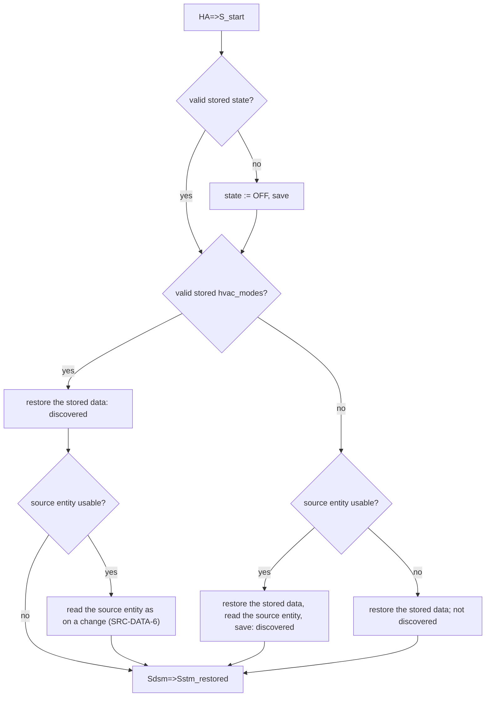

- **SRC-DATA-4** At `HA=>S_start`, the stored data is read and restored.
  Each missing value is handled alone:
  - no stored state → the stored state is set to `OFF`: the source was
    never used (or its state is lost), so it starts from a clean state
    (its entry turns the source entity off if it runs, SRC-STATE-2);
  - no stored `hvac_modes` → the source entity is read (`hvac_modes`,
    and the mode capabilities if it runs in a mode); if it cannot be
    read (not usable), the source is not discovered (SRC-DATA-3) until
    the first usable change (SRC-DATA-6);
  - no stored mode capabilities or `low_high_seen` for a mode → the
    mode is not discovered (SRC-DATA-1, SRC-DATA-13);
  - no stored kept settings → no kept setting, as when the entity has
    sent none (SRC-SET-1, SRC-SET-12).

  When `hvac_modes` was restored and the source entity is usable, the
  source entity is then read as on a change (SRC-DATA-6): what changed
  while Home Assistant was stopped (the modes offered, the capabilities of
  the mode it runs in) is seen at once. An item added is stored; an item
  no longer shown goes through the removal confirmation (SRC-DATA-10).
  The first state of the source (SRC-STATE-1) is judged on the data so
  read.

  The end of this first restore raises `Sdsm=>Sstm_restored`: the state
  management takes its first state from the data (SRC-STATE-1). Before
  it, the data storage management sends nothing else to the state
  management: a source discovered at start (`hvac_modes` restored or
  read), or a served source mode found again by the read that follows
  the restore, sends neither `Sdsm=>Sstm_discovered` nor
  `Sdsm=>Sstm_served_modes_back`. The first state reads the data.
- **SRC-DATA-5** A stored value that is not valid (corrupted) is dropped,
  and handled as missing (SRC-DATA-4); the other stored data is
  restored.

##### 1.2.2.3 Update (on each change of the source entity)

- **SRC-DATA-6** On every change of a usable source entity (`SE=>S_off`,
  `SE=>S_on(m)`, `SE=>S_attributes`):
  - source not discovered yet → it is read and saved: the source is
    discovered (`Sdsm=>Sstm_discovered`), and its data is reported
    (SRC-DATA-12);
  - `hvac_modes` is read again;
  - if the source entity runs in a mode `m`, the capabilities of `m`
    are read again;
  - each value read is compared with the stored one:
    - no change → nothing;
    - a first value, or a new number (`min_temp`, `target_temp_step`...)
      → stored and saved at once, and reported (SRC-DATA-12);
    - a value no longer shown (attribute missing or `None`) → removal
      confirmation (below);
    - a value made of items (a list such as `hvac_modes` or `fan_modes`,
      or `supported_features`, a set of features) is compared **item by
      item**: an item added is stored and saved at once; an item no
      longer shown goes through the removal confirmation, on its own.
      Example: `fan_modes` stored `[low, medium, high]`, shown
      `[low, medium, turbo]`: `turbo` is added at once, the removal of
      `high` is confirmed.
  - an item added to `hvac_modes` that makes every served source mode
    offered again, while one was missing, sends
    `Sdsm=>Sstm_served_modes_back` (SRC-STATE-7).
- **SRC-DATA-7** A source entity that is not usable is not read: the stored
  data stays as it is.
- **SRC-DATA-8** `low_high_seen` of mode `m` is set when numeric low/high
  values are shown while the source entity runs in `m` (reported,
  SRC-DATA-12). It is never removed.
- **SRC-DATA-9** Only the configured source entities keep their data: a
  source entity removed from the configuration loses it.

**Removal confirmation** (one per value no longer shown, and one per item
no longer shown in a value made of items; for `hvac_modes`, or a
capability of a mode). "value" below is that value or that item:

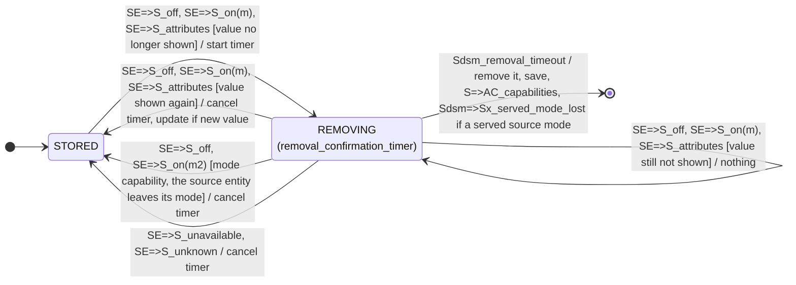

- **SRC-DATA-10** A value no longer shown, or an item no longer shown,
  stays stored for `removal_confirmation_timer` (§3.1.4, 60 s by default). The
  timer is cancelled when it is shown again; other changes of the source
  entity (current temperature, items added...) let it run. At the end of
  the timer, it is removed, the data is saved, and the change is reported
  (SRC-DATA-12). A served source mode removed from `hvac_modes` also
  sends `Sdsm=>Sx_served_mode_lost` (SRC-STATE-6, SRC-REQ-1).
- **SRC-DATA-11** A capability of mode `m` is only judged while the source
  entity runs in `m`: the source entity leaving `m` cancels its timer.
  The source entity becoming not usable cancels every timer (SRC-DATA-7).
- **SRC-DATA-12** Every change of the stored capabilities (`hvac_modes`,
  mode capabilities, `low_high_seen`) is reported to the entity, once
  stored: `S=>AC_capabilities`, whatever the state of the source. This
  covers an item or a value added or changed (SRC-DATA-6),
  `low_high_seen` set (SRC-DATA-8), and a removal confirmed
  (SRC-DATA-10). Several changes read in the same update of the source
  entity give one event.
  - The data read when the source is discovered after the start
    (SRC-DATA-6: it leaves `UNDISCOVERED`) is reported too: it is read
    for the first time, and the entity has never seen it. `S=>AC_capabilities` is
    sent on the change of the source entity itself, before `S=>AC_off` or
    `S=>AC_unusable` (sent by the state management on
    `Sdsm=>Sstm_discovered`, SRC-STATE-8; EXEC-1, EXEC-2): the
    entity has rebuilt its capabilities when it sees the source leave
    `UNDISCOVERED`.
  - The data restored or read at start (SRC-DATA-4) is not reported this way:
    it is there before the first state of the source (SRC-STATE-1),
    while the entity is in `INIT` (ENT-INIT-1). A change read on the
    source entity right after the restore (SRC-DATA-4) is reported as
    any other change.
- **SRC-DATA-13** **Provisional capabilities.** At each read of a usable
  source entity (at start, and on each change, SRC-DATA-6), whatever its
  mode, `off` included, the source reads what it shows: features, range,
  step, fan/swing options, and whether it shows numeric low/high.
  - They are its provisional capabilities: the capabilities of its modes
    not discovered yet, until their discovery (ENT-CAP-4). A discovered
    mode never uses them: it has its own, stored (SRC-DATA-1).
  - They are not stored: read again at start. They are kept while the
    source entity is not usable. A source entity never seen usable since
    the start gives none (ENT-CAP-4).
  - A change is reported to the entity (`S=>AC_capabilities`) while a
    served source mode is not discovered yet.
  - At the discovery of a mode, its capabilities are what the source
    entity shows in it (SRC-DATA-6). A provisional capability, read
    before it entered the mode, that it does not show there is **held**:
    still shown by the entity for that mode until
    `removal_confirmation_timer` ends (SRC-DATA-10), but never used to
    send (ENT-CAP-5). So the entity does not lose, then find again, a
    capability that a device shows a few seconds after it enters the
    mode; if the device shows it meanwhile, it is stored as any other.
    The source entity becoming not usable ends the holding.

#### 1.2.3 State management

##### 1.2.3.1 State machine

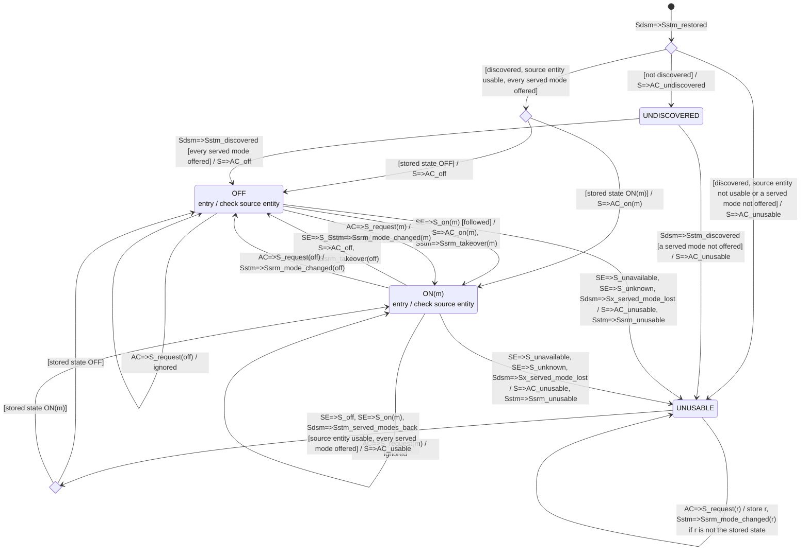

`[followed]`: the change of the source entity is a takeover: no mode request
confirmation running, or in `RETRY_WAIT(r)` a state other than `r`
(SRC-STATE-5, SRC-REQ-8). In `CONFIRMING(r)`, and for `r` shown in
`RETRY_WAIT(r)`, the mode request confirmation handles it alone (§1.2.4).

"check source entity" (entry of `OFF` and `ON(m)`): if the source entity
does not show the state (`off`, or `m`), the state is sent to it and the
mode request confirmation starts (`Sstm=>Smrc_send(r)`, §1.2.4). Back from
`UNUSABLE` in `ON(m)` with the source entity already in `m`, the settle
time starts (`Sstm=>Ssrm_back(m)`, SRC-STATE-7). At start, in `ON(m)`
with the source entity already in `m`, nothing is sent and there is no
settle time (`Sstm=>Ssrm_restored(m)`, SRC-SET-13). A change of the
source entity to the state it is already in (`SE=>S_on(m)` in `ON(m)`)
moves nothing. During a mode request
confirmation, a request for another state is always sent, without this
comparison (`Sstm=>Smrc_send(r2)`, SRC-STATE-2).

- **SRC-STATE-1** After `HA=>S_start`, the source waits for the end of the first
  restore (`Sdsm=>Sstm_restored`), then:
  - not discovered → `UNDISCOVERED`, reported to the entity;
  - discovered, and source entity not usable or a served source mode not
    offered (§1.2.3.5) → `UNUSABLE`, reported to the entity;
  - discovered, source entity usable and every served source mode
    offered → the stored state (`OFF`
    when none was stored, SRC-DATA-4), reported to
    the entity (`OFF` or `ON(m)`).
- **SRC-STATE-2** On entry of `OFF` or `ON(m)`, however it is entered (request,
  restore, back from `UNUSABLE`), the state is compared with the source
  entity: if it differs, the state is sent to the source entity and the
  mode request confirmation starts (§1.2.4). Entered from a change of the
  source entity, it is the same: nothing is sent.
  - Exception: during a mode request confirmation (`CONFIRMING(r)` or
    `RETRY_WAIT(r)`, §1.2.4), a request for another state than `r` is
    always sent, without comparing. A command is still on its way, so the
    state shown by the source entity cannot be trusted.
  - Example: `request(heat)`, then `request(off)` while the device still
    shows `off`: `off` is sent, so that the `heat` still on its way does
    not win.
  - A request for `r` itself changes nothing: the state is already `r`
    (SRC-STATE-3), the confirmation goes on.
- **SRC-STATE-3** In `OFF` or `ON(m)`, a request from the entity for
  another state moves the state at once to the state asked (`ON(m)` or
  `OFF`), and its entry sends it (SRC-STATE-2); `ON(m)` → `ON(m2)` is a
  new entry. No `S=>AC_*` event is sent: the entity asked for it. A
  `S=>AC_off` / `S=>AC_on(m)` always means a change made on the source
  entity, never the result of a request.
  - A request for the state the source is already in (`off` in `OFF`,
    `m` in `ON(m)`) has no effect: no new entry, nothing sent, no
    `Sstm=>Ssrm_mode_changed`, the kept settings stay. During a mode request
    confirmation, the confirmation goes on (SRC-STATE-2).
  - Example: at start, and at the return from `NO_SOURCE`, a source
    restored in `ON(m)` gets `AC=>S_request(m)` from `resume`
    (`AC.apply(m)`, ENT-STATE-6): nothing changes.
- **SRC-STATE-4** In `UNUSABLE`, a request from the entity is stored as the
  stored state; nothing is sent.
- **SRC-STATE-5** In `OFF` or `ON(m)`, a change of the source entity
  (`SE=>S_off`, `SE=>S_on(m)`) moves the state, and the new state is
  reported to the entity (takeover). During a mode request confirmation, the
  confirmation handles these changes first (§1.2.4):
  - a change that shows `r` confirms the request: the state is already
    `r`, nothing is reported;
  - in `CONFIRMING(r)`, a change that does not show `r` is ignored
    (SRC-REQ-1): it does not reach the state machine;
  - in `RETRY_WAIT(r)`, a change to another state than `r` stops the
    retries and is followed as a takeover (SRC-REQ-8).

  In `SETTLE`, a change of mode is followed as a takeover too (only
  the settings shown are ignored, SRC-SET-5). So the only change of mode
  of the source entity that is not followed is one that does not show
  `r` in `CONFIRMING(r)`.
- **SRC-STATE-6** In `OFF` or `ON(m)`, `SE=>S_unavailable`, `SE=>S_unknown`
  or `Sdsm=>Sx_served_mode_lost` always moves the source to
  `UNUSABLE`, even during a mode request confirmation, which ends: it gets the
  same events (SRC-REQ-1). The state asked stays the stored state, sent
  again on return (SRC-STATE-7). Reported to
  the entity.
- **SRC-STATE-7** In `UNUSABLE`, the source back (source entity usable,
  and every served source mode offered: on `SE=>S_off`, `SE=>S_on(m)` or
  `Sdsm=>Sstm_served_modes_back`) moves the source to its **stored** state, not to
  the state shown. While a served source mode is missing, the changes of
  the source entity do not make it leave `UNUSABLE`.
  - The entry of that state sends it if needed (SRC-STATE-2).
  - When the stored state is `ON(m)`, the source always goes through
    `SETTLE` (§1.2.5), even if the source entity already shows `m`: it
    sends its kept settings, ignores during `settle_timer` the values the
    device reports while reconnecting, and sends them again at the end if
    needed (SRC-SET-5, SRC-SET-6).
  - The entity gets only `S=>AC_usable`: it reads the state in
    `state@S`.
  - The source does not know whether its stored state is a foreign mode
    (SRC-ON-1): it is resent like any other (ENT-STATE-5).
- **SRC-STATE-8** In `UNDISCOVERED`, the source gets no request
  (ENT-SEND-3). When it is discovered, the source goes to `OFF`,
  reported to the entity; its entry turns the source entity off if it
  runs (SRC-STATE-2). If a served source mode is not offered, it goes to
  `UNUSABLE` instead, with `OFF` as stored state.
- **SRC-STATE-9** Every change of state is saved as the stored state.
  `UNDISCOVERED` and `UNUSABLE` are never stored: they keep the stored
  state as it is (a request in `UNUSABLE` still changes it,
  SRC-STATE-4).
- **SRC-STATE-10** Resynchronization: at start, and when the source comes back
  from `UNUSABLE`, **Home Assistant wins**: the stored state is sent
  to the source entity (SRC-STATE-2, SRC-STATE-7), whatever was changed on the device
  meanwhile. At start, everything is resynchronized (several sources left
  on would give odd effects); after unavailability, there was a problem,
  so everything is resynchronized when it ends. The source entity has the
  upper hand (takeover) in `OFF` / `ON(m)`, except in `CONFIRMING(r)`
  (SRC-STATE-5).

- **SRC-STATE-11** In `OFF` or `ON(m)`, a change of the current
  temperature of the source entity (`current_temperature`, in
  `SE=>S_attributes`) is reported to the entity: `S=>AC_temperature(t)`, as
  read (the entity removes the offset, CFG-SENS-1), `None` when it is no
  longer shown (attribute missing or `None`). The source does not store
  it: the entity reads it when it needs it (`temperature@S`, §1.1.2).
- **SRC-STATE-12** Action (`hvac_action`): the source does not store it;
  the entity reads it when it needs it (`action@S`, §1.1.2).
  - In `OFF` or `ON(m)`, a change of the `hvac_action` of the source
    entity (in `SE=>S_attributes`, `SE=>S_on(m)` or `SE=>S_off`) is
    reported to the entity: `S=>AC_action(a)`, as read (`None` when it
    disappears). This includes the mode request confirmation and `SETTLE`:
    the source entity may still show the action of the previous mode,
    it is reported as it is.

##### 1.2.3.2 UNDISCOVERED state

The source is not discovered: its `hvac_modes` is not known (SRC-DATA-3).

- **SRC-UNDISC-1** The first usable change of the source entity discovers it
  (SRC-DATA-6), and its data is reported to the entity
  (`S=>AC_capabilities`, SRC-DATA-12): `Sdsm=>Sstm_discovered` moves the
  source to `OFF`, or to `UNUSABLE` if a served source mode is not
  offered (SRC-STATE-8).
- **SRC-UNDISC-2** The source offers nothing: no capability, and no
  provisional capability if its source entity was never seen usable since
  the start (SRC-DATA-13): the entity does not count it for the step,
  counts its modes as with a single temperature target in the Home
  Assistant default range 7–35 °C (ENT-CAP-4), without options; no HVAC
  mode (its modes are not judged as offered or not).

##### 1.2.3.3 OFF state

The source entity is off.

- Settings: see §1.2.5.

##### 1.2.3.4 ON(m) state

The source entity runs in `m`, any HVAC mode other than `off`.

- **SRC-ON-1** `ON(m)` is just the HVAC mode of the source entity. Whether
  `m` is a mode the source serves here (or a foreign mode) is decided by
  the entity. The source only uses its served source modes to judge
  whether it is `UNUSABLE` (§1.2.3.5).
- Settings: see §1.2.5.

##### 1.2.3.5 UNUSABLE state

The source is discovered, but it cannot be used, for one of two
reasons:

- **SRC-UNUS-1** Source entity not usable (`unavailable`, `unknown`, or
  missing in Home Assistant): the stored data stays as it is
  (SRC-DATA-7): the entity keeps reading the capabilities of the source
  as they were when it was last usable.
- **SRC-UNUS-2** Served mode not offered: the source entity is
  usable, but a served source mode is not in its stored `hvac_modes`
  (lost after the configuration, or never offered by a source entity
  not checked at configuration, CFG-MODE-5). The source entity is still
  read (SRC-DATA-6), so that the return of the mode is seen
  (`Sdsm=>Sstm_served_modes_back`). The entity raises a Repairs issue (ENT-HVAC-5).
  A source serving several modes is `UNUSABLE` for all of them, even
  those still offered: losing a mode is an anomaly, to be repaired.

- **SRC-UNUS-3** In both cases, nothing is sent to the source entity
  (SRC-STATE-4), and it is resynchronized when the source is back
  (SRC-STATE-7).

#### 1.2.4 Mode request confirmation

Runs in parallel with the state machine of §1.2.3.1. `Sstm=>Smrc_send(r)` is
the entry check of `OFF` / `ON(m)` sending `r` to the source entity
(SRC-STATE-2). It works the same way to turn a source entity on in a
mode (`r` = `m`) and to turn it off (`r` = `off`). In `CONFIRMING(r)`
and `RETRY_WAIT(r)`, every request for another state is a
`Sstm=>Smrc_send(r2)`: it is always sent (SRC-STATE-2).

When a mode is confirmed, it tells the setting request management
(`Smrc=>Ssrm_confirmed(m)`), which sends the settings and protects them
for the settle time (§1.2.5). The mode request confirmation is then over
(SRC-REQ-2).

A **mode request confirmation is running** in `CONFIRMING(r)` and
`RETRY_WAIT(r)`: "during a mode request confirmation" and "outside a mode
request confirmation" have this meaning in the whole spec.

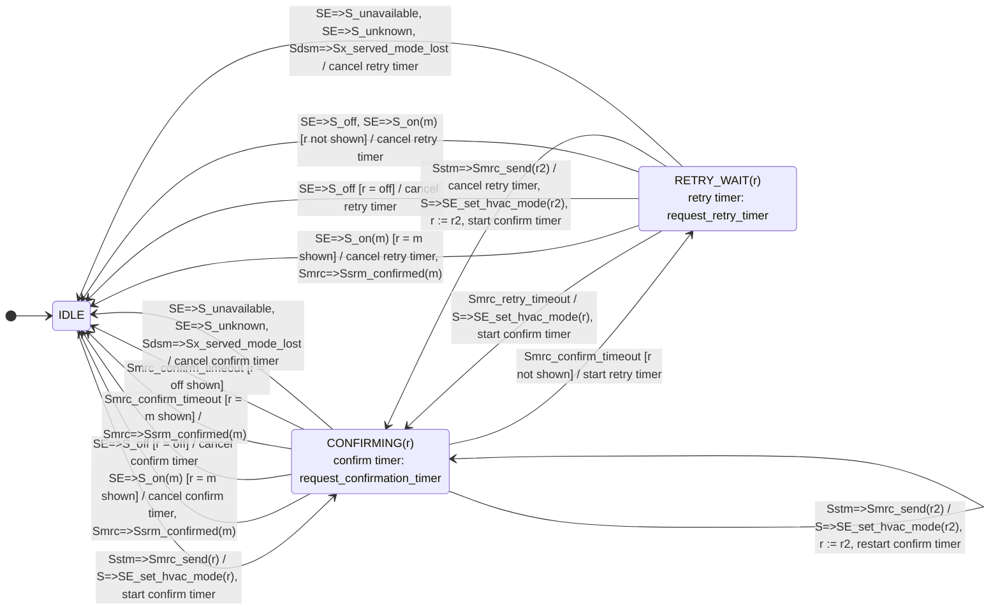

- **SRC-REQ-1** During the confirmation, the changes of the source entity
  that do not show `r` are ignored: a device may still show its previous
  mode, or go through `off`, before showing the mode asked. Cloud devices
  may take a while. Exception: `SE=>S_unavailable` / `SE=>S_unknown` /
  `Sdsm=>Sx_served_mode_lost` ends the confirmation or the retry wait:
  the source becomes `UNUSABLE` (SRC-STATE-6).
- **SRC-REQ-2** The source entity showing `r` ends the confirmation: the
  source is in the state asked. When `r` is a mode (`ON(m)`), the setting
  request management is told (`Smrc=>Ssrm_confirmed(m)`): it sends the
  settings (targets, fan/swing) and, for `settle_timer` (§3.1.4, 12 s by
  default), ignores the settings shown by the source entity (`SETTLE`,
  SRC-SET-5, SRC-SET-13).
- **SRC-REQ-3** The call to the source entity fails: the error is logged;
  the confirmation goes on until its timeout (SRC-REQ-5).
- **SRC-REQ-4** A new send (new request) during the confirmation or the
  retry wait replaces the previous one: the state confirmed becomes the
  new one (`r := r2`), and a new confirmation starts. It is always sent,
  even if the source entity already shows the new state (SRC-STATE-2).
- **SRC-REQ-5** At the end of the confirm timer, the state shown by the
  source entity is checked:
  - it shows `r`: the request is confirmed, as in SRC-REQ-2, without
    monitoring. This happens when `r` was sent to a source entity that
    already showed it (SRC-REQ-4): it reports no change, so nothing else
    would end the confirmation;
  - it does not show `r` (call failed, or the device did not follow): the
    monitoring reports the source entity out of sync (MON-SRC-3), and the
    source waits `request_retry_timer` (§3.1.4, 5 min by default: retry
    wait).
- **SRC-REQ-6** At the end of the retry wait, `r` is sent again and a new
  confirmation (`request_confirmation_timer`, §3.1.4, 30 s by default) starts, with
  the same behavior. This goes on every `request_retry_timer` as long as the
  source entity does not show `r`.
- **SRC-REQ-7** The confirmation and the retries stop only when the source
  entity shows `r`, or when the source leaves the state that started them
  (new request: SRC-REQ-4; `SE=>S_unavailable` / `SE=>S_unknown` /
  `Sdsm=>Sx_served_mode_lost`: SRC-STATE-6; change of the source entity
  during the retry wait: SRC-REQ-8).
- **SRC-REQ-8** During the retry wait, the source entity is master: a change
  of the source entity to another state than `r` (remote, app) stops the
  retries and is followed as a takeover (SRC-STATE-5).
- **SRC-REQ-9** Out of sync: the source judges its source entity **out of
  sync** (MON-SRC-3) from a confirm timeout where `r` is not shown until
  the end of the confirmation of that `r`: in `RETRY_WAIT(r)`, and in the
  `CONFIRMING(r)` started by `Smrc_retry_timeout`. A new send (`r2`)
  starts a confirmation that is not out of sync until its own timeout.
  The source tells the monitoring at the end of its step (MON-SEND-1).

#### 1.2.5 Setting request management

The setting request management is a state machine of the source, in
parallel with the state management (§1.2.3) and the mode request
confirmation (§1.2.4). It starts **once**, at `HA=>S_start` (the resync
timer starts then), and runs until the entry unloads (END-1): it is not started
for each request.

- **It keeps the settings.** The setting request management keeps the
  settings received from the entity (`AC=>S_settings(s)`) for the current
  mode of the source, and saves them with the stored data (SRC-SET-1).
  They are withdrawn when the mode of the source changes. The entity
  keeps its temperature targets and remembers the fan/swing values of
  each mode, all stored (ENT-TGT-2, ENT-FANV-1): it sends the settings of
  the new mode at each request.
- **It sends them.** In `SETTLE` and `ACTIVE`, it sends to the source
  entity the kept settings the source entity does not show, with one Home
  Assistant service call per setting (`S=>SE_set_*`). In `HOLD`, the
  settings are only kept (SRC-SET-3).
- **It protects them.** After a mode entered at the request of Home
  Assistant, or a return from `UNUSABLE`, it ignores for `settle_timer`
  the values the source entity shows for the kept settings, then sends
  them again if needed (`SETTLE`, SRC-SET-5, SRC-SET-13).
- **It follows the source entity.** In `ACTIVE`, it adopts the settings
  changed on the source entity (takeover), and reports them to the entity
  (`S=>AC_settings`, SRC-SET-11).

Its state changes only on its own timers and on the events of the state
management and of the mode request confirmation: its conditions read only
its own state.

Settings `s`: any of the temperature targets (`temperature`, or
`target_temp_low` and `target_temp_high`, already computed by the entity:
range, offset (CFG-SENS-1), step), `fan_mode`, `swing_mode`,
`swing_horizontal_mode`. Each one is sent with its own service call
(`S=>SE_set_temperature`, `S=>SE_set_fan_mode`, `S=>SE_set_swing_mode`,
`S=>SE_set_swing_horizontal_mode`).

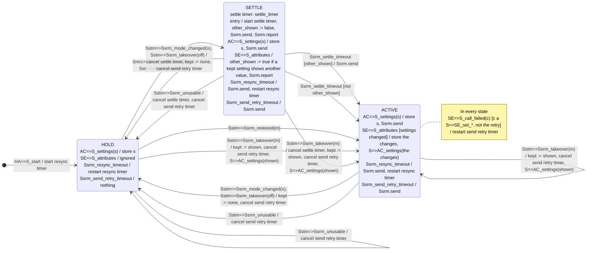

`m` is a mode (not `off`); `x` a mode or `off`.

| State | The source is | The setting request management |
|---|---|---|
| `HOLD` | `OFF`, `UNDISCOVERED`, `UNUSABLE`, or a mode request confirmation is running (`CONFIRMING`, `RETRY_WAIT`) | keeps, sends nothing, ignores what the source entity shows |
| `SETTLE` | `ON(m)`, just after a mode request confirmed or a return from `UNUSABLE` | sends; ignores the values shown for the kept settings, and sends them again at the end; reports the fan/swing without kept value (SRC-SET-5, SRC-SET-6, SRC-SET-12) |
| `ACTIVE` | `ON(m)`, outside a mode request confirmation and `SETTLE` | sends at once, adopts the changes (takeover) |

| Name | Meaning |
|---|---|
| `kept` | The settings kept for the current mode of the source, stored with its state (SRC-SET-1). |
| `kept := none` | All the kept settings are withdrawn. |
| `kept := shown` | The settings the source entity shows now replace the kept ones. |
| `store s` | The settings of `s` replace the kept settings they concern; the others stay. |
| `shown` | The settings the source entity shows now. |
| `Ssrm.send` | Composite activity: `S=>SE_set_*` of each kept setting the source entity does not show (compared as in SRC-SET-4), one call per setting; fan/swing written as the source entity spells them, and not sent if not offered (SRC-SET-4); low and high together (SRC-SET-2). |
| `Ssrm.report` | Composite activity: `S=>AC_settings` of the fan/swing settings without kept value that the source entity shows: all of them on entry of `SETTLE`, those that changed on a `SE=>S_attributes` (SRC-SET-12). |
| `other_shown` | In `SETTLE`, a kept setting was shown with another value: the kept settings are sent again at the end of the settle timer (SRC-SET-6). |
| the retry | The call made on `Ssrm_send_retry_timeout`: if it fails, the send retry timer is not started again (SRC-SET-7). |
| settle timer | `settle_timer` (§3.1.4, 12 s by default). Started on entry of `SETTLE`, which always lasts the whole timer (SRC-SET-14); cancelled on any other exit. Its end is `Ssrm_settle_timeout`. |
| resync timer | 30 min, fixed (CFG-TIMER-2). Started at `HA=>S_start`, restarted at each end, never cancelled. Its end is `Ssrm_resync_timeout` (SRC-SET-8). |
| send retry timer | 5 s, fixed (CFG-TIMER-2). Started, or restarted, on a call in error; cancelled when the kept settings are withdrawn or the source becomes `UNUSABLE`. Its end is `Ssrm_send_retry_timeout` (SRC-SET-7). |

- **SRC-SET-1** The setting request management keeps the last settings received
  (`AC=>S_settings(s)`) for its current mode: settings depend on the mode.
  - The kept settings are saved across restarts (§1.2.2.1). After a
    restart, the source finds the settings it had, consistent with those
    of the entity: a source back from `UNUSABLE` sends them (SRC-STATE-7),
    and "no kept value" really means that the entity sent none
    (SRC-SET-12).
  - When the mode of the source changes (`AC=>S_request(r)` for another
    state, or a change of the source entity followed: `SE=>S_off`,
    `SE=>S_on(m2)`), the kept settings are **withdrawn**, from the stored
    data too.
  - After a request, the entity sends the settings of the new mode
    (`AC=>S_settings(s)`).
  - In `UNUSABLE`, they are kept, unless a request for another state is
    received: the state asked is stored (SRC-STATE-4) and the kept
    settings are withdrawn, as for any mode change.
- **SRC-SET-2** In `SETTLE` and `ACTIVE`, the settings received
  (`AC=>S_settings(s)`) are sent to the source entity at once, except
  those it already shows. Low and high targets go together.
- **SRC-SET-3** In `HOLD`, nothing is sent. The settings received in
  `UNUSABLE` or during a mode request confirmation are kept, and sent
  when the source enters `SETTLE`. In `OFF` and `UNDISCOVERED`, the
  source gets none (ENT-SEND-3): the entity sends settings only to a
  source it asks for a mode, after the request, so the source is already
  in `ON(m)` when they arrive (SRC-STATE-3).
- **SRC-SET-4** Comparing a value shown by the source entity with the value
  sent: every rule that judges whether the source entity "shows" a
  setting (sending, `SETTLE`, resync, setting not applied, takeover,
  MON-SRC-4) compares this way.
  - Fan and swing: ignoring case. They are matched to the options of the
    source entity in that mode ignoring case, and sent as the source
    entity spells them. A value it does not offer is not sent.
  - Temperature targets: two values are the same when their gap is
    strictly less than one step of the source in that mode (0.5 °C
    (1 °F) when it declares none, as in ENT-STEP-1). A real change, on
    the device or by the user, is at least one step. A smaller gap comes
    from a rounding or a unit conversion: a device in °F with Home
    Assistant in °C gets 70.7 °F for 21.5 °C, keeps 71 °F, and shows
    21.7 °C.
  - A device that cannot take the value sent (a step declared finer than
    the one it accepts) shows a gap of one step or more: it is a setting
    not applied (SRC-SET-10), reported by the monitoring. No gap can tell
    it from a change of one step on the device.
- **SRC-SET-5** On entry of `SETTLE`, the kept settings the source entity
  does not show are sent. During `SETTLE`, the values shown by the source
  entity for the kept settings are ignored (a device may report its own
  values for the mode a few seconds later). The settle time only protects
  the settings the source has a value for: a fan/swing setting without
  kept value is followed at once (SRC-SET-12).
- **SRC-SET-6** At the end of the settle timer, if the source entity
  showed other settings meanwhile, the kept settings are sent again; if it
  showed nothing, nothing is sent.
- **SRC-SET-7** Retry on error: a call that fails starts the send retry
  timer (5 s), or restarts it if it runs (another call failed meanwhile);
  the retry call itself does not. It is a timer of the setting request
  management, not a state: the other events are handled meanwhile as usual
  (new settings, takeover, settings shown).
  - At its end, in `SETTLE` or `ACTIVE`, the kept settings the source
    entity does not show are sent again, **once**: if the call fails
    again, a warning is logged, and no new retry is started (the resync
    takes over, SRC-SET-8). In `HOLD`, nothing is sent.
  - A mode change of the source (the kept settings are withdrawn,
    SRC-SET-1), and the source entering `UNUSABLE` (the settings are
    sent again when it comes back, SRC-STATE-7), cancel it.
  - Only a call error triggers it, not a source entity that accepts the
    call without applying the setting (SRC-SET-10).
- **SRC-SET-8** Resync: the resync timer runs all the time (started at
  `HA=>S_start`, restarted at each end). Every 30 minutes, in `SETTLE` and
  `ACTIVE`, the settings the source entity does not show (compared with
  those sent) are sent again (a command lost by the device, a device back
  to its own value without telling).
- **SRC-SET-9** Monitoring: in `ACTIVE`, a kept setting the source
  entity does not show (compared as in SRC-SET-4) is a problem, setting
  not applied (MON-SRC-4). It is only judged in `ACTIVE`: it ends when
  the source entity shows the setting, or when the source leaves `ACTIVE`
  (its mode changes, or it becomes `UNUSABLE`).
- **SRC-SET-10** Setting not applied (the source entity accepts the call, or
  fails, and its value **does not change**): the source keeps the setting
  received from the entity, which stays the reference (Home Assistant wins). It is sent
  again (SRC-SET-7, SRC-SET-8) and the monitoring reports it (MON-SRC-4). Nothing is
  sent to the entity: its setting is unchanged.
- **SRC-SET-11** Takeover (a value shown by the source entity **changes**:
  it differs from the value it showed before, and from the kept value,
  both compared as in SRC-SET-4: remote, app): in `ACTIVE`, the source keeps the
  new value as its setting and sends `S=>AC_settings(s)` (the settings
  changed) to the entity, which adopts them. A setting without kept value
  that changes is a takeover too. A value that does not change is not a
  takeover, even if it differs from the kept value: it is a setting not
  applied (SRC-SET-10). In `HOLD` and `SETTLE`, such
  changes are ignored (SRC-REQ-1, SRC-SET-5), except, in `SETTLE`, a
  fan/swing setting without kept value (SRC-SET-12). After a mode change
  made on the source entity (`SE=>S_on(m)` followed, SRC-STATE-5), the
  source sends its current settings at once (`S=>AC_settings(s)`, the
  settings shown by the source entity in `m`): the entity adopts them (the
  source wins).
- **SRC-SET-12** A fan/swing setting the source did not get (no value kept:
  the entity sent none, ENT-FANV-5) is not protected by the settle time,
  since nothing was pushed for it:
  - on entry of `SETTLE`, the source reports to the entity
    (`S=>AC_settings`) the value its source entity shows for it;
  - during `SETTLE`, every change of that value is reported at once.
    The source keeps no value for it, so each change is followed: a
    device that first shows a passing value (that of the previous mode)
    then its own one ends with its own one;
  - the entity adopts these values when its memory is empty, and sends
    its remembered value otherwise (ENT-FANV-5). Once it gets a value,
    the source keeps it, and protects it as the others (SRC-SET-5).

  Temperature targets are not concerned: the entity always has a value
  for them, sent once the mode is discovered (ENT-CAP-6).
- **SRC-SET-13** When the settle time applies. `SETTLE` protects the
  settings Home Assistant has just **pushed**: right after entering a
  mode, some devices report their own stored value for that mode a few
  seconds later, which must not be taken for a takeover.
  - Settle: after a mode request confirmed by the source entity
    (`Smrc=>Ssrm_confirmed(m)`, SRC-REQ-2): Home Assistant asked for the
    mode and pushes its settings.
  - Settle: when the source comes back from `UNUSABLE` in `ON(m)`
    (`Sstm=>Ssrm_back(m)`, SRC-STATE-7): resynchronization, Home Assistant
    wins and pushes its settings, and the device that reconnects may
    report its own values.
  - No settle: on a mode change made on the device
    (`Sstm=>Ssrm_takeover(m)`). The source wins: nothing is pushed, the
    settings of the device are adopted (SRC-SET-11), and the values it
    reports in the next seconds are adopted too.
  - No settle: at start, when the source is restored in `ON(m)` and its
    source entity already shows `m` (`Sstm=>Ssrm_restored(m)`). The
    device is in a stable state and does not enter a mode: the settings
    of the entity are sent at once (SRC-SET-2).
- **SRC-SET-14** `SETTLE` lasts the full settle timer, even when the
  source entity already shows the settings sent: an integration may show
  a value sent at once, then the own value of the device when it reads
  the device again, up to 10 s later (§3.1.4). It stops earlier only
  (settle timer cancelled) on an event of the state management:
  - the source leaves `m`: a change of the source entity followed
    (`Sstm=>Ssrm_takeover`, SRC-STATE-5);
  - a new request (`Sstm=>Ssrm_mode_changed`);
  - the source becomes `UNUSABLE` (`Sstm=>Ssrm_unusable`).
- How the entity computes the temperature targets (offsets, steps, ranges) and
  remembers fan/swing per mode: §1.3.5.3, §1.3.5.4.

### 1.3 Entity behavior

The AC entity has four functions:

- **state management** (`ACstm`, §1.3.2): its own state machine, which
  drives the sources;
- **mode management** (`ACmom`, §1.3.3): mono-source and bi-source modes,
  and the phases of a bi-source mode;
- **capabilities management** (`ACcam`, §1.3.4): its capabilities, from
  those of its sources;
- **settings management** (`ACsem`, §1.3.5): temperature targets and
  fan/swing settings.

They exchange internal events (§1.3.1), handled as in §1.1.3. The entity
sends to its sources when its queues are empty (ENT-SEND, §1.3.2.1). The
entity judges the problems that need its state or several sources
(source unusable, temperatures) and tells the monitoring the same way
(MON-SEND, §4.4). What the entity stores, used by several functions, is
gathered in §1.3.6.

#### 1.3.1 Events

The events between the entity and the other actors, Home Assistant, the
user and the sensors are described in §1.1.2. Each event of the external
queue is given to every function of the entity (EXEC-1).

| Event | From → To | Meaning |
|---|---|---|
| `HA=>AC_start`, `HA=>AC_unload` | Home Assistant → AC entity | See §1.1.2. |
| `U=>AC_set_mode(m)`, `U=>AC_set_settings(s)` | user → AC entity | See §1.1.2. |
| `T=>AC_temperature(t)` | temperature sensor → AC entity | See §1.1.2. |
| `S=>AC_undiscovered`, `S=>AC_off`, `S=>AC_on(m)`, `S=>AC_unusable`, `S=>AC_usable`, `S=>AC_settings(s)`, `S=>AC_temperature(t)`, `S=>AC_capabilities`, `S=>AC_action(a)` | source → AC entity | See §1.1.2. Each one comes from one source. |
| `AC=>S_request(r)`, `AC=>S_settings(s)` | AC entity → source | See §1.1.2. Sent when the queues are empty (ENT-SEND-3). |
| `AC=>M_up(p)`, `AC=>M_down(p)` | AC entity → monitoring | See §1.1.2. Sent when the queues are empty (MON-SEND-1). |
| `AC=>XS_set_value(v)` | AC entity → external sensor entity | See §1.1.2. Sent at once (ENT-EXT-1). |
| `XS=>AC_usable`, `XS=>AC_call_failed` | external sensor entity → AC entity | See §1.1.2. Each one comes from one external sensor entity. |

Timers of the entity:

| Event | Timer of | Meaning |
|---|---|---|
| `ACsem_resend_timeout` | settings management | End of `external_sensor_resend_timer` (ENT-EXT-4). |

Between the functions of the entity (abbreviations: §1.1.2):

| Event | From → To | Meaning |
|---|---|---|
| `ACcam=>ACsem_capabilities_changed(m)` | capabilities management → settings management | The capabilities of the mode `m` changed (ENT-CAP-7): the kept targets are brought back in line (ENT-TGT-4), the fan/swing memory is checked (ENT-FANV-3), the settings expected from the active source are computed again. |
| `ACsem=>ACmom_targets_changed` | settings management → mode management | The temperature targets changed (user, takeover, or brought back in line on a change of capabilities), now kept: the phase of a bi-source `heat_cool` is checked without hysteresis (ENT-PHASE-2). |
| `ACstm=>ACmom_entered` | state management → mode management | The entity enters `ON(heat_cool)` bi-source, whatever the origin (user, restart, back from `WAITING(heat_cool)` or `NO_SOURCE`): the phase is chosen again (ENT-PHASE-1, ENT-WANT-1). |
| `ACstm=>ACmom_left` | state management → mode management | The mode of the entity is no longer `heat_cool` (another mode, or `off`): the phase is forgotten (ENT-PHASE-1). `WAITING(heat_cool)` and `NO_SOURCE` keep it. |

Data read (§1.1.2): from a source, `state@S`, `capabilities@S`,
`temperature@S`, `action@S`, `settings@S`; from the temperature sensor,
`temperature@T`; from an external sensor entity, `attributes@XS`. The
guards and activities that name the state of a
source (`OFF`, `ON(x)`, `UNUSABLE`, `UNDISCOVERED`, available) read it in
`state@S`.

The words source of `m`, active source, available and served / foreign
are defined in the glossary (§0).

#### 1.3.2 State management

##### 1.3.2.1 State machine

Activities on the transitions:

| Activity | What the entity expects (ENT-SEND) |
|---|---|
| `AC.apply(m)` | The source of `m` is expected in `m`, with the settings of `m` (§1.3.5). For a bi-source `heat_cool`, the two phase sources are left to the mode management (`AC.apply(p)`, §1.3.3.2.1).<br> Every other source not `UNDISCOVERED` (`UNUSABLE` included) is expected `off`. |
| `AC.apply(off)` | Every source not `UNDISCOVERED` (`UNUSABLE` included) is expected `off`. |
| `AC.follow(S)` | Takeover by `S` in a **served** mode only. What `S` reported is adopted (ENT-SEND-2). Every other source not `UNDISCOVERED` (`UNUSABLE` included) is expected `off`. |

**Sending to the sources.** The activities above, and the rules of the
entity that send something to a source (ENT-SET-1, ENT-CAP-7, ENT-TGT-8,
ENT-FANV-6, ENT-FANV-7…), say what the entity expects from it. The
sending itself follows these rules.

- **ENT-SEND-1** The entity keeps, for each source `S`, what it
  **expects** from it, `expected(S)`: a state (`off`, or a source mode)
  and, for the active source, the settings of its mode. The activities and
  the rules of the entity only change `expected(S)`: nothing is sent while
  an event is handled.
- **ENT-SEND-2** The entity also keeps what each source **has** from it,
  `sent(S)`: the last state and settings sent to it, or reported by it.
  - A state or settings reported by a source (`S=>AC_off`, `S=>AC_on(x)`
    served or foreign, `S=>AC_settings` from the active source) are
    written in both `expected(S)` and `sent(S)`: they are not sent back
    (ENT-TGT-9), and a foreign mode is tolerated until an activity
    changes `expected(S)` again (ENT-STATE-5). Except a fan/swing value
    reported for a capability just discovered, while the entity has a
    remembered value for it (ENT-FANV-5): it is written in `sent(S)`
    only, so the remembered value is sent.
  - A request for another state empties the settings in `sent(S)`: the
    source withdraws them (SRC-SET-1).
  - At `HA=>AC_start`, `sent(S)` is empty: everything is sent again
    (SRC-STATE-10).
- **ENT-SEND-3** When its queues are empty (EXEC-1), the entity sends to
  each source the difference between `expected(S)` and `sent(S)`, then
  writes `expected(S)` in `sent(S)`:
  - the request first, if the state differs (`AC=>S_request`);
  - then, in one `AC=>S_settings`, the settings that differ.

  An `UNDISCOVERED` source gets nothing, not even `off`: its modes are
  refused (ENT-HVAC-2), and it does not need to be turned off, since it
  enters `OFF` when it is discovered (SRC-STATE-8). Only the final state
  counts: a
  value decided while an event is handled, and replaced before the queues
  are empty, is not sent. Examples: a setting for the source of a phase
  just left (only `off` is sent); a target brought back in line on a
  change of capabilities, then taken over by the source in the same update
  (ENT-TGT-4).

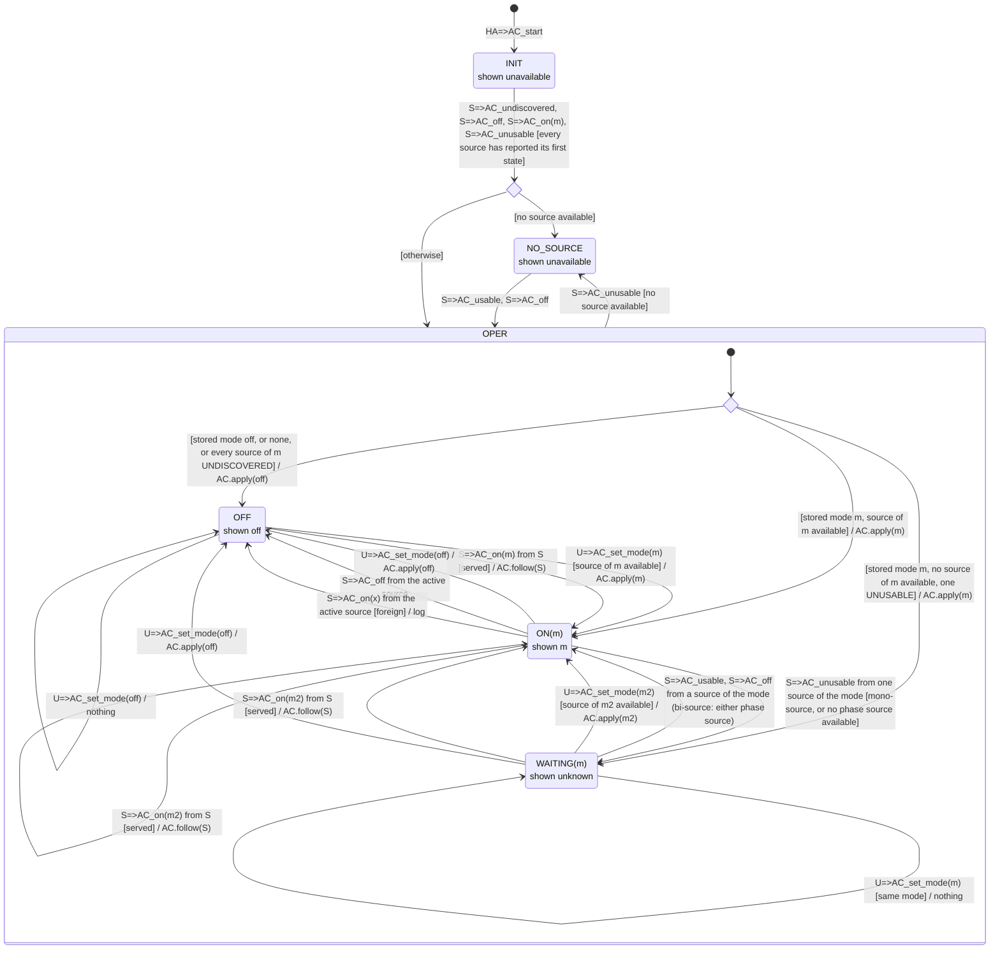

- **ENT-STATE-1** The entity stores its mode (`off` or `m`), saved across
  restarts. `INIT` and `NO_SOURCE` keep it.
- **ENT-STATE-2** The entity also stores its **last used mode**: the mode of
  its last `ON(m)` (`heat_cool` for a bi-source `heat_cool`). It is saved
  across restarts. It is used:
  - by `turn_on`, which asks for the last used mode, or for the first
    configured mode when no mode was ever used (`U=>AC_set_mode`). A
    last used mode no longer configured counts as none (ENT-INIT-4);
  - in `OFF`, for the temperature targets shown and set when the entity
    has no low/high (ENT-TGT-7, ENT-TGT-11: "the mode `turn_on` would
    start");
  - in `OFF`, for the reference temperature (ENT-REF-2: the last used
    source).
- **ENT-STATE-3** **A change asked by the user** (`U=>AC_set_mode`) is sent to
  the sources (`AC.apply`). **A change coming from a source** (`S=>AC_*`) is
  followed, and nothing is sent to that source: the source wins
  (takeover). The other sources are still turned off (`AC.follow`).
- **ENT-STATE-4** A user mode change goes to the mode asked if its source is
  available (`OFF` or `ON`). `off` is always accepted. Otherwise it is
  refused with an error.
  - A user request for the current mode does nothing: nothing sent, no
    error. This holds in `ON(m)` and `WAITING(m)` for `m` (in
    `WAITING(m)`, the source is not available, but the entity is already
    in `m` and waits for it), and in `OFF` for `off`. An automation that repeats the mode (a schedule setting
    `heat` every morning) does not turn off a tolerated foreign source
    (ENT-STATE-5), nor choose the phase of a bi-source `heat_cool` again
    (ENT-WANT-1), nor gets an error while the source is away.
- **ENT-STATE-5** A source mode change:
  - `S=>AC_on(x)` **served**: takeover, the entity goes to `ON(x)` and
    turns the other sources off (`AC.follow`);
  - `S=>AC_on(x)` **foreign** from the currently active source (it left
    its mode for a foreign one): the entity goes `OFF`; nothing is sent
    to any source (the source keeps running);
  - `S=>AC_on(x)` **foreign** from any other source: nothing happens
    (logged, listed in the `foreign_modes` attribute);
  - `S=>AC_off` from the active source: the entity goes `OFF`.

  A source in a foreign mode is **tolerated until the entity next sends
  requests**: nothing is sent to it on the foreign change, but every
  `AC.apply` and `AC.follow` turns off each source not `OFF`, the foreign one
  included. This happens on a mode change by the user, a takeover by
  another source (`AC.follow`), a phase switch of a bi-source `heat_cool`
  (`AC.apply(p)`), and at start or reload (`resume` makes an `AC.apply`,
  ENT-INIT-1, ENT-INIT-4).
  - A foreign source that goes `UNUSABLE` and comes back resends its
    stored state (SRC-STATE-7): the foreign mode if no `AC.apply` / `AC.follow`
    happened meanwhile, else `off` (the request was stored,
    SRC-STATE-4).
- **ENT-STATE-6** Main states: `INIT`, `OPER` (sub-states `OFF`, `ON(m)`,
  `WAITING(m)`) and `NO_SOURCE`. Entering `OPER` goes through the choice
  `resume`. `no source available` leaves `OPER` for `NO_SOURCE`, whatever
  the sub-state, and wins over the other transitions.
- **ENT-STATE-7** Bi-source mode (`heat_cool` with the heat and cool
  sources): its phase is managed by the mode management, in parallel
  (§1.3.3.2). On every entry of `ON(heat_cool)` the state management
  sends `ACstm=>ACmom_entered`, and `ACstm=>ACmom_left` when its mode is
  no longer `heat_cool`; "source of
  `m` available" means at least one of the two sources available
  (ENT-TYPE-4).
- **ENT-STATE-8** `turn_on` only acts in `OFF`:
  - in `OFF`, it asks for the last used mode (ENT-STATE-2);
  - in `ON(m)` and `WAITING(m)`, it does nothing: no request, no error
    (the entity is already on; in `WAITING(m)`, it waits for its source);
  - in `INIT` and `NO_SOURCE`, the entity is `unavailable`, so Home
    Assistant does not call it (ENT-NOSRC-3).

##### 1.3.2.2 INIT state

- **ENT-INIT-1** At `HA=>AC_start`, the entity waits until every source has reported
  its first state (`S=>AC_undiscovered`, `S=>AC_off`, `S=>AC_on(m)` or
  `S=>AC_unusable`, SRC-STATE-1); a source in `UNDISCOVERED` counts. It then goes
  to its stored mode if it can, else `OFF` (choice `resume`), and
  resynchronizes the sources (`AC.apply`). Before, its kept targets are
  brought back in line with the step and the range (ENT-TGT-4).
- **ENT-INIT-2** Stored mode `m` whose source is `UNDISCOVERED` (bi-source:
  both phase sources): `OFF`. This should not happen: a configuration
  change sets the entity to `OFF` (ENT-INIT-4), and a source discovered
  stays discovered (its data is saved). It covers lost or corrupted
  stored data (SRC-DATA-5, ENT-DATA-2).
- **ENT-INIT-3** Shows: the entity is **`unavailable`** (no mode, no action, no
  temperature target, no setting).
- **ENT-INIT-4** A change of the configuration (options in the UI, or
  YAML: an entry changed in the YAML, CFG-YAML-3) reloads the entry and
  **sets the entity to `OFF`**: its stored mode becomes `off`, and the
  phase is forgotten (ENT-PHASE-1). The reload then goes through `INIT`
  as when Home Assistant starts (stored data, last used mode, settings),
  and `resume` turns the sources off (`AC.apply(off)`).
  - This keeps a new configuration simple: no mode is resumed with
    sources that changed, and a new source (`UNDISCOVERED`) never gets a
    request (ENT-SEND-3).
  - If the last used mode is no longer configured, it is forgotten: the
    entity is as if no mode was ever used (ENT-STATE-2). `turn_on` asks
    for the first configured mode, and in `OFF` the temperature targets
    are those of that mode (ENT-TGT-7, ENT-TGT-11) and the reference
    temperature is read on the first available source (ENT-REF-2).
  - A source entity removed from the configuration is no longer managed:
    if it runs, it keeps running, since the entity only sends requests to
    its configured sources. Its stored data is dropped (SRC-DATA-9).
  - A reload without configuration change (asked from Home Assistant),
    and a YAML entry imported again unchanged at start (CFG-YAML-1), are
    restarts: the stored mode is resumed.
- **ENT-INIT-5** In `INIT`, the state management only handles the first
  state of each source (ENT-INIT-1). The start is one stimulus (EXEC-4),
  so no other `S=>AC_*` event is expected from a source before the
  entity leaves `INIT`; one that came would be ignored by the state
  management: the choice `resume` reads the state of the sources
  (`state@S`) and resynchronizes them (SRC-STATE-10). The other functions
  still handle their events (EXEC-1): `S=>AC_capabilities` (ENT-CAP-7),
  `T=>AC_temperature` for the external sensors (ENT-EXT-1).

##### 1.3.2.3 OFF state

Every source is asked to be off, except an `UNDISCOVERED` one, which gets
nothing (ENT-SEND-3), and a source turned on since in a foreign mode,
tolerated until the entity next sends requests (ENT-STATE-5).

- **ENT-OFF-1** Shows: the entity is not `unavailable`; `hvac_mode` `off`;
  `hvac_action` `off`. Capabilities and settings shown: §1.3.4, §1.3.5.

##### 1.3.2.4 ON(m) state

The source of `m` runs `m` (bi-source: the source of the current phase
runs it, §1.3.3.2); every other source is asked to be off, with the same
exceptions as in `OFF` (§1.3.2.3).

- **ENT-ON-1** Shows: the entity is not `unavailable`; `hvac_mode` `m`;
  `hvac_action` of the active source (the phase source for a bi-source
  mode). Capabilities and settings shown: those of `m` (§1.3.4, §1.3.5).
- **ENT-ON-2** `hvac_action`:
  - it is read on the active source (`action@S`) each time the
    active source changes or comes back: entry of `ON(m)`, phase switch
    of a bi-source `heat_cool`, return of the phase source from
    `UNUSABLE` (`WAITING_PHASE(p)` → `PHASE(p)`);
  - it then follows `S=>AC_action(a)` from the active source; those of
    the other sources are ignored;
  - it is shown as the source entity shows it, also during a mode request
    confirmation and `SETTLE` (it may still be the action of the
    previous mode);
  - `None` when the source entity has none, or is not usable
    (`WAITING_PHASE(p)`). The Home Assistant card then shows the mode
    instead of the action.

##### 1.3.2.5 WAITING(m) state

The source of the current mode `m` is `UNUSABLE`; the mode is kept.

- **ENT-WAIT-1** Entered from `ON(m)` on `S=>AC_unusable` from the
  active source (bi-source: once no phase source is available,
  ENT-PHASE-6), or by the choice `resume` when no source of `m` is
  available and one is `UNUSABLE`. Left when the source is back
  (`S=>AC_usable`, or `S=>AC_off` from a phase source → `ON(m)`: the
  source resynchronizes itself, SRC-STATE-7; its settings are kept,
  SRC-SET-1), when the user asks for another mode or `off`, on a
  takeover by another source, or for `NO_SOURCE` when no source is
  available any more (ENT-STATE-6).
- **ENT-WAIT-2** Shows: the entity is not `unavailable`; `hvac_mode` unknown
  (`None`); `hvac_action` unknown (`None`). Capabilities and settings
  shown: those of `m`, as last known (§1.3.4, §1.3.5). The
  `monitoring_sources` binary sensor (§4.2) tells which source is
  away.

##### 1.3.2.6 NO_SOURCE state

No source is available: every source is `UNUSABLE` or `UNDISCOVERED`.

- **ENT-NOSRC-1** Entered from `INIT` (ENT-INIT-1) or from `OPER`
  (ENT-STATE-6) when no source is available. Left as soon as a source
  becomes available (`S=>AC_usable`, `S=>AC_off`), through the choice
  `resume` (§1.3.2.1): the sources are resynchronized (`AC.apply`).
- **ENT-NOSRC-2** Shows: the entity is **`unavailable`** (no mode, no action, no
  temperature target, no setting). The stored mode is kept for the return.
- **ENT-NOSRC-3** No user event in `NO_SOURCE` (nor in `INIT`): Home
  Assistant does not call a service on an `unavailable` entity (the call
  is skipped without error, also from an automation).
- **ENT-NOSRC-4** In `NO_SOURCE`, the state management only handles the
  exits (`S=>AC_usable`, `S=>AC_off`). A source discovered `UNUSABLE`
  (`S=>AC_unusable`) leaves the entity in `NO_SOURCE`. The sources send
  nothing else to the state management: an `UNUSABLE` or `UNDISCOVERED`
  source reports no state, setting, temperature or action (SRC-STATE-11,
  SRC-STATE-12). `S=>AC_capabilities` is handled by the capabilities
  management (ENT-CAP-7).

#### 1.3.3 Mode management

##### 1.3.3.1 Mono-source and bi-source modes

The sources of the modes are configured in §3.1.2 (CFG-MODE-1 to
CFG-MODE-5). From that configuration,
each mode is mono-source or bi-source. The following table describes the possible options from the configuration:

| Mode | Configuration | Type | Sources |
|---|---|---|---|
| `heat`, `cool`, `auto`, `dry`, `fan_only` | `<mode>_entity` set | mono-source | its source |
| `heat_cool` | `heat_cool_entity` set | mono-source | its source |
| `heat_cool` | no `heat_cool_entity`, `heat_entity` and `cool_entity` set | **bi-source** | the heat source (phase `heat`) and the cool source (phase `cool`) |
| any | no source | not listed | — |

When `heat_cool` is bi-source (no `heat_cool_entity`, CFG-MODE-3), it uses the heat
and cool sources, one per phase:

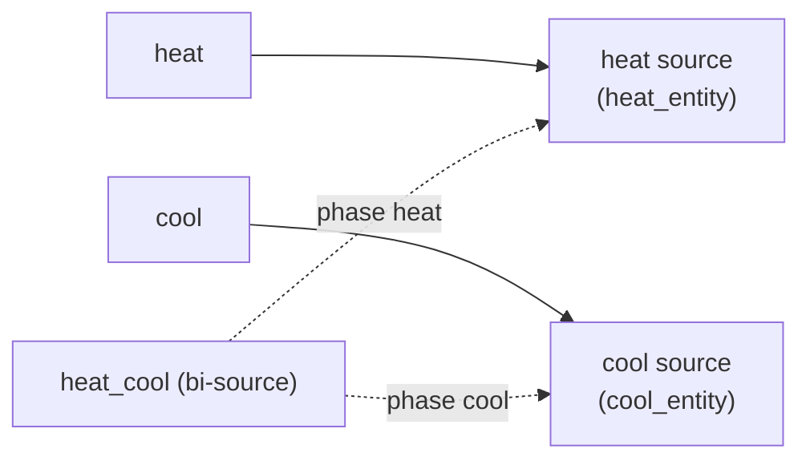

Otherwise (`heat_cool_entity` declared), `heat_cool` is mono-source and
uses its own source, like the other modes.

- **ENT-TYPE-1** Whether a mode is mono-source or bi-source is set by the
  **configuration only** (CFG-MODE-3): it never changes while running, only
  when the configuration changes (the entry is reloaded, ENT-INIT-4). The same mode
  can be either, depending on the configuration (today only `heat_cool`).
- **ENT-TYPE-2** Mono-source mode `m`: the source mode is `m`; the active
  source is the source of `m`.
- **ENT-TYPE-3** Bi-source mode: two sources, one per **phase** (`heat`,
  `cool`); one runs at a time (§1.3.3.2). The source mode is the phase; the
  active source is the source of the phase. Both sources can be the same
  entity (a heat pump switches its own mode).
- **ENT-TYPE-4** A bi-source mode is available as long as at least one of
  its two sources is available (ENT-HVAC-3); when none is, a user request
  for it is refused (ENT-STATE-4). A source that does not offer its phase
  is `UNUSABLE` (SRC-UNUS-2).
- **ENT-TYPE-5** In `ON(heat_cool)` bi-source, a mode change made on one
  of the two phase sources (`S=>AC_on(x)`, `x` = `heat` or `cool`) is a
  takeover: the source wins, and the entity leaves `heat_cool` for the
  **mono-source** mode `x` (`ON(x)`). Examples:
  - phase `heat`, the AC (cool source) is set to `cool` on its remote →
    `ON(cool)`;
  - phase `heat`, a heat pump serving both is set to `cool` on its
    remote → `ON(cool)`;
  - phase `cool`, the radiator (heat source) is turned on in `heat` →
    `ON(heat)`.

  A phase source set to `heat_cool` is in a foreign mode (§0), handled
  as in ENT-STATE-5.

  Setting the phase source to the mode it already runs (radiator set to
  `heat` in phase `heat`) changes nothing on the source entity: no event,
  the entity stays `heat_cool`.

##### 1.3.3.2 Bi-source mode: phase management

###### 1.3.3.2.1 Phase management

When `heat_cool` is bi-source, the phase is managed by the mode
management (`ACmom`), in its own state machine, in parallel with the state
management (§1.3.2). Its states are written with the current phase `p`
(`heat` or `cool`):

- `NO_PHASE`: the mode of the entity is not `heat_cool`, or
  `ON(heat_cool)` was not entered yet;
- `PHASE(p)`: the source of `p` is available and runs `p`;
- `WAITING_PHASE(p)`: the source of `p` is `UNUSABLE`. The phase `p` is
  kept, and its source gets the request when it comes back (SRC-STATE-4),
  like `WAITING(m)` for a mode.

`p'` is the other phase (`cool` when `p` is `heat`, and the reverse).

The entity chooses the phase from the reference temperature and the temperature targets
(see `AC.wanted` below). The state management tells the mode management
when the entity enters `ON(heat_cool)` (`ACstm=>ACmom_entered`) and when
its mode is no longer `heat_cool` (`ACstm=>ACmom_left`); the settings
management tells it when the temperature targets have changed: by the
user, by a takeover, or on a change of capabilities
(`ACsem=>ACmom_targets_changed`, §1.3.1).

Entering a phase `p` is written `AC.apply(p)`. Like the other activities
of the entity, it says what the entity expects from the sources, sent as
in ENT-SEND (§1.3.2.1):

- the source of `p` is expected in `p`, with the settings of that phase;
- every other source not `UNDISCOVERED` (ENT-SEND-3) is expected `off`,
  the source of the other phase included. Except when both phases use the
  same entity (a heat pump): it is just expected in the other mode.

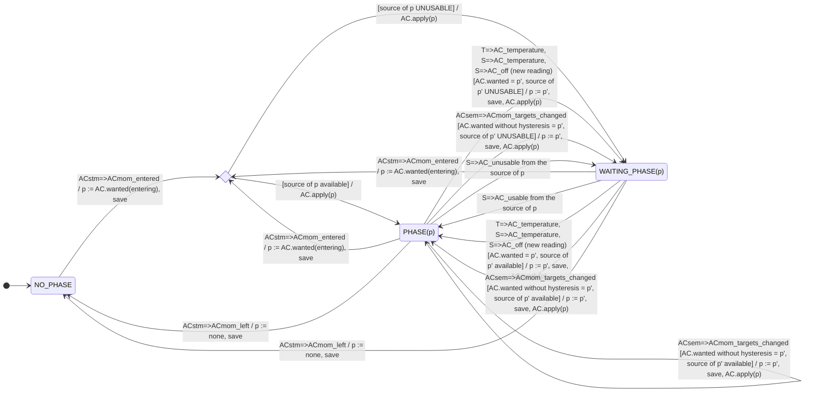

Leaving: no phase source available → `WAITING(heat_cool)` (ENT-PHASE-6),
where the mode management stays in `WAITING_PHASE(p)`; a change made on a
phase source → takeover (ENT-PHASE-4); another mode, or `off` →
`ACstm=>ACmom_left`.

The choice `entering` is taken on each `ACstm=>ACmom_entered`.

The events of the diagram marked "(new reading)" are defined in
ENT-PHASE-2.

- **ENT-PHASE-1** The phase is stored with the mode, and saved across
  restarts.
  - It only exists while the stored mode is `heat_cool`: it is forgotten
    when the entity leaves `heat_cool` (another mode, or `off`: `ACstm=>ACmom_left`).
  - It is not resumed as such. Every entry of `ON(heat_cool)` (user
    request, restart, back from `WAITING(heat_cool)` or `NO_SOURCE`)
    chooses the phase again (`ACstm=>ACmom_entered`, `AC.wanted(entering)`,
    ENT-WANT-1); the stored
    phase is only used there when there is no reference temperature.
- **ENT-PHASE-2** The phase is checked (`AC.wanted`, below):
  - on every **new reading**, an event that can change the wanted phase:
    - a new value of the reference, local high or local low temperature
      (§1.3.3.2.2): `T=>AC_temperature`, or `S=>AC_temperature` from the
      heat or cool source;
    - the discovery of a phase source: `S=>AC_off` from a phase source
      that was `UNDISCOVERED` (SRC-STATE-8). The switch it blocked
      (ENT-PHASE-7) can then happen.

    Not new readings: a `S=>AC_off` from a phase source that was
    available, a change made on that source (takeover, ENT-PHASE-4); the
    return of an `UNUSABLE` phase source, whose phase was not blocked: it
    waited in `WAITING_PHASE` (ENT-PHASE-5);
  - on every change of the temperature targets
    (`ACsem=>ACmom_targets_changed`, sent once the new targets are kept:
    the phase is judged on them):
    - set by the user (ENT-TGT-7);
    - taken from a source (takeover, ENT-TGT-9);
    - brought back in line on a change of the capabilities (ENT-TGT-4).

  A change of the temperature targets ignores the hysteresis
  (`phase_hysteresis` = 0): the phase follows at once. It is rare (a
  user request, a change on a device, a change of its
  capabilities), so it cannot cause short cycles. Without it, the phase
  would wait for the next reading, which may not come while the
  temperature is stable.
- **ENT-PHASE-3** A phase switch is an `AC.apply(p)` of the new phase
  (above). The entity does not wait nor judge anything meanwhile: each
  source confirms its own request (§1.2.4): the new phase source its mode
  (retries, monitoring, settle time), the other one `off`. A source sends
  no `S=>AC_*` event for a request it confirms (SRC-STATE-3).
- **ENT-PHASE-4** Leaving the phase from a source (phase source turned off
  or set to another served mode elsewhere) follows the state machine
  (ENT-STATE-5, ENT-TYPE-5).
- **ENT-PHASE-5** One phase source `UNUSABLE`:
  - the entity stays in `ON(heat_cool)`, in `WAITING_PHASE(p)` if it is the
    source of the current phase;
  - the phase is kept, and its source gets the request when it comes back
    (SRC-STATE-4);
  - the other phase can still start if the temperatures ask for it
    (ENT-PHASE-7): from `PHASE(p)` toward an `UNUSABLE` source, the
    entity goes to `WAITING_PHASE(p')`.
- **ENT-PHASE-6** No phase source available (both `UNUSABLE`, or one
  `UNUSABLE` and the other `UNDISCOVERED`): the entity goes to
  `WAITING(heat_cool)` (§1.3.2). It goes back to `ON(heat_cool)` as soon
  as one of them becomes available.
  Meanwhile, the mode management stays in `WAITING_PHASE(p)`: the current
  phase is still `p`.
- **ENT-PHASE-7** The entity switches to the other phase unless the
  source of that phase is `UNDISCOVERED`: it cannot get a request
  (ENT-SEND-3), so the current phase is kept. A source `UNUSABLE` does not
  block the switch: the entity goes to `WAITING_PHASE(p')`, and the source
  gets the request when it comes back (SRC-STATE-4).

###### 1.3.3.2.2 Wanted phase

Phase choice (`AC.wanted`). It uses three temperatures:

- the **reference temperature** (§1.3.5.1);
- the **local high temperature**: the temperature that must be above the
  high target to switch to `cool`;
- the **local low temperature**: the temperature that must be below the
  low target to switch to `heat`.

| Temperatures known (§1.3.5.1) | Local high temperature | Local low temperature |
|---|---|---|
| `temperature_sensor` with a valid value | the sensor | the sensor |
| no valid sensor, both source readings | the **lowest** of the two | the **highest** of the two |
| no valid sensor, one source reading | that one | that one |
| none | none | none |

Hysteresis `h`:

- on a new reading: `h` = `phase_hysteresis` (§3.1.3, ENT-WANT-3);
- on a change of the temperature targets (user, takeover, capabilities): `h` = 0 ("wanted without
  hysteresis", ENT-PHASE-2).

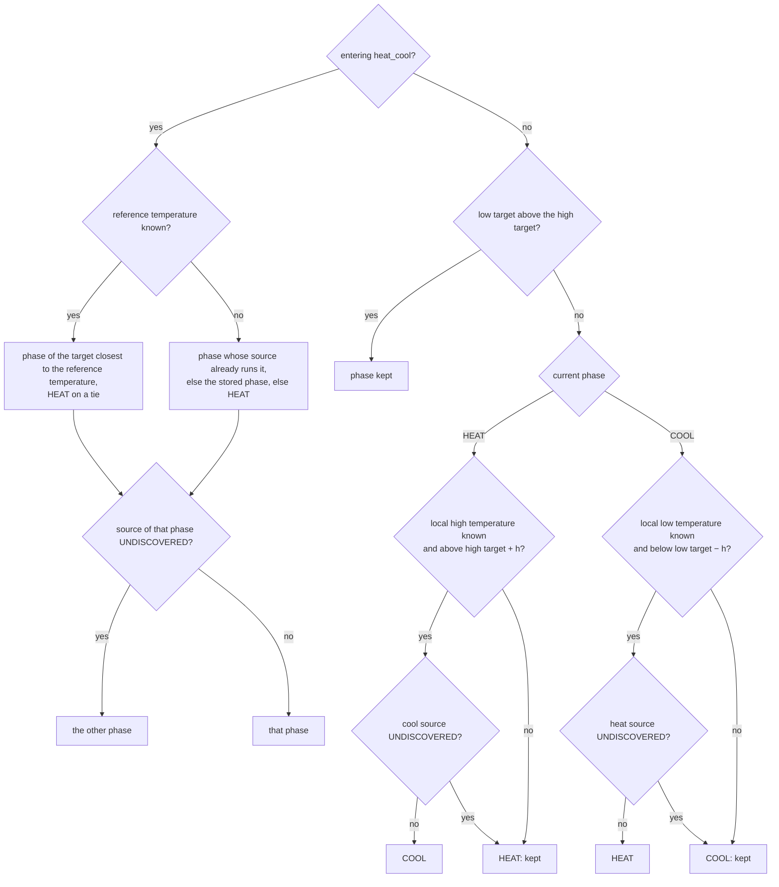

- **ENT-WANT-1** Entering `heat_cool`: the phase is the one of the temperature target
  closest to the reference temperature; `heat` when both are as close
  (targets 19 / 24, reference 21.5). Without reference temperature:
  the phase whose source already runs it, else the stored phase
  (ENT-PHASE-1), else `heat`.
  - "Runs it" is read in `state@S`: `ON` in the source mode of its
    phase (`heat` for the heat source, `cool` for the cool source); for
    an `UNUSABLE` source, its stored state, the one it imposes when it
    comes back (SRC-STATE-7). At a restart, it is the stored
    state the source imposes on its source entity (SRC-STATE-1,
    SRC-STATE-10), whatever the device shows yet: the phase is chosen
    after Home Assistant takes over.
  - A source in any other mode does not count: a foreign mode, or `dry`
    for a cool source that is also the source of `dry`.
  - At most one source runs its phase: the entity never leaves two
    sources running in modes they serve (every `AC.apply` and
    `AC.follow` expects the other sources `off`).
  - A phase whose source is `UNDISCOVERED` is never chosen: the other
    phase is taken (its source is available or `UNUSABLE`; otherwise the
    mode is not available, ENT-HVAC-3). Afterwards, ENT-PHASE-7 keeps
    the entity out of that phase until its source is discovered.
  - This applies to every entry: user request, restart, back from
    `WAITING(heat_cool)` or `NO_SOURCE`.
  - The hysteresis is not used when entering. So after a restart, the
    phase can differ from the one before. Example: targets 19 / 24, phase
    `heat`, reference temperature 22: after a restart, the closest target
    is 24, so the phase is `cool`.
- **ENT-WANT-2** Local high and low temperatures: see the table above.
- **ENT-WANT-3** Switching phase (after entering):
  - in phase `heat`, the phase switches to `cool` when the local high
    temperature is above the high target plus `h`;
  - in phase `cool`, the phase switches to `heat` when the local low
    temperature is below the low target minus `h`;
  - a source of the new phase `UNDISCOVERED` keeps the current phase
    (ENT-PHASE-7); a source `UNUSABLE` does not: the phase switches, and
    waits for its source (`WAITING_PHASE`);
  - otherwise the phase is kept. This covers: a temperature in between,
    an unknown local temperature, and the low target above the high one
    (after a takeover).
> **Note — why the lowest and the highest:** each source reads near its
> own device, so the two may disagree. Switching to `cool` only when even
> the lowest one is above the high target (and to `heat` only when even
> the highest one is below the low target) means the two sources agree.
> When they contradict each other, the phase is kept: no oscillation.

> **Note — why the hysteresis:** with close temperature targets, or a temperature
> near a temperature target, the phase would switch back and forth (short cycles).
> This wears the compressors and wastes energy. A change of the temperature targets
> (user, takeover, capabilities) is not concerned: it is rare, and the phase
> follows at once (`h` = 0).

#### 1.3.4 Capabilities management

Capabilities of the modes and temperatures (§1.3.4.1 to §1.3.4.5), then of fan and swing (§1.3.4.6).

The capabilities management runs in parallel with the state management
(§1.3.2), from `HA=>AC_start` until the entry unloads (END-1), in every
state of the entity (ENT-CAP-7).

##### 1.3.4.1 Principle

- **ENT-CAP-1** The entity builds its own capabilities (modes, range, step,
  temperature targets, options) from the capabilities of its sources
  (`capabilities@S`, §1.2.2).
  - It uses them whatever the state of the sources.
  - A source in `UNUSABLE` keeps the capabilities it showed last.
- **ENT-CAP-2** The capabilities of a mode `m` come from the source of `m`,
  as it showed them while running in `m`.
  - They are stored per source and per mode (SRC-DATA-1).
  - For a bi-source `heat_cool`, they come from the heat source running in
    `heat`, and from the cool source running in `cool`.

> **Note:** the entity does not need to handle a capability that
> disappears for a while (a device that hides an attribute while it
> restarts, or in some states): the source keeps it until its removal is
> confirmed (SRC-DATA-10, SRC-DATA-11). The entity always reads stable
> capabilities.

A mode is **not discovered yet** when its source has never run in it
(SRC-DATA-1):

- **ENT-CAP-3** A mode not discovered yet is available as any other
  (ENT-HVAC-2): the entity can switch to it.
- **ENT-CAP-4** Until it is discovered, the mode has the provisional
  capabilities of its source (SRC-DATA-13): what the source entity shows
  now, whatever its mode.
  - The entity shows the temperature targets of the case they give
    (ENT-FEAT-1, ENT-FEAT-2: with both features, the single target, until
    low/high are seen in the mode), in their range and on their step
    (ENT-RANGE-1, ENT-STEP-1) (ENT-FEAT-5).
  - A source never seen usable since the start gives none: the mode then
    counts as a source with a single temperature target, in the Home
    Assistant default range, 7–35 °C, without step.
  - The temperature targets the user sets for it meanwhile are kept, but
    not sent (ENT-CAP-5).
  - No fan/swing for it, except in `OFF` for an entity with a single
    configured mode (ENT-FAN-3). Elsewhere, a user request for a fan/swing
    setting in it is refused (ENT-FAN-4).
  - What it shows is a guess: the entity never sends anything from it
    (ENT-CAP-5).
- **ENT-CAP-5** When the entity enters a mode not discovered yet, it
  only sends the mode.
  - No temperature target and no fan/swing setting is sent: the entity does not know
    yet what the source accepts in that mode.
  - The entity never uses the capabilities of another mode to decide what
    to send.
- **ENT-CAP-6** At the first update of the source entity in that mode,
  the mode is discovered: its capabilities are read (SRC-DATA-6), and
  reported to the entity (`S=>AC_capabilities`, ENT-CAP-7). A provisional
  capability the source entity does not show in the mode stays shown
  until the removal confirmation ends, but nothing is sent from it
  (held, SRC-DATA-13); its end is reported too.
  - The kept temperature targets are first brought back in line
    (ENT-TGT-4): before, the mode counted with its provisional range and
    step (ENT-CAP-4).
  - When the temperature targets the mode shows differ from those it
    showed before its discovery (another case, ENT-FEAT-1: no target, or
    low/high instead of the single target), a line is logged at info
    level: the targets set before are kept, the mode uses others, or
    none.
  - They are then sent as in ENT-TGT-8 (range of the mode, offset, step
    of the source): none was sent yet (ENT-CAP-5), so every target the
    mode uses differs from what the source has (ENT-CAP-7).
  - For fan/swing, a remembered value (synchronized mode) is sent;
    without one, the entity adopts the value of the source as soon as it
    is shown, during the settle time too (ENT-FANV-5).
  - Until the discovery, the source runs with its own settings.

A change of the capabilities of a source (discovery of the source or of
a mode, or later):

- **ENT-CAP-7** On `S=>AC_capabilities` (SRC-DATA-12), whatever the
  state of the entity (`INIT` and `NO_SOURCE` included, and without
  changing it), the entity reads the capabilities of that source again (`capabilities@S`) and rebuilds its own (§1.3.4: modes
  available, features, step, range, fan/swing options). Then (the first three through the settings
  management, `ACcam=>ACsem_capabilities_changed(m)`, §1.3.1):
  - the step or the range of a mode changed, as read on its source
    (ENT-RANGE-1), even when the limits `min_temp` / `max_temp` hide the
    change (ENT-RANGE-3): the kept targets are brought back in line
    (ENT-TGT-4);
  - the options of a mode changed: the fan/swing memory is checked
    (ENT-FANV-3);
  - the settings expected from the active source (`expected(S)`,
    ENT-SEND-1) are computed again with the new capabilities: the
    temperature targets its mode now sends (§1.3.4.3), as in ENT-TGT-8
    (range of the mode, offset, step of the source), and the
    fan/swing values remembered for that mode (ENT-FANV-6). The entity
    then sends what differs from what the source has (`sent(S)`,
    ENT-SEND-3):
    - a setting changed: the value to send counts, not the value kept.
      A new range of the mode can change the value sent without changing
      the value kept, which is brought into the range of the temperature
      target, not of the mode (ENT-TGT-4);
    - a setting the mode now uses and that was never sent: the discovery
      of the mode (only the mode was sent, ENT-CAP-5), a feature that
      appears in a mode already discovered (`TARGET_TEMPERATURE`, a
      fan/swing setting), low/high once `low_high_seen` is set
      (ENT-FEAT-2). It is not in `sent(S)`, so it is sent;
    - a fan/swing setting without remembered value is not sent: the
      source keeps its own value, which the entity adopts (ENT-FANV-5);
    - a takeover reported in the same update of the source arrives after
      (EXEC-2) and wins (ENT-SEND-3). The fan/swing value a source
      reports for a capability just discovered is not one when the entity
      has a remembered value: that value is sent (ENT-FANV-5). This decides who wins when the mode
      changes to low/high (`low_high_seen` set), and when
      `TARGET_TEMPERATURE` appears in a mode already discovered: during
      `SETTLE` (the discovery of the mode, the usual case), the source does
      not report the temperature targets it shows, and the ones of the
      entity are sent; outside `SETTLE`, the source reports them
      (`S=>AC_settings`, a value shown for the first time is a change,
      SRC-SET-11): they are adopted (ENT-TGT-9) and not sent back;
  - the entity writes its state in Home Assistant, so that the card and
    the attributes show the new capabilities (except in `INIT` and
    `NO_SOURCE`, where the entity is `unavailable`).

##### 1.3.4.2 Modes listed

- **ENT-HVAC-1** The entity lists `off` and every configured mode
  (§1.3.3.1), in its `hvac_modes`.
  - `heat_cool` is listed when it is configured, mono-source or
    bi-source.
  - The modes are listed in mode order (§0).
  - The list comes from the configuration. It does not change while
    running, so the card always shows the same modes.
- **ENT-HVAC-2** A mode can be in the list without being available. A
  mono-source mode is not available when its source is `UNDISCOVERED` or
  `UNUSABLE`. A source that does not offer the mode is `UNUSABLE`
  (SRC-UNUS-2).
- **ENT-HVAC-3** A bi-source mode is not available when **both** sources
  are `UNDISCOVERED` or `UNUSABLE` (one available source is enough,
  ENT-PHASE-5). A source that does not offer its phase is `UNUSABLE`
  (SRC-UNUS-2).
- **ENT-HVAC-4** A mode that is not available:
  - stays in the list;
  - is listed in the `unavailable_modes` attribute;
  - is refused when the user asks for it (ENT-STATE-4).
- **ENT-HVAC-5** When a source does not offer the mode it serves (the
  source is then `UNUSABLE`, SRC-UNUS-2):
  - a warning is logged, and a Repairs issue
    (`<entry>_<mode>_not_supported`) is raised;
  - the issue is removed when the source offers the mode again (logged at
    info level), and when the entry unloads (END-1, not logged);
  - a source never seen is not judged.

##### 1.3.4.3 Temperature targets used by each mode

The entity keeps three temperature targets:

- **low** and **high**: a pair, the temperature target to heat and the
  one to cool, always used together;
- **T**: the single temperature target.

Each mode uses some of them. It shows them either in the single target
attribute (`temperature`), or in the low/high attributes
(`target_temp_low`, `target_temp_high`). Which ones depends on the case
of its source in that mode (ENT-FEAT-1), and, for `heat_cool`, on its
number of sources (ENT-FEAT-4).

| Mode | Source in that mode | Temperature targets used | Shown as | Sent as |
|---|---|---|---|---|
| `heat`, `cool`, `heat_cool` mono-source, `auto`, `dry` | with a single temperature target | T | `temperature` | `temperature` |
| `heat`, `cool`, `heat_cool` mono-source, `auto`, `dry` | with low/high | low, high | `target_temp_low`, `target_temp_high` | `target_temp_low`, `target_temp_high` |
| `heat_cool` bi-source | two sources | low, high | `target_temp_low`, `target_temp_high` | in each phase, to the source of that phase: low in `heat`, high in `cool`, or both to a source with low/high (ENT-FEAT-4, ENT-TGT-8) |
| `heat`, `cool`, `heat_cool` mono-source, `auto`, `dry` | without temperature target | none | nothing | nothing |
| `fan_only` | any | none | nothing | nothing |
| a mono-source mode not discovered yet | its provisional capabilities (ENT-CAP-4) | those of the case they give | as in that case | nothing (ENT-CAP-5, ENT-FEAT-5) |

- **ENT-FEAT-1** What a mode uses depends on what its source supports in
  that mode. The source is in one of three cases:
  - **with low/high**: the source uses two temperature targets, `target_temp_low`
    and `target_temp_high` (ENT-FEAT-2);
  - **with a single temperature target**: the source uses one temperature target,
    `temperature`. It declares the feature `TARGET_TEMPERATURE`, and is
    not "with low/high";
  - **without temperature target**: the source has no temperature target at all, for example a
    dehumidifier in `dry`. It declares neither `TARGET_TEMPERATURE` nor
    `TARGET_TEMPERATURE_RANGE`. The entity then shows no temperature target in that
    mode, and sends none.
- **ENT-FEAT-2** A source is "with low/high" in the mode `m` when it
  declares the feature `TARGET_TEMPERATURE_RANGE`.
  - If it declares only `TARGET_TEMPERATURE_RANGE`, that is enough.
  - If it also declares `TARGET_TEMPERATURE`, one more condition is
    needed: it has already shown numeric low/high values while running
    in `m` (`low_high_seen`, SRC-DATA-8).
  - Why: some sources declare both features but only use the single
    temperature target, or only use low/high in some modes. For example,
    a template climate with only `set_temperature`, or a thermostat that
    declares both features in every mode and uses low/high only in
    `heat_cool` or `auto`: in `heat`, it shows no low/high, so it gets
    the single target.
  - The condition is judged per mode, from what the source showed in
    that mode: offering a mode such as `heat_cool` says nothing about the
    other modes.

> **Note — known limitation:** if the device behind a source entity is
> replaced, and the entity id stays the same, the source keeps its
> `low_high_seen`. Only deleting the entry clears it (END-3).

- **ENT-FEAT-3** Features declared by the entity:
  - it always declares `TURN_ON` and `TURN_OFF`;
  - it declares `TARGET_TEMPERATURE` when at least one configured mode
    shows a single temperature target (`temperature`);
  - it declares `TARGET_TEMPERATURE_RANGE` when at least one configured
    mode shows low/high;
  - these features do not change with the current mode. They follow
    what the modes show (table above): a mode not discovered yet counts
    with its provisional capabilities (ENT-FEAT-5), and a mode whose source changes case
    (`low_high_seen` set, ENT-FEAT-2) is judged again (ENT-CAP-7);
  - the other features of the sources (presets, humidity) are not
    exposed.
- **ENT-FEAT-4** A mono-source mode uses the temperature targets of its
  source, whatever the mode (`heat` and `cool` included): T with a
  single temperature target, low and high with low/high.
  - The modes whose sources have a single temperature target therefore
    share T: a target set in `heat` is the target of `cool` too.
  - Only a bi-source `heat_cool` splits the pair between its two
    sources: the heat source gets low, the cool source gets high. A
    phase source with low/high in the mode of its phase gets both
    (ENT-TGT-8).
  - When a mode starts to show low/high (its discovery, ENT-CAP-6, or
    `low_high_seen` set, ENT-FEAT-2), it shows low and high as kept,
    brought back in line (ENT-TGT-4): they do not take the value of T.
    This happens once per mode, at its first use (SRC-DATA-8).
- **ENT-FEAT-5** A mono-source mode not discovered yet (ENT-CAP-4) uses
  the temperature targets of the case its provisional capabilities give:
  they are shown, nothing is sent (ENT-CAP-5).
  - The temperature targets the user sets meanwhile go through the
    service (ENT-FEAT-3, ENT-TGT-7): a single `temperature` sets T,
    `target_temp_low` / `target_temp_high` set low / high. They are kept,
    and the ones the mode uses are sent at the discovery (ENT-CAP-6).
  - At the discovery, the case may differ from the provisional one: the
    mode then shows the targets of its real case (logged, ENT-CAP-6).
  - A bi-source `heat_cool` always shows low and high: they choose the
    phase (§1.3.3.2.2). The source of a phase whose mode is not
    discovered yet gets only the mode (ENT-CAP-5).

##### 1.3.4.4 Step

- **ENT-STEP-1** The entity has one step (`target_temp_step`). It is
  computed from the steps of all the sources, in all their discovered
  modes, and from the provisional step of a source while one of its
  configured modes is not discovered yet (ENT-CAP-4).
  - The step of the entity is the largest value that divides every step
    of the sources exactly.
  - Examples: steps 0.5 and 1 give 0.5. Steps 0.5 and 0.2 give 0.1.
  - A source without step counts as 0.5 °C (1 °F), as the Home Assistant
    card does.
  - If no step is known yet, the step is 0.5 °C (1 °F).
- **ENT-STEP-2** The step does not change with the state or the mode. So a
  temperature target keeps the same value when the mode changes.

##### 1.3.4.5 Range

- **ENT-RANGE-1** The range of a mode comes from its source.
  - It is the `min_temp` / `max_temp` of the source in that mode, minus the
    offset of the mode (CFG-SENS-1).
  - For a bi-source `heat_cool`, it goes from the minimum of the heat
    phase (the heat source in `heat`) to the maximum of the cool phase
    (the cool source in `cool`): the low target goes to the heat source,
    the high one to the cool source. Each target is then brought into
    the range of its phase when it is sent (ENT-RANGE-4).
  - For a mode not discovered yet, it is the provisional range of its
    source, minus the offset; 7–35 °C for a source never seen usable
    (ENT-CAP-4).
- **ENT-RANGE-2** The range shown by the entity:
  - in `ON(m)` and `WAITING(m)`: the range of `m`;
  - in `OFF`: the widest range of the modes that use a temperature
    target (§1.3.4.3, provisionally or not). A mode without temperature
    target (`fan_only`, a source without temperature target) does not
    count: its range bounds no target. With no such mode, the widest
    range of all the modes.
- **ENT-RANGE-3** The limits `min_temp` / `max_temp` (§3.1.6):
  - they can only narrow the range, never widen it;
  - a limit outside the range is ignored;
  - they apply to the reference temperature, before the offset.
- **ENT-RANGE-4** When the entity sends a temperature target to the source
  of a mode, it first brings it into the range of that mode
  (ENT-RANGE-1, ENT-RANGE-3), both on the scale of the entity; the
  offset is added after (ENT-TGT-8). A value below the minimum is sent as the
  minimum, and a value above the maximum is sent as the maximum. The
  value kept by the entity does not change.
- **ENT-RANGE-5** A temperature target set by the user is kept within the
  widest range of all the modes that use it (§1.3.4.3). A value taken
  from a source can be outside (takeover: ENT-TGT-9). For example, T is
  used by `heat` and `cool` when their sources have a single temperature
  target: T can take any value that at least one of these modes accepts.
  A temperature target that no mode uses, even provisionally (ENT-FEAT-5),
  is kept within the range shown in `OFF` (ENT-RANGE-2).
- **ENT-RANGE-6** This way, a value is not lost because one mode cannot
  reach it. For example, with a radiator at 5–30 °C for `heat` and an AC
  unit at 16–30 °C for `cool`, a target T of 14 °C is kept at 14 °C. The
  radiator gets 14 °C, and the AC unit gets 16 °C.

##### 1.3.4.6 Fan and swing

The three settings `fan_mode`, `swing_mode` and `swing_horizontal_mode` are
handled the same way. This section only covers their options; the values
remembered for each mode are in §1.3.5.4.

- **ENT-FAN-1** The options of a mode for a setting are the options its
  source showed while running in that mode (`fan_modes`, `swing_modes`,
  `swing_horizontal_modes`), when it declares the matching feature in
  that mode.
  - For a bi-source `heat_cool`, they are the options of the source of
    the current phase.
  - A mode not discovered yet has no option (ENT-CAP-4), except in `OFF`
    for an entity with a single configured mode: the provisional options
    of its source (ENT-FAN-3).
- **ENT-FAN-2** The entity declares the features `FAN_MODE`, `SWING_MODE`
  and `SWING_HORIZONTAL_MODE` as soon as at least one configured mode has
  that capability discovered (ENT-FAN-4), even without option; with a
  single configured mode not discovered yet, as soon as its source has it
  provisionally (ENT-FAN-3). These
  features do not change with the mode, so the card keeps the same size.
- **ENT-FAN-3** The options shown by the entity depend on its state:
  - in `ON(m)` and `WAITING(m)`, it shows the options of `m` (in
    `WAITING(m)`, the ones known last), all of them, even when `m` is in
    `sync_modes`: an option not shared can be chosen, it is just not
    remembered (ENT-FANV-3);
  - in `ON(heat_cool)` bi-source, it shows the options of the current
    phase, with or without `bi_source_sync` (ENT-FAN-8);
  - in `OFF`, it shows the options shared by the synchronized modes when
    **every** configured mode is in `sync_modes` (ENT-FAN-6), a bi-source
    `heat_cool` excepted (it cannot be listed, ENT-FAN-7). With a single
    configured mode, it shows the options of that mode, the only one
    `turn_on` can start, as if it were synchronized with itself; before
    its discovery, the provisional options of its source (SRC-DATA-13): a
    value chosen then is remembered (ENT-FANV-9), and sent at the
    discovery if the mode offers it (ENT-CAP-6, ENT-FANV-3). With several
    configured modes, a mode not discovered yet adds nothing, even to
    the options shared by synchronized modes (ENT-FAN-6).
    Otherwise, it shows none (it does not show the options of the mode
    `turn_on` would start).
- **ENT-FAN-4** A setting is shown and set only from what is discovered.
  The capability (the setting itself) and its options (the values
  offered) are distinct:
  - **capability not discovered** (the source never ran in the mode, or
    does not declare the setting in it): the setting is not shown, and a
    user request for it is refused with a clear error. Only exception: in
    `OFF`, with a single configured mode not discovered yet, the
    provisional capability and options of its source (ENT-FAN-3);
  - **capability discovered**: the setting is shown, with its discovered
    options (ENT-FAN-1), which may be none;
  - only a value among the options shown can be set. Any other value is
    refused with a clear error; with no option shown, every user request
    is refused.

  Home Assistant makes this check itself, before it calls the entity: a
  `set_fan_mode`, `set_swing_mode` or `set_swing_horizontal_mode` whose
  value is not exactly (case included) one of the options shown is
  refused with an error that lists them. The entity checks the same. So
  the user only sees and sets discovered options, written as shown. In
  `OFF`, what is shown is given by ENT-FAN-3 (shared options when every
  mode is synchronized, the options of the mode with a single configured
  mode, otherwise none, so every user request is refused).
- **ENT-FAN-5** Between the entity and its sources, values are compared
  without taking the case into account: `Low` and `low` are the same
  value (a remembered value and the options of a mode, the shared
  options, a value reported by a source, SRC-SET-4). Each source gets the
  value written as it writes it, and the entity shows a value written as
  the options it shows. Other names are not matched: `1` is not `low`.
  A user request needs no such comparison: it is one of the options
  shown, as written (ENT-FAN-4).
- **ENT-FAN-6** The options shared by the synchronized modes (`sync_modes`,
  §3.1.7) are the options offered by **all** of them, without taking the
  case into account. They are written as the first synchronized mode
  writes them, in mode order.
  - A mode not discovered yet (ENT-CAP-4) is left out until its
    discovery: it does not block the sharing between the others. With no
    synchronized mode discovered, there is no shared option.
  - Its discovery may reduce the shared options: the memory is then
    checked (ENT-CAP-7, ENT-FANV-3).
- **ENT-FAN-7** Configuration errors of `sync_modes`, each one reported by
  a warning and a Repairs issue, removed once the cause is gone (logged at
  info level), and when the entry unloads (END-1, not logged):
  - a synchronized mode whose source does not have a setting at all (a
    radiator without fan): that mode is ignored for that setting, so that
    the others still share their options. It is judged once the mode is
    discovered: its source does not declare the feature in that mode
    (ENT-FAN-1). A mode not discovered yet is not judged (it is left out,
    ENT-FAN-6). It is reported only when another synchronized mode,
    discovered, has that setting: when none has it (AC units without
    horizontal swing), there is nothing to share, and nothing is
    reported. The check is made at each rebuild of the capabilities
    (ENT-CAP-7), and at start with the stored capabilities;
  - `heat_cool` listed while it is bi-source: it is ignored in
    `sync_modes`. A bi-source `heat_cool` is synchronized with
    `bi_source_sync` instead (ENT-FAN-8). `heat_cool` always stays in the
    list of choices of `sync_modes`.
- **ENT-FAN-8** `bi_source_sync` (§3.1.7) synchronizes the two phases of a
  bi-source `heat_cool`, with the same principle as `sync_modes`:
  - the shared options are the options offered by both phase sources
    (the heat source in `heat`, the cool source in `cool`), without
    taking the case into account. Only they are remembered (ENT-FANV-3);
  - the options shown in `ON(heat_cool)` are all the options of the
    current phase (ENT-FAN-3);
  - a phase not discovered yet is left out, like a mode in ENT-FAN-6;
  - a phase source that does not have a setting at all, while the other
    phase source has it, is reported like in ENT-FAN-7 (judged once the
    phase is discovered), and ignored for that setting.

#### 1.3.5 Settings management

- **ENT-SET-1** `U=>AC_set_settings(s)`: the entity keeps the temperature
  targets (ENT-TGT-7) and remembers the fan/swing values of the current
  mode (ENT-FANV-4); in `OFF`, the temperature targets (ENT-TGT-7), and
  fan/swing only when shown (ENT-FAN-3, ENT-FANV-9). The fan/swing values asked are checked first (ENT-FAN-4).
  - In `ON(m)`, they are sent to the active source (`AC=>S_settings(s)`).
  - In `WAITING(m)` and `WAITING_PHASE(p)`, they are sent too: the source
    is `UNUSABLE` and keeps them (SRC-SET-1), then sends them when it
    comes back (SRC-STATE-7).
- **ENT-SET-2** `S=>AC_settings(s)` from the active source (takeover of a
  setting, or of the mode: SRC-SET-11): the entity adopts them. From any
  other source (a source tolerated in a foreign mode, ENT-STATE-5; any
  source while the entity is `OFF`), they are ignored: neither adopted,
  nor written in `expected(S)` or `sent(S)` (ENT-SEND-2).
- Temperature targets: §1.3.5.3. Fan and swing values: §1.3.5.4.

##### 1.3.5.1 Reference temperature

The temperature the entity regulates on, and shows as its current
temperature.

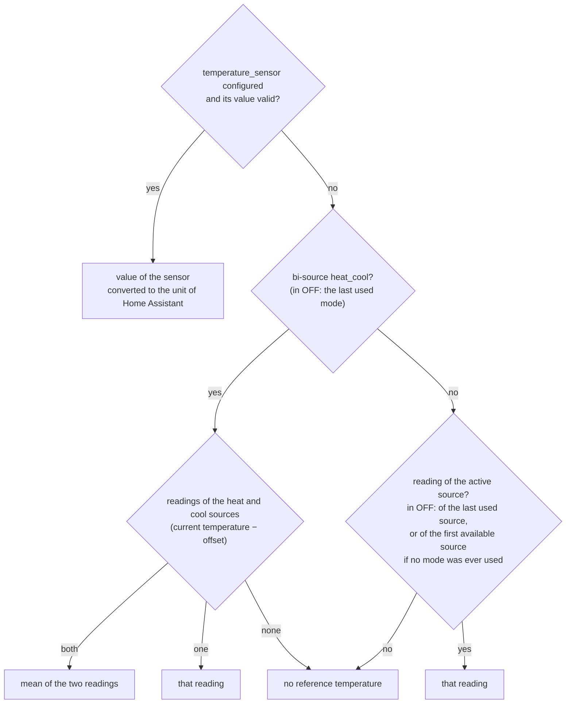

- **ENT-REF-1** With `temperature_sensor` (§3.1.3), the reference
  temperature is its value (`temperature@T`), converted to the unit of
  Home Assistant. A value that is not a valid number (`unavailable`,
  `unknown`, text, infinite), or whose unit is not a temperature
  (CFG-SENS-6), is no value (`None`).
- **ENT-REF-2** Without `temperature_sensor`, or while it has no valid
  value, the reference temperature is the current temperature
  (`temperature@S`) minus the offset of its mode (CFG-SENS-1) of:
  - the active source, in `ON(m)` and `WAITING(m)`;
  - the **last used source** in `OFF`: the source of the last used mode
    (ENT-STATE-2, saved across restarts); for a bi-source `heat_cool`,
    both phase sources, as in `ON(heat_cool)` below (the phase is
    forgotten in `OFF`, ENT-PHASE-1);
  - in `OFF` when no mode was ever used (or the last used mode is no
    longer configured, ENT-INIT-4), the **first available source**, in
    mode order. It is not a fallback: when the last used source has no
    reading, there is no reference temperature (ENT-REF-3);
  - in `ON(heat_cool)` and `WAITING(heat_cool)` **bi-source**, from the
    readings of the heat and cool sources (ENT-REF-5):
    - both readings known: their **mean**;
    - only one (the other source `UNUSABLE`, or without current
      temperature): that one;
    - none: no reference temperature (ENT-REF-3).
- **ENT-REF-3** No reference temperature (no valid sensor value, and no
  reading from that source: not available, or no `current_temperature`): the
  entity shows no current temperature
  (`None`). The users of the reference temperature handle its absence
  (for the phase choice: ENT-WANT-1, ENT-WANT-3).
- **ENT-REF-4** The entity shows the reference temperature as its
  `current_temperature`, in every sub-state of `OPER` (in `INIT` and
  `NO_SOURCE` the entity is `unavailable`).
- **ENT-REF-5** The reading of a source is its current temperature
  (`temperature@S`) minus the offset of the mode it serves (CFG-SENS-1): a
  well set offset makes the source read the reference temperature.
- **ENT-REF-6** Bi-source mode without valid sensor:
  - the entity shows the reference temperature, the mean of the two
    readings; it is also used when entering `heat_cool`
    (ENT-WANT-1);
  - to switch phase, the entity uses the local high and low temperatures
    instead (the lowest and the highest of the two, ENT-WANT-2), so that
    two sources that disagree do not make the phase oscillate
    (§1.3.3.2.2).
- **ENT-REF-7** The reference temperature is computed from the data
  (`temperature@T`, `temperature@S`), read at each computation. It is
  computed again on every event that can change it:
  - a value changed: `T=>AC_temperature`, `S=>AC_temperature` (`None`
    included: the value is gone);
  - the readings used changed: entry of `OPER`, change of mode or of
    phase, a source that becomes available or `UNUSABLE`.

  So a value that does not change is never missing: at start, at the
  discovery of a source or at its return from `UNUSABLE`, the value is
  read at once, without waiting for a change.

##### 1.3.5.2 External sensors

- **ENT-EXT-1** For each external sensor entity (`<mode>_external_sensor`,
  CFG-SENS-2; one per source entity, CFG-SENS-4), the
  entity writes the value of the temperature sensor to that entity
  (`AC=>XS_set_value(v)`) **on every `T=>AC_temperature` event with a
  valid value**, whatever the state of the entity and of the source (even
  off, even when the mode is not the current one). At `HA=>AC_start`, the
  current value (`temperature@T`) is written at once if it is valid. An
  external sensor entity named by several modes is kept once when the
  configuration is read: each value is written to it once.
  - The write is sent at once, not when the queues are empty (ENT-SEND):
    the value written, `temperature@T`, cannot change during a step, and
    each write is wanted, even unchanged (ENT-EXT-4).
- **ENT-EXT-2** The value is converted to the unit of the external sensor
  entity and rounded to its step (`attributes@XS`). It is not written when
  the external sensor entity is not usable (`attributes@XS` `None`), or
  when the value is out of its range. A warning is logged when the value
  goes out of the range, not again while it stays out (each change of
  the temperature and each rewrite would repeat it); the next write in
  the range is logged at info level, and a new exit logs a new warning.
  A write error (`XS=>AC_call_failed`) is logged.
- **ENT-EXT-3** The offset of a mode with an external sensor is 0: its
  source regulates on the reference temperature (CFG-SENS-2).
- **ENT-EXT-4** While the temperature sensor has a valid value
  (`temperature@T`), that value is written again every `external_sensor_resend_timer` (§3.1.4, 900 s by default;
  a timer of the settings management, its end is `ACsem_resend_timeout`),
  even unchanged: some devices (thermostatic valves) go back to their own
  sensor when the external temperature is not updated for a while.
- **ENT-EXT-5** Temperature sensor without valid value (`unavailable`,
  `unknown`, `None`, not a number: `T=>AC_temperature(None)`, or
  `temperature@T` `None` at `HA=>AC_start`): nothing is written, and the
  periodic rewrite stops, so that the device does not regulate on a stale value: a
  device that watches the updates goes back to its own sensor. Writing
  resumes with the next valid value. The monitoring reports the sensor
  (MON-TEMP-4). An external sensor entity cannot be made invalid from Home
  Assistant (a `number` only takes a number in its range).
- **ENT-EXT-6** When an external sensor entity becomes usable
  (`XS=>AC_usable`: it appears in Home Assistant, or leaves `unavailable`
  / `unknown`), the current value (`temperature@T`) is written to it at
  once if it is valid, as at `HA=>AC_start`. An external sensor entity
  loaded after the integration when Home Assistant starts gets the value
  at once, without waiting for the next change of the temperature sensor
  or for `external_sensor_resend_timer`.

##### 1.3.5.3 Temperature targets

The temperature targets used and shown by each mode are listed in
§1.3.4.3 (low, high, T).

**What the entity keeps**

- **ENT-TGT-1** The temperature targets belong to the entity, not to the
  sources.
  - Switching mode keeps them, and the source of the new mode gets them.
  - They are temperatures of the reference (§1.3.5.1): the offset is only
    added when a temperature target is sent to a source (ENT-TGT-8).
  - The `saved_targets` attribute shows the three values as kept.
- **ENT-TGT-2** The temperature targets are kept:
  - across restarts;
  - while the entity is `OFF`, in `fan_only`, in a mode without
    temperature target, and in `WAITING(m)`.
- **ENT-TGT-3** A value kept is always on the step of the entity
  (ENT-STEP-1). Its range depends on who set it:
  - set by the user, or taken as a first target (ENT-TGT-10): it is within
    the range of the temperature target (ENT-RANGE-5);
  - taken from the source (takeover, ENT-TGT-9): it is kept as it is,
    even outside that range. The source wins.

  A value outside the range stays until the user or a source sets the
  target again, or until the capabilities change (ENT-TGT-4).

**Capabilities changed**

- **ENT-TGT-4** When the capabilities of a mode change (`S=>AC_capabilities`,
  ENT-CAP-7: discovery of the source, SRC-DATA-12, or of the mode,
  ENT-CAP-6, or later update of the step or the
  range read on the source, SRC-DATA-6, SRC-DATA-10, even when the limits
  `min_temp` / `max_temp` hide it, ENT-RANGE-3), and when it leaves `INIT` (the step
  or the range may have changed since the targets were saved: a source
  added or removed by a configuration change, ENT-INIT-4), the entity
  takes back control of its kept targets:
  - every kept target is rounded to the step of the entity (ENT-STEP-1);
  - every kept target is brought into the range of the temperature target
    (ENT-RANGE-5), not into the range of the mode alone (ENT-RANGE-6).
    This includes a value taken from a source outside the range
    (ENT-TGT-9): the takeover does not survive a change of the
    capabilities;
  - the gap is applied again (ENT-TGT-5), also when a takeover broke it
    (ENT-TGT-9): the high target moves, as when the user changes both
    (ENT-TGT-6); if it cannot (the end of its range is reached), the low
    target moves instead;
  - what is sent to the active source follows ENT-CAP-7: the settings
    expected from it are computed again, and the ones that differ from
    what it has are sent (ENT-SEND-3). A target the mode uses and that
    was never sent is sent too, even when it did not change;
  - a takeover of a target in the same update of the source (EXEC-3)
    arrives after, and wins: the target brought back in line is not sent
    yet (ENT-SEND-3), and the value adopted is not sent back;
  - in a bi-source `heat_cool`, the phase is checked on the targets
    brought back in line (ENT-PHASE-2).

**Gap between low and high**

- **ENT-TGT-5** The low target stays at least `min_gap` (§3.1.6) below the
  high target, when the entity has low/high (a configured mode shows
  them, ENT-FEAT-3).
  - Without, no mode uses low and high: they are only kept, and one
    never moves the other.
  - When a mode starts to show low/high (its discovery, `low_high_seen`
    set), the gap is applied on the change of capabilities (ENT-TGT-4).
  - When the ranges leave no room for it (the low target cannot go
    below the high one by `min_gap` within their ranges, which only the
    ranges of the sources can cause, CFG-LIM-1), the low target goes to
    the minimum of its range and the high target to the maximum of its
    range: the gap is as large as they allow.
- **ENT-TGT-6** The user sets low and high together (Home Assistant asks
  for both). A target the user changes is one whose value asked differs
  from the value shown (ENT-TGT-11); the card changes one at a time. When
  they are closer than the gap (ENT-TGT-5):
  - one target changed: it is kept, and the other one moves away from it,
    rounded away from it, on the step of the entity, so that the gap is
    kept. The same rule as a takeover (ENT-TGT-9). If the other one
    cannot move far enough (the end of its range is reached), it goes to
    that end, and the target changed gives way: it stops at the gap from
    the other one. Example with `min_gap` 2 °C and a range 16–30 °C:
    from 22 / 24, high lowered to 23 gives 21 / 23; from 28 / 30, low
    raised to 29 stays 28 / 30;
  - both changed, or none: the high target moves up,
    rounded away from the low one, on the step of the entity, so that the
    gap is kept; if it cannot move (the end of its range is reached), the
    low target moves down instead.

**Set by the user**

- **ENT-TGT-7** `U=>AC_set_settings` with temperature targets:
  - a value outside the range shown by the entity now (ENT-RANGE-2: the
    range of the current state, even with an `hvac_mode` in the request),
    a `target_temp_low` above `target_temp_high`, a `temperature` while
    the entity does not declare `TARGET_TEMPERATURE`, or a
    `target_temp_low` / `target_temp_high` while it does not declare
    `TARGET_TEMPERATURE_RANGE` (ENT-FEAT-3), is refused with an error:
    nothing is kept, nothing is sent. Home Assistant makes these checks
    itself, before it calls the entity; the entity checks the same. In a
    new entry, the features come from the provisional capabilities of the
    sources (ENT-CAP-4): `temperature` is accepted as soon as a mode shows
    a single temperature target, provisionally or not, and low/high as
    soon as a mode shows them (a bi-source `heat_cool` always does,
    ENT-FEAT-5);
  - a value within the range shown, but outside the range of the
    temperature target it sets (ENT-RANGE-5), is brought to the nearest
    end of that range, without error, then the gap is applied
    (ENT-TGT-6). This happens in `OFF` (the range shown is the widest of
    the modes with a temperature target, ENT-RANGE-2), with `target_temp_low` / `target_temp_high` in a mode
    that shows `temperature` (`target_temp_low` in `cool`), in a mode not
    discovered yet (shown in its provisional range, ENT-CAP-4), and with an `hvac_mode`
    (the range checked is the one of the current state);
  - a single `temperature` sets T, the temperature target every mode
    shows as `temperature` (§1.3.4.3). This holds too in `OFF`, and when
    the current mode does not use T (a source without temperature
    target, or with low/high, provisionally or not, ENT-FEAT-5),
    as long as the entity declares `TARGET_TEMPERATURE` (another mode
    shows it): T is kept, not sent;
  - `target_temp_low` / `target_temp_high` set low / high;
  - when the values kept are not the ones asked (the gap, the range, the
    step), the entity writes its state in Home Assistant even when it did
    not change: the card shows the values kept, not the ones it asked.
    Example: from 28 / 30 (range 16–30 °C, `min_gap` 2 °C), low raised to
    29 stays 28 / 30, and the card goes back to 28;
  - with an `hvac_mode` in the same user request, the mode and the temperature
    targets are handled together: the entity switches to the new mode
    (`U=>AC_set_mode`), and the temperature targets are set for that new
    mode (§1.3.4.3). The source of the new mode gets the mode and the
    temperature targets in the same `AC.apply` (`AC=>S_request` then
    `AC=>S_settings`). If the mode is refused (ENT-STATE-4), the whole
    request is refused: no temperature target is kept either.

**Sent to the source**

- **ENT-TGT-8** The entity sends to the active source the temperature targets its
  mode sends (`AC=>S_settings`, §1.3.4.3), each one, in this order:
  - brought into the range of the mode (ENT-RANGE-4), on the scale of
    the entity (CFG-SENS-1);
  - for low and high, the gap is applied again (`min_gap`, ENT-TGT-5) on
    the values sent: the high target moves up; if it is at the maximum
    of the range, the low target moves down instead. In the phase `cool`
    of a bi-source `heat_cool`, to a source with low/high (ENT-FEAT-4),
    the low target moves first, so that high, the target of the phase,
    is kept. A range of the mode
    narrower than `min_gap` cannot hold the gap: the two ends of the
    range are sent;
  - converted for the source, last: plus the offset of the mode
    (CFG-SENS-1);
  - rounded to the step of that source (not the step of the entity); a
    source without step uses the Home Assistant default, 0.5 °C (1 °F),
    as in ENT-STEP-1. For low and high, the target moved for the gap is
    rounded away from the other one, as in ENT-TGT-6. The value sent
    never leaves the `min_temp` / `max_temp` of the source: when a limit
    is not on the step, a value that rounding would take out is rounded
    toward the inside.

  The values kept by the entity do not change. Low and high are sent
  together. Example: with a radiator at step 0.5 and an AC at step 1, a
  target of 24.5 °C stays 24.5 °C in the entity, and the AC gets 25 °C.

  Why the gap again: each target is brought into the range of the mode
  on its own, so the pair sent can lose its gap, even when the values
  kept have it. Example with a `heat_cool` source at 16–28 °C and
  `min_gap` 2 °C: kept 27 / 29 (the range of the targets is wider,
  ENT-RANGE-6), 30 / 30 (gap broken by a takeover, ENT-TGT-9) or 31 / 33
  (taken outside the range): the source gets 26 / 28 in every case. A
  device with its own minimum gap could otherwise refuse or correct the
  pair, and the setting would never be applied (MON-SRC-4).

  For a bi-source `heat_cool`, the active source is the source of the
  phase, and it gets what the mode of its phase sends (§1.3.4.3): in
  phase `heat`, the heat source gets low; in phase `cool`, the cool
  source gets high. A phase source with low/high in the mode of its
  phase gets the pair (ENT-FEAT-4); a phase source without temperature
  target gets none.

**Changed on the source (takeover)**

- **ENT-TGT-9** A temperature target changed on the active source (`S=>AC_settings`)
  becomes the temperature target of the entity. The source wins:
  - the value taken is the value of the source minus the offset of its
    mode, rounded to the step of the entity;
  - it is kept even outside the limits and the range of the entity, until
    the capabilities change (ENT-TGT-4);
  - it is not sent back to the source;
  - the other temperature target moves to keep the gap (ENT-TGT-5), as
    when the user changes one (ENT-TGT-6); unlike the user, the
    temperature target taken never gives way. If the other one cannot move (the end
    of its range is reached), the gap is broken: ENT-TGT-5 does not hold
    until the next change of a target by the user (ENT-TGT-6) or of the
    capabilities (ENT-TGT-4). Example: low taken at 30 °C from the
    radiator of a bi-source `heat_cool`, high at the maximum of its range
    (30 °C): low 30, high 30;
  - the target moved for the gap is sent to the active source when it
    uses it (ENT-TGT-8): low and high go together, the one taken with
    the value the source shows. Example: source at 19 / 24, `min_gap`
    2 °C, low set to 23 on the source: the entity keeps 23 / 25, and the
    source gets 23 / 25;
  - when the source changes both low and high, both are taken as they
    are, gap included;
  - in a bi-source `heat_cool`, the phase is checked on the targets
    taken (ENT-PHASE-2).

**First temperature targets**

- **ENT-TGT-10** A temperature target not stored (first start, or stored
  data lost, ENT-DATA-1) is taken from the settings the sources show
  (`settings@S`) when the entity enters `OPER` (from `INIT`, or from
  `NO_SOURCE` if it went there first), before the choice `resume`: at
  least one source is then available, and the first `AC.apply` sends
  the targets so taken. Each value is minus the offset of its source
  (one per source entity, CFG-SENS-4), rounded to the step of the
  entity, and kept within the range of its temperature target
  (ENT-RANGE-5). The sources are looked at in mode order of the first
  mode each one serves (§0); a source that shows nothing (not
  available, or no target shown) is skipped.
  - T: the single target (`temperature`) of the first source that shows
    one; else the middle of the range shown in `OFF` (ENT-RANGE-2: the
    widest range of the modes with a temperature target, 21 °C with the
    Home Assistant default range 7–35 °C).
  - low and high: the low/high targets of the first source that shows
    them; else, in a bi-source `heat_cool`, low from the single target of
    its heat source and high from the single target of its cool source;
    for the missing ones, T − 1 °C and T + 1 °C (2 °F, CFG-UNIT-1).
  - The targets restored are kept as they are: only the missing ones are
    taken. The gap is then applied (ENT-TGT-5), as when the user changes
    both (ENT-TGT-6).

**Shown**

- **ENT-TGT-11** The entity shows the temperature targets of its current mode
  (§1.3.4.3). In `OFF`:
  - if the entity has low/high (ENT-FEAT-3), it shows low and high, so
    that they can be set before turning on;
  - otherwise, it shows the temperature targets of the mode `turn_on` would start.
- **ENT-TGT-12** A temperature target is shown within what can be reached:
  - in `ON(m)` and `WAITING(m)`, within the range of `m`: the range of its
    source minus the offset of the mode (ENT-RANGE-1), narrowed by
    `min_temp` / `max_temp` (ENT-RANGE-3);
  - in `OFF`, within the range of the temperature target (ENT-RANGE-5),
    narrowed by `min_temp` / `max_temp`;
  - beyond, the temperature target cannot be reached, so it is not shown
    beyond. The value kept does not change (it may be outside, for
    example after a takeover, ENT-TGT-9).
- **ENT-TGT-13** The `target_gaps` attribute of the AC entity lists the
  temperature targets shown otherwise than they are kept: the target
  kept cannot be reached by the current mode, and the entity shows it
  within what can be reached (ENT-TGT-12).
  - Each entry gives `attribute`, `saved` (the value kept) and `shown`
    (the value shown). The list is empty when every target is shown as
    kept.
  - Example: a low target kept at 14 °C, in `heat_cool` on a heat pump
    whose minimum is 18 °C: the entity shows 18 °C, and `target_gaps`
    holds `{attribute: target_temp_low, saved: 14, shown: 18}`.
  - It is informative, not a problem: the temperature target comes back
    when a mode that can reach it runs.

##### 1.3.5.4 Fan and swing values

The options of each mode are in §1.3.4.6. This section covers the values
the entity remembers, shows and sends for `fan_mode`, `swing_mode` and
`swing_horizontal_mode`.

**Memory**

- **ENT-FANV-1** The entity remembers the fan and swing values of each
  mode, so that a mode finds the values it was left with. The memory is
  saved across restarts, for the configured modes only. The
  `saved_settings` attribute shows it.
- **ENT-FANV-2** Each mode has its own memory, except:
  - the modes in `sync_modes` share one memory (a fan speed chosen in
    `cool` is used in `dry` too);
  - for a bi-source `heat_cool`, the phase `heat` uses the memory of the
    `heat` mode, and the phase `cool` the memory of the `cool` mode;
  - with `bi_source_sync`, the two phases share one memory of their own.
- **ENT-FANV-3** A memory only holds a value its modes offer: a memory of
  its own, a value offered by its mode (ENT-FAN-1); a shared memory, a
  value offered by all the modes that share it (the shared options,
  ENT-FAN-6, ENT-FAN-8).
  - A value offered by some of them only (a `turbo` speed) is shown and
    can be chosen in a mode that offers it (ENT-FAN-3), by the user or on
    the source (takeover, ENT-FANV-4). It is sent and shown (ENT-FANV-8),
    but not remembered: the shared memory holds its previous value.
  - Such a value is not saved either. It stays the value of the mode
    until another value is chosen, or until the entity sends the values
    of a mode again (`AC.apply`: another mode, a phase change, a restart,
    ENT-FANV-6): the remembered value is then sent and shown.
  - When a remembered value is no longer offered (by its mode, or by one of the
    modes that share it: a mode discovered, or the options of a source
    changed, `S=>AC_capabilities`, ENT-CAP-7), it is removed: the memory
    is empty for that setting. The same treatment applies to a memory of
    its own and to a shared memory:
    - the current mode (for a bi-source `heat_cool`, the mode of the
      current phase) still offers it (another mode of a shared memory
      lost it): it stays the value shown, as a value not shared (above);
    - the current mode no longer offers it: the entity takes the value
      its source entity shows now (`settings@S`), as a mode that starts
      with an empty memory (ENT-FANV-5). It is shown, and remembered if
      the memory can hold it. It becomes the value expected from the
      source (ENT-SEND-1): the source keeps it instead of the value
      removed, and nothing reaches the device, which already shows it
      (SRC-SET-2);
    - the mode concerned is not the current one: nothing is sent. The
      next time a mode starts with this empty memory, it takes the value
      of its source (ENT-FANV-5).

**Filled**

- **ENT-FANV-4** The memory of a mode is updated:
  - when the user sets a value (`U=>AC_set_settings`);
  - when a value is changed on the active source (`S=>AC_settings`,
    takeover): the source wins;
  - when a mode starts with an empty memory for a setting, with the value
    its source already has (ENT-FANV-5).
- **ENT-FANV-5** The memory decides what a mode starts with:
  - **empty memory** (a memory of its own, the mode not used yet; a
    shared memory while no synchronized mode was used yet; a value removed,
    ENT-FANV-3): nothing is sent, the value of the source is taken. The
    source reports the value its source entity shows, and each change of
    it, without waiting for the end of the settle time (`S=>AC_settings`,
    SRC-SET-12). The entity adopts it, and remembers it for that mode (a
    shared memory only holds a shared value, ENT-FANV-3);
  - **remembered value** (a synchronized mode whose shared memory has a
    value, ENT-FANV-2; a value set in `OFF`, ENT-FANV-9): it is sent (ENT-FANV-6), also at the discovery of
    the mode, once the capability is discovered (ENT-CAP-7). The value the
    source reports before getting it (SRC-SET-12) is not adopted: it only
    tells what the source has (`sent(S)`, ENT-SEND-2), and the
    remembered value is sent.

  Until a synchronized mode is used, its discoveries only change the
  shared options (ENT-FAN-6): the shared memory stays empty, and nothing
  is decided for it, except a value set by the user in `OFF`
  (ENT-FANV-9).

**Sent**

- **ENT-FANV-6** On entering a mode (`AC.apply`), the entity sends the
  remembered values of that mode to its source (`AC=>S_settings`). For a
  mode not discovered yet, they are sent at its discovery (ENT-CAP-5,
  ENT-CAP-7).
  - A setting without remembered value is not sent: the source keeps its
    own value, which the entity takes (ENT-FANV-5).
- **ENT-FANV-7** A value set by the user is sent to the active source in
  `ON(m)`, and in `WAITING(m)` / `WAITING_PHASE(p)` (ENT-SET-1).

**Shown**

- **ENT-FANV-8** The entity shows:
  - in `ON(m)` and `WAITING(m)`: the value remembered for `m` (for a
    bi-source `heat_cool`, the memory of the current phase, ENT-FANV-2),
    or the value not shared chosen in `m` (ENT-FANV-3). It is the value
    the entity imposes, as for the temperature targets (ENT-TGT-11):
    - a takeover is adopted (ENT-FANV-4), so the value shown is then the
      one of the source;
    - a setting not applied by the source keeps the value of the entity
      (SRC-SET-10); the gap with the device is reported by the monitoring
      (MON-SRC-4);
    - a mode not discovered yet shows nothing (ENT-CAP-4); a setting
      with an empty memory shows nothing until the source reports its
      value (ENT-FANV-5);
  - in `OFF`: the value of the shared memory when every configured mode
    is in `sync_modes`, the value remembered for the mode with a single
    configured mode; otherwise, none (ENT-FAN-3).
- **ENT-FANV-9** In `OFF` with every mode synchronized, a value set by the
  user is remembered in the shared memory, and sent when a mode starts.
  With a single configured mode, it is remembered for that mode, and sent
  when it starts.

#### 1.3.6 Stored data

Stored data of the entity, saved across restarts (`save`, at each
change, END-1):

| Data | Content | Rules |
|---|---|---|
| Mode | `off` or `m`: the mode of `OFF`, `ON(m)` or `WAITING(m)`; `INIT` and `NO_SOURCE` keep it. | ENT-STATE-1 |
| Last used mode | The mode of the last `ON(m)`. | ENT-STATE-2 |
| Phase | The current phase of a bi-source `heat_cool`, only while the stored mode is `heat_cool`. | ENT-PHASE-1 |
| Temperature targets | low, high and T, as kept. | ENT-TGT-1, ENT-TGT-2 |
| Fan/swing memory | The remembered values of each memory (of a mode, of `sync_modes`, of `bi_source_sync`), for the configured modes only. | ENT-FANV-1, ENT-FANV-2 |

- **ENT-DATA-1** At `HA=>AC_start`, the stored data is read and restored.
  Each missing value is handled alone, as for a source (SRC-DATA-4):
  - no stored mode, or a mode no longer configured → `off` (choice
    `resume`, ENT-INIT-1);
  - no last used mode, or a mode no longer configured → none: as if no
    mode was ever used (ENT-STATE-2, ENT-INIT-4);
  - no phase → none: it is only used when entering `heat_cool` without
    reference temperature (ENT-WANT-1), which then takes `heat` if no
    phase source runs its phase;
  - a temperature target missing → taken from the sources when the
    entity enters `OPER` (ENT-TGT-10); the targets restored are kept;
  - no remembered value in a memory → empty memory (ENT-FANV-5); the
    memory of a mode no longer configured is dropped (ENT-FANV-1).
- **ENT-DATA-2** A stored value that is not valid (corrupted, or not of
  its type: a temperature target that is not a number, a fan/swing value
  that is not text) is dropped, and handled as missing (ENT-DATA-1); the
  other stored data is restored. The stored data of the entity and that
  of its sources are independent: a loss on one side changes nothing on
  the other.

## 2. Entities and attributes

### 2.1 Entities created

Each config entry creates one AC entity and two monitoring binary
sensors, never `unavailable` while the entry is loaded (MON-SENS-4).
Their names come from the
`name` of the entry (§3.1.1).

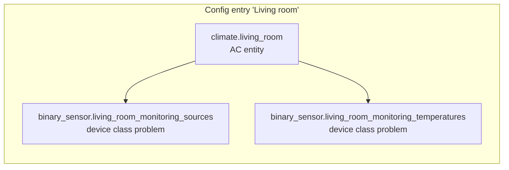

| Entity | Role | Detail |
|---|---|---|
| `climate.<name>` | The AC entity. | §1.3, §2.2 |
| `binary_sensor.<name>_monitoring_sources` | On while the source devices do not respond or do not obey (device class problem). | §4.2 |
| `binary_sensor.<name>_monitoring_temperatures` | On while the temperature readings are not consistent (device class problem). | §4.3 |

### 2.2 Attributes of the AC entity

Standard attributes of a Home Assistant `climate` entity:

| Attribute | Content | Detail |
|---|---|---|
| `hvac_mode` | The current mode; unknown in `WAITING(m)`. | §1.3.2 |
| `hvac_modes` | `off` and the configured modes. | ENT-HVAC-1 |
| `hvac_action` | In `ON(m)`, the action of the active source (`None` when it has none); `off` in `OFF`; `None` in `WAITING(m)`. | ENT-OFF-1, ENT-ON-1, ENT-ON-2, ENT-WAIT-2 |
| `current_temperature` | The reference temperature. | §1.3.5.1 |
| `temperature`, `target_temp_low`, `target_temp_high` | The temperature targets shown by the current mode. | §1.3.4.3, ENT-TGT-11 |
| `min_temp`, `max_temp` | The range shown. | ENT-RANGE-2 |
| `target_temp_step` | The step of the entity. | ENT-STEP-1 |
| `fan_mode(s)`, `swing_mode(s)`, `swing_horizontal_mode(s)` | The fan and swing options and values. | §1.3.4.6, §1.3.5.4 |

Extra attributes:

| Attribute | Content | Detail |
|---|---|---|
| `active_entity_id` | The active source, or `None`. | §0 |
| `phase` | The current phase of a bi-source `heat_cool` (`heat` or `cool`, also in `WAITING(heat_cool)` entered from `ON(heat_cool)`, where it is kept), else `None`. After a restart that resumes in `WAITING(heat_cool)`, no phase is chosen yet (`NO_PHASE`): `None` until a phase source comes back. It tells the phase also when both phases use the same source entity. | §1.3.3.2.1 |
| `mode_entity_ids` | `{mode: source entity}` of each mode with its own source entity (`<mode>_entity`), as configured. A bi-source `heat_cool` has none, so it is not listed: its phases use the sources listed for `heat` and `cool`. | §3.1.2 |
| `unavailable_modes` | The modes listed but not available. | ENT-HVAC-4 |
| `foreign_modes` | `{source: mode}` of the sources running a mode they do not serve. | ENT-STATE-5 |
| `saved_targets` | The three temperature targets, as kept. | ENT-TGT-1 |
| `saved_settings` | The fan and swing values remembered for each mode (not recorded in the history). | ENT-FANV-1 |
| `target_gaps` | The temperature targets shown otherwise than they are kept. | ENT-TGT-13 |
| `min_gap` | The smallest gap between the low and high targets, as configured (§3.1.6). | ENT-TGT-5 |

The attributes of the monitoring sensors are in §4.

### 2.3 Home Assistant versions

- **ENT-HA-1** The entities work with Home Assistant before and after
  2026.11. From 2026.11, Home Assistant reads the temperature properties
  of a `climate` entity under new names (`native_temperature_unit`,
  `native_current_temperature`, `native_target_temperature`,
  `native_target_temperature_low`, `native_target_temperature_high`);
  before, it reads them without `native_`. The AC entity provides both.
- **ENT-HA-2** The tests run on a version before 2026.11 and on a version
  from 2026.11, so that both paths are checked.
- **ENT-HA-3**<a id="ent-ha-3"></a> The integration needs Home Assistant
  2026.6 or later.

  > **Why:** the AC card needs it, and the integration keeps the same
  > minimum.

### 2.4 Dashboard card

The card that shows an AC entity has its own spec:
[CARD_SPEC.md](CARD_SPEC.md).

- **ENT-CARD-1**<a id="ent-card-1"></a> The integration provides the card to
  the dashboards. Nothing else is installed.

## 3. Configuration

The configuration of an entry is set in the UI (config flow, options
flow) or in the YAML (§3.2). Each option is named in the tables of §3.1,
each constraint is a rule, and the checks are gathered in §3.3.

What the configuration changes elsewhere:

- a change of the configuration reloads the entry and sets the entity to
  `OFF` (ENT-INIT-4); the modes listed, and whether a mode is mono-source
  or bi-source, follow it (ENT-HVAC-1, ENT-TYPE-1);
- a source entity removed from the configuration is no longer managed,
  and loses its stored data (SRC-DATA-9);
- deleting the entry erases all its stored data (END-3).

### 3.1 Configuration parameters

- **CFG-UNIT-1** The temperature options are in the unit of Home
  Assistant: a *temperature* is a value on the scale, a *temperature
  gap* is a difference (offset, hysteresis, gap). The tables give their
  bounds and defaults in °C, with the °F value in parentheses: the gap
  times 1.8, rounded to the whole °F (as the step, §1.3.4.4).

#### 3.1.1 General

| Option | Type | Default | Effect |
|---|---|---|---|
| `name` | string, unique | — | Title of the entry, and name of the AC entity (the monitoring sensors are named after it, §2.1). In YAML, it identifies the entry (CFG-YAML-2). |

- **CFG-NAME-1** `name` is unique among all the entries of the
  integration, created from the UI or from the YAML alike, ignoring case
  (`Living room` and `living room` are the same name): an entry whose
  name is already used is refused (CFG-CHECK-1). A YAML entry
  whose name is used by an entry of the UI is not imported, and the
  error is logged (CFG-YAML-5).
- **CFG-NAME-2** In the YAML, the name identifies the entry
  (CFG-YAML-2): renaming a YAML entry is a deletion of the entry of the
  old name, with all its stored data (CFG-YAML-3, END-3), and the
  creation of a new entry, which starts as at a first start (no stored
  mode, first temperature targets taken from the sources, ENT-TGT-10;
  sources not discovered until their source entity is read, SRC-DATA-4).

#### 3.1.2 Modes

| Option | Type | Default | Effect |
|---|---|---|---|
| `heat_entity` | `climate.*` | none | Source entity of the `heat` mode. |
| `cool_entity` | `climate.*` | none | Source entity of the `cool` mode. |
| `heat_cool_entity` | `climate.*` | none | Source entity of the `heat_cool` mode (mono-source). |
| `auto_entity` | `climate.*` | none | Source entity of the `auto` mode. |
| `dry_entity` | `climate.*` | none | Source entity of the `dry` mode. |
| `fan_only_entity` | `climate.*` | none | Source entity of the `fan_only` mode. |

- **CFG-MODE-1** Each mode has at most one source entity of its own
  (`<mode>_entity`). A source entity can serve several modes, in one
  entry or in several; its options must then be consistent (CFG-SENS-4,
  CFG-SENS-5).
- **CFG-MODE-2** A source entity cannot be an AC entity (an entity
  created by Adaptative Climate, of this entry or of another): the calls
  would loop. Such a configuration is refused.
- **CFG-MODE-3** Declaring `heat_entity` and `cool_entity` gives a
  **bi-source** `heat_cool` mode, unless `heat_cool_entity` is also
  declared: `heat_cool` is then mono-source, with that source. A mode
  without source entity is not configured, and not listed (ENT-HVAC-1).
  The modes and their sources: §1.3.3.1, ENT-TYPE-1.
- **CFG-MODE-4** At least one mode has a source entity: a configuration
  without any is refused.
- **CFG-MODE-5** When an entry is created or its configuration changed
  (UI or YAML), each source entity is checked against the source modes
  it serves:
  - it shows its `hvac_modes` and one of them is missing: the
    configuration is refused;
  - it does not show them (`unavailable`, `unknown`, not loaded yet): the
    configuration is accepted. The state machine protects: if the source
    entity, once seen, does not offer the mode, the source is `UNUSABLE`
    (SRC-UNUS-2) and a Repairs issue is raised (ENT-HVAC-5).

  At a start with an unchanged configuration (YAML imported again,
  CFG-YAML-1), nothing is refused: a mode lost meanwhile is handled while
  running (SRC-UNUS-2), so that the entry and its stored data are kept.

#### 3.1.3 Temperature readings

The temperature sensor, the offsets and the external sensors of the
sources, and the hysteresis of the phase switch.

| Option | Type | Default | Effect |
|---|---|---|---|
| `temperature_sensor` | `sensor.*`, a temperature (CFG-SENS-6) | none | Reference temperature: read by the entity (`temperature@T`, §1.1.2), its changes sent as `T=>AC_temperature`, converted to the unit of Home Assistant. Without it, the readings of the sources are used (§1.3.5.1). |
| `heat_offset` | temperature gap, -10 to 10 °C (-18 to 18 °F) | 0 | Offset of the source of the `heat` mode (CFG-SENS-1). |
| `cool_offset` | temperature gap, -10 to 10 °C (-18 to 18 °F) | 0 | Offset of the source of the `cool` mode (CFG-SENS-1). |
| `heat_cool_offset` | temperature gap, -10 to 10 °C (-18 to 18 °F) | 0 | Offset of the source of the `heat_cool` mode (CFG-SENS-1; no effect when bi-source, CFG-SENS-3). |
| `auto_offset` | temperature gap, -10 to 10 °C (-18 to 18 °F) | 0 | Offset of the source of the `auto` mode (CFG-SENS-1). |
| `dry_offset` | temperature gap, -10 to 10 °C (-18 to 18 °F) | 0 | Offset of the source of the `dry` mode (CFG-SENS-1). |
| `fan_only_offset` | temperature gap, -10 to 10 °C (-18 to 18 °F) | 0 | Offset of the source of the `fan_only` mode (CFG-SENS-1). |
| `heat_external_sensor` | `number.*` / `input_number.*` | none | External temperature input of the source of the `heat` mode (§1.3.5.2). Needs `temperature_sensor` (CFG-SENS-2). |
| `cool_external_sensor` | `number.*` / `input_number.*` | none | External temperature input of the source of the `cool` mode (§1.3.5.2). Needs `temperature_sensor` (CFG-SENS-2). |
| `heat_cool_external_sensor` | `number.*` / `input_number.*` | none | External temperature input of the source of the `heat_cool` mode (§1.3.5.2). Needs `temperature_sensor` (CFG-SENS-2). No effect when bi-source (CFG-SENS-3). |
| `auto_external_sensor` | `number.*` / `input_number.*` | none | External temperature input of the source of the `auto` mode (§1.3.5.2). Needs `temperature_sensor` (CFG-SENS-2). |
| `dry_external_sensor` | `number.*` / `input_number.*` | none | External temperature input of the source of the `dry` mode (§1.3.5.2). Needs `temperature_sensor` (CFG-SENS-2). |
| `fan_only_external_sensor` | `number.*` / `input_number.*` | none | External temperature input of the source of the `fan_only` mode (§1.3.5.2). Needs `temperature_sensor` (CFG-SENS-2). |
| `phase_hysteresis` | temperature gap, ≥ 0 | 1 °C (2 °F) | Bi-source mode: margin beyond a temperature target before the phase switches (ENT-WANT-3), to avoid short cycles. 0: switch as soon as the temperature target is passed. |

- **CFG-SENS-1** Offset (`<mode>_offset`): how much warmer than the
  reference temperature the source of that mode reads (negative:
  colder). The current temperature of that source minus the offset, its
  reading (ENT-REF-5), is a reference temperature; a temperature target
  sent to it is the temperature target plus the offset. The reference is
  the entity: it computes everything on its own scale (ranges, limits,
  gaps, targets). What it reads from a source (current temperature,
  settings, `min_temp` / `max_temp`) is converted at once to that scale
  (minus the offset); what it sends is converted last, when it is written
  (plus the offset). The offset is set per mode, but a source entity has
  only one: the modes it serves must have the same offset (CFG-SENS-4).
  An external sensor forces it to 0 (CFG-SENS-2).
- **CFG-SENS-2** External sensor (`<mode>_external_sensor`): some source
  devices can regulate with an external temperature (a thermostatic
  valve with an "external temperature" number entity, a thermostat
  following a probe). That entity gets the reference temperature, so the
  source regulates on it (§1.3.5.2).
  - It needs `temperature_sensor`: a configuration that sets an external
    sensor without `temperature_sensor` is refused.
  - The offset of that mode is then 0 (ENT-EXT-3): a configuration that
    sets an external sensor and a `<mode>_offset` other than 0 for the
    same mode (with its own source entity, CFG-SENS-3) is refused, so
    that an offset never looks set while it has no effect.
  - It is set per mode, but a source entity has only one: the modes it
    serves must have the same (CFG-SENS-4). An external sensor entity
    named by several modes is written once (ENT-EXT-1).
- **CFG-SENS-3** `<mode>_offset` and `<mode>_external_sensor` act on the
  source entity of the mode (`<mode>_entity`). For a mode without its own
  source entity, they have no effect: a mode not configured, or a
  bi-source `heat_cool`, whose phases use the options of `heat` and
  `cool` (the source serves `heat` or `cool`, ENT-REF-5).
- **CFG-SENS-4** The options of a source entity must be consistent: it
  has one external sensor and one offset, whatever the mode.
  - The modes it serves must have the same `<mode>_external_sensor`, or
    none of them.
  - Without external sensor, they must have the same `<mode>_offset`.
    With one, the offset is 0 for all of them (CFG-SENS-2).

  A configuration that breaks it is refused, with an error naming the
  modes. The modes without their own source entity are not counted
  (CFG-SENS-3). Why: a source entity has one thermometer and one
  external input, and its readings and targets must not depend on the
  mode it is read in (a source `OFF` is in no mode).
- **CFG-SENS-5** The same holds between entries: a source entity
  declared in several entries must have the same external sensor (or
  none) and, without one, the same offset in all of them. A
  configuration that breaks it is refused, with an error naming the
  other entry and its modes. Not handled: two entries with different
  `temperature_sensor` then each write their own value to that external
  sensor (ENT-EXT-1). No real use case: two entries sharing a source
  entity already fight over its mode and settings.
- **CFG-SENS-6** `temperature_sensor` gives a temperature: its unit
  (`unit_of_measurement`) is a temperature unit (°C, °F, K), converted
  to the unit of Home Assistant.
  - A sensor that shows another unit when the configuration is checked
    (a humidity sensor chosen by mistake) is refused.
  - A sensor without unit (a template sensor) is accepted: its value is
    read in the unit of Home Assistant.
  - While running, a value with a unit that is not a temperature is not
    valid (`temperature@T` `None`, ENT-REF-1): the sensor is reported as
    without valid value (MON-TEMP-4).

#### 3.1.4 Timers and durations

Every configurable duration is in seconds, and named `<what>_timer`
(the one of the monitoring, `monitoring_delay_timer`, is in §3.1.5).

| Option | Type / range | Default | Effect |
|---|---|---|---|
| `removal_confirmation_timer` | seconds, ≥ 0 | 60 | How long a capability no longer shown by a source entity stays stored before it is removed (SRC-DATA-10). 0: removed at once. |
| `request_confirmation_timer` | seconds, > 0 | 30 | How long a source waits for its source entity to show the state asked before the monitoring reports it out of sync (§1.2.4). |
| `settle_timer` | seconds, > 0 | 12 | After the source entity enters a mode asked, how long the settings it shows are ignored (§1.2.5). 12 s by default: integrations that poll their device usually refresh right after a command, then at most every 10 s (Home Assistant debounce of refresh requests); a value reported late by the device arrives within that time, plus a margin. |
| `external_sensor_resend_timer` | seconds, > 0 | 900 | How often the value of the temperature sensor is written again to the external sensors, even unchanged (ENT-EXT-4). 15 min by default: a margin for devices that need an update at least every 30 min, without loading battery devices. |
| `request_retry_timer` | seconds, ≥ `request_confirmation_timer` | 300 | How long a source waits, after a mode request confirmation timed out, before sending the state asked again (§1.2.4). |

- **CFG-TIMER-1** `request_retry_timer` must be greater than or equal to
  `request_confirmation_timer`: a configuration that breaks it is refused.
  Why: a device is given `request_confirmation_timer` to follow a
  command; sending it again sooner, while it does not follow, would only
  load the device (and its cloud, often rate-limited), without giving it
  more chance to follow.
- **CFG-TIMER-2** Fixed durations, not configurable: they are internal
  margins, with no use to tune per installation.

  | Duration | Value | Rule | Why |
  |---|---|---|---|
  | Send retry timer | 5 s | SRC-SET-7 | A failed call is often a short error (device busy, network): one retry soon after; the resync covers a longer one. |
  | Resync timer | 30 min | SRC-SET-8 | Background check: catches a lost command or a device back to its own value, without loading the devices. |
  | Minimum delay of a setting not applied | 30 s | MON-SRC-4 | A device may take that long to show a setting: below it, `monitoring_delay_timer` would report normal delays. |

#### 3.1.5 Monitoring

| Option | Type / range | Default | Effect |
|---|---|---|---|
| `monitoring_gap` | temperature gap, > 0 | 2 °C (4 °F) | Largest gap between two temperature readings before it is a problem (MON-TEMP-1). |
| `monitoring_delay_timer` | seconds, ≥ 0 | 900 | How long a problem lasts before the monitoring reports it (MON-SRC-1, MON-SRC-4, MON-SRC-5, MON-TEMP-1, MON-TEMP-4; 30 s at least for a setting not applied). 0: at once. |

#### 3.1.6 Temperature limits and gap

| Option | Type | Default | Effect |
|---|---|---|---|
| `min_temp` | temperature | none | Lowest temperature of the entity: narrows the range of the sources (ENT-RANGE-3). |
| `max_temp` | temperature | none | Highest temperature of the entity: narrows the range of the sources (ENT-RANGE-3). |
| `min_gap` | temperature gap, ≥ 1 °C (2 °F) | 1 °C (2 °F) | Smallest gap between the low and high targets (ENT-TGT-5). |

- **CFG-LIM-1** When both are set, `max_temp` must be at least `min_gap`
  above `min_temp`, so that the low and high targets can keep their gap
  (ENT-TGT-5): a configuration that breaks it is refused. The ranges of
  the sources can still be narrower than `min_gap`: ENT-TGT-5 and
  ENT-TGT-8 handle it.

#### 3.1.7 Fan and swing

| Option | Type | Default | Effect |
|---|---|---|---|
| `sync_modes` | list of modes | empty | The modes listed share their fan and swing values: a fan speed chosen in one of them is used in the others (ENT-FAN-6, CFG-FAN-1). |
| `bi_source_sync` | boolean | off | Bi-source `heat_cool` only: its two phases share their fan and swing values, for the options offered by both (ENT-FAN-8, CFG-FAN-2). |

- **CFG-FAN-1** `sync_modes`: a mode listed without a source entity is
  ignored. A synchronized mode whose source does not have a setting, and
  a bi-source `heat_cool` listed, are not refused: they are configuration
  errors, judged while running and reported by a warning and a Repairs
  issue (ENT-FAN-7).
- **CFG-FAN-2** `bi_source_sync` only acts on a bi-source `heat_cool`
  (ENT-FAN-8): without one, it has no effect. A phase source that does
  not have a setting is reported as in CFG-FAN-1 (ENT-FAN-8).

### 3.2 YAML

The entries can also be declared in `configuration.yaml`:

```yaml
adaptative_climate:
  - name: Living room
    heat_entity: climate.heater
    cool_entity: climate.air_conditioner
    temperature_sensor: sensor.living_room_temperature
```

- **CFG-YAML-1** Each YAML entry is imported as a config entry when Home
  Assistant starts. The options are those of §3.1.
- **CFG-YAML-2** The `name` identifies the entry, so it must be unique in
  the YAML: two entries with the same name (ignoring case, CFG-NAME-1)
  are refused. It must be unique
  with the entries of the UI too (CFG-NAME-1); renaming: CFG-NAME-2.
- **CFG-YAML-3** YAML wins over the UI:
  - an entry changed in the YAML is updated, as by the options in the
    UI (ENT-INIT-4), when it is valid (CFG-YAML-5);
  - an entry removed from the YAML is deleted (END-3); an entry still in
    the YAML but invalid is not (CFG-YAML-5);
  - an imported entry has no options in the UI (they would be
    overwritten by the YAML).
- **CFG-YAML-4** The entries created from the UI are not affected by the
  YAML. Their options flow saves every option at once: the options
  replace the whole configuration of the entry.
- **CFG-YAML-5** The same checks apply to the YAML and to the UI (§3.3).
  An invalid YAML entry (refused by CFG-CHECK-1, or a name used twice in
  the YAML, CFG-YAML-2) is an error: it is not imported, and the error is
  logged.
  - An imported entry of that name is kept, with its stored data, but
    not loaded: Home Assistant shows it in error, with the message, and
    its entities are `unavailable`. As after an unload (END-1), its source
    entities are left as they are, no longer managed.
  - It is loaded at the next start where its YAML entry is valid: updated
    if its configuration changed (ENT-INIT-4), resumed as at a restart
    otherwise (END-2).
  - An entry of the UI is not affected (CFG-YAML-4).

### 3.3 Checks

- **CFG-CHECK-1** When an entry is created, or its configuration changed
  (options in the UI, an entry added or changed in the YAML), the
  configuration is refused when:
  - an option is outside the type or the range its table gives (§3.1);
  - `name` is not unique, among the entries of the UI and of the YAML
    (CFG-NAME-1, CFG-YAML-2);
  - `temperature_sensor` shows a unit that is not a temperature
    (CFG-SENS-6);
  - a source entity is an AC entity (CFG-MODE-2);
  - no mode has a source entity (CFG-MODE-4);
  - a source entity shows its `hvac_modes`, and a source mode it serves
    is missing (CFG-MODE-5);
  - an external sensor is set without `temperature_sensor`, or with an
    offset other than 0 for the same mode (CFG-SENS-2);
  - the options of a source entity are not consistent, in the entry
    (CFG-SENS-4) or with another entry (CFG-SENS-5);
  - `request_retry_timer` is lower than `request_confirmation_timer`
    (CFG-TIMER-1);
  - `max_temp` is less than `min_gap` above `min_temp` (CFG-LIM-1).

  A refused configuration is not applied: the UI shows the error; an
  invalid YAML entry is an error, not imported, and an imported entry of
  that name is kept but not loaded (CFG-YAML-5). At a start with an unchanged
  configuration, nothing is refused (CFG-MODE-5).
- **CFG-CHECK-2** Accepted, with no effect:
  - the offset and the external sensor of a mode without its own source
    entity: a mode not configured, a bi-source `heat_cool` (CFG-SENS-3);
  - a mode of `sync_modes` without source entity (CFG-FAN-1);
  - `bi_source_sync` while `heat_cool` is not bi-source (CFG-FAN-2).
- **CFG-CHECK-3** Accepted, then judged while running, since it depends
  on what the source entities show; reported, not refused:
  - a source entity that does not offer a source mode it serves, not
    known at the check (CFG-MODE-5): the source is `UNUSABLE`, with a
    warning and a Repairs issue (ENT-HVAC-5);
  - a source entity never seen usable (wrong entity id, integration
    missing): the source stays `UNDISCOVERED`, reported by the monitoring
    (MON-SRC-5);
  - a synchronized mode, or a phase source with `bi_source_sync`, whose
    source does not have a setting, and a bi-source `heat_cool` in
    `sync_modes`: warning and Repairs issue (ENT-FAN-7, ENT-FAN-8).

## 4. Monitoring

- **MON-ROLE-1** The monitoring (`M`) is an actor of the config entry
  (§1.1.2, EXEC-1). It judges nothing itself: each problem is judged by
  the actor that has what it needs, the source for its own problems, the
  entity for the others (column "Judged by" of §4.2 and §4.3). That actor
  tells the monitoring when the problem begins and when it ends
  (MON-SEND, §4.4). The monitoring waits for the delay of the problem,
  reports it and shows it. It sends nothing to the other actors, reads
  none of their data and makes none readable (EVT-3): nothing they do
  depends on it.

> **Note — Repairs issues:** the configuration problems found while
> running are not monitoring problems: the entity raises them as Repairs
> issues of Home Assistant, at once, with a warning in the logs: a
> source that does not offer a mode it serves (ENT-HVAC-5), the
> configuration errors of `sync_modes` and `bi_source_sync` (ENT-FAN-7,
> ENT-FAN-8). They do not end with time but with a change of the
> configuration or of the device, so they have no delay and do not turn
> a monitoring sensor on. As for a problem (MON-LIFE-2), their end is
> logged at info level. A source that does not offer a mode it serves
> is also `UNUSABLE`: as such, it can be reported as source unusable as
> well (MON-SRC-1).

### 4.1 Monitoring sensors

The monitoring uses two binary sensors (§2.1), grouped by what the user
has to do when one turns on:

| Binary sensor | Device class | Groups | What to do |
|---|---|---|---|
| `binary_sensor.<name>_monitoring_sources` | problem | The source devices do not respond or do not obey: source unusable, source not discovered, source out of sync, setting not applied (§4.2). | Check the device: connection, integration, state. |
| `binary_sensor.<name>_monitoring_temperatures` | problem | The temperature readings are not consistent: gaps between the sensor and the sources, or between sources; sensor without valid value (§4.3). | Set the offsets, move or repair the sensor. |

- **MON-SENS-1** A sensor is on while at least one of its problems is
  reported (§4.4).
- **MON-SENS-2** Attributes of both sensors:
  - `problems`: one entry per problem reported, with its type and what it
    is about (source, setting, temperatures, gap);
  - `max_gap` (`monitoring_temperatures` only): the value of
    `monitoring_gap`.
- **MON-SENS-3** Each problem keeps its own delay before it is reported,
  given in §4.2 and §4.3.
- **MON-SENS-4** While the entry is loaded, the two monitoring binary
  sensors are never `unavailable`, even when the AC entity is, or when
  its sources are not available: they report on them. When the entry
  unloads, Home Assistant makes them `unavailable`, like the AC entity
  (END-1).

### 4.2 Sources (`monitoring_sources`)

| Problem | Judged by | Up (reported) | Down |
|---|---|---|---|
| Source unusable (per source, MON-SRC-1) | entity: state, phase | the entity waits for that source, `UNUSABLE` (`WAITING(m)`; in `ON(heat_cool)` bi-source: `WAITING_PHASE(p)`, the source of the current phase), for `monitoring_delay_timer` (§3.1.5) | the source is available again, or the entity no longer waits for it (another mode or phase, `OFF`, `NO_SOURCE`) |
| Source not discovered (per source, MON-SRC-5) | source: its state | the source is `UNDISCOVERED` for `monitoring_delay_timer` (§3.1.5), whatever the stored mode | the source is discovered (SRC-STATE-8) |
| Source out of sync (per source, MON-SRC-3) | source: mode request confirmation (SRC-REQ-9) | timeout of a mode request confirmation: the source entity does not show the state asked after `request_confirmation_timer` (SRC-REQ-5) | the source entity shows the state asked; or the retries stop: new request, `SE=>S_unavailable` / `SE=>S_unknown` / `Sdsm=>Sx_served_mode_lost`, change of the source entity during the retry wait (SRC-REQ-7) |
| Setting not applied (per source and setting, MON-SRC-4) | source: setting request management (SRC-SET-9) | the source entity in `ON(m)` shows another setting (temperature target, fan, swing) than the one sent, outside the settle time and the mode request confirmation, for `monitoring_delay_timer` (§3.1.5, 900 s by default, 30 s at least) | the source entity shows the setting sent, or the source leaves `ACTIVE` (SRC-SET-9) |

- **MON-SRC-1** Source unusable: reported after `monitoring_delay_timer`
  while the entity waits for an `UNUSABLE` source (`WAITING(m)`, §1.3.2.5).
  The delay absorbs a source entity loaded after the integration when
  Home Assistant starts, and short outages of a device (Wi-Fi, cloud):
  the state is already shown meanwhile (`WAITING(m)`,
  `unavailable_modes`). The sources reported:
  - the source of the current mode, in `WAITING(m)`;
  - in `ON(heat_cool)` bi-source, only the source of the current phase,
    in `WAITING_PHASE(p)`: the source of the other phase is not reported,
    even `UNUSABLE` (MON-SRC-2). In `WAITING(heat_cool)`, every
    `UNUSABLE` phase source is reported, as for a mode, even if the mode
    management keeps a phase (ENT-PHASE-6). An `UNUSABLE` source stopped
    for the season is then reported only while the other one is not
    available either.
- **MON-SRC-2** Source unusable is reported only in `WAITING`. The
  monitoring only reports a source that is in the way, and that the
  entity does not already show:
  - in `OFF`, the entity asks nothing of its sources, so a source
    `UNUSABLE` blocks nothing. It is only met when its mode is asked:
    the user request is refused, and the mode is listed in
    `unavailable_modes` (ENT-HVAC-4);
  - in `NO_SOURCE`, no source is available, and the entity is
    `unavailable` (ENT-NOSRC-2): that already says it. An entity with a
    single source entity is never in `WAITING`: when that source is
    `UNUSABLE`, the entity is `unavailable`, and nothing is reported;
  - a device unplugged for the season (a radiator in summer, an AC at
    the breaker in winter) is normal: reported in `OFF`, it would keep
    `monitoring_sources` on for months, and the sensor would no longer
    mean anything;
  - for the same reason, the sources of the other modes are not
    reported, nor, in `ON(heat_cool)` bi-source, the source of the other
    phase: it may be stopped for the season (MON-SRC-1).
- **MON-SRC-3** Source out of sync (judged by the source, SRC-REQ-9):
  - reported at the first timeout of a mode request confirmation where the
    source entity does not show the state asked (SRC-REQ-5);
  - it stays reported during the retries (every `request_retry_timer`);
  - it ends on every exit of the confirmation or of the retry wait: the
    source entity shows the state asked, a new request (a new
    confirmation starts, and the problem is reported again at its
    timeout if needed), `SE=>S_unavailable` / `SE=>S_unknown` /
    `Sdsm=>Sx_served_mode_lost`, or a change
    of the source entity during the retry wait (followed as a takeover).
- **MON-SRC-4** Setting not applied: the source entity shows another
  setting (temperature target, fan, swing) than the one sent to it
  (§1.2.5, compared as in SRC-SET-4), and it is not a takeover. Reported after `monitoring_delay_timer`
  (30 s at least: a device may take that long to show it). It ends when
  the source entity shows the setting sent, or when the source leaves
  `ACTIVE` (SRC-SET-9).
- **MON-SRC-5** Source not discovered: a source that stays `UNDISCOVERED`
  (§1.2.3.2) for `monitoring_delay_timer` is reported, whatever the state
  of the entity (in `OFF` and `NO_SOURCE` too, unlike MON-SRC-2). Its source entity was never seen
  usable: it is more likely a configuration error (wrong entity id,
  integration missing or not loaded) than a device away for a while. The
  delay lets a source entity loaded after the integration be discovered
  without a report. It ends when the source is discovered.

### 4.3 Temperatures (`monitoring_temperatures`)

| Problem | Judged by | Up (reported) | Down |
|---|---|---|---|
| Gap between the sensor and a source (per reading, MON-TEMP-1) | entity (MON-TEMP-5) | the temperature sensor and a source reading differ by more than `monitoring_gap`, for `monitoring_delay_timer` (§3.1.5) | the gap is back below `monitoring_gap` |
| Gap between two sources (per pair of readings, MON-TEMP-1) | entity (MON-TEMP-5) | two readings of different source entities differ by more than `monitoring_gap`, for `monitoring_delay_timer` | the gap is back below `monitoring_gap` |
| Sensor without valid value (MON-TEMP-4) | entity (MON-TEMP-5) | `temperature_sensor` is configured and has no valid value (`unavailable`, `unknown`, not a number) for `monitoring_delay_timer` | the sensor has a valid value again |

- **MON-TEMP-1** Temperature gaps: a source that does not read the
  reference temperature keeps the room away from the temperature target.
  The monitoring compares the temperature sensor (`temperature@T`)
  with each source reading, and the readings of two **different** source
  entities with each other. A gap is reported when it stays above
  `monitoring_gap` for `monitoring_delay_timer`, and ends when it is back
  below.
- **MON-TEMP-2** Readings compared:
  - each source entity gives one reading: its current temperature
    (`temperature@S`) minus its offset (CFG-SENS-1; the same for all the
    modes it serves, CFG-SENS-4). A well set offset clears the problem;
  - a source `UNUSABLE`, or without current temperature, gives no
    reading.
- **MON-TEMP-3** The readings of sources that are `OFF` are compared too.
- **MON-TEMP-4** Sensor without valid value: reported when
  `temperature_sensor` (§3.1.3) has no valid value (`temperature@T`
  `None`: `T=>AC_temperature(None)`, or already at `HA=>AC_start`) for
  `monitoring_delay_timer`. It ends as soon as the sensor has one again.
  Meanwhile, the external sensors are not written (ENT-EXT-5), and the
  reference temperature comes from the sources (ENT-REF-2).
- **MON-TEMP-5** The entity judges the temperature problems at the end of
  each of its steps (MON-SEND-1), from the data (`temperature@T`,
  `temperature@S`) read then. A value that does not change is compared
  from `HA=>AC_start`; a change is seen at the end of the step of the event
  that brings it (`T=>AC_temperature`, `S=>AC_temperature`, a source that
  becomes available or `UNUSABLE`).

### 4.4 Problem lifecycle, logs and events

- **MON-SEND-1** Each source, and the entity, judges its problems
  (column "Judged by" of §4.2, §4.3) when its queues are empty, at the
  end of each step (EXEC-1), as it sends to the sources (ENT-SEND). It
  keeps the problems it has told the monitoring, and sends the
  difference: `X=>M_up(p)` for a problem that began, `X=>M_down(p)` for
  a problem that ended. A problem that begins and ends within one step is
  not sent.
- **MON-SEND-2** `p` is the problem: its type and its subject (the source,
  the setting, the readings compared), with what the monitoring needs to
  log it and show it (MON-SENS-2, MON-LIFE-3). The monitoring reads no
  data.
- **MON-SEND-3** At start, no problem has been told the monitoring: a
  problem still there is sent at the end of the first step, and its delay
  starts from zero (MON-LIFE-1, END-2).

Events of the monitoring (described in §1.1.2):

| Event | From → To | Meaning |
|---|---|---|
| `HA=>M_start`, `HA=>M_unload` | Home Assistant → monitoring | See §1.1.2. |
| `S=>M_up(p)`, `AC=>M_up(p)`, `S=>M_down(p)`, `AC=>M_down(p)` | source or AC entity → monitoring | See §1.1.2. Written `X=>M_up(p)`, `X=>M_down(p)` below. |

Timer of the monitoring:

| Event | Timer of | Meaning |
|---|---|---|
| `M_delay_timeout` | monitoring | End of the delay of the problem `p` (§4.2, §4.3, MON-SENS-3), one timer per problem (MON-LIFE-1). |

One machine per problem `p`. A `X=>M_down(p)` for a problem the
monitoring does not have is ignored.

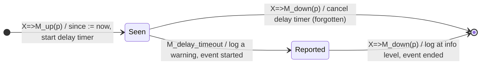

- **MON-LIFE-1** A problem is reported once it lasted its delay (§4.2,
  §4.3). A problem that goes away starts again from zero when it comes
  back, and after a restart.
- **MON-LIFE-2** When a problem is reported, a warning is logged, and an
  `adaptative_climate_problem` event is fired with `status: started`. When
  it ends, it is logged at info level, and the event is fired with
  `status: ended`.
- **MON-LIFE-3** Event data: `entry_id`, `name`, `entity_id` (the
  monitoring sensor of the problem), `status`, `message` (as logged),
  `problem` (as in the `problems` attribute). Automations can use it to
  send notifications.

## 5. Sequence examples (informative)

These sequences illustrate the execution model (§1.1.3), the functions
of a source (§1.2) and those of the entity (§1.3). They are not rules.

Notation:

- An arrow is an event. All events are asynchronous (open arrowhead,
  §1.1.2). An arrow is drawn when its receiver handles the event; when it
  was sent earlier, the note of the sender says so ("sends …").
- An external event given to several functions of an actor is framed in
  grey: it is one event, with one number per function (EXEC-1). A
  function that does nothing with it is not drawn.
- Reading a data item is not an event: it is written in the note of the
  reader ("reads …").

### 5.1 Mode change by the user

A source `S` (an AC unit) is off; `cool` is already discovered. The entity
is `OFF`; its target T is 24, its memory for `cool`: fan `low`.

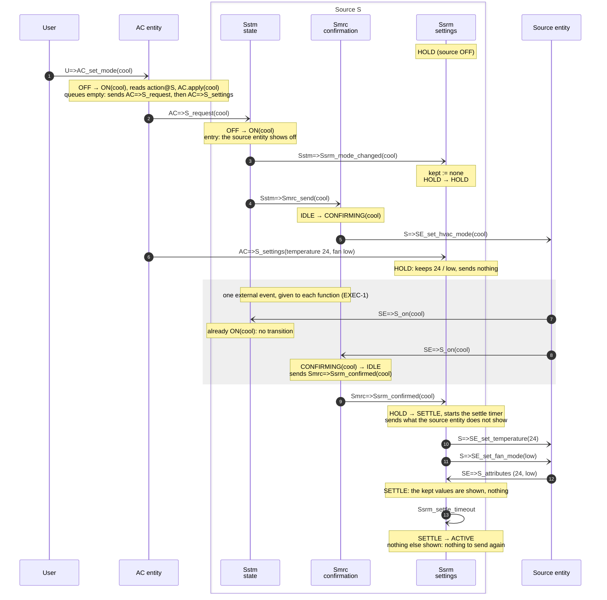

- **Messages 3 and 4 before 6.** The source handles 2 to the end, its
  internal events included (EXEC-1), before 6, already in its queue
  (EXEC-2). If 6 came before 3, the new settings would be withdrawn.
- **Message 7.** `SE=>S_on(cool)` in `ON(cool)` has no transition.
- **Message 8.** The mode request confirmation is over: the setting
  request management takes over, with `SETTLE`.
- **Messages 12 and 13.** `SETTLE` lasts the whole settle timer
  (SRC-SET-14), even when the source entity shows the settings sent.

### 5.2 Takeover on the device

The source `S` runs `cool`, the entity is `ON(cool)`, no mode request
confirmation is running; `dry` is already discovered. Someone sets the AC
unit to `dry` with its remote.

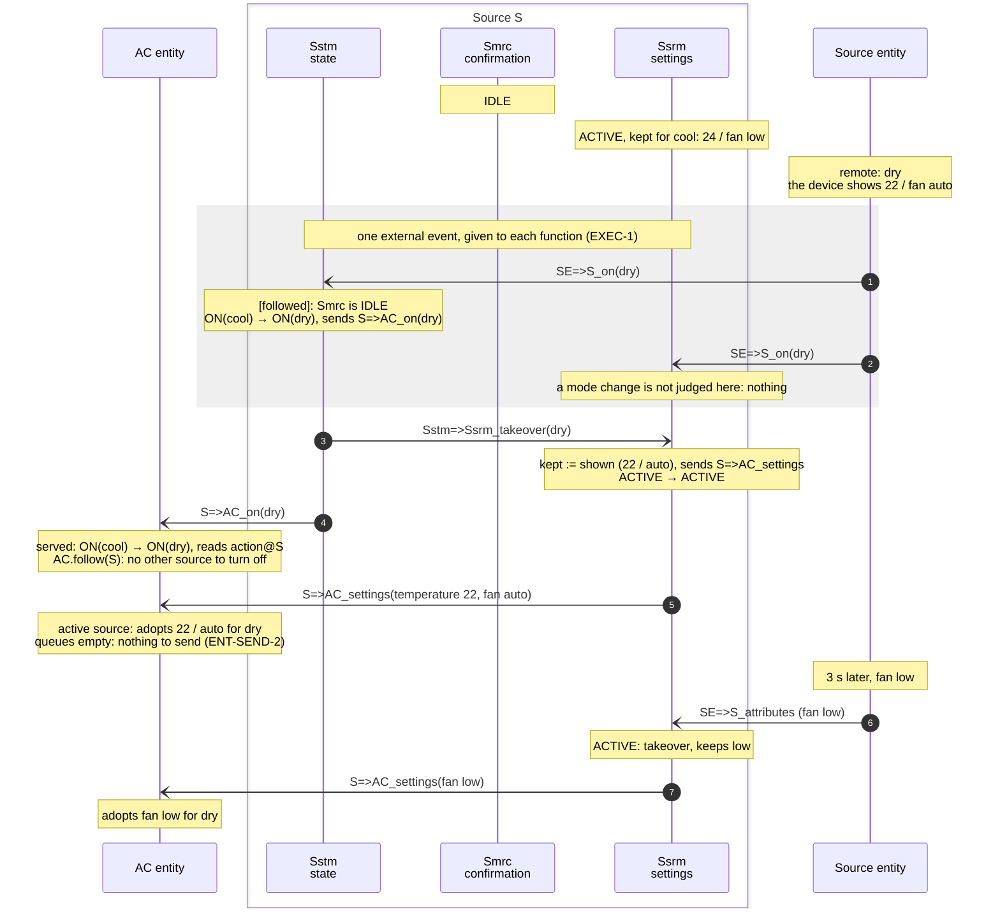

- **A mode change is judged by `Sstm`, a setting by `Ssrm`.** Only `Sstm`
  knows whether a change of mode is followed. `Ssrm` gets
  `SE=>S_on(dry)` (message 2) and does nothing with it; it changes on the
  event of `Sstm` (message 3).
- **Message 4 before 5.** The settings are reported on an internal event
  (message 3), handled after the external one in which `Sstm` sent
  `S=>AC_on` (EXEC-1); both come from the same sender (EXEC-2). The entity
  is in `ON(dry)` when it gets them.
- **No settle time** on a takeover (SRC-SET-13): the values the device
  shows next are adopted (messages 6 and 7).

### 5.3 The device shows its own value during the settle time

Just after message 11 of §5.1. The setting request management keeps
24 / `low` / swing `off`; on entry of `SETTLE`, it sent 24 and `low` (the
swing `off` was already shown). The device applies them and, in the same
change of state, puts back its own swing for `cool`.

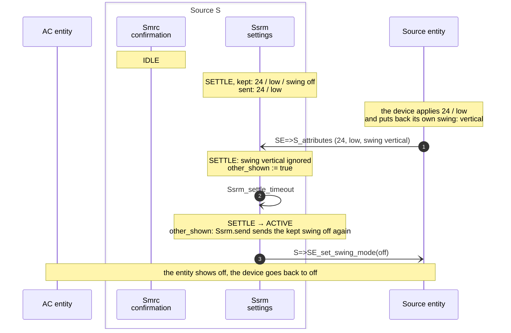

- `SETTLE` ignores the own value of the device, then sends the kept value
  again (SRC-SET-5, SRC-SET-6). One function judges the event: `Smrc`, in
  `IDLE`, does nothing with it.
- If the integration shows `vertical` again when it reads the device
  (less than 10 s later), the setting request management is still in
  `SETTLE`: ignored, then replaced at the end. After `settle_timer`, a
  change on the device is a takeover (SRC-SET-11).

### 5.4 Discovery of a mode

The same AC unit is off. `dry` is not discovered yet: it never ran, no
capability is stored for it.
`dry` is not in `sync_modes`: its fan memory is empty. The entity is
`OFF`; its target T is 22. The device starts in `dry` with 25 and fan
`auto`.

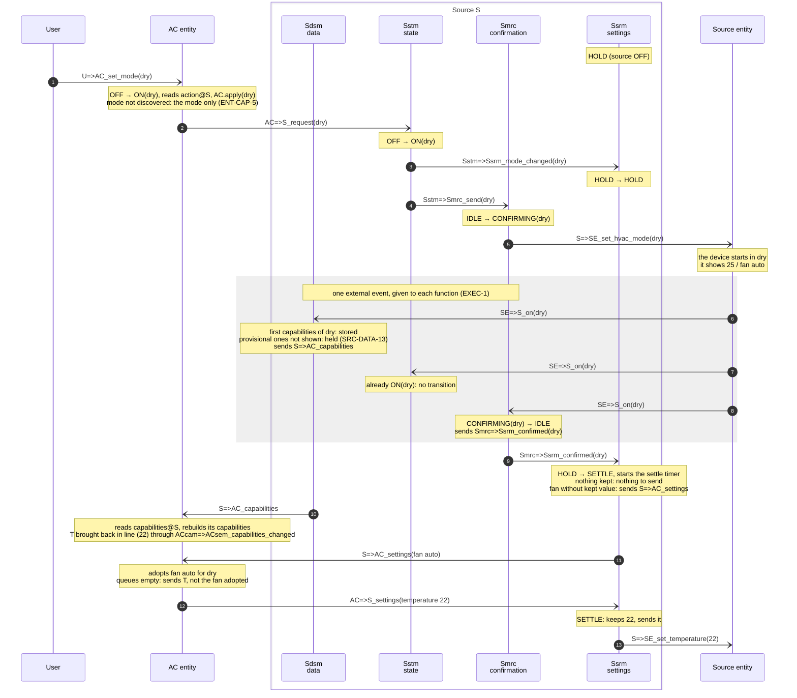

- **Message 10 before 11.** `S=>AC_capabilities` is sent by `Sdsm` on
  the external event (message 6), `S=>AC_settings` by `Ssrm` on the
  internal event (message 9), handled after (EXEC-1); both come from the
  same sender (EXEC-2). The entity knows the fan of `dry` when it gets
  its value (ENT-FAN-4). The same holds for `low_high_seen`.
- **Message 12.** The target arrives once `SETTLE` has started: it is
  sent at once, under the protection of `SETTLE` (SRC-SET-2). The fan
  adopted from the source is not sent back (ENT-SEND-2).
- The data storage management goes first (EXEC-1). It only matters when
  one `SE=>S_attributes` in `SETTLE` brings both a new capability and a
  fan/swing without kept value.

### 5.5 Bi-source `heat_cool`: a target change switches the phase

A radiator `R` (`heat_entity`) and an AC unit `C` (`cool_entity`), no
`heat_cool_entity`. The entity is `ON(heat_cool)`, its mode management in
`PHASE(heat)`: `R` runs, `C` is off. Targets 19 / 24, reference
temperature 22. The user sets 17 / 20. The functions of the sources are
not drawn.

```mermaid
sequenceDiagram
    autonumber
    participant U as User
    box AC entity
        participant ACmom as ACmom<br/>modes, phases
        participant ACsem as ACsem<br/>settings
        participant AC as AC<br/>sending (ENT-SEND)
    end
    participant R as Source R<br/>radiator (heat)
    participant C as Source C<br/>AC unit (cool)

    Note over ACmom: PHASE(heat), reference 22
    Note over ACsem: targets 19 / 24
    U-)ACsem: U=>AC_set_settings(low 17, high 20)
    Note over ACsem: keeps 17 / 20<br/>sends ACsem=>ACmom_targets_changed
    ACsem-)ACmom: ACsem=>ACmom_targets_changed
    Note over ACmom: reads the reference (22) and the targets (17 / 20)<br/>22 above high 20, without hysteresis<br/>PHASE(heat) → PHASE(cool), AC.apply(cool)
    Note over AC: queues empty: sends what changed<br/>C: cool and its settings, R: off
    AC-)C: AC=>S_request(cool)
    Note over C: OFF → ON(cool), CONFIRMING(cool)<br/>S=>SE_set_hvac_mode(cool) to the AC unit
    AC-)C: AC=>S_settings(temperature 20, fan low)
    Note over C: HOLD: kept, sent on entry of SETTLE
    AC-)R: AC=>S_request(off)
    Note over R: ON(heat) → OFF, settings withdrawn<br/>S=>SE_set_hvac_mode(off) to the radiator
```

- **Message 2: the settings, then the phase (EXEC-1).** The mode
  management does not react to `U=>AC_set_settings` itself: it waits for
  `ACsem=>ACmom_targets_changed`, sent once 17 / 20 are kept, and handled
  after the external event. It judges the phase on the new targets
  (ENT-PHASE-2), with no order between functions.
- **Messages 3 to 5: the sending (ENT-SEND-3)**, from the final state.
  `C` gets its request, then its settings; `R` only gets `off`: the
  target 17 expected from `R` before the phase switch is not sent. `R`
  and `C` are separate actors: only the order of the events of one sender
  to one actor counts (EXEC-2).

### 5.6 Restart, source entity already loaded

A source `S`, stored state `ON(cool)`, kept settings 24 / fan `low`
(SRC-SET-1). The entity has `cool` as stored mode; its memory for `cool`:
24, fan `low`. The AC unit still runs `cool` at 24, but its fan was set to
`auto` while Home Assistant was stopped. The start is a single stimulus
(EXEC-3).

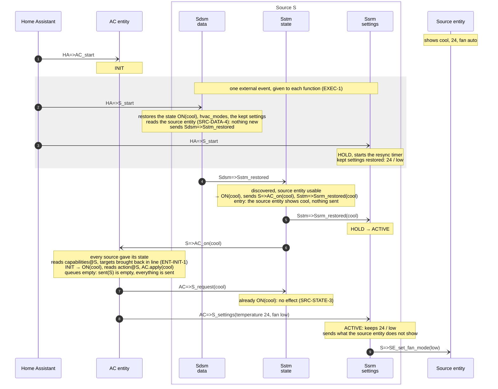

- **Message 1 before 6.** `HA=>AC_start` comes from Home Assistant,
  `S=>AC_on(cool)` from the source: EXEC-2 does not order them. EXEC-4
  does: the entity starts before its sources, and is in `INIT` when their
  first states arrive.
- **Message 5.** The device is already in `cool`, in a stable state: no
  settle time (SRC-SET-13). The setting request management goes straight
  to `ACTIVE`.
- **Message 7.** A request for the state the source is already in has no
  effect (SRC-STATE-3): no confirmation, no `SETTLE`. The fan goes at
  once.
- **Message 4.** At start, the data storage management sends only
  `Sdsm=>Sstm_restored` (SRC-DATA-4): the choice `first` reads the data,
  the source is discovered.

### 5.7 Restart, source entity loaded later

The same situation, but the integration of the AC unit loads after
Adaptative Climate. At start, the source is `UNUSABLE` and, as it is the
only one, the entity is `NO_SOURCE`. The setting request management is in
`HOLD`, with its kept settings restored (SRC-SET-1). Then the source
entity appears.

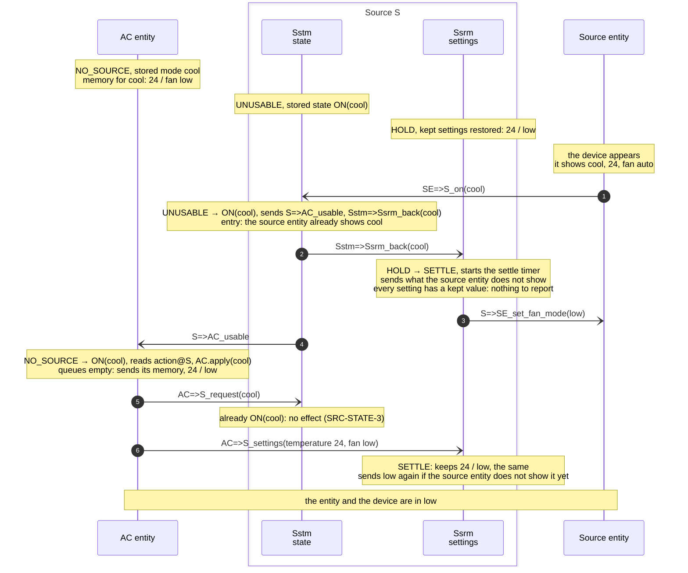

- **Home Assistant wins on the return** (SRC-STATE-10). The setting
  request management finds its kept settings, sends `low` on entry of
  `SETTLE` (message 3), and reports nothing, since every setting has a
  kept value.
- **Message 6.** The settings of the entity are the same: `low` may go a
  second time if the device does not show it yet, without effect.
- **Why the kept settings are saved** (SRC-SET-1). Without them, the
  setting request management would take the fan of the device for a
  setting the entity never sent (SRC-SET-12) and report it, while the entity sends its own in
  the same stimulus: each one would take the value of the other.

### 5.8 One update changes a capability and a target

The AC unit runs `cool`, the entity is `ON(cool)`; its target T is 27.
The range of the AC unit in `cool` is 16–30. The device switches to a profile that limits its range to 26 and
lowers its temperature target to 25: a single change of state of the source entity
brings both. No offset.

```mermaid
sequenceDiagram
    autonumber
    participant AC as AC entity
    box Source S
        participant Sdsm as Sdsm<br/>data
        participant Ssrm as Ssrm<br/>settings
    end
    participant SE as Source entity

    Note over AC: ON(cool), T 27
    Note over Ssrm: ACTIVE, kept: 27
    Note over SE: profile of the device<br/>max_temp 30 → 26, target 27 → 25
    rect rgba(127, 127, 127, 0.12)
        Note over Sdsm,Ssrm: one external event, given to each function (EXEC-1)
        SE-)Sdsm: SE=>S_attributes (max_temp 26, temperature 25)
        Note over Sdsm: max_temp of cool: 26, stored<br/>sends S=>AC_capabilities
        SE-)Ssrm: SE=>S_attributes (max_temp 26, temperature 25)
        Note over Ssrm: ACTIVE: the target changed, takeover<br/>keeps 25, sends S=>AC_settings
    end
    Sdsm-)AC: S=>AC_capabilities
    Note over AC: reads capabilities@S, range of cool: 16–26<br/>ENT-TGT-4: T 27 → 26, expected, not sent yet
    Ssrm-)AC: S=>AC_settings(temperature 25)
    Note over AC: active source: adopts T 25 (ENT-TGT-9)<br/>queues empty: 25 comes from the source, nothing to send
    Note over AC,SE: 25 everywhere
```

- **The entity decides once it has seen both** (ENT-SEND-3). The target
  brought back in line (26) is replaced by the takeover (25) before the
  queues are empty; 25 comes from the source, so nothing is sent
  (ENT-SEND-2). The last information wins (ENT-TGT-4).
- **If the entity sent at once**, it would send 26 at message 3, before
  seeing the takeover at 25 (message 4), and the source would apply 26
  after reporting 25: each one would end with the value of the other,
  and nothing would detect it.
